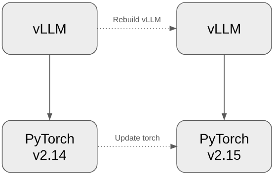
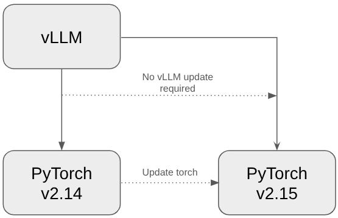
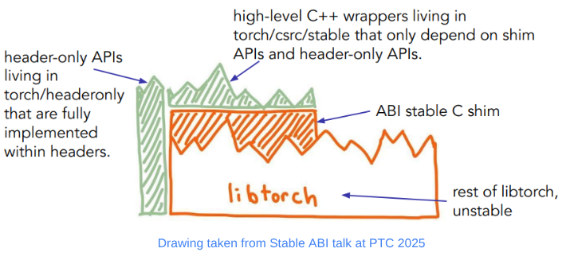
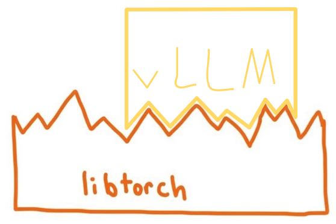
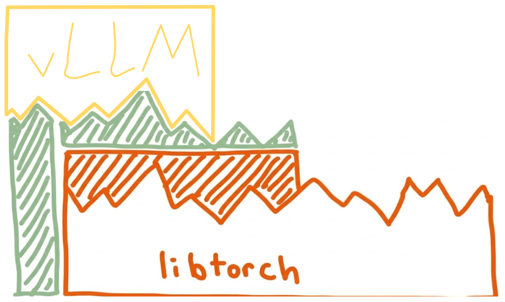
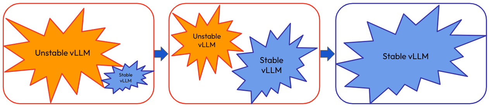

### Introduction

vLLM relies heavily on PyTorch, with frequent calls to LibTorch in its C++ backend. As a result, changes to LibTorch’s binary interface may require vLLM to be rebuilt and relinked, even when the APIs remain unchanged. What if we could update LibTorch without rebuilding vLLM? That’s where the LibTorch Stable ABI comes in. With a LibTorch Stable ABI, updating LibTorch does not require rebuilding or updating vLLM in order to keep using it. Instead, we could swap out the torch wheel and import it directly into our vLLM package. As of v0.33.0, vLLM publishes LibTorch ABI Stable CUDA wheels.  




<p style="text-align: center;"><strong>Left:</strong> <em>Unstable ABI—new torch requires vLLM to rebuild. <strong>Right:</strong> Stable ABI—vLLM can import new torch directly.</em></p>

### What Is the LibTorch Stable ABI?
An application binary interface (ABI) defines how compiled code interacts with a library: how functions are called, data is laid out, and symbols are named. Even if an API looks the same in source code, an ABI change can force extensions to rebuild. A stable ABI preserves a supported set of interfaces across compatible versions, so extensions that use them can keep working without a rebuild.

PyTorch's LibTorch Stable ABI has three layers: a stable C-shim exposing selected LibTorch APIs, C++ wrappers that make the shim easier to use, and headeronly utilities in `torch::headeronly` that do not link against `libtorch.so`.




### Why Stable ABI Matters
Before the Stable ABI, a new PyTorch release could require a vLLM rebuild, delaying support for the new version and its features. With the Stable ABI, the same vLLM wheel can work across compatible PyTorch releases, letting users upgrade sooner and reducing rebuilds for package distributors.




<p style="text-align: center;"><em><strong>Left:</strong> vLLM needs to change as LibTorch changes. <strong>Right:</strong> vLLM can change independent of LibTorch.</em></p>


### Tradeoffs
The Stable ABI comes with a few tradeoffs.

 First, a smaller API surface. The stable APIs cover most of the LibTorch APIs vLLM in-tree uses, but `is_pinned()` lacked a stable equivalent during the migration. Thus we needed to replace the direct call:

```cpp
if (cpu_tensor.is_pinned())
```

with a dispatcher call:

```cpp
std::array<StableIValue, 2> is_pinned_stack{
     torch::stable::detail::from(cpu_tensor),
     torch::stable::detail::from(std::nullopt)};
 TORCH_ERROR_CODE_CHECK(torch_call_dispatcher(
     "aten::is_pinned", "", is_pinned_stack.data(), TORCH_ABI_VERSION));
 if (torch::stable::detail::to<bool>(is_pinned_stack[0]))
```

PyTorch added a stable `is_pinned()` method in version 2.14.

The second tradeoff is a small runtime overhead. Dispatching calls through `TORCH_LIBRARY` adds a few microseconds and adding the boxing and unboxing of  `StableIValue` values adds a few more nanoseconds to this. This overhead is usually negligible relative to execution time, and becomes significant only in rare cases of frequently launching very short-running kernels without optimizations such as CUDA graphs. We saw no noticeable runtime regression during the migration.


<style>
.abi-story__row {
  display: grid;
  grid-template-columns: minmax(0, 3fr) minmax(10.5rem, 0.7fr);
  column-gap: 2rem;
}
.abi-story__copy { grid-column: 1; grid-row: 1; min-width: 0; padding-bottom: 1.5rem; }
.abi-story__event { grid-column: 2; grid-row: 1; min-width: 0; border-left: 3px solid #6b7280; padding: 0 0 1.5rem 1rem; }
.abi-story__copy > :first-child, .abi-story__event > :first-child { margin-top: 0; }
.abi-story__copy > :last-child, .abi-story__event > :last-child { margin-bottom: 0; }
.abi-story__row:last-child > * { padding-bottom: 0; }
.abi-story__table { max-width: 100%; overflow-x: auto; }
.abi-audit-output { overflow-x: auto; }
.abi-audit-stable { background-color: #4e7fc0; color: #0f172a; }
.abi-audit-unstable { background-color: #e74d50; color: #0f172a; }
@media (max-width: 48rem) {
  .abi-story__row { grid-template-columns: minmax(0, 1fr); }
  .abi-story__copy { padding-bottom: 0; }
  .abi-story__event { grid-column: 1; grid-row: 2; margin-bottom: 1.5rem; }
}
</style>

<div class="abi-story">
<div class="abi-story__row">
<div class="abi-story__copy">
<h3>Migrating vLLM to the Stable ABI</h3>
<p>We have broken down the migration to the Stable ABI into a series of steps:</p>
<p>1. <strong>Assess the situation</strong></p> 
<p>First, we assessed whether vLLM could migrate using the stable APIs available at the time. We inventoried its PyTorch API calls, identified gaps, and planned the stable APIs needed to fill them. This work is outlined in the original <a href="https://github.com/vllm-project/vllm/issues/26946">RFC</a> for updating vLLM's CUDA build to use the LibTorch Stable ABI.</p>
</div>
<div class="abi-story__event">
<h4>Timeline</h4>
<p><strong>October 15, 2025</strong><br>RFC opened to begin discussion of migrating to the Stable ABI. <a href="https://github.com/vllm-project/vllm/issues/26946">RFC</a></p>
</div>
</div>

<div class="abi-story__row">
<div class="abi-story__copy">
<p>2. <strong>Migrate AutogradFunctions and meta functions to Python</strong></p> 
<p>As of today, the LibTorch Stable ABI does not support stable SymInt, so meta functions need to be written in Python instead of C++. Luckily, vLLM already had most of its meta functions in Python, so migrating the few that were not was relatively simple and made the project more consistent. Similarly, the Stable ABI does not expose PyTorch's autograd machinery, so AutogradFunctions also need to be written in Python. This matters less for an inference engine like vLLM, but if a backward function is implemented, it needs to be in Python.</p>
</div>
<div class="abi-story__event">
<p><strong>November 13, 2025</strong><br>Rewrite C++ meta funcs to Python. <a href="https://github.com/vllm-project/vllm/pull/28595">PR #28595</a></p>
</div>
</div>

<div class="abi-story__row">
<div class="abi-story__copy">
<p>3. <strong>Set up necessary scaffolding</strong></p> 
<p>Since vLLM is such a big project, with over 175 .cpp/.cu source files plus another 120+ header files in its CUDA build alone, we can't hope to migrate it all in one go. So instead we created a separate stable library (see CMakeLists.txt updates in the first migration <a href="https://github.com/vllm-project/vllm/pull/31509/changes#diff-1e7de1ae2d059d21e1dd75d5812d5a34b0222cef273b7c3a2af62eb747f9d20a">PR #31509</a>), and we migrated the kernels to this library in manageable chunks.</p>



<p style="text-align: center;"><em>As the stable library grows, the unstable library shrinks then disappears.</em></p>
</div>
<div class="abi-story__event">
<p><strong>December 29, 2025</strong><br>First migration PR opened: <a href="https://github.com/vllm-project/vllm/pull/31509">PR #31509</a></p>
<p><strong>March 19, 2026</strong><br>First migration PR closed.</p>
</div>
</div>


<div class="abi-story__row">
<div class="abi-story__copy">
<p>4. <strong>Make sure you register ops through the dispatcher</strong></p> 
<p>As of today, registering your LibTorch Stable ops requires registration through <code>STABLE_TORCH_LIBRARY</code>. This is very familiar if you already register your ops through <code>TORCH_LIBRARY</code>, which vLLM does. The biggest difference with the new stable registration is that the implementation needs to be wrapped with <code>TORCH_BOX</code>. This generates an adapter that boxes and unboxes the C++ data types into the generic StableIValue types that can cross PyTorch’s Stable ABI.</p>

<p>If your kernels are registered through another mechanism, such as pybind11, we recommend first converting the registration to <code>TORCH_LIBRARY</code> before registering through <code>STABLE_TORCH_LIBRARY</code> (more on this below in the <strong>Challenges Along the Way</strong> section).</p>

</div>
<div class="abi-story__event">
</div>
</div>

<div class="abi-story__row">
<div class="abi-story__copy">
<p>5. <strong>Migrate each source file to use stable APIs</strong></p> 
<p>Once steps 1–4 are in place, we can migrate each source file to stable APIs. Any PyTorch headers we include should come from the C++ stable wrappers, the headeronly utilities, or the C-shim itself:</p>
<ul>
<li><code>torch/csrc/stable</code></li>
<li><code>torch/headeronly</code></li>
<li><code>torch/csrc/stable/c/shim.h</code> (or <code>torch/csrc/inductor/aoti_torch/c/shim.h</code>) </li>
</ul>

<p>The source file changes are mostly mechanical. For example:</p>
<ul>
<li><code>torch::Tensor</code> → <code>torch::stable::Tensor</code></li>
<li><code>at::kInt</code> → <code>torch::headeronly::ScalarType::Int</code></li>
<li><code>t.view({...})</code> → <code> torch::stable::view(t, {...})</code></li>
</ul>
<p>To help migrate the source files, we created skills for AI agents that map existing APIs to their stable equivalents and flag common mistakes, such as changes unrelated to the migration. These skills also support the earlier steps (1–4). They have been useful in our work, but we have not yet developed evaluations to measure their effectiveness (see <a href="https://github.com/janeyx99/abi-stable-skills">abi-stable-skills</a>).</p>

</div>
<div class="abi-story__event">
<p><strong>May 2026</strong><br>Creation of <a href="https://github.com/janeyx99/abi-stable-skills">abi-stable-skills</a></p>
</div>
</div>

<div class="abi-story__row">
<div class="abi-story__copy">
<p>6. <strong>Verify!</strong></p> 
<p>vLLM is used by millions of users across multiple industries, and we do not want to interrupt any of their processes with the migration. Therefore, the most important step in this list is to <strong>verify</strong> that the migration did not make any significant changes. This means running appropriate unit and performance tests and manually reviewing each migration diff line by line to make sure there were no unintended updates.</p>

<p>Along with verifying correctness, we also need to verify that the new library is LibTorch ABI Stable. For this, we use <a href="https://pypi.org/project/torch-abi-audit/">torch-abi-audit</a> (thanks Ralf Gommers!). This tool inspects .so files and categorizes stable and unstable PyTorch symbols. If there are no unstable symbols, the library is LibTorch ABI Stable. It also reports the minimum LibTorch version that provides all the required stable symbols (for example, <code>min-torch=2.11.0</code>). We used it to track migration progress and check for regressions, and now use it in vLLM CI to ensure the wheel remains LibTorch ABI Stable.</p>
<pre class="abi-audit-output">torch-abi-audit vllm
Package: vllm
  Root: /workspaces/vllm_container/vllm/vllm
  <span class="abi-audit-unstable">Torch ABI:   UNSTABLE</span>
  Min torch:   2.11.0
  CPython ABI: mixed
  Extensions:  10
  Bundled libs: 0
  -- extensions --
    [<span class="abi-audit-stable">STABLE</span>  ] [abi3-ok               ] _C_stable_libtorch.abi3.so  (stable_shim=88, unstable=0)  min-torch=2.11.0
    [<span class="abi-audit-unstable">UNSTABLE</span>] [abi3-ok               ] _flashmla_C.abi3.so  (stable_shim=0, unstable=70)
    [<span class="abi-audit-unstable">UNSTABLE</span>] [abi3-ok               ] _flashmla_extension_C.abi3.so  (stable_shim=0, unstable=68)
    [<span class="abi-audit-stable">STABLE</span>  ] [abi3-ok               ] _moe_C_stable_libtorch.abi3.so  (stable_shim=72, unstable=0)  min-torch=2.11.0
    [<span class="abi-audit-unstable">UNSTABLE</span>] [abi3-ok               ] _qutlass_C.abi3.so  (stable_shim=0, unstable=59)
    [NO-TORCH] [abi3-ok               ] cumem_allocator.abi3.so
    [NO-TORCH] [abi3-ok               ] spinloop.abi3.so
    [<span class="abi-audit-unstable">UNSTABLE</span>] [uses-private-api      ] third_party/deep_gemm/_C.cpython-312-x86_64-linux-gnu.so  (stable_shim=0, unstable=59)
    [<span class="abi-audit-unstable">UNSTABLE</span>] [abi3-ok               ] vllm_flash_attn/_vllm_fa2_C.abi3.so  (stable_shim=0, unstable=85)
    [<span class="abi-audit-unstable">UNSTABLE</span>] [abi3-ok               ] vllm_flash_attn/_vllm_fa3_C.abi3.so  (stable_shim=0, unstable=81)
</pre>
<p>torch-abi-audit before the dependencies were migrated</p>
</div>
<div class="abi-story__event">
<p><strong>March–June 2026</strong><br>12+ more PRs were merged, making vLLM's in-tree code LibTorch ABI Stable.</p>
</div>
</div>

<div class="abi-story__row">
<div class="abi-story__copy">
<h3>vLLM Build Dependencies</h3>


<p>Migrating vLLM source alone does not establish that the entire vLLM wheel is ABI stable. For the wheel to be completely stable, its compiled dependencies must be LibTorch ABI Stable as well. vLLM currently has seven dependencies that also depend on LibTorch. These are:</p>
<div class="abi-story__table">
<table>
<thead><tr><th>Dependency</th><th>Migrated on vLLM Fork</th><th>Migrated Upstream</th></tr></thead>
<tbody>
<tr><td>FlashMLA</td><td>✅</td><td>✅</td></tr>
<tr><td>DeepGEMM</td><td>✅</td><td>🚧 Work in progress</td></tr>
<tr><td>FlashAttention-2</td><td>✅</td><td>🚧 PR open to make it stable</td></tr>
<tr><td>FlashAttention-3</td><td>✅</td><td>✅</td></tr>
<tr><td>DeepSelect</td><td>✅</td><td>🚧 Work in progress</td></tr>
<tr><td>FlashKDA</td><td>✅</td><td>❌</td></tr>
<tr><td>QuTLASS</td><td>N/A</td><td>✅</td></tr>
</tbody>
</table>
</div>
<p>After the in-tree vLLM code had been migrated, each of these dependencies was migrated to the LibTorch Stable ABI as well, making the entire vLLM CUDA wheel LibTorch ABI Stable.</p>

<pre class="abi-audit-output">torch-abi-audit vllm
Package: vllm
  Root: /workspaces/vllm_container/vllm/vllm
  <span class="abi-audit-stable">Torch ABI:   STABLE</span>
  Min torch:   2.13.0
  CPython ABI: abi3
  Extensions:  13
  Bundled libs: 0
  -- extensions --
    [<span class="abi-audit-stable">STABLE</span>  ] [abi3-ok               ] _C_stable_libtorch.abi3.so  (stable_shim=88, unstable=0)  min-torch=2.11.0
    [<span class="abi-audit-stable">STABLE</span>  ] [abi3-ok               ] _deepselect_C.abi3.so  (stable_shim=40, unstable=0)  min-torch=2.10.0
    [<span class="abi-audit-stable">STABLE</span>  ] [abi3-ok               ] _flashkda_C.abi3.so  (stable_shim=43, unstable=0)  min-torch=2.11.0
    [<span class="abi-audit-stable">STABLE</span>  ] [abi3-ok               ] _flashmla_C.abi3.so  (stable_shim=66, unstable=0)  min-torch=2.11.0
    [<span class="abi-audit-stable">STABLE</span>  ] [abi3-ok               ] _flashmla_extension_C.abi3.so  (stable_shim=63, unstable=0)  min-torch=2.11.0
    [<span class="abi-audit-stable">STABLE</span>  ] [abi3-ok               ] _moe_C_stable_libtorch.abi3.so  (stable_shim=72, unstable=0)  min-torch=2.11.0
    [<span class="abi-audit-stable">STABLE</span>  ] [abi3-ok               ] _qutlass_C.abi3.so  (stable_shim=63, unstable=0)  min-torch=2.13.0
    [NO-TORCH] [abi3-ok               ] cumem_allocator.abi3.so
    [NO-TORCH] [abi3-ok               ] fs_io_C.abi3.so
    [NO-TORCH] [abi3-ok               ] spinloop.abi3.so
    [<span class="abi-audit-stable">STABLE</span>  ] [abi3-ok               ] third_party/deep_gemm/_C_extension.abi3.so  (stable_shim=85, unstable=0)  min-torch=2.11.0
    [<span class="abi-audit-stable">STABLE</span>  ] [abi3-ok               ] vllm_flash_attn/_vllm_fa2_C.abi3.so  (stable_shim=69, unstable=0)  min-torch=2.10.0
    [<span class="abi-audit-stable">STABLE</span>  ] [abi3-ok               ] vllm_flash_attn/_vllm_fa3_C.abi3.so  (stable_shim=63, unstable=0)  min-torch=2.10.0
</pre>
<p>torch-abi-audit after dependencies were migrated</p>

</div>
<div class="abi-story__event">
<p><strong>July–September 2026</strong><br>FlashMLA, QuTLASS, FlashAttention 2, FlashKDA, FlashAttention 3, and DeepSelect moved to the Stable ABI.</p>
</div>
</div>

<div class="abi-story__row">
<div class="abi-story__copy">
<h3>Challenges Along the Way</h3>
<p>The biggest challenge was keeping pace with a large, rapidly changing project. Upstream files often changed while our migration patches were in progress, so we had to update those patches before they could merge. vLLM’s external dependencies also meant coordinating across projects and building support for the migration. At the API level, we sometimes needed wrappers for functions without Stable ABI equivalents or for operator arguments with unsupported types, such as using <code>int</code> instead of <code>int64_t</code>.</p>
</div>
<div class="abi-story__event">
</div>
</div>

<div class="abi-story__row">
<div class="abi-story__copy">
<p>DeepGEMM illustrates all of these challenges in one migration, along with several additional complications. Migrating it required us to:</p>

<ul>
<li>Replace pybind11 registration with <code>TORCH_LIBRARY</code></li>
<li>Write wrappers for APIs without direct Stable ABI equivalents</li>
<li>Add wrappers where the Stable ABI requires different operator argument types</li>
<li>Keep pace with DeepGEMM’s move from version 1 to version 2, including migrating its new dependency, <a href="https://github.com/deepseek-ai/DeepJIT">DeepJIT</a>, which also relied on LibTorch
</li>
<li>Account for ongoing repository changes, including vLLM’s switch from upstream DeepGEMM to its own fork</li>
</ul>
</div>
<div class="abi-story__event">
<p><strong>July 27–29, 2026</strong><br>First PRs to migrate DeepGEMM off pybind11 and onto the Stable ABI opened.</p>
</div>
</div>

<div class="abi-story__row">
<div class="abi-story__copy">
<p>Resolving these issues took more than a few API changes. We moved DeepGEMM's registration to <code>TORCH_LIBRARY</code>, added wrappers where the Stable ABI lacked direct support, and kept the migration current as DeepGEMM evolved. Once those changes were in place, we migrated DeepGEMM, the last remaining dependency. With the in-tree code and every LibTorch-dependent component now migrated, the entire vLLM CUDA wheel became LibTorch ABI Stable exactly one year after the original RFC!</p>

</div>
<div class="abi-story__event">
<p><strong>October 15, 2026</strong><br>DeepGEMM migrated; the vLLM CUDA wheel became LibTorch ABI Stable.</p>
</div>
</div>
</div>


### Example Run on Newer PyTorch

```python
# stable_abi_demo.py
import importlib
import torch
import vllm

print(f"PyTorch runtime: {torch.__version__}")
print(f"vLLM: {vllm.__version__}")

# This module contains vLLM operators registered with STABLE_TORCH_LIBRARY.
stable_extension = importlib.import_module("vllm._C_stable_libtorch")

x = torch.arange(16, device="cuda", dtype=torch.float32).reshape(2, 8) - 8
out = torch.empty(2, 4, device="cuda", dtype=x.dtype)
torch.ops._C.silu_and_mul(out, x)
print(f"silu_and_mul output:\n{out}")
```

Build vLLM and run the demo with PyTorch 2.14.1:

<pre><code>python stable_abi_demo.py
PyTorch runtime: 2.14.1+cu132
vLLM: 0.1.dev24235+gc9af9acc6.d20261030
silu_and_mul output:
tensor([[1.0731e-02, 1.9132e-02, 2.9671e-02, 3.3464e-02],
        [0.0000e+00, 3.6553e+00, 1.0570e+01, 2.0004e+01]], device='cuda:0')
</code></pre>

Update the PyTorch wheel to `torch==2.15.0`:

<pre><code>uv pip install torch==2.15.0 \
  --index-url https://download.pytorch.org/whl/cu132
</code></pre>
Rerun demo without rebuilding vLLM:

<pre><code>python stable_abi_demo.py
PyTorch runtime: 2.15.0+cu132
vLLM: 0.1.dev24235+gc9af9acc6.d20261030
silu_and_mul output:
tensor([[1.0731e-02, 1.9132e-02, 2.9671e-02, 3.3464e-02],
        [0.0000e+00, 3.6553e+00, 1.0570e+01, 2.0004e+01]], device='cuda:0')
</code></pre>

### Future Work

Now that vLLM’s CUDA build uses the LibTorch Stable ABI, our next steps are to make all of vLLM’s builds ABI stable, including the CPU and ROCm builds. These migrations are smaller than the CUDA migration but remain important to the vLLM ecosystem. The ROCm build shares many source files with the CUDA build: hipify converts `.cu` files to `.hip` files, so these files already use the LibTorch Stable ABI. Only a few ROCm-specific files remain to be migrated.


We are also expanding the stable API surface so that vLLM and its dependencies no longer need wrappers. As the API surface grows, we will also be updating PyTorch’s upstream tests to ensure the APIs remain LibTorch ABI Stable.


### Acknowledgement to main contributors

- vLLM Community: <a href="https://github.com/Harry-Chen">Shengqi Chen</a> (main coordinator), <a href="https://github.com/ZJY0516">Jiangyun Zhu</a> (DeepSelect fork migration), <a href="https://github.com/gau-nernst">Thien Tran</a> (FlashKDA fork migration), <a href="https://github.com/LopezCastroRoberto">Roberto L. Castro</a>  (upstream QuTLASS migration), <a href="https://github.com/youkaichao">Kaichao You</a> (roadmap), and all maintainers who have reviewed our PRs and gave suggestions
- PyTorch Community: <a href="https://github.com/janeyx99">Jane Xu</a> (project lead, FlashMLA migration in both fork & upstream, <a href="https://github.com/janeyx99/abi-stable-skills">abi-stable-skills</a> project), <a href="https://github.com/cleonard530">Chris Leonard</a>  (major migration work), <a href="https://github.com/mikaylagawarecki">Mikayla Gawarecki</a>  (early-stage migration work for in-tree source), <a href="https://github.com/rgommers">Ralf Gommers</a> (<a href="https://pypi.org/project/torch-abi-audit/">torch-abi-audit</a> project)
- DeepSeek: <a href="https://github.com/LyricZhao">Chenggang Zhao</a>, <a href="https://github.com/oraluben">Yichen Yan</a>, <a href="https://github.com/interestingLSY">Shengyu Liu</a> 
