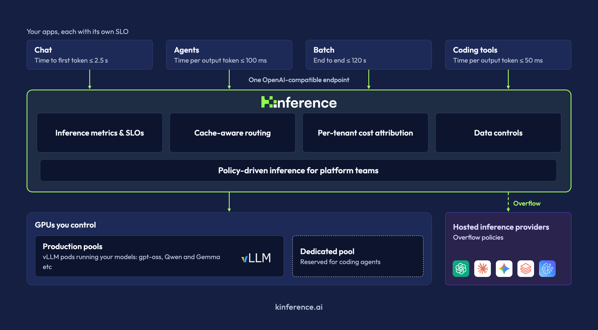
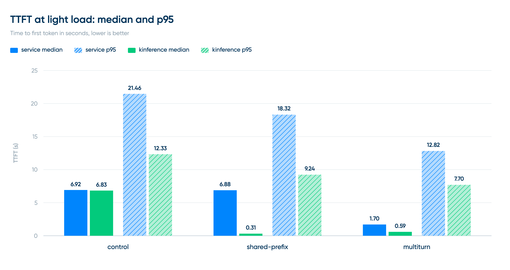
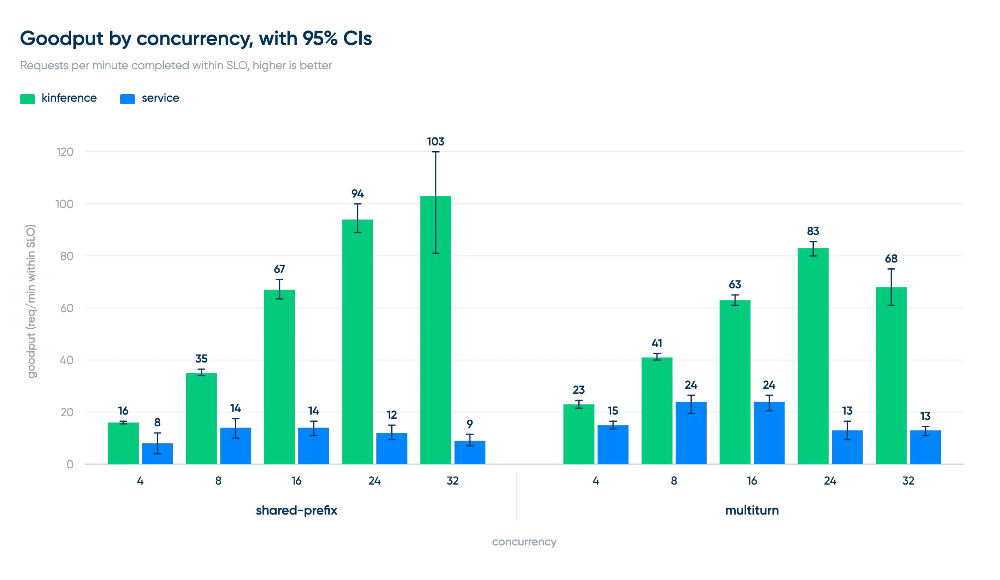
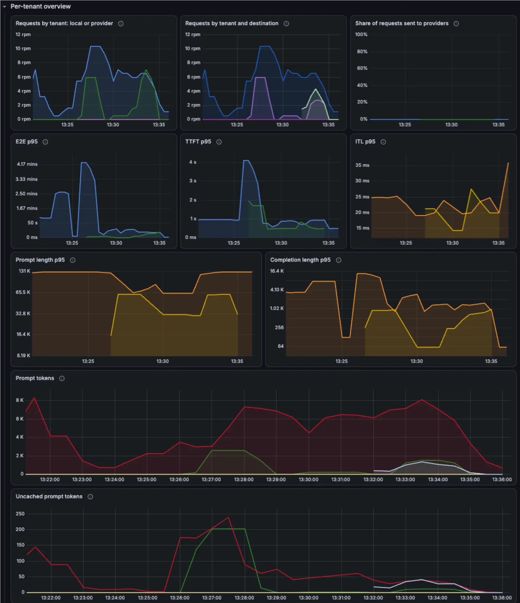

We’re excited to announce [Kinference \[kay-inference\]](https://kinference.ai/), a new open source project for building scalable inference platforms with vLLM.


We created Kinference at [Buoyant](https://buoyant.io/) after watching our customers struggle to run open weight models in their environments. We designed Kinference to be the control plane layer for the platform you need to build. It uses vLLM to do the underlying inference, and provides the set of features necessary for building an inference platform in practice. This includes token rate limiting, tenant usage and cost tracking, intelligent load balancing, and inference policies.



Kinference can be paired with your existing stack. Using Kinference is simply a matter of pointing inference clients to its HTTP endpoint and sending OpenAI or Anthropic-compatible inference traffic there.

Kinference serves a heterogeneous, evolving set of models running on a heterogeneous, evolving pool of GPUs, to a heterogenous, evolving set of clients..

## **Inference load balancing and performance**

In addition to policies and a routing layer, Kinference provides inference-specific load balancing that takes into account signals like GPU queue sizes, historical performance, and the contents of the KV cache on the GPU. This KV-cache awareness, in particular, allows Kinference to send requests to the vLLM worker that will do the least work for that specific request.

Modeling the KV cache content of the GPU can produce dramatic gains in performance for distributed inference. For example, in our [public Kinference benchmarks](https://buoyant.io/blog/distributed-inference-benchmarks-kinference-vs-plain-kubernetes), we showed that, when compared to standard Kubernetes load balancing (labeled “service” below), **Kinference (labeled “kinference”) was able to cut median time-to-first-token (TTFT) by 95% and median end-to-end latency by 45%** of requests on one workload type.



By incorporating cache awareness into policies, platform owners can create policies that will send simple requests to the cheaper model — but only if that’s less work than sending them to the expensive model in the first place.

In our *unloaded latency* benchmark above, we sought to measure the effect of Kinference’s KV-cache-aware load balancing in isolation. In our *capacity* benchmark, below, we measured the requests per minute can each endpoint can serve within a latency SLO.



In the capacity benchmark, Kinference served **7.4× the goodput on shared-prefix and about 3.5× the goodput on multiturn**. It was able to attain our chosen SLO at concurrency 32 (the highest measured) on our shared-prefix workload, and concurrency 8 on the multiturn workload, whereas the kube-proxy approach was not able to attain the SLO at any concurrency level.

Read more details on our benchmarking setup, process, and findings [here](https://buoyant.io/blog/distributed-inference-benchmarks-kinference-vs-plain-kubernetes).

## **A policy-driven approach**

Central to Kinference is the idea of *inference policies*.

Inference policies allow platform owners to balance tradeoffs across usage, performance, and priorities. We observed our customers tackle questions like:

* How do we allow users to request not just specific model checkpoints (“Qwen 3.8 with 27B params and the FP8 quantization, please”) but broader classes of models, such as “any Qwen 3.8 model” or “whatever is good for coding”?
* How do we redirect “easy” inference requests to cheaper models, even if the user requested an expensive model? And how do we do that without sending the whole prompt history to a cold GPU and incurring a huge latency hit?

Rather than build a set of one-off features, we built a policy layer in Kinference that can express them all—and many others as well.

For example, here’s how you can define a YAML policy for Kinference to semantically classify prompts by complexity level, and route simpler prompts to cheaper models. But also take into account cache usage if it's faster to send it to an expensive model.

```yaml
apiVersion: kinference.buoyant.io/v1alpha1
kind: InferencePolicy
metadata:
  name: smart-semantic-routing
  namespace: inference
spec:
  rules:
  - name: low-complexity-consider-qwen
    matches:
    - model: glm-5.3
      tag: complexity-low
    route:
      consider:
      - models: { names: [ qwen-3.6-27b, glm-5.3 ] }
      select: [ { minimize: PredictedTTFT } ]
```

Here’s another example of using Kinference to burst the excess requests to cloud provider endpoints (like OpenAI, Anthropic, Databricks etc) when queue depth or cache pressure indicate GPUs are saturated.

```yaml
apiVersion: kinference.buoyant.io/v1alpha1
kind: InferencePolicy
metadata:
  name: burst-policy
  namespace: inference
spec:
  rules:
  - name: burst-to-cloud
    route:
      exclude:
      - name: drop-overloaded-workers
        drop:
          backend:       { type: Local }
          queuedPrompts: { greaterThan: 2 }

      select:
      - { type: Local,
          minimize: PredictedTTFT }
      - { type: Provider,
          order: [bedrock, databricks] }
```

Finally, here's an example of a policy that semantically classifies prompts according to whether they contain PII, and bursts requests to the third-party provider if the GPU pool is saturated.

```yaml
apiVersion: kinference.buoyant.io/v1alpha1
kind: InferencePolicy
metadata:
  name: pii-stays-local
  namespace: inference
spec:
  rules:
  - name: serve
    route:
      exclude:
      - name: pii-never-leaves-cluster
        if:   { tag: pii-detected }
        drop: { backend: { type: Provider } }
      select:
      - { type: Provider,
          order: [ databricks ] }
      - { type: Local,
          minimize: PredictedTTFT }
      onEmpty: Reject   # fail closed
```

With inference policies, platform owners can create explicit rules for how inference requests should be routed (or rejected) based on tenant, model requested, state of the underlying GPU pool, semantic classification of the prompts, and many other factors. These policies can go through human or agentic review; they can be committed to git; they can be linted and vetted; and they can be applied or rolled back independently.

We think this policy engine is critical for providing a true inference platform. See our [Kinference policy docs](http://kinference.ai/docs/)  for more.

## **Inference metrics and SLOs**

Finally, there is a comprehensive suite of inference-related metrics for platform owners to monitor, alert on, and build SLOs around. Kinference reports about what’s happening on the system, including not just its own health but:

* Tokens rates in and out, and histograms of input and output token sizes
* TTFT, ITL, and E2E latency histograms
* Uncached vs cached prompt tokens, for cost estimation
* Model usage, GPU saturation, etc



Almost every metric is also available per tenant, so you can track tenant usage, build specific SLOs around performance for specific tenants, and everything else you might need to ensure the platform you’re building is living up to its requirements.

## **Try it today**

Getting started is easy:

### 01 Install the Gateway API CRDs

**Note:** This guide installs Kinference into the `default` namespace. To install into a different namespace, override the namespaces in the following helm commands.

The first step is to install the [Gateway API](https://gateway-api.sigs.k8s.io/docs/introduction/) CRDs, which provide standard mechanisms for handling traffic.

```bash
GWAPI_VERSION=1.5.1
kubectl apply --server-side --force-conflicts -f https://github.com/kubernetes-sigs/gateway-api/releases/download/v$GWAPI_VERSION/standard-install.yaml
```

### 02 Install the Kinference gateway

Kinference has two basic components: a traffic gateway and an inference handler. Each is released independently and ships its CRDs as a separate chart, installed before the component itself.

Install the gateway CRDs and components:

```bash
helm upgrade -i gateway-crds \
  oci://ghcr.io/buoyantio/charts/gateway-crds \
  --devel

helm upgrade -i gateway \
  oci://ghcr.io/buoyantio/charts/gateway \
  --devel --wait
```

### 03 Install Kinference

Now, install Kinference and the Kinference CRDs:

```bash
helm upgrade -i kinference-crds \
  oci://cr.kinference.ai/kinference-ai/charts/kinference-crds \
  --devel

helm upgrade -i kinference \
  oci://cr.kinference.ai/kinference-ai/charts/kinference \
  --set extension.enabled=true \
  --devel --wait
```

### 04 Make sure it’s working

```bash
kubectl get pods
```

Verify the processes are running:

```
NAME                           READY   STATUS    RESTARTS   AGE
gateway-cp-566cddc46d-jsqlq    1/1     Running   0          8s
kinference-7bb854cfc5-pp4t7    1/1     Running   0          8s
```

Please always refer to the latest documentation at [http\://kinference.ai/docs/](http://kinference.ai/docs/) as these steps will evolve over time.

Kinference is fully open source under Apache v2. It’s available on [GitHub](https://github.com/Kinference-AI/kinference) today. Feedback, issues and benchmark reports from other deployments are very welcome.
