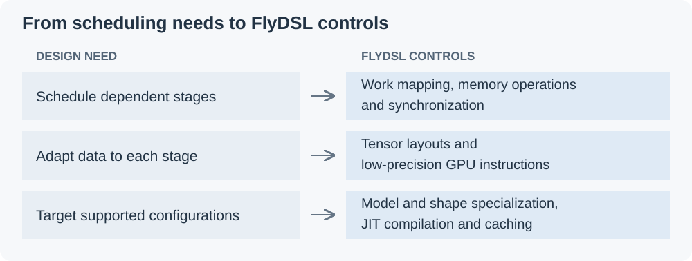
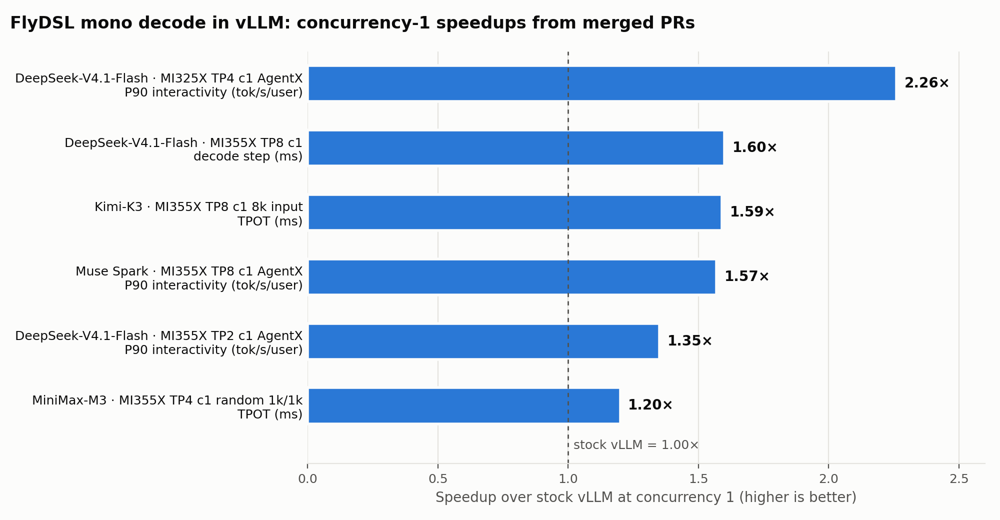

## Introduction

Interactive LLM applications depend on low decode latency. A coding agent must finish generating its current action before it can call the next tool, so decode sits on the task’s critical path. Serving these workloads at low concurrency prioritizes per-user responsiveness over aggregate throughput.

A decode step executes a chain of GPU kernels for operations such as projections, attention, and expert computation. At small batch sizes, many of these kernels do only a little work, yet each still incurs GPU-side dispatch, startup, and completion costs. A dependent kernel cannot proceed until its inputs are ready, so whole-kernel boundaries also limit overlap. Repeated across a long chain, these costs can account for a substantial part of decode latency, while the small amount of parallel work leaves GPU capacity unused. CUDA graphs reduce CPU launch overhead, but do not eliminate these GPU-side costs. Figure 1 illustrates the repeated stages; widths and gaps are schematic, not measured durations or an overhead breakdown.

<a id="en-kernel-overhead"></a>

<figure><a href="/assets/figures/2026-11-05-flydsl-monokernels/kernel-overhead.svg" title="Open full-size figure"></a><figcaption>Figure 1. Repeated startup and completion around short kernels.</figcaption></figure>

This post explores how **MonoKernels** written in [FlyDSL](https://github.com/ROCm/FlyDSL) reduce decode latency in vLLM for interactive LLM serving on AMD Instinct GPUs. We explain the approach and its integration with vLLM, then examine performance and accuracy.

<a id="en-monokernel-mechanism"></a>


## How MonoKernels Reduce Decode Latency

A **MonoKernel** combines multiple dependent operator stages inside a single GPU kernel launch, using an explicitly designed schedule rather than a separate launch at every operator boundary. Here, *mono* means a single kernel execution boundary, not an entire model in one kernel. A model’s mono-decode path can contain several MonoKernels, and a decoder layer does not have to map to exactly one launch.

The goal is not just to make individual operators faster, but to shorten the waits between them. Inspired by [TileRT](https://github.com/tile-ai/TileRT), the implementations discussed here use a **persistent launch**: a fixed grid of GPU thread blocks works through multiple stages. A thread block is a group of GPU threads executing together; it can continue with subsequent work once the required dependencies are satisfied.

Both paths in Figure 2 can be replayed under CUDA graphs. The difference is between multiple independent kernels and an author-designed persistent schedule within a launch. Some whole-kernel boundaries become finer-grained handoffs between portions of the computation.

<a id="en-figure-1"></a>

<figure>
<a href="/assets/figures/2026-11-05-flydsl-monokernels/decode-schedule.svg" title="Open full-size figure"></a>
<figcaption>Figure 2. Reducing waits within a decode layer. Schematic only: block widths and spacing are not measured durations or a speedup estimate. Kernel boundaries do not represent a fresh CPU launch for every operator.</figcaption>
</figure>

- **Reuse thread blocks across stages.** After completing its current work, a block can take on ready work from the next stage without a separate kernel launch. This reduces repeated GPU kernel startup and drain.
- **Read later weights while earlier work computes.** For example, output-projection or expert up/gate weights can be prefetched during earlier computation. Where the schedule and resources allow it, that overlaps part of the HBM traffic with useful work rather than exposing all of it on the critical path. It does not eliminate weight reads or guarantee that all memory latency is hidden.
- **Hand off data at the granularity the consumer needs.** A *tile* is a portion of a tensor. A **tagged mailbox** holds an intermediate result and a tag indicating readiness. A downstream stage, or a reduction on a peer GPU, can proceed once the required data is ready rather than waiting for unrelated work in the producing stage. Consumers still wait for all inputs required by their own computation.

### Choosing Model-Specific Kernel Boundaries

A key design challenge is deciding **where a MonoKernel begins and ends**: which operations share one launch, and which remain in separate kernels. Fusing more stages is not automatically better. The boundary must fit the model’s data dependencies, communication pattern, and GPU resource limits. MonoKernel boundaries are therefore model-specific, rather than a universal one-layer, one-kernel template.

For example, the initial DeepSeek-V4.1-Flash implementation ([#60397](https://github.com/vllm-project/vllm/pull/60397)) divides the standard decoder-layer path into K1 and K2. Figure 3 shows the operations within each boundary, not their execution timing.

<a id="en-figure-2"></a>

<figure>
<a href="/assets/figures/2026-11-05-flydsl-monokernels/deepseek-boundaries.svg" title="Open full-size figure"></a>
<figcaption>Figure 3. Two launch boundaries in the DeepSeek-V4.1-Flash example. Both tensor-parallel (TP) all-reduces are inside K2. This is a model-specific partition, not a universal two-kernel recipe; the arrows show logical order, not a measured schedule.</figcaption>
</figure>

K1 prepares attention inputs and updates the KV cache. K2 completes attention and continues through the feed-forward work, with both TP all-reduces using symmetric peer memory inside the kernel. These reductions sum in fp32 in rank order, then convert to bf16, and overlap with surrounding work. Their placement inside K2 does not mean that communication or cross-rank synchronization disappears.

<details><summary>Operator-level mapping for this example</summary>
<table><thead><tr><th>Launch</th><th>Stages</th></tr></thead><tbody>
<tr><td><strong>K1</strong></td><td>mHC attention seam → attention front: <code>wqkv</code>, q/kv norms, KV-cache insert, <code>wq_b</code></td></tr>
<tr><td><strong>K2</strong></td><td>attention back (split attention, combine, <code>wo_a</code>, <code>wo_b</code>) → TP all-reduce → FFN seam → MoE (router, top-6, shared expert, MXFP4 experts) → TP all-reduce</td></tr>
</tbody></table></details>

**A narrower boundary: MiniMax-M3.** The initial implementation ([#62712](https://github.com/vllm-project/vllm/pull/62712)) fuses the FFN portion, including its surrounding communication, while attention stays on the stock path. Compared with the DeepSeek example, it chooses only part of the layer for mono execution. These examples illustrate different boundary choices, not a fixed recipe that transfers unchanged to every model.

<a id="en-flydsl-execution"></a>


## Why FlyDSL Fits This Execution Model

The boundary and schedule are designed by the kernel author, not automatically created by choosing a language. [FlyDSL](https://github.com/ROCm/FlyDSL), AMD’s Python DSL and MLIR compiler for high-performance ROCm kernels, provides the controls needed to express and compile that design. Figure 4 connects the design needs to those controls: **the author designs, FlyDSL compiles, and vLLM selects and integrates the execution path.**

<a id="en-flydsl-controls"></a>

<figure><a href="/assets/figures/2026-11-05-flydsl-monokernels/flydsl-controls.svg" title="Open full-size figure"></a><figcaption>Figure 4. FlyDSL controls that support an author-designed MonoKernel schedule.</figcaption></figure>

These controls enable targeted implementations, not automatic fusion or portability. The model, GPU architecture, and supported step widths still determine which variants can run. The following section explains how vLLM integrates them without replacing the rest of the serving engine.

<details><summary>Implementation details: layouts, compilation and supported configurations</summary>
<p><strong>Control data movement and synchronization.</strong> To overlap stages, the implementation must decide how work is divided across blocks, waves, and threads, when loads are issued, and when results become available. FlyDSL lets the author express these choices down to specific buffer and matrix instructions where needed. The benefit comes from the resulting schedule, not from Python syntax itself.</p>
<p><strong>Match layouts and low-precision computation to each stage.</strong> Projections, attention, and experts do not all use the same data layout. FlyDSL lets the author choose how each stage partitions and accesses its tensors, and map low-precision computation to the GPU's matrix instructions. On MI355X, the mono implementation can read vLLM's loaded weights in place, including AITER's shuffled MXFP4 expert layout, rather than keeping a second copy. These controls also support porting, but do not make it automatic: CDNA3 needs tile sizes suited to its smaller shared memory (LDS) and different matrix-instruction paths from CDNA4.</p>
<p><strong>Specialize and compile for the supported configuration.</strong> Kernels written with <code>@flyc.kernel</code> and <code>@flyc.jit</code> are compiled on first use and cached. The implementation is specialized for its model, TP size, and supported step widths—the number of token rows processed in a forward step, including speculative positions and graph padding. vLLM builds the required width variants during warm-up and replays them under CUDA graphs. This is targeted specialization, not a guarantee that one schedule serves arbitrary models or batch sizes.</p>
<p>The kernel source remains in the model's vLLM directory, with the <code>flydsl</code> wheel as its new runtime dependency. Deterministic compilation also supports ISA and resource-usage comparisons during review. With the execution mechanism established, the next question is how vLLM enables it without replacing the rest of the serving engine.</p>
</details>

## Specialized Decode in vLLM

From vLLM's point of view, a MonoKernel path is a *specialized decode*: a model- and hardware-specific implementation of the decode forward pass that sits behind vLLM's normal interfaces. The scheduler, the KV-cache manager, speculative decoding, sampling, and CUDA graph capture all stay as they are. The specialized path only changes how the model's decoder layers execute, and only on the steps it can serve.

Such an implementation can reach tens of thousands of lines, so while the first mono PRs were in review, the community agreed on a standard for hosting them in RFC [#60904](https://github.com/vllm-project/vllm/issues/60904). The standard is written for any model and any hardware vendor, and the merged mono PRs follow it:

- **Opt-in, like any other engine feature.** The path is off by default. `--monokernel` is a regular engine argument (`KernelConfig.monokernel`); Kimi-K3 uses `--additional-config '{"decode_backend": "latency_specialized"}'`. With the switch off, nothing changes.
- **Refuse at startup, never degrade silently.** A deployment the kernels can't serve fails with one error that lists every reason: TP size, pipeline, data, or expert parallelism, LoRA, KV connectors, a partitioned GPU, an unsupported KV-cache dtype, and so on. Kimi-K3, for example, checks the config when the model is built, the weights once they are loaded, and the KV caches each time they are bound, and every TP rank reaches the same verdict.
- **The model owns the code.** Kernels, runtime, and tests live under `vllm/models/<model>/amd/`, and the model file only calls into that folder. For Kimi-K3 this took 26 added lines in the existing model files: build the configuration in `__init__`, plan once in `forward`, call `(step.layer(i) or layer)(...)` in the layer loop, and finish the step in `compute_logits`. Nothing under `vllm/v1/` or `vllm/config/` changed.
- **One `plan()` per step.** At the start of each forward pass, the plan reads the step's metadata and picks mono or stock for every layer. It reads only metadata that all TP ranks share, so the ranks stay in lockstep, which the kernels require because they wait on each other's data. Prefill, mixed batches, steps wider than the kernels were built for, and PIECEWISE graphs, which vLLM replays for mixed batches, run on the stock layers.
- **Compatible with CUDA graphs and speculative decoding.** vLLM's capture sizes don't change. Under FULL graphs, the plan is fixed at capture time, and because hand-offs inside the kernel are tagged with an epoch instead of cleared every step, no host-side hook is needed between replays. When a graph is replayed with fewer requests than it was captured with, the padding requests are served like real ones. For DeepSeek-V4.1-Flash, Kimi-K3, and Muse Spark, speculative verify steps run on the mono path, and for DeepSeek-V4.1-Flash, so do the DSpark draft model's layers.
- **The same tensors at the layer boundary.** A mono layer uses the weights vLLM has already loaded (in place on MI355X) and vLLM's KV-cache layout, and it returns the same tensors as the stock layer. Mono and stock layers can therefore alternate within one step.
- **Failures stop every rank together.** Because TP ranks wait on each other inside the kernel, a stalled rank could hang the whole server. The Kimi-K3 and MiniMax-M3 paths add fail-stop: every in-kernel wait has a timeout, a stalled rank sets a sticky health word, and all TP ranks raise at the same step instead of hanging in a collective. Bringing the same bounded waits to DeepSeek-V4.1 is planned.
- **Tested in vLLM's CI.** Each model adds CPU tests for its configuration checks and step routing, and GPU tests in vLLM's MI355 Buildkite jobs. The GPU tests compare the mono layers with vLLM's own ops and serve a small multi-layer model with mono on and off. For DeepSeek-V4.1-Flash, a race stress test ran 100K graph replays per layer without a mismatch.

With this structure in place, specialized decode in vLLM grew quickly from one model on one GPU to many. DeepSeek-V4.1-Flash went from 30 layers to all 40 ([#61082](https://github.com/vllm-project/vllm/pull/61082)), to the DSpark draft layers ([#62131](https://github.com/vllm-project/vllm/pull/62131)), to MI300X/MI325X ([#60731](https://github.com/vllm-project/vllm/pull/60731)), and to TP8 ([#64101](https://github.com/vllm-project/vllm/pull/64101)). DeepSeek-V4-Pro, MiniMax-M3, Kimi-K3, and Muse Spark followed. To keep that growth manageable, [#61311](https://github.com/vllm-project/vllm/pull/61311) proposes a thin shared `SpecializedDecode` layer under `vllm/models/common/`, and [#62256](https://github.com/vllm-project/vllm/pull/62256) adds an authoring guide that walks from architecture through a FlyDSL introduction to a step-by-step implementation.

## Results

The merged-PR evaluations summarized in Figure 5 were measured by their authors on MI355X or MI325X. The separate GLM-5.2 subsection reports the RFC measurements on MI350X; those results are not included in Figure 5. AgentX is InferenceX's benchmark built from multi-turn, long-context agent sessions. Each AgentX point is one 3,600-second run. **Interactivity** is 1 / P90 inter-token latency, in tokens/s/user (higher is better).

<p><a href="/assets/figures/2026-11-05-flydsl-monokernels/vllm-mono-speedups.png" title="Open full-size figure"></a></p>

*Figure 5. Concurrency-1 speedup over stock vLLM for each merged mono decode PR, by the metric each PR reports (interactivity: mono / stock; TPOT and step time: stock / mono). Data: [mono-speedups.csv](/assets/figures/2026-11-05-flydsl-monokernels/mono-speedups.csv).*

### DeepSeek-V4.1-Flash

The first measurement compares mono off and on, on the same node at TP2 on MI355X, with K1 + K2 on the 30 standard layers ([#60397](https://github.com/vllm-project/vllm/pull/60397)):

<table>
<thead>
<tr>
<th>Concurrency</th>
<th>P90 interactivity (tok/s/user)</th>
<th>Total throughput (tok/s)</th>
<th>P90 TTFT (s)</th>
</tr>
</thead>
<tbody>
<tr>
<td>1</td>
<td>318.1 → 429.1 (<strong>1.35×</strong>)</td>
<td>21,573 → 25,039 (1.16×)</td>
<td>1.18 → 1.28</td>
</tr>
<tr>
<td>2</td>
<td>299.3 → 381.7 (<strong>1.28×</strong>)</td>
<td>22,735 → 25,695 (1.13×)</td>
<td>1.10 → 1.08</td>
</tr>
<tr>
<td>4</td>
<td>288.0 → 332.4 (<strong>1.15×</strong>)</td>
<td>33,043 → 35,885 (1.09×)</td>
<td>1.27 → 1.26</td>
</tr>
<tr>
<td>8</td>
<td>214.6 → 245.3 (<strong>1.14×</strong>)</td>
<td>58,294 → 60,501 (1.04×)</td>
<td>1.01 → 1.08</td>
</tr>
</tbody>
</table>

Interactivity improves at every concurrency, and the gain narrows as concurrency rises. Prefill doesn't use the mono path, and P90 TTFT moves by at most 0.1 s in either direction across these single runs.

The same PR added an FFN launch for the remaining 10 layers, which adds another 1.02–1.19×. At TP4, P90 interactivity at concurrency 1 / 2 / 4 / 8 is **1.66× / 1.56× / 1.64× / 1.38×** that of InferenceX's published run of the same recipe. [#61082](https://github.com/vllm-project/vllm/pull/61082) then runs all 40 layers as K1 + K2, which brings TP4 concurrency-1 P90 interactivity to **562.6 tok/s/user** (+3.9%).

The **MI300X/MI325X port** ([#60731](https://github.com/vllm-project/vllm/pull/60731)) shows the largest end-to-end gain. A standard decoder layer drops from 32 kernels to 2:

<table>
<thead>
<tr>
<th>MI325X, TP4, AgentX, concurrency 1</th>
<th><code>main</code></th>
<th><code>--monokernel</code></th>
<th></th>
</tr>
</thead>
<tbody>
<tr>
<td>P50 interactivity (tok/s/user)</td>
<td>216.85</td>
<td>503.53</td>
<td><strong>2.32×</strong></td>
</tr>
<tr>
<td>P90 interactivity (tok/s/user)</td>
<td>182.25</td>
<td>411.26</td>
<td><strong>2.26×</strong></td>
</tr>
<tr>
<td>Total throughput per GPU (tok/s)</td>
<td>4,024</td>
<td>6,546</td>
<td>1.63×</td>
</tr>
<tr>
<td>Standard decoder layer</td>
<td>320 µs, 32 kernels</td>
<td>115 µs, 2 kernels</td>
<td>2.8×</td>
</tr>
</tbody>
</table>

At concurrency 2 / 4 / 8, P90 interactivity is 2.41× / 2.22× / 1.99× InferenceX's published MI325X points.

At **TP8 on MI355X** ([#64101](https://github.com/vllm-project/vllm/pull/64101)), each rank streams half as many weights while the K1/K2 chain stays the same length. A DSpark decode step at concurrency 1 drops from 8.59 ms to **5.36 ms (−37.5%)**, and the output rate rises from 392 to 580 tok/s.

Finally, the **DSpark draft model** runs on the same kernels ([#62131](https://github.com/vllm-project/vllm/pull/62131)). Its three layers take about 227 µs per step instead of about 640 µs, with no change in acceptance length.

### DeepSeek-V4-Pro

The larger Pro model uses its own copy of the mono package, specialized to its dimensions, at TP8 on MI355X ([#61482](https://github.com/vllm-project/vllm/pull/61482)). AgentX P50 interactivity is **+28.7% / +26.5% / +11.9%** at concurrency 1 / 4 / 8. The baseline is a historical InferenceX run on an older software stack, so these numbers include stack changes as well as the kernels.

### MiniMax-M3

The MiniMax-M3 MXFP4 PR ([#62712](https://github.com/vllm-project/vllm/pull/62712)) shows that a partial fusion already helps. Only the FFN half of layers 3–59 runs as one launch: all-reduce, RMSNorm, router, shared and routed experts, and the final all-reduce. Attention stays on the stock path. At TP4 on MI355X with random 1k/1k prompts:

<table>
<thead>
<tr>
<th>Concurrency</th>
<th>TPOT, stock → mono (ms)</th>
<th>Change</th>
</tr>
</thead>
<tbody>
<tr>
<td>1</td>
<td>5.12 → 4.27</td>
<td><strong>−16.6%</strong></td>
</tr>
<tr>
<td>2</td>
<td>5.54 → 4.85</td>
<td>−12.5%</td>
</tr>
<tr>
<td>4</td>
<td>6.23 → 5.69</td>
<td>−8.7%</td>
</tr>
<tr>
<td>8</td>
<td>7.46 → 6.88</td>
<td>−7.8%</td>
</tr>
<tr>
<td>16</td>
<td>8.89 → 8.87</td>
<td>parity</td>
</tr>
</tbody>
</table>

Full-layer mono decode for M3 and M3.1, which also fuses attention and the sparse indexer, is in review ([#59705](https://github.com/vllm-project/vllm/pull/59705), [#65638](https://github.com/vllm-project/vllm/pull/65638)).

### Kimi-K3

Kimi-K3 mixes KDA linear-attention layers with MLA layers. The first PR ([#60683](https://github.com/vllm-project/vllm/pull/60683)) runs the KDA layers as K1 + K2, and runs the MLA layers' output projection and MoE as K2. The follow-up ([#61435](https://github.com/vllm-project/vllm/pull/61435)) adds MLA prologue and epilogue kernels and, at DCP1, fuses a FlyDSL MLA decode-attention stage into K2, so an MLA layer takes two launches. TPOT P50 at TP8 on MI355X, concurrency 1, seven speculative tokens (the stock and #60683 columns are #60683's published numbers; #61435 is the mean of two seeds):

<table>
<thead>
<tr>
<th>Input length</th>
<th>Stock</th>
<th>#60683</th>
<th>#60683 + #61435 (DCP1)</th>
<th>Total</th>
</tr>
</thead>
<tbody>
<tr>
<td>8k</td>
<td>5.47 ms</td>
<td>4.35 ms</td>
<td><strong>3.44 ms</strong></td>
<td><strong>1.59×</strong></td>
</tr>
<tr>
<td>64k</td>
<td>5.67 ms</td>
<td>4.47 ms</td>
<td><strong>3.58 ms</strong></td>
<td><strong>1.58×</strong></td>
</tr>
</tbody>
</table>

### Muse Spark

Muse Spark Open MXFP4 ([#63440](https://github.com/vllm-project/vllm/pull/63440)) runs decoder layers 1–60 of every DSpark verify step as persistent launches on 8× MI355X with TP8 and expert parallelism. The comparison is on AgentX's agentic-coding traces (median input length 159k tokens). The baseline is the recipe's stock TP8 configuration at concurrency 1, its stock TEP8 configuration at concurrency 8, and the faster of the two in between:

<table>
<thead>
<tr>
<th>Concurrency</th>
<th>Interactivity (tok/s/user)</th>
<th>Total tok/s/GPU</th>
</tr>
</thead>
<tbody>
<tr>
<td>1</td>
<td>263.1 → 413.8 (<strong>+57%</strong>)</td>
<td>2,325 → 2,974 (+28%)</td>
</tr>
<tr>
<td>2</td>
<td>232.7 → 314.1 (+35%)</td>
<td>2,368 → 3,056 (+29%)</td>
</tr>
<tr>
<td>4</td>
<td>217.3 → 295.2 (+36%)</td>
<td>3,585 → 4,430 (+24%)</td>
</tr>
<tr>
<td>8</td>
<td>143.3 → 208.4 (+45%)</td>
<td>6,126 → 7,384 (+21%)</td>
</tr>
</tbody>
</table>

### GLM-5.2: RFC measurements

RFC [#60904](https://github.com/vllm-project/vllm/issues/60904) reports measurements on GLM-5.2-MXFP4 (TP8, 8× MI350X), using the GLM-5.2 MonoKernel that is now in review ([#60889](https://github.com/vllm-project/vllm/pull/60889)). A graph-mode decode step in vLLM issues about **2,459 kernels**. With MonoKernels it issues about **210**: 75 MonoKernel launches plus the dense layers, input preparation, and the head.

<table>
<thead>
<tr>
<th>GLM-5.2-MXFP4, TP8, MI350X</th>
<th>vLLM</th>
<th>MonoKernel</th>
<th>Speedup</th>
</tr>
</thead>
<tbody>
<tr>
<td>Time per token, batch 1 / 8</td>
<td>13.70 / 17.33 ms</td>
<td>5.92 / 11.44 ms</td>
<td>2.31× / 1.51×</td>
</tr>
<tr>
<td>Time per token, batch 1, FP8 attention</td>
<td>13.70 ms</td>
<td>4.80 ms</td>
<td>2.85×</td>
</tr>
<tr>
<td>AgentX time between tokens, 1 / 8 users</td>
<td>15.0 / 20.4 ms</td>
<td>6.5 / 12.7 ms</td>
<td>2.28× / 1.68×</td>
</tr>
</tbody>
</table>

In this RFC example, the gain is largest at batch one and shrinks as the batch grows, illustrating why mono decode targets latency-bound serving.

### Accuracy

A fused kernel quantizes, accumulates, and reduces in a different order from the stock path, so every mono PR reports accuracy with mono on and off. The DeepSeek and Muse Spark PRs follow the protocol of RFC [#59665](https://github.com/vllm-project/vllm/issues/59665): the full GSM8K set, GPQA-Diamond, AIME25, and RULER NIAH at 32K–256K context or longer, with real speculative acceptance, compared paired by question. The differences stay within noise:

- **DeepSeek-V4.1-Flash, TP2:** GPQA-Diamond 85.3 → 85.1 (Δ −0.2 ± 0.6), AIME25 99.4 → 98.3 (Δ −1.0 ± 0.7), and RULER NIAH 40/40 in every cell.
- **DeepSeek-V4.1-Flash, MI325X:** GSM8K 0.9247 → 0.9270 (p = 0.49).
- **Muse Spark:** GPQA-Diamond 88.5 → 88.7, AIME25 98.3 → 98.6.

Below the end-to-end evaluations, the mono layers are tested against vLLM's own op chain and an exact fp32 reference, for example per-token cosine similarity ≥ 0.999 for DeepSeek-V4.1-Flash and bit-exact results across 300 CUDA-graph replays.

## Try It

Since October 2026, mono decode has been merged into vLLM `main` for **DeepSeek-V4.1-Flash**, **DeepSeek-V4-Pro**, **MiniMax-M3**, **Kimi-K3**, and **Muse Spark** on MI355X, and for DeepSeek-V4.1-Flash also on MI325X. Ports for GLM-5.x, Qwen3.8, and MiniMax-M3.1 are in review.

Mono decode is opt-in, so add `--monokernel` to a supported recipe. For example, the DeepSeek-V4.1-Flash setup used in the PRs on MI355X:

```
VLLM_ROCM_USE_AITER=1 \
vllm serve deepseek-ai/DeepSeek-V4.1-Flash \
  --tensor-parallel-size 4 \
  --tokenizer-mode deepseek_v41 --trust-remote-code --language-model-only \
  --max-num-seqs 8 --block-size 128 \
  --attention_config.indexer_kv_dtype=mxfp4 \
  --moe-backend aiter \
  --speculative-config '{"method":"dspark","num_speculative_tokens":5}' \
  --monokernel
```

If the deployment isn't supported, vLLM refuses to start and lists every reason. The supported configurations for each model are documented in its package under `vllm/models/<model>/amd/`.

## FlyDSL Beyond Mono Decode

MonoKernels are the most visible use of FlyDSL in vLLM, but they aren't the only one. Many standalone FlyDSL kernels reach vLLM's ROCm path, most of them through AITER:

<table>
<thead>
<tr>
<th>Area</th>
<th>PRs</th>
</tr>
</thead>
<tbody>
<tr>
<td>GDN (linear attention) prefill, <strong>on by default for gfx942/gfx950</strong></td>
<td><a href="https://github.com/vllm-project/vllm/pull/57560">#57560</a>, <a href="https://github.com/vllm-project/vllm/pull/60645">#60645</a></td>
</tr>
<tr>
<td>INT4 QuickReduce all-reduce</td>
<td><a href="https://github.com/vllm-project/vllm/pull/59478">#59478</a></td>
</tr>
<tr>
<td>MoE: W4A16, MiniMax-M3 MXFP8, Kimi-K3 a4w4</td>
<td><a href="https://github.com/vllm-project/vllm/pull/44400">#44400</a>, <a href="https://github.com/vllm-project/vllm/pull/46184">#46184</a>, <a href="https://github.com/vllm-project/vllm/pull/53940">#53940</a></td>
</tr>
<tr>
<td>Sparse-indexer FP8 MQA logits (gfx942)</td>
<td><a href="https://github.com/vllm-project/vllm/pull/49544">#49544</a></td>
</tr>
<tr>
<td>Attention over 4-bit quantized KV caches (UltraQuant, TurboQuant)</td>
<td><a href="https://github.com/vllm-project/vllm/pull/57057">#57057</a>, <a href="https://github.com/vllm-project/vllm/pull/47896">#47896</a>, <a href="https://github.com/vllm-project/vllm/pull/61649">#61649</a></td>
</tr>
<tr>
<td>Runtime: reused host launchers, JIT-after-warmup monitoring</td>
<td><a href="https://github.com/vllm-project/vllm/pull/64008">#64008</a>, <a href="https://github.com/vllm-project/vllm/pull/62481">#62481</a></td>
</tr>
</tbody>
</table>

More is in review, including FP8 MLA prefill ([#59124](https://github.com/vllm-project/vllm/pull/59124)), a fused all-reduce + RMSNorm ([#57547](https://github.com/vllm-project/vllm/pull/57547)), and the first RDNA4 kernels: all-reduce, split-KV attention, and FP8 block-scale GEMM ([#55917](https://github.com/vllm-project/vllm/pull/55917), [#55996](https://github.com/vllm-project/vllm/pull/55996), [#56005](https://github.com/vllm-project/vllm/pull/56005)).

## Scope and Limitations

Mono decode is a latency optimization, and its benefits have limits:

- **Gains shrink with batch size.** On DeepSeek-V4.1-Flash TP2, P90 interactivity improves 1.35× at concurrency 1 but 1.14× at concurrency 8. Its FFN launch at TP2, concurrency 8 is at parity (345 → 342 µs per layer), and MiniMax-M3 reaches parity at 16 rows. At TP8, mono decode is a concurrency-1 configuration; by concurrency 4, two TP4 replicas deliver more throughput.
- **Steps are limited in width.** Each kernel is built for specific step widths, and speculative tokens and graph padding count toward the limit. DeepSeek-V4.1 supports up to 48 rows on MI355X and 42 on MI325X, where LDS is 64 KB instead of 160 KB. MiniMax-M3 and Kimi-K3 support up to 16. Wider steps run on the stock path.
- **Fusion costs registers and LDS.** Fusing more stages can lower occupancy, so each schedule is tuned for its architecture and TP size.
- **Weight copies on gfx942.** MI300X and MI325X have no scaled FP4/FP8 MFMA, so the kernels keep their own copy of the weights. For DeepSeek-V4.1 at TP4 this is 170 GiB per rank instead of 99 GiB. That still leaves a large KV cache on MI325X, but little room on MI300X.
- **Each model needs its own work.** Every model needs its own schedule and ongoing validation. The RFC, the shared runtime layer, and the authoring guide are meant to keep that cost down.

## Building Mono Decode for a New Model

Adding mono decode for a new model follows the path the existing ports took:

1. **Profile the stock decode path.** Find where stages wait for each other and where weight streaming is exposed.
2. **Write the overlap schedule in FlyDSL.** Reuse the existing building blocks: GEMV and MoE stages, the router, the seams, the peer-memory all-reduce, tagged mailboxes, and fail-stop.
3. **Integrate it following RFC #60904.** Add startup refusals, a per-step `plan()`, and layer tests against vLLM's own ops. Then evaluate with real rejection sampling, comparing interactivity, TTFT, throughput, and accuracy at matched concurrency.

The authoring guide ([#62256](https://github.com/vllm-project/vllm/pull/62256)) and the merged DeepSeek-V4.1 package (`vllm/models/deepseek_v41/amd/mono/`) are the best places to start.

## Summary

Small-batch decode spends most of its time between kernels: launching them, waiting for whole stages to finish, and streaming weights while the GPU idles. FlyDSL MonoKernels remove most of that time by running a decoder layer as one or two persistent launches that reuse thread blocks across stages, prefetch weights, pass ready data forward through tagged mailboxes, and reduce across GPUs inside the kernel. FlyDSL makes this practical: kernels are written in Python, specialized and compiled just in time, controlled down to individual instructions, and portable across CDNA3 and CDNA4 through its layout algebra.

In vLLM, mono decode is now merged for five model families and follows a common, opt-in standard. It improves concurrency-1 interactivity or time per output token by 1.20× to 2.26×, with accuracy within noise. We invite the vLLM community to try `--monokernel` on AMD Instinct GPUs, review the in-flight ports, and use the authoring guide to bring mono decode to new models.

## References

1. [FlyDSL language and compiler](https://github.com/ROCm/FlyDSL)
2. [RFC #60904: A standard for Specialized (MonoKernel) decodes in `vllm/models`](https://github.com/vllm-project/vllm/issues/60904)
3. DeepSeek-V4.1-Flash mono decode: [#60397](https://github.com/vllm-project/vllm/pull/60397), [#61082](https://github.com/vllm-project/vllm/pull/61082), [#60731](https://github.com/vllm-project/vllm/pull/60731), [#62131](https://github.com/vllm-project/vllm/pull/62131), [#64101](https://github.com/vllm-project/vllm/pull/64101)
4. DeepSeek-V4-Pro mono decode: [#61482](https://github.com/vllm-project/vllm/pull/61482)
5. MiniMax-M3 mono decode: [#62712](https://github.com/vllm-project/vllm/pull/62712)
6. Kimi-K3 specialized decode: [#60683](https://github.com/vllm-project/vllm/pull/60683), [#61435](https://github.com/vllm-project/vllm/pull/61435)
7. Muse Spark mono decode: [#63440](https://github.com/vllm-project/vllm/pull/63440)
8. Shared specialized-decode abstractions: [#61311](https://github.com/vllm-project/vllm/pull/61311); MonoKernel authoring guide: [#62256](https://github.com/vllm-project/vllm/pull/62256)
9. [TileRT](https://github.com/tile-ai/TileRT)
10. [InferenceX AgentX metric definitions](https://github.com/SemiAnalysisAI/InferenceX/blob/8b25006fa0b23c7e157438996a3d2a90ff5e8cd2/inferencex-e2e/infx/results/agentic/request_metrics.py)

## Disclaimers

Performance and accuracy numbers in this blog are taken from the linked vLLM pull requests and RFC. The merged-PR results were measured by the PR authors on AMD Instinct™ MI355X (gfx950, 288 GB HBM3E) and AMD Instinct™ MI325X (gfx942, 256 GB HBM3E) systems, with the models, software revisions, serving flags, and benchmark settings described in each PR. The separate GLM-5.2 RFC example uses an 8× MI350X system, as specified in that subsection. AgentX results use InferenceX's benchmark client with one 3,600-second run per point. Where a PR compares against a published InferenceX run instead of a same-node baseline, this blog says so.

Third-party content is licensed to you directly by the third party that owns the
content and is not licensed to you by AMD. ALL LINKED THIRD-PARTY CONTENT IS
PROVIDED "AS IS" WITHOUT A WARRANTY OF ANY KIND. USE OF SUCH THIRD-PARTY CONTENT
IS DONE AT YOUR SOLE DISCRETION AND UNDER NO CIRCUMSTANCES WILL AMD BE LIABLE TO
YOU FOR ANY THIRD-PARTY CONTENT. YOU ASSUME ALL RISK AND ARE SOLELY RESPONSIBLE
FOR ANY DAMAGES THAT MAY ARISE FROM YOUR USE OF THIRD-PARTY CONTENT.

Results shown are from specific test configurations and may vary based on workload,
model, and system configuration.

The information presented in this document is for informational purposes only and may contain technical inaccuracies, omissions, and typographical errors. The information contained herein is subject to change and may be rendered inaccurate for many reasons, including but not limited to product and roadmap changes, component and motherboard version changes, new model and/or product releases, product differences between differing manufacturers, software changes, BIOS flashes, firmware upgrades, or the like. Any computer system has risks of security vulnerabilities that cannot be completely prevented or mitigated. AMD assumes no obligation to update or otherwise correct or revise this information.
However, AMD reserves the right to revise this information and to make changes from time to time to the content hereof without obligation of AMD to notify any person of such revisions or changes.
THIS INFORMATION IS PROVIDED "AS IS." AMD MAKES NO REPRESENTATIONS OR WARRANTIES WITH RESPECT TO THE CONTENTS HEREOF AND ASSUMES NO RESPONSIBILITY FOR ANY INACCURACIES, ERRORS, OR OMISSIONS THAT MAY APPEAR IN THIS INFORMATION. AMD SPECIFICALLY DISCLAIMS ANY IMPLIED WARRANTIES OF NON-INFRINGEMENT, MERCHANTABILITY, OR FITNESS FOR ANY PARTICULAR PURPOSE. IN NO EVENT WILL AMD BE LIABLE TO ANY PERSON FOR ANY RELIANCE, DIRECT, INDIRECT, SPECIAL, OR OTHER CONSEQUENTIAL DAMAGES ARISING FROM THE USE OF ANY INFORMATION CONTAINED HEREIN, EVEN IF AMD IS EXPRESSLY ADVISED OF THE POSSIBILITY OF SUCH DAMAGES.
AMD, the AMD Arrow logo, AMD Instinct, AMD EPYC, AMD ROCm, and combinations thereof are trademarks of Advanced Micro Devices, Inc. Other product names used in this publication are for identification purposes only and may be trademarks of their respective companies. Linux is the registered trademark of Linus Torvalds in the U.S. and other countries. PyTorch, the PyTorch logo, vLLM, and any related marks are trademarks of The Linux Foundation. Ubuntu is a registered trademark of Canonical Ltd. All other trademarks and product names referenced in this publication, including MiniMax, DeepSeek, Kimi, Muse Spark, InferenceX, and Hugging Face, are the property of their respective owners.
© 2026 Advanced Micro Devices, Inc. All rights reserved.
