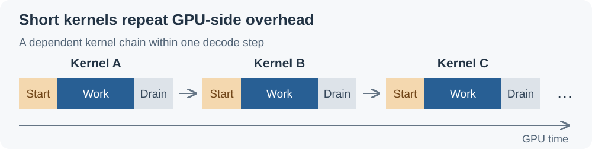
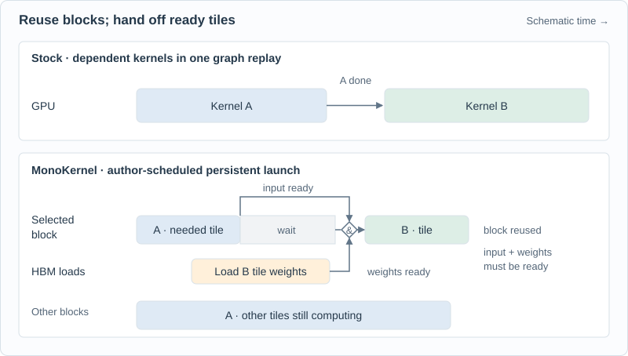
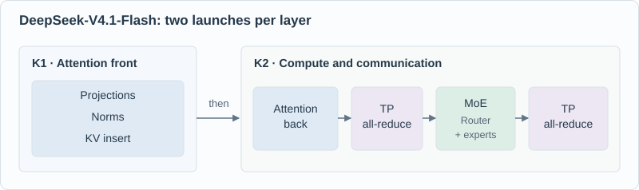
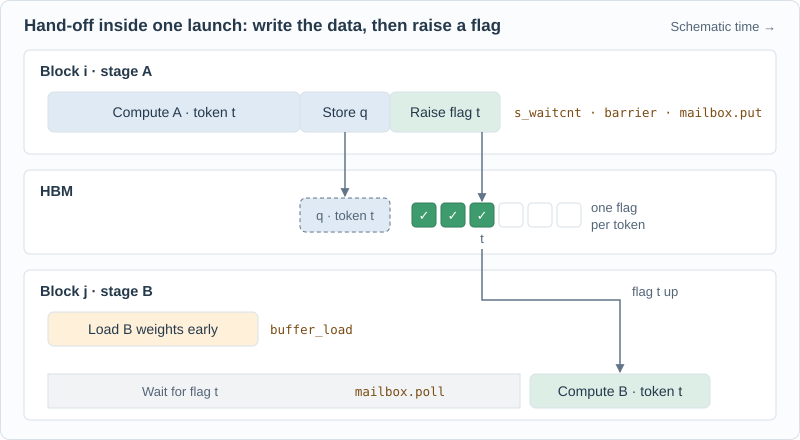
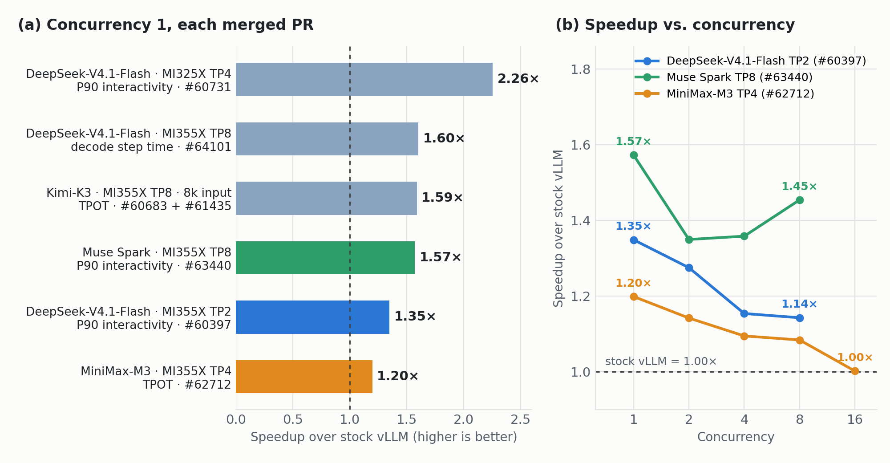

## Introduction

Interactive LLM applications depend on low decode latency. A coding agent must finish generating its current action before it can call the next tool, so decode sits on the task’s critical path. Serving these workloads at low concurrency prioritizes per-user responsiveness over aggregate throughput.

A decode step executes a chain of GPU kernels for operations such as projections, attention, and expert computation. At small batch sizes, many of these kernels do only a little work, yet each still incurs GPU-side dispatch, startup, and completion costs. A dependent kernel cannot proceed until its inputs are ready, so whole-kernel boundaries also limit overlap. Repeated across a long chain, these costs can account for a substantial part of decode latency, while the small amount of parallel work leaves GPU capacity unused. HIP graphs reduce CPU launch overhead, but do not eliminate these GPU-side costs. Figure 1 illustrates the repeated stages; widths and gaps are schematic, not measured durations or an overhead breakdown.

<a id="en-kernel-overhead"></a>

<figure><a href="/assets/figures/2026-11-05-flydsl-monokernels/kernel-overhead.svg" title="Open full-size figure"></a><figcaption>Figure 1. Repeated startup and completion around short kernels.</figcaption></figure>

This post explores how **MonoKernels** written in [FlyDSL](https://github.com/ROCm/FlyDSL) reduce decode latency in vLLM for interactive LLM serving on AMD Instinct GPUs. We explain the approach and its integration with vLLM, then examine performance and accuracy.

<a id="en-monokernel-mechanism"></a>


## How MonoKernels Reduce Decode Latency

A **MonoKernel** combines multiple dependent operator stages inside a single GPU kernel launch, using an explicitly designed schedule rather than a separate launch at every operator boundary. Here, *mono* means a single kernel execution boundary, not an entire model in one kernel. A model’s mono-decode path can contain several MonoKernels, and a decoder layer does not have to map to exactly one launch.

The goal is not just to make individual operators faster, but to shorten the waits between them. Inspired by [TileRT](https://github.com/tile-ai/TileRT), the implementations discussed here use a **persistent launch**: a fixed grid of GPU thread blocks works through multiple stages. A thread block is a group of GPU threads executing together; it can continue with subsequent work once the required dependencies are satisfied.

Both paths in Figure 2 can be replayed under HIP graphs. The difference is between multiple independent kernels and an author-designed persistent schedule within a launch. Some whole-kernel boundaries become finer-grained handoffs between portions of the computation.

<a id="en-figure-1"></a>

<figure>
<a href="/assets/figures/2026-11-05-flydsl-monokernels/decode-schedule.svg" title="Open full-size figure"></a>
<figcaption>Figure 2. Reducing waits within a decode layer. Schematic only: block widths and spacing are not measured durations or a speedup estimate. Kernel boundaries do not represent a fresh CPU launch for every operator.</figcaption>
</figure>

- **Reuse thread blocks across stages.** After completing its current work, a block can take on ready work from the next stage without a separate kernel launch. This reduces repeated GPU kernel startup and drain.
- **Read later weights while earlier work computes.** For example, output-projection or expert up/gate weights can be prefetched during earlier computation. Where the schedule and resources allow it, that overlaps part of the HBM traffic with useful work rather than exposing all of it on the critical path. It does not eliminate weight reads or guarantee that all memory latency is hidden.
- **Hand off data at the granularity the consumer needs.** A *tile* is a portion of a tensor. A **tagged mailbox** holds an intermediate result and a tag indicating readiness. A downstream stage, or a reduction on a peer GPU, can proceed once the required data is ready rather than waiting for unrelated work in the producing stage. Consumers still wait for all inputs required by their own computation.

### Choosing Model-Specific Kernel Boundaries

A key design challenge is deciding **where a MonoKernel begins and ends**: which operations share one launch, and which remain in separate kernels. Fusing more stages is not automatically better. The boundary must fit the model’s data dependencies, communication pattern, and GPU resource limits. MonoKernel boundaries are therefore model-specific, rather than a universal one-layer, one-kernel template.

For example, the initial DeepSeek-V4.1-Flash implementation ([#60397](https://github.com/vllm-project/vllm/pull/60397)) divides the standard decoder-layer path into K1 and K2. Figure 3 shows the operations within each boundary, not their execution timing.

<a id="en-figure-2"></a>

<figure>
<a href="/assets/figures/2026-11-05-flydsl-monokernels/deepseek-boundaries.svg" title="Open full-size figure"></a>
<figcaption>Figure 3. Two launch boundaries in the DeepSeek-V4.1-Flash example. Both tensor-parallel (TP) all-reduces are inside K2. This is a model-specific partition, not a universal two-kernel recipe; the arrows show logical order, not a measured schedule.</figcaption>
</figure>

K1 prepares attention inputs and updates the KV cache. K2 completes attention and continues through the feed-forward work, with both TP all-reduces using symmetric peer memory inside the kernel. These reductions sum in fp32 in rank order, then convert to bf16, and overlap with surrounding work. Their placement inside K2 does not mean that communication or cross-rank synchronization disappears.

<details><summary>Operator-level mapping for this example</summary>
<table><thead><tr><th>Launch</th><th>Stages</th></tr></thead><tbody>
<tr><td><strong>K1</strong></td><td>mHC (hyper-connection) mixing before attention → attention front: <code>wqkv</code>, q/kv norms, KV-cache insert, <code>wq_b</code></td></tr>
<tr><td><strong>K2</strong></td><td>attention back (split attention, combine, <code>wo_a</code>, <code>wo_b</code>) → TP all-reduce → mHC mixing before the FFN → MoE (router, top-6, shared expert, MXFP4 experts) → TP all-reduce</td></tr>
</tbody></table></details>

**A narrower boundary: MiniMax-M3.** The initial implementation ([#62712](https://github.com/vllm-project/vllm/pull/62712)) fuses the FFN portion, including its surrounding communication, while attention stays on the stock path. Compared with the DeepSeek example, it chooses only part of the layer for mono execution. These examples illustrate different boundary choices, not a fixed recipe that transfers unchanged to every model.

<a id="en-flydsl-execution"></a>


## Why FlyDSL Fits This Execution Model

The boundary and schedule are designed by the kernel author, not automatically created by choosing a language. [FlyDSL](https://github.com/ROCm/FlyDSL), AMD’s Python DSL and MLIR compiler for high-performance ROCm kernels, provides the controls needed to express and compile that design. **The author designs, FlyDSL compiles, and vLLM selects and integrates the execution path.** Figure 4 shows the hand-off from Figure 2 between two thread blocks, with the FlyDSL primitive behind each step.

<a id="en-flydsl-handoff"></a>

<figure><a href="/assets/figures/2026-11-05-flydsl-monokernels/flydsl-handoff.svg" title="Open full-size figure"></a><figcaption>Figure 4. A hand-off between two thread blocks inside one MonoKernel launch, with the FlyDSL primitive for each step.</figcaption></figure>

Block i stores its result, waits until the stores have landed (`s_waitcnt` and a barrier), then raises one flag per token with a mailbox write. Block j issued its stage-B weight loads earlier, so the weights arrive while it polls the flags it needs; it starts stage B as soon as they are up, with no kernel boundary in between. FlyDSL compiles this order as written; it does not fuse or reorder stages on its own. The [DeepSeek-V4.1-Flash attention front](https://github.com/vllm-project/vllm/blob/7691ff6e5b70930b80d09ec14fed84d1a2ea612f/vllm/models/deepseek_v41/amd/mono/attention/front.py) in vLLM follows this pattern. The model, GPU architecture, and supported step widths still determine which variants can run. The following section explains how vLLM integrates them without replacing the rest of the serving engine.

<details><summary>Implementation details: layouts, compilation and supported configurations</summary>
<p><strong>Control data movement and synchronization.</strong> To overlap stages, the implementation must decide how work is divided across blocks, waves, and threads, when loads are issued, and when results become available. FlyDSL lets the author express these choices down to specific buffer and matrix instructions where needed. The benefit comes from the resulting schedule, not from Python syntax itself.</p>
<p><strong>Match layouts and low-precision computation to each stage.</strong> Projections, attention, and experts do not all use the same data layout. FlyDSL lets the author choose how each stage partitions and accesses its tensors, and map low-precision computation to the GPU's matrix instructions. On MI355X, the mono implementation can read vLLM's loaded weights in place, including AITER's shuffled MXFP4 expert layout, rather than keeping a second copy. These controls also support porting, but do not make it automatic: CDNA3 needs tile sizes suited to its smaller shared memory (LDS) and different matrix-instruction paths from CDNA4.</p>
<p><strong>Specialize and compile for the supported configuration.</strong> Kernels written with <code>@flyc.kernel</code> and <code>@flyc.jit</code> are compiled on first use and cached. The implementation is specialized for its model, TP size, and supported step widths—the number of token rows processed in a forward step, including speculative positions and graph padding. vLLM builds the required width variants during warm-up and replays them under HIP graphs. This is targeted specialization, not a guarantee that one schedule serves arbitrary models or batch sizes.</p>
<p>The kernel source remains in the model's vLLM directory, with the <code>flydsl</code> wheel as its new runtime dependency. Deterministic compilation also supports ISA and resource-usage comparisons during review.</p>
</details>

## Specialized Decode in vLLM

To vLLM, a MonoKernel path is a *specialized decode*: a model- and hardware-specific decode forward pass behind vLLM's normal interfaces. The scheduler, KV-cache manager, sampling, speculative decoding, and HIP graphs stay unchanged; only the decoder layers run differently, and only on steps the kernels can serve. Every merged mono PR follows the rules agreed in RFC [#60904](https://github.com/vllm-project/vllm/issues/60904):

- **Opt-in, refused when unsupported.** The path is off by default; `--monokernel` turns it on (Kimi-K3 uses `--additional-config '{"decode_backend": "latency_specialized"}'`). A deployment the kernels can't serve fails at startup with every reason listed.
- **The model owns the code.** Kernels, runtime, and tests live under `vllm/models/<model>/amd/`. Kimi-K3 added 26 lines to its existing model files and nothing to vLLM's core.
- **Mono or stock, per layer, per step.** One `plan()` per step decides. Prefill, mixed batches, and steps too wide for the kernels run on the stock layers. Mono layers use vLLM's weights and KV cache and return the same tensors, so the two can mix within a step.
- **Works with HIP graphs and speculative decoding.** Capture sizes don't change, and speculative verify steps can run on the mono path too.

## Results

The merged-PR evaluations summarized in Figure 5 were measured by their authors on MI355X or MI325X. The separate GLM-5.2 subsection reports the RFC measurements on MI350X; those results are not included in Figure 5. AgentX is InferenceX's benchmark built from multi-turn, long-context agent sessions. Each AgentX point is one 3,600-second run. **Interactivity** is 1 / inter-token latency (P90 unless noted), in tokens/s/user (higher is better). Figure 5a shows the concurrency-1 speedup from each merged PR. Figure 5b follows the three PRs that sweep concurrency against a same-node stock baseline; their bars in 5a have the same colours as their lines. Each value is a ratio of the metric its PR reports, oriented so that higher is better: interactivity as mono / stock, TPOT and decode step time as stock / mono. The per-model subsections below give the absolute numbers and link the PRs.

<a id="en-mono-speedups"></a>

<figure><a href="/assets/figures/2026-11-05-flydsl-monokernels/mono-speedups.png" title="Open full-size figure"></a><figcaption>Figure 5. Mono decode speedup over stock vLLM: (a) each merged PR at concurrency 1; (b) as concurrency grows.</figcaption></figure>

### DeepSeek-V4.1-Flash

[#60397](https://github.com/vllm-project/vllm/pull/60397) runs the 30 standard layers as K1 + K2; on the same TP2 MI355X node, turning mono on raises concurrency-1 P90 interactivity from 318.1 to 429.1 tok/s/user. Across the sweep, total throughput rises 1.04–1.16×, and P90 TTFT moves by at most 0.1 s because prefill doesn't use the mono path. The same PR's FFN launch for the other 10 layers adds another 1.02–1.19×; at TP4, P90 interactivity at concurrency 1 / 2 / 4 / 8 is **1.66× / 1.56× / 1.64× / 1.38×** that of InferenceX's published run of the same recipe. [#61082](https://github.com/vllm-project/vllm/pull/61082) then runs all 40 layers as K1 + K2, reaching **562.6 tok/s/user** at TP4, concurrency 1 (+3.9%).

The **MI300X/MI325X port** ([#60731](https://github.com/vllm-project/vllm/pull/60731)) cuts a standard decoder layer from 32 kernels in 320 µs to 2 kernels in 115 µs. At TP4 on MI325X with AgentX, concurrency-1 P90 interactivity goes from 182.25 to 411.26 tok/s/user and total throughput per GPU rises 1.63×; at concurrency 2 / 4 / 8, P90 interactivity is 2.41× / 2.22× / 1.99× InferenceX's published MI325X points.

At **TP8 on MI355X** ([#64101](https://github.com/vllm-project/vllm/pull/64101)), each rank streams half as many weights as at TP4 while the K1/K2 chain stays the same length, so mono decode still pays off at concurrency 1. On one TP8 server with only `--monokernel` toggled, a decode step with DSpark speculative decoding drops from 8.59 to 5.36 ms (392 → 580 tok/s). The **DSpark draft model** runs on the same kernels ([#62131](https://github.com/vllm-project/vllm/pull/62131)): its three layers take about 227 µs per step instead of about 640 µs, with no change in acceptance length.

### DeepSeek-V4-Pro

The larger Pro model has its own copy of the mono package, specialized to its dimensions ([#61482](https://github.com/vllm-project/vllm/pull/61482), TP8 on MI355X). AgentX P50 interactivity is **+28.7% / +26.5% / +11.9%** at concurrency 1 / 4 / 8, but the baseline is a historical InferenceX run on an older software stack, so these numbers include stack changes as well as the kernels.

### MiniMax-M3

The MiniMax-M3 MXFP4 PR ([#62712](https://github.com/vllm-project/vllm/pull/62712)) shows that partial fusion already helps: only the FFN half of layers 3–59 (all-reduce, RMSNorm, router, shared and routed experts, final all-reduce) runs as one launch, and attention stays on the stock path. At TP4 on MI355X with random 1k/1k prompts, TPOT at concurrency 1 drops from 5.12 to 4.27 ms. Full-layer mono decode for M3 and M3.1, which also fuses attention and the sparse indexer, is in review ([#59705](https://github.com/vllm-project/vllm/pull/59705), [#65638](https://github.com/vllm-project/vllm/pull/65638)).

### Kimi-K3

Kimi-K3 mixes KDA linear-attention layers with MLA layers. [#60683](https://github.com/vllm-project/vllm/pull/60683) runs the KDA layers as K1 + K2 and the MLA layers' output projection and MoE as K2; [#61435](https://github.com/vllm-project/vllm/pull/61435) adds MLA prologue and epilogue kernels and, without decode context parallelism (DCP1), fuses a FlyDSL MLA decode-attention stage into K2, so an MLA layer takes two launches. At TP8 on MI355X, concurrency 1, with seven speculative tokens, P50 TPOT at 8k input goes from 5.47 ms (stock) to 4.35 ms (#60683) to **3.44 ms** (+ #61435 at DCP1, 1.59×); at 64k input it goes from 5.67 to 3.58 ms (1.58×). The stock and #60683 numbers are #60683's published results; the #61435 numbers are the mean of two seeds.

### Muse Spark

Muse Spark Open MXFP4 ([#63440](https://github.com/vllm-project/vllm/pull/63440)) runs decoder layers 1–60 of every DSpark verify step as persistent launches on 8× MI355X with TP8 and expert parallelism, measured on AgentX's agentic-coding traces (median input length 159k tokens). The baseline is the recipe's stock TP8 configuration at concurrency 1, its stock TEP8 configuration (TP8 with expert parallelism, as in the mono run) at concurrency 8, and the faster of the two in between. Concurrency-1 interactivity goes from 263.1 to 413.8 tok/s/user, and total throughput per GPU rises 21–29% across the sweep.

### GLM-5.2: RFC measurements

RFC [#60904](https://github.com/vllm-project/vllm/issues/60904) measured the GLM-5.2 MonoKernel, now in review ([#60889](https://github.com/vllm-project/vllm/pull/60889)), on GLM-5.2-MXFP4 at TP8 on 8× MI350X. A graph-mode decode step in vLLM drops from about **2,459 kernels** to about **210** (75 MonoKernel launches plus the dense layers, input preparation, and the head), and time per token drops from 13.70 to 5.92 ms at batch 1 (**2.31×**; 2.85× with FP8 attention) and from 17.33 to 11.44 ms at batch 8 (1.51×). On AgentX, time between tokens is 2.28× / 1.68× shorter with 1 / 8 users.

### Accuracy

A fused kernel quantizes, accumulates, and reduces in a different order from the stock path, so every mono PR reports accuracy with mono on and off on the same server. In the evaluations below, the differences are within noise:

- **DeepSeek-V4.1-Flash, TP2** (RFC [#59665](https://github.com/vllm-project/vllm/issues/59665) protocol, paired by question)**:** GPQA-Diamond 85.3 → 85.1 (Δ −0.2 ± 0.6), AIME25 99.4 → 98.3 (Δ −1.0 ± 0.7), and RULER NIAH 40/40 in every cell.
- **DeepSeek-V4.1-Flash, MI325X:** GSM8K 92.5 → 92.7 (p = 0.49).
- **MiniMax-M3:** GSM8K 89.7 → 90.5 (p = 0.37).
- **Kimi-K3:** GSM8K 96.0 → 96.3 and GPQA-Diamond 92.4 → 93.9; with mono on, RULER NIAH scores 1.0 at every length up to 256K.
- **Muse Spark** (RFC [#59665](https://github.com/vllm-project/vllm/issues/59665) protocol)**:** GPQA-Diamond 88.5 → 88.7, AIME25 98.3 → 98.6.

Full results for each configuration are in the linked PRs.

Below the end-to-end evaluations, the mono layers are tested against vLLM's own op chain and an exact fp32 reference, for example per-token cosine similarity ≥ 0.999 for DeepSeek-V4.1-Flash and bit-exact results across 300 HIP-graph replays.

## Try It

Since October 2026, mono decode has been merged into vLLM `main` for **DeepSeek-V4.1-Flash**, **DeepSeek-V4-Pro**, **MiniMax-M3**, **Kimi-K3**, and **Muse Spark** on MI355X, and for DeepSeek-V4.1-Flash also on MI325X. Ports for GLM-5.x, Qwen3.8, and MiniMax-M3.1 are in review.

Mono decode is opt-in, so add `--monokernel` to a supported recipe. For example, the DeepSeek-V4.1-Flash setup used in the PRs on MI355X:

```
VLLM_ROCM_USE_AITER=1 \
vllm serve deepseek-ai/DeepSeek-V4.1-Flash \
  --tensor-parallel-size 4 \
  --tokenizer-mode deepseek_v41 --trust-remote-code --language-model-only \
  --max-num-seqs 8 --block-size 128 \
  --attention_config.indexer_kv_dtype=mxfp4 \
  --moe-backend aiter \
  --speculative-config '{"method":"dspark","num_speculative_tokens":5}' \
  --monokernel
```

If the deployment isn't supported, vLLM refuses to start and lists every reason. The supported configurations for each model are documented in its package under `vllm/models/<model>/amd/`.

## Scope and Limitations

Mono decode is a latency optimization with three limits:

- **Best at low concurrency.** Gains are largest at concurrency 1 and smaller at higher concurrency (Figure 5b). For DeepSeek-V4.1-Flash, TP8 mono decode is a concurrency-1 configuration: at concurrency 4, one TP8 server delivers 26% less throughput than two TP4 replicas ([#64101](https://github.com/vllm-project/vllm/pull/64101)).
- **Steps are limited in width.** Speculative tokens and graph padding count toward the limit: up to 48 rows for DeepSeek-V4.1-Flash on MI355X (42 on MI325X, which has less LDS) and 16 for MiniMax-M3 and Kimi-K3. Wider steps run on the stock path.
- **Weight copies on MI300X/MI325X.** Without scaled FP4/FP8 MFMA, the kernels keep their own copy of the weights: 170 GiB per rank instead of 99 GiB for DeepSeek-V4.1-Flash at TP4. That still leaves a large KV cache on MI325X, but little room on MI300X.

## Summary

Small-batch decode spends much of its time between kernels: launching them, waiting for whole stages to finish, and streaming weights while the GPU idles. FlyDSL MonoKernels remove much of that time by running each decoder layer, or part of it, as a few persistent launches that reuse thread blocks across stages, prefetch weights, pass ready data forward through tagged mailboxes, and reduce across GPUs inside the kernel. FlyDSL makes this practical: the author controls each stage's layout, data movement, and synchronization down to individual instructions, and each kernel is specialized and compiled just in time for its model, TP size, and step widths.

In vLLM, mono decode is now merged for five models and follows a common, opt-in standard. It improves concurrency-1 interactivity or time per output token by 1.20× to 2.26×, and every PR reports accuracy with mono on and off. We invite the vLLM community to try `--monokernel` on AMD Instinct GPUs, review the in-flight ports, and use the [authoring guide](https://github.com/vllm-project/vllm/pull/62256) (in review) to bring mono decode to new models.

## References

1. [FlyDSL language and compiler](https://github.com/ROCm/FlyDSL)
2. [RFC #60904: A standard for Specialized (MonoKernel) decodes in `vllm/models`](https://github.com/vllm-project/vllm/issues/60904)
3. DeepSeek-V4.1-Flash mono decode: [#60397](https://github.com/vllm-project/vllm/pull/60397), [#61082](https://github.com/vllm-project/vllm/pull/61082), [#60731](https://github.com/vllm-project/vllm/pull/60731), [#62131](https://github.com/vllm-project/vllm/pull/62131), [#64101](https://github.com/vllm-project/vllm/pull/64101)
4. DeepSeek-V4-Pro mono decode: [#61482](https://github.com/vllm-project/vllm/pull/61482)
5. MiniMax-M3 mono decode: [#62712](https://github.com/vllm-project/vllm/pull/62712)
6. Kimi-K3 specialized decode: [#60683](https://github.com/vllm-project/vllm/pull/60683), [#61435](https://github.com/vllm-project/vllm/pull/61435)
7. Muse Spark mono decode: [#63440](https://github.com/vllm-project/vllm/pull/63440)
8. Shared specialized-decode abstractions: [#61311](https://github.com/vllm-project/vllm/pull/61311); MonoKernel authoring guide (in review): [#62256](https://github.com/vllm-project/vllm/pull/62256)
9. [TileRT](https://github.com/tile-ai/TileRT)
10. [InferenceX AgentX metric definitions](https://github.com/SemiAnalysisAI/InferenceX/blob/8b25006fa0b23c7e157438996a3d2a90ff5e8cd2/inferencex-e2e/infx/results/agentic/request_metrics.py)

## Disclaimers

Performance and accuracy numbers in this blog are taken from the linked vLLM pull requests and RFC #60904. They were measured by their authors on AMD Instinct™ MI355X (gfx950, 288 GB HBM3E), AMD Instinct™ MI350X (gfx950, 288 GB HBM3E), and AMD Instinct™ MI325X (gfx942, 256 GB HBM3E) systems, with the models, software revisions, serving flags, and benchmark settings described in each PR or the RFC. AgentX results use InferenceX's benchmark client with one 3,600-second run per point. Where a PR compares against a published InferenceX run instead of a same-node baseline, this blog says so.

Third-party content is licensed to you directly by the third party that owns the
content and is not licensed to you by AMD. ALL LINKED THIRD-PARTY CONTENT IS
PROVIDED "AS IS" WITHOUT A WARRANTY OF ANY KIND. USE OF SUCH THIRD-PARTY CONTENT
IS DONE AT YOUR SOLE DISCRETION AND UNDER NO CIRCUMSTANCES WILL AMD BE LIABLE TO
YOU FOR ANY THIRD-PARTY CONTENT. YOU ASSUME ALL RISK AND ARE SOLELY RESPONSIBLE
FOR ANY DAMAGES THAT MAY ARISE FROM YOUR USE OF THIRD-PARTY CONTENT.

Results shown are from specific test configurations and may vary based on workload,
model, and system configuration.

The information presented in this document is for informational purposes only and may contain technical inaccuracies, omissions, and typographical errors. The information contained herein is subject to change and may be rendered inaccurate for many reasons, including but not limited to product and roadmap changes, component and motherboard version changes, new model and/or product releases, product differences between differing manufacturers, software changes, BIOS flashes, firmware upgrades, or the like. Any computer system has risks of security vulnerabilities that cannot be completely prevented or mitigated. AMD assumes no obligation to update or otherwise correct or revise this information.
However, AMD reserves the right to revise this information and to make changes from time to time to the content hereof without obligation of AMD to notify any person of such revisions or changes.
THIS INFORMATION IS PROVIDED "AS IS." AMD MAKES NO REPRESENTATIONS OR WARRANTIES WITH RESPECT TO THE CONTENTS HEREOF AND ASSUMES NO RESPONSIBILITY FOR ANY INACCURACIES, ERRORS, OR OMISSIONS THAT MAY APPEAR IN THIS INFORMATION. AMD SPECIFICALLY DISCLAIMS ANY IMPLIED WARRANTIES OF NON-INFRINGEMENT, MERCHANTABILITY, OR FITNESS FOR ANY PARTICULAR PURPOSE. IN NO EVENT WILL AMD BE LIABLE TO ANY PERSON FOR ANY RELIANCE, DIRECT, INDIRECT, SPECIAL, OR OTHER CONSEQUENTIAL DAMAGES ARISING FROM THE USE OF ANY INFORMATION CONTAINED HEREIN, EVEN IF AMD IS EXPRESSLY ADVISED OF THE POSSIBILITY OF SUCH DAMAGES.
AMD, the AMD Arrow logo, AMD Instinct, AMD EPYC, AMD ROCm, and combinations thereof are trademarks of Advanced Micro Devices, Inc. Other product names used in this publication are for identification purposes only and may be trademarks of their respective companies. Linux is the registered trademark of Linus Torvalds in the U.S. and other countries. PyTorch, the PyTorch logo, vLLM, and any related marks are trademarks of The Linux Foundation. Ubuntu is a registered trademark of Canonical Ltd. All other trademarks and product names referenced in this publication, including MiniMax, DeepSeek, Kimi, Muse Spark, InferenceX, and Hugging Face, are the property of their respective owners.
© 2026 Advanced Micro Devices, Inc. All rights reserved.
