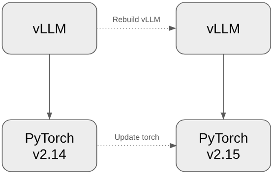
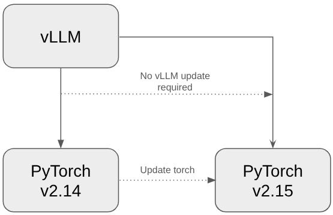
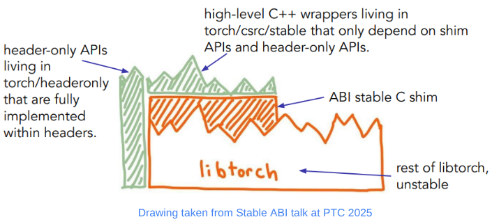
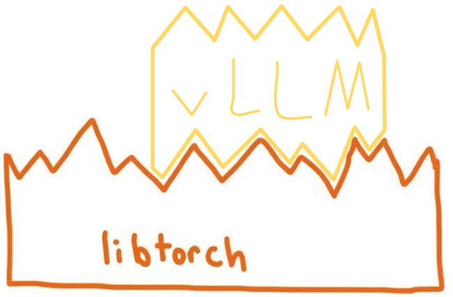
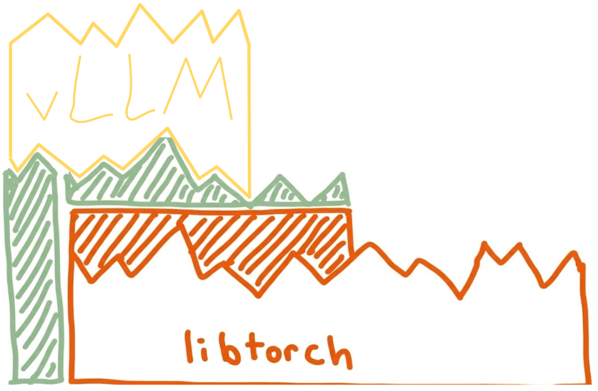
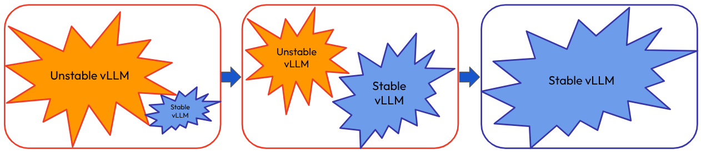

<style>
.abi-story {
  display: grid;
  grid-template-columns: minmax(0, 3fr) minmax(10.5rem, 0.7fr);
  column-gap: 2rem;
  align-items: stretch;
}
.abi-story__copy { grid-column: 1; min-width: 0; }
.abi-story__copy > :first-child { margin-top: 0; }
.abi-story__table { max-width: 100%; overflow-x: auto; }
.abi-story__timeline { grid-column: 2; position: relative; min-width: 0; }
.abi-timeline__title { margin-top: 0; }
.abi-timeline__track {
  position: absolute;
  top: 3.25rem;
  right: 0;
  bottom: 0;
  left: 0;
  border-left: 3px solid #6b7280;
}
.abi-timeline__event {
  position: absolute;
  top: var(--position);
  right: 0;
  left: -3px;
  padding-left: 1rem;
}
.abi-timeline__event::before {
  position: absolute;
  top: 0;
  left: -5px;
  width: 0.65rem;
  height: 0.65rem;
  border: 2px solid #6b7280;
  border-radius: 50%;
  background: Canvas;
  content: "";
  transform: translateY(-50%);
}
.abi-timeline__card { transform: translateY(-50%); }
.abi-timeline__event:first-child .abi-timeline__card { transform: none; }
.abi-timeline__event:last-child .abi-timeline__card { transform: translateY(-100%); }
.abi-timeline__card > :first-child { margin-top: 0; }
.abi-timeline__card > :last-child { margin-bottom: 0; }
.abi-comparison-caption { clear: both; text-align: center; }
.abi-comparison-caption,
.abi-image-caption { margin-top: 0.25rem !important; }
img[alt="Unstable import"],
img[alt="Unstable ABI diagram"],
figure:has(> img[alt="Unstable import"]),
figure:has(> img[alt="Unstable ABI diagram"]) {
  float: left;
  box-sizing: border-box;
  width: 45%;
  margin: 1rem 2% 0 3%;
  vertical-align: top;
}
img[alt="Stable import"],
img[alt="Stable ABI diagram"],
figure:has(> img[alt="Stable import"]),
figure:has(> img[alt="Stable ABI diagram"]) {
  float: left;
  box-sizing: border-box;
  width: 45%;
  margin: 1rem 3% 0 2%;
  vertical-align: top;
}
figure:has(> img[alt="Unstable import"]) > img,
figure:has(> img[alt="Stable import"]) > img,
figure:has(> img[alt="Unstable ABI diagram"]) > img,
figure:has(> img[alt="Stable ABI diagram"]) > img {
  float: none;
  display: block;
  width: 100% !important;
  height: 250px !important;
  margin: 0;
  object-fit: contain;
}
img[alt="LibTorch Stable"] {
  display: block;
  margin-right: auto;
  margin-left: auto;
  object-position: center;
}
figure:has(> img[alt="LibTorch Stable"]) {
  width: 100%;
  margin-right: auto;
  margin-left: auto;
  text-align: center;
}
figure:has(> img[alt="Unstable import"]) > figcaption,
figure:has(> img[alt="Stable import"]) > figcaption,
figure:has(> img[alt="Unstable ABI diagram"]) > figcaption,
figure:has(> img[alt="Stable ABI diagram"]) > figcaption,
figure:has(> img[alt="LibTorch Stable"]) > figcaption,
figure:has(> img[alt="vLLM migration from the unstable library to the stable library"]) > figcaption {
  display: none;
}
img[alt="vLLM migration from the unstable library to the stable library"] {
  display: block;
  margin-bottom: 0;
}
figure:has(> img[alt="vLLM migration from the unstable library to the stable library"]) {
  margin-bottom: 0 !important;
}
.abi-audit-output { overflow-x: auto; }
.abi-audit-stable { background-color: #4e7fc0; color: #0f172a; }
.abi-audit-unstable { background-color: #e74d50; color: #0f172a; }
@media (max-width: 48rem) {
  .abi-story { grid-template-columns: minmax(0, 1fr); }
  .abi-story__timeline { grid-column: 1; min-height: 110rem; margin-top: 2rem; }
}
</style>

### Introduction

vLLM relies heavily on PyTorch, with frequent calls to LibTorch in its C++ backend. As a result, changes to LibTorch’s binary interface may require vLLM to be rebuilt and relinked, even when the APIs remain unchanged. What if we could update LibTorch without rebuilding vLLM? That’s where the LibTorch Stable ABI comes in. With a LibTorch Stable ABI, updating LibTorch does not require rebuilding or updating vLLM in order to keep using it. Instead, we could swap out the torch wheel and import it directly into our vLLM package. As of v0.33.0, vLLM publishes LibTorch ABI Stable CUDA wheels.  




<p class="abi-comparison-caption"><strong>Left:</strong> <em>Unstable ABI—new torch requires vLLM to rebuild. <strong>Right:</strong> Stable ABI—vLLM can import new torch directly.</em></p>

_Note: Compatibility between vLLM and PyTorch still depends on other factors, including Python APIs, GPU-related requirements (such as the minimum supported CUDA version), and third-party dependencies. The LibTorch Stable ABI addresses binary compatibility but does not eliminate these other constraints._

### What Is the LibTorch Stable ABI?
An application binary interface (ABI) defines how compiled code interacts with a library: how functions are called, data is laid out, and symbols are named. Even if an API looks the same in source code, an ABI change can force extensions to rebuild. A stable ABI preserves a supported set of binary interfaces across compatible versions, so extensions that use them can keep working without a rebuild.

PyTorch's LibTorch Stable ABI has three layers: a stable C shim exposing selected LibTorch APIs, C++ wrappers that make the shim easier to use, and headeronly utilities in `torch::headeronly` that do not link against `libtorch.so`.



### Why Stable ABI Matters
Before the Stable ABI, a new PyTorch release could require a vLLM rebuild, delaying support for the new version and its features. With the Stable ABI, the same vLLM wheel can work across compatible PyTorch releases, letting users upgrade sooner and reducing rebuilds for package distributors. For developers, this means you can update and rebuild PyTorch, then test those changes in vLLM without rebuilding vLLM.




<p class="abi-comparison-caption"><em><strong>Left:</strong> vLLM needs to change as LibTorch changes. <strong>Right:</strong> vLLM can change independent of LibTorch.</em></p>

### Tradeoffs
The LibTorch Stable ABI is a limited subset of all of LibTorch. While many common ops are already supported through the C shim and through the higher level C++ convenience wrappers, not all are. For example, `is_pinned()` lacked a stable equivalent during the migration. Thankfully, there is a general-purpose `torch_call_dispatcher` C shim that allows us to call ATen ops through the dispatcher in an ABI stable manner! This let us maintain behavior and achieve ABI stability at the same time. This migration also helped inform PyTorch which APIs were commonly used, and in version 2.14 they added a stable C++ `is_pinned()` method.

**Before: direct LibTorch method call**

```cpp
if (cpu_tensor.is_pinned())
```

**After: ABI stable dispatcher call**

```cpp
std::array<StableIValue, 2> is_pinned_stack{
    torch::stable::detail::from(cpu_tensor),
    torch::stable::detail::from(std::nullopt)};
TORCH_ERROR_CODE_CHECK(torch_call_dispatcher(
    "aten::is_pinned", "", is_pinned_stack.data(), TORCH_ABI_VERSION));
if (torch::stable::detail::to<bool>(is_pinned_stack[0]))
```

The second tradeoff is a small amount of additional host-side overhead. The stable C shim adds type-conversion overhead and, for some wrappers that rely on `torch_call_dispatcher`, operator lookup and boxing. This overhead is usually negligible and disappears after warmup under CUDA Graphs, but it can matter in eager mode when repeatedly launching very fast kernels. We saw no noticeable runtime regression during the migration.

<div class="abi-story" markdown="1">

<div class="abi-story__copy" markdown="1">

### Migrating vLLM to the Stable ABI

We have broken down the migration to the Stable ABI into a series of steps:

1. **Assess the situation**

First, we assessed whether vLLM could migrate using the stable APIs available at the time. We inventoried its PyTorch API calls, identified gaps, and planned the stable APIs needed to fill them. This work is outlined in the original [RFC](https://github.com/vllm-project/vllm/issues/26946) for updating vLLM's CUDA build to use the LibTorch Stable ABI.

2. **Migrate AutogradFunctions and meta functions to Python**

As of today, the LibTorch Stable ABI does not support stable SymInt, so meta functions need to be written in Python instead of C++. Luckily, vLLM already had most of its meta functions in Python, so migrating the few that were not was relatively simple and made the project more consistent. Similarly, the Stable ABI does not expose PyTorch's autograd machinery, so AutogradFunctions also need to be written in Python. This matters less for an inference engine like vLLM, but if a backward function is implemented, it would need to be in Python.

3. **Set up necessary scaffolding**

Since vLLM is such a big project, with over 175 .cpp/.cu source files plus another 120+ headers in its CUDA build alone, migrating everything in one go would have been unwieldy and difficult to review. Instead, we created a separate stable library (see CMakeLists.txt updates in the first migration [PR #31509](https://github.com/vllm-project/vllm/pull/31509/changes#diff-1e7de1ae2d059d21e1dd75d5812d5a34b0222cef273b7c3a2af62eb747f9d20a)), and we migrated the kernels to this library in manageable chunks. The `TORCH_TARGET_VERSION` build flag helps keep the new library LibTorch ABI stable by causing the build to fail if it includes any unstable LibTorch headers.



<p class="abi-image-caption" style="text-align: center;"><em>As the stable library grows, the unstable library shrinks then disappears.</em></p>

4. **Make sure you register ops through the dispatcher**

As of today, registering your LibTorch Stable ops requires registration through `STABLE_TORCH_LIBRARY`. This is very familiar if you already register your ops through `TORCH_LIBRARY`, which vLLM does. The biggest difference with the new stable registration is that the implementation needs to be wrapped with `TORCH_BOX`. This generates an adapter that boxes and unboxes the C++ data types into the generic StableIValue types that can cross PyTorch’s Stable ABI.

If your kernels are registered through another mechanism, such as pybind11, we recommend first converting the registration to `TORCH_LIBRARY` before registering through `STABLE_TORCH_LIBRARY` (more on this below in the **Challenges Along the Way** section).

5. **Migrate each source file to use stable APIs**

Once steps 1–4 are in place, we can migrate each source file to stable APIs. Any PyTorch headers we include should come from the C++ stable wrappers, the headeronly utilities, or the C shim itself:

- `torch/csrc/stable`
- `torch/headeronly`
- `torch/csrc/stable/c/shim.h` (or `torch/csrc/inductor/aoti_torch/c/shim.h`)

The source file changes are mostly mechanical. For example:

- `torch::Tensor` → `torch::stable::Tensor`
- `at::kInt` → `torch::headeronly::ScalarType::Int`
- `t.view({...})` → `torch::stable::view(t, {...})`

To help migrate the source files, we created skills for AI agents that map existing APIs to their stable equivalents and flag common mistakes, such as changes unrelated to the migration. These skills also support the earlier steps (1–4). They have been useful in our work, but we have not yet developed evaluations to measure their effectiveness (see [abi-stable-skills](https://github.com/janeyx99/abi-stable-skills)).

6. **Verify!**

vLLM is used by millions of users across multiple industries, and we do not want to interrupt any of their processes with the migration. Therefore, the most important step in this list is to **verify** that the migration did not make any significant changes. This means running appropriate unit and performance tests and manually reviewing each migration diff line by line to make sure there were no unintended updates.

Along with verifying correctness, we also need to verify that the new library is actually LibTorch ABI Stable. For this, we use [torch-abi-audit](https://pypi.org/project/torch-abi-audit/) (thanks Ralf Gommers!). This tool inspects .so files and categorizes stable and unstable PyTorch symbols. If there are no unstable symbols, the library is LibTorch ABI Stable. It also reports the minimum LibTorch version that provides all the required stable symbols (for example, `min-torch=2.11.0`). We used it to track migration progress and check for regressions, and now use it in vLLM CI to ensure the wheel remains LibTorch ABI Stable.

<pre class="abi-audit-output">torch-abi-audit vllm
Package: vllm
  Root: /workspaces/vllm_container/vllm/vllm
  <span class="abi-audit-unstable">Torch ABI:   UNSTABLE</span>
  Min torch:   2.11.0
  CPython ABI: mixed
  Extensions:  10
  Bundled libs: 0
  -- extensions --
    [<span class="abi-audit-stable">STABLE</span>  ] [abi3-ok               ] _C_stable_libtorch.abi3.so  (stable_shim=88, unstable=0)  min-torch=2.11.0
    [<span class="abi-audit-unstable">UNSTABLE</span>] [abi3-ok               ] _flashmla_C.abi3.so  (stable_shim=0, unstable=70)
    [<span class="abi-audit-unstable">UNSTABLE</span>] [abi3-ok               ] _flashmla_extension_C.abi3.so  (stable_shim=0, unstable=68)
    [<span class="abi-audit-stable">STABLE</span>  ] [abi3-ok               ] _moe_C_stable_libtorch.abi3.so  (stable_shim=72, unstable=0)  min-torch=2.11.0
    [<span class="abi-audit-unstable">UNSTABLE</span>] [abi3-ok               ] _qutlass_C.abi3.so  (stable_shim=0, unstable=59)
    [NO-TORCH] [abi3-ok               ] cumem_allocator.abi3.so
    [NO-TORCH] [abi3-ok               ] spinloop.abi3.so
    [<span class="abi-audit-unstable">UNSTABLE</span>] [uses-private-api      ] third_party/deep_gemm/_C.cpython-312-x86_64-linux-gnu.so  (stable_shim=0, unstable=59)
    [<span class="abi-audit-unstable">UNSTABLE</span>] [abi3-ok               ] vllm_flash_attn/_vllm_fa2_C.abi3.so  (stable_shim=0, unstable=85)
    [<span class="abi-audit-unstable">UNSTABLE</span>] [abi3-ok               ] vllm_flash_attn/_vllm_fa3_C.abi3.so  (stable_shim=0, unstable=81)
</pre>

torch-abi-audit before the dependencies were migrated

### vLLM Build Dependencies

Migrating vLLM source alone does not establish that the entire vLLM wheel is ABI stable. For the wheel to be completely stable, its compiled dependencies must be LibTorch ABI Stable as well. vLLM currently has seven dependencies that also depend on LibTorch. These are:

<div class="abi-story__table" markdown="1">

| Dependency | Migrated on vLLM Fork | Migrated Upstream |
| --- | --- | --- |
| FlashMLA | ✅ | ✅ |
| DeepGEMM | ✅ | 🚧 Work in progress |
| FlashAttention-2 | ✅ | 🚧 PR open to make it stable |
| FlashAttention-3 | ✅ | ✅ |
| DeepSelect | ✅ | 🚧 Work in progress |
| FlashKDA | ✅ | ❌ |
| QuTLASS | N/A | ✅ |

</div>

After the in-tree vLLM code had been migrated, each of these dependencies was migrated to the LibTorch Stable ABI as well, making the entire vLLM CUDA wheel LibTorch ABI Stable.

<pre class="abi-audit-output">torch-abi-audit vllm
Package: vllm
  Root: /workspaces/vllm_container/vllm/vllm
  <span class="abi-audit-stable">Torch ABI:   STABLE</span>
  Min torch:   2.13.0
  CPython ABI: abi3
  Extensions:  13
  Bundled libs: 0
  -- extensions --
    [<span class="abi-audit-stable">STABLE</span>  ] [abi3-ok               ] _C_stable_libtorch.abi3.so  (stable_shim=88, unstable=0)  min-torch=2.11.0
    [<span class="abi-audit-stable">STABLE</span>  ] [abi3-ok               ] _deepselect_C.abi3.so  (stable_shim=40, unstable=0)  min-torch=2.10.0
    [<span class="abi-audit-stable">STABLE</span>  ] [abi3-ok               ] _flashkda_C.abi3.so  (stable_shim=43, unstable=0)  min-torch=2.11.0
    [<span class="abi-audit-stable">STABLE</span>  ] [abi3-ok               ] _flashmla_C.abi3.so  (stable_shim=66, unstable=0)  min-torch=2.11.0
    [<span class="abi-audit-stable">STABLE</span>  ] [abi3-ok               ] _flashmla_extension_C.abi3.so  (stable_shim=63, unstable=0)  min-torch=2.11.0
    [<span class="abi-audit-stable">STABLE</span>  ] [abi3-ok               ] _moe_C_stable_libtorch.abi3.so  (stable_shim=72, unstable=0)  min-torch=2.11.0
    [<span class="abi-audit-stable">STABLE</span>  ] [abi3-ok               ] _qutlass_C.abi3.so  (stable_shim=63, unstable=0)  min-torch=2.13.0
    [NO-TORCH] [abi3-ok               ] cumem_allocator.abi3.so
    [NO-TORCH] [abi3-ok               ] fs_io_C.abi3.so
    [NO-TORCH] [abi3-ok               ] spinloop.abi3.so
    [<span class="abi-audit-stable">STABLE</span>  ] [abi3-ok               ] third_party/deep_gemm/_C_extension.abi3.so  (stable_shim=85, unstable=0)  min-torch=2.11.0
    [<span class="abi-audit-stable">STABLE</span>  ] [abi3-ok               ] vllm_flash_attn/_vllm_fa2_C.abi3.so  (stable_shim=69, unstable=0)  min-torch=2.10.0
    [<span class="abi-audit-stable">STABLE</span>  ] [abi3-ok               ] vllm_flash_attn/_vllm_fa3_C.abi3.so  (stable_shim=63, unstable=0)  min-torch=2.10.0
</pre>

torch-abi-audit after dependencies were migrated

</div>

<aside class="abi-story__timeline" aria-label="Stable ABI migration timeline">
<h4 class="abi-timeline__title">Timeline</h4>
<div class="abi-timeline__track">
<div class="abi-timeline__event" style="--position: 0%;">
<div class="abi-timeline__card">
<p><strong>October 15, 2025</strong><br>RFC opened to begin discussion of migrating to the Stable ABI. <a href="https://github.com/vllm-project/vllm/issues/26946">RFC</a></p>
</div>
</div>
<div class="abi-timeline__event" style="--position: 7.9%;">
<div class="abi-timeline__card">
<p><strong>November 13, 2025</strong><br>Rewrite C++ meta funcs to Python. <a href="https://github.com/vllm-project/vllm/pull/28595">PR #28595</a></p>
</div>
</div>
<div class="abi-timeline__event" style="--position: 20.5%;">
<div class="abi-timeline__card">
<p><strong>December 29, 2025</strong><br>First migration PR opened: <a href="https://github.com/vllm-project/vllm/pull/31509">PR #31509</a></p>
</div>
</div>
<div class="abi-timeline__event" style="--position: 42.5%;">
<div class="abi-timeline__card">
<p><strong>March 19, 2026</strong><br>First migration PR closed.</p>
</div>
</div>
<div class="abi-timeline__event" style="--position: 58.1%;">
<div class="abi-timeline__card">
<p><strong>May 2026</strong><br>Creation of <a href="https://github.com/janeyx99/abi-stable-skills">abi-stable-skills</a></p>
</div>
</div>
<div class="abi-timeline__event" style="--position: 66.6%;">
<div class="abi-timeline__card">
<p><strong>June 2026</strong><br>12+ more PRs were merged, making vLLM's in-tree code LibTorch ABI Stable.</p>
</div>
</div>
<div class="abi-timeline__event" style="--position: 78.4%;">
<div class="abi-timeline__card">
<p><strong>July 27–29, 2026</strong><br>First PRs to migrate DeepGEMM off pybind11 and onto the Stable ABI opened.</p>
</div>
</div>
<div class="abi-timeline__event" style="--position: 91.8%;">
<div class="abi-timeline__card">
<p><strong>July–September 2026</strong><br>FlashMLA, QuTLASS, FlashAttention 2, FlashKDA, FlashAttention 3, and DeepSelect moved to the Stable ABI.</p>
</div>
</div>
<div class="abi-timeline__event" style="--position: 100%;">
<div class="abi-timeline__card">
<p><strong>October 15, 2026</strong><br>DeepGEMM migrated; the vLLM CUDA wheel became LibTorch ABI Stable.</p>
</div>
</div>
</div>
</aside>

</div>

### Challenges Along the Way

The biggest challenge was keeping pace with a large, rapidly changing project. Upstream files often changed while our migration patches were in progress, so we had to update those patches before they could merge. vLLM’s external dependencies also meant coordinating across projects and building support for the migration.

#### DeepGEMM: A Migration Case Study

DeepGEMM brought several of these challenges together. While our migration was in progress, DeepGEMM moved from version 1 to version 2 and added DeepJIT, another LibTorch-dependent project that also needed to be migrated. vLLM then switched from the upstream `deepseek-ai/DeepGEMM` repository to its own `vllm-project/DeepGEMM` fork, requiring us to redo the migration on the new fork.

Those upstream changes were only part of the challenge. Because DeepGEMM registered its operators through pybind11, we also needed to move its registration to `TORCH_LIBRARY` before adopting the Stable ABI. For example, the original binding of `fp8_fp4_paged_mqa_logits` was:

```cpp
m.def("fp8_fp4_paged_mqa_logits", &fp8_fp4_paged_mqa_logits,
      py::arg("q"), ...,
      py::arg("max_context_len"), ...);
```

where `q` is a `std::tuple<Tensor, std::optional<Tensor>>&` and `max_context_len` is a `const int&`. To make these arguments compatible with `TORCH_LIBRARY`, we added a wrapper that accepts the tuple elements separately and uses `int64_t` in its C++ signature:

```cpp
static torch::Tensor fp8_fp4_paged_mqa_logits(
    const torch::Tensor& q, const c10::optional<torch::Tensor>& q_sf, ...
    const int64_t& max_context_len, ...) {
  return attention::fp8_fp4_paged_mqa_logits(
      std::make_tuple(q, q_sf), ...,
      static_cast<int>(max_context_len), ...);
}
```

This can now be registered with `TORCH_LIBRARY` as:

```cpp
TORCH_LIBRARY_FRAGMENT(deep_gemm, m) {
    m.def("fp8_fp4_paged_mqa_logits(Tensor q, Tensor? q_sf, ..., int max_context_len, ...) -> Tensor");
}

TORCH_LIBRARY_IMPL(deep_gemm, CUDA, m) {
    m.impl("fp8_fp4_paged_mqa_logits", TORCH_FN(fp8_fp4_paged_mqa_logits));
}
```

The Python interface unpacks the tuple before calling the registered operator:

```python
def fp8_fp4_paged_mqa_logits(q, ..., max_context_len, ...):
    q_fp, q_sf = q[0], q[1]
    return _torch_ops.fp8_fp4_paged_mqa_logits(
        q_fp, q_sf, ..., max_context_len, ...)
```

This lets the registration use `TORCH_LIBRARY` without changing the user-facing API.

After DeepGEMM was migrated to TORCH_LIBRARY, the Stable ABI migration followed a similar process as the other migrations. We replaced its unstable APIs and updated the operator registrations:

```cpp
STABLE_TORCH_LIBRARY_FRAGMENT(deep_gemm, m) {
    m.def("fp8_fp4_paged_mqa_logits(Tensor q, Tensor? q_sf, ..., int max_context_len, ...) -> Tensor");
}

STABLE_TORCH_LIBRARY_IMPL(deep_gemm, CUDA, m) {
    m.impl("fp8_fp4_paged_mqa_logits", TORCH_BOX(fp8_fp4_paged_mqa_logits));
}
```

Because DeepGEMM was vLLM’s final build dependency to be migrated, completing this work made the entire vLLM wheel LibTorch ABI Stable!

### Example Run on Newer PyTorch

```python
# stable_abi_demo.py
import os

os.environ.setdefault("VLLM_USE_FLASHINFER_SAMPLER", "0")

import torch
import vllm
from vllm import LLM, SamplingParams

print(f"PyTorch runtime: {torch.__version__}")
print(f"vLLM: {vllm.__version__}")

llm = LLM(
    model="HuggingFaceTB/SmolLM2-135M-Instruct",
    max_model_len=128,
    gpu_memory_utilization=0.1,
    enforce_eager=True,
)
outputs = llm.generate(
    ["The capital of France is"],
    SamplingParams(temperature=0, max_tokens=8),
)
print(outputs[0].outputs[0].text)
```

Build vLLM and run the demo with PyTorch 2.14.1:

```text
> python stable_abi_demo.py

PyTorch runtime: 2.14.1+cu132
vLLM: 0.1.dev24716+gcb95d994f.d20261105
Paris. Paris is a city known for
```

Update the PyTorch wheel to `torch==2.15.0`:

```shell
uv pip install torch==2.15.0 \
  --index-url https://download.pytorch.org/whl/cu132
```

Rerun demo without rebuilding vLLM:

```text
> python stable_abi_demo.py

PyTorch runtime: 2.15.0+cu132
vLLM: 0.1.dev24716+gcb95d994f.d20261105
Paris. Paris is a city known for
```

_Note: Routine vLLM initialization logs, progress bars, and unrelated deprecation warnings have been omitted from the outputs above for clarity._

### Future Work

Now that vLLM’s CUDA build uses the LibTorch Stable ABI, our next steps are to make all of vLLM’s builds ABI stable, including the CPU and ROCm builds. These migrations are smaller than the CUDA migration but remain important to the vLLM ecosystem. The ROCm build shares many source files with the CUDA build: hipify converts `.cu` files to `.hip` files, so these files already use the LibTorch Stable ABI. Only a few ROCm-specific files remain to be migrated.

We are also expanding the stable API surface so that vLLM and its dependencies no longer need wrappers. As the API surface grows, we will also be updating PyTorch’s upstream tests to ensure the APIs remain LibTorch ABI Stable.

### Acknowledgement to main contributors

- **vLLM Community:** [Shengqi Chen](https://github.com/Harry-Chen) (main coordinator), [Jiangyun Zhu](https://github.com/ZJY0516) (DeepSelect fork migration), [Thien Tran](https://github.com/gau-nernst) (FlashKDA fork migration), [Roberto L. Castro](https://github.com/LopezCastroRoberto) (upstream QuTLASS migration), [Kaichao You](https://github.com/youkaichao) (roadmap), and all maintainers who reviewed our PRs and provided suggestions.
- **PyTorch Community:** [Jane Xu](https://github.com/janeyx99) (project lead, FlashMLA migration in both fork and upstream, [abi-stable-skills](https://github.com/janeyx99/abi-stable-skills) project), [Chris Leonard](https://github.com/cleonard530) (major migration work), [Mikayla Gawarecki](https://github.com/mikaylagawarecki) (early-stage migration work for in-tree sources), [Ralf Gommers](https://github.com/rgommers) ([torch-abi-audit](https://pypi.org/project/torch-abi-audit/) project).
- **DeepSeek:** [Chenggang Zhao](https://github.com/LyricZhao), [Yichen Yan](https://github.com/oraluben), [Shengyu Liu](https://github.com/interestingLSY).
