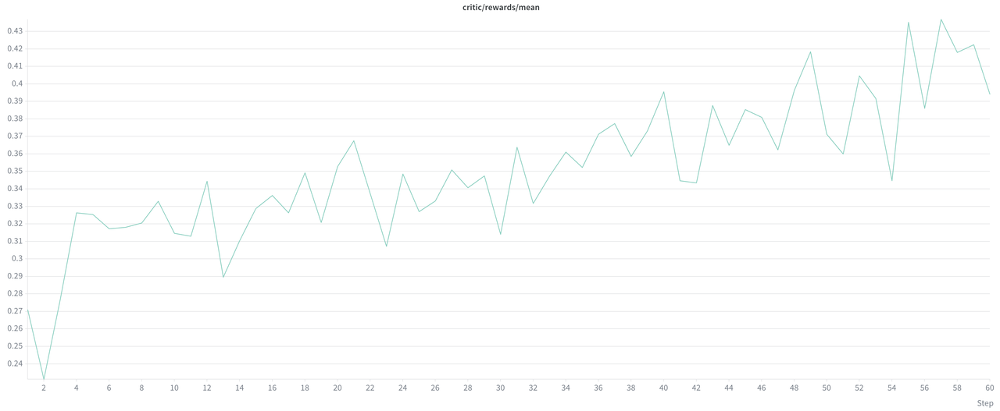
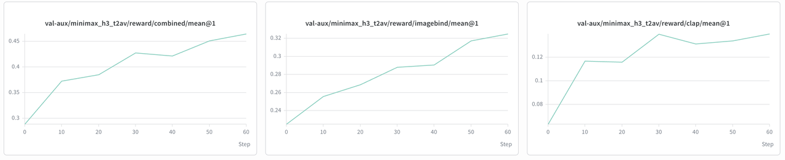
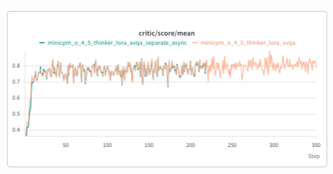
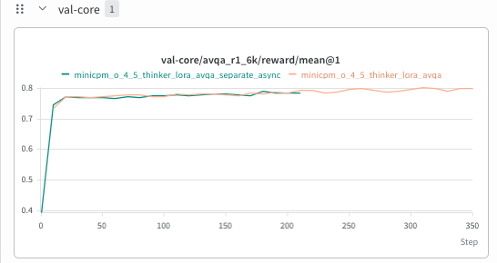

Following our [August v0.2.0 release](https://vllm.ai/blog/2026-08-20-verl-omni-v0-2-0), [VeRL-Omni](https://github.com/verl-project/verl-omni) **v0.3.0** widens what you can train with reinforcement learning in a single, unified stack. This release brings asynchronous execution to more multimodal RL workloads, makes the V1 trainer the default for everyone, and expands post-training coverage across image, video, audio, and multimodal understanding. Building on v0.2.0's rollout batching and reusable model adapters, the focus this time is on making the whole pipeline work *together*: generation, reward evaluation, policy updates, and weight synchronization.

Two end-to-end recipes show what that means in practice: **MiniMax H3 audio-video post-training with DiffusionNFT**, and **MiniCPM-o 4.5 GSPO with colocated-sync or separate-async execution**. Together they demonstrate an important design principle: the right execution mode depends on your workload. Overlapping rollout and training helps only when that overlap pays for the resources assigned to each role — and now you have the tools to measure exactly that.

**Release:** [v0.3.0 release notes](https://github.com/verl-project/verl-omni/releases/tag/v0.3.0) · **Code:** [verl-omni](https://github.com/verl-project/verl-omni) · **Previous release:** [v0.2.0 blog](https://vllm.ai/blog/2026-08-20-verl-omni-v0-2-0)

## 1. Async and Decoupled RL Execution

Multimodal RL has several expensive stages, each with different resource needs. An autoregressive model can spend a long time generating responses; a diffusion model runs repeated denoising steps; audio-video rewards add decoding and scorer inference on top. A strictly alternating loop leaves one role idle while another works. v0.3.0 breaks that bottleneck open with a richer set of execution paths:

- **Fully asynchronous rollout** now extends Qwen3-Omni training to text and audio-input workloads, using the supported FSDP recipes identified in the release notes.
- **Separate-async Omni training** places the actor and rollout engine on separate GPU pools. A replay buffer connects generation and training, while configurable synchronization intervals control how often rollout workers receive policy updates.
- **Separate-async diffusion training** gains from weight synchronization and dynamic hybrid rollout switching. When the replay buffer runs low, colocated actor replicas can be lent to rollout and reclaimed for training on demand.
- **Diffusion on-policy distillation (OPD)** gains asynchronous teacher scheduling and standalone teacher routing, so teacher execution can be managed independently of the actor.

The point of these changes is *choice*, not a one-size-fits-all prescription. The MiniCPM-o case study below shows why GPU partitioning, generation length, and the trainer's critical path should always be measured together.

## 2. A Shared V1 Training Foundation

The V1 trainer, built around **TransferQueue and ReplayBuffer**, is now the default. v0.3.0 extends V1 synchronous recipes across diffusion models while strengthening the handoff between rollout and training: grouped trajectories are written together, unnecessary data reads are reduced, and scheduling and batch ordering receive additional validation.

The rollout stack moves to **vLLM 0.30.0 and vLLM-Omni 0.30.0**. Lifecycle changes make request cancellation and policy updates more explicit: requests are aborted before pausing, sleep/wake transitions require acknowledgements, and weight-update failures propagate to callers. That matters when generation, memory reclamation, and weight synchronization repeatedly cross execution boundaries.

For diffusion workloads, prompt embedding caching avoids repeated encoding, and rollout sequence parallelism and VAE parallelism expose additional scaling controls. Named media artifacts make image, video, audio, and latent outputs explicit, so rewards and exporters consume declared outputs instead of inferring modalities from tensor shapes.

## 3. Recipes and Training Results

### 3.1 MiniMax H3: Joint Audio-Video Post-Training

MiniMax H3 generates video and audio jointly, and its post-training pipeline has to preserve both modalities through generation, reward evaluation, actor updates, and export. v0.3.0 adds H3 training coverage with FlowGRPO and DiffusionNFT — here we focus on the DiffusionNFT **T2VA** and **FL2VA** case study.

**T2VA** generates audio-video from text. **FL2VA** adds first- and/or first-frame conditioning (`FRAME_INDICES='[0]'`). Both use vLLM-Omni for rollout, Diffusers/FSDP2 for actor training, and VeRL-Omni for orchestration, rewards, and policy synchronization. In FL2VA, conditional-frame latents stay fixed while the objective trains the generated content.

DiffusionNFT applies reward-guided optimization through a forward-process training objective, avoiding the need to retain transition log-probabilities for every reverse denoising step. The case study scores with CLAP for text-audio alignment and ImageBind reward (under CC-BY-NC-SA) for audio-video correspondence.

The pipeline keeps two paths separate. The vLLM-Omni rollout engine generates audio-video from the prompt — plus fixed first- and last-frame latents for FL2VA — and routes the decoded media to the reward scorers (CLAP for text-audio alignment, ImageBind for audio-video correspondence). In parallel, the clean latents and conditioning metadata flow to the Diffusers/FSDP2 actor for training.

The T2VA example script set its defaults to `ROLLOUT_TP=2` and `ROLLOUT_N=16`. The FL2VA example script uses rollout `ROLLOUT_TP=4` and `ROLLOUT_N=16`. The table below reports the launcher defaults; they describe that case study's configuration rather than a performance comparison between release versions. Both DiffusionNFT launchers pass `trainer.use_v1=false`.

| Setting | T2VA | FL2VA |
|---|---|---|
| GPUs / rollout tensor parallelism | 8 / TP=2 | 8 / TP=4 |
| Samples per prompt | 16 | 16 |
| Training / validation resolution | 256×384 / 512×768 | 288×448 / 576×928 |
| Frames | 121 | Requested 96, aligned to 107 by the pipeline |
| Rollout / validation denoising steps | 10 / 40 | 10 / 40 |
| LoRA rank / alpha | 64 / 128 | 64 / 128 |
| Reward | CLAP + ImageBind | CLAP + ImageBind |

In the reported T2VA run, `critic/rewards/mean` starts near **0.27** and moves upward over roughly 60 steps, close to **0.4**.

<div align="center">
  
  <br/>
  <small>Reported T2VA training reward.</small>
</div>

> [!NOTE]
> The upward reward trend demonstrates optimization of the selected reward signal; it is not, by itself, evidence of a general improvement in visual quality or temporal consistency. Component-level validation rewards and fixed-sample outputs below provide the complementary checks.

<div align="center">
  
  <br/>
  <small>Read CLAP, ImageBind, and combined validation rewards together, rather than treating the aggregate as a complete quality assessment.</small>
</div>

The case study compares base and trained outputs using the same prompts, seeds, and inference settings. One example uses the prompt: *"17th century sailing ship making a path through the waves during a storm."*

<div align="center">
  <video autoplay loop muted playsinline controls preload="metadata" width="48%">
    <source src="/assets/figures/2026-11-06-verl-omni-v0-3-0/minimax-h3-ship-base.mp4" type="video/mp4">
  </video>
  <video autoplay loop muted playsinline controls preload="metadata" width="48%">
    <source src="/assets/figures/2026-11-06-verl-omni-v0-3-0/minimax-h3-ship-diffusionnft.mp4" type="video/mp4">
  </video>
  <br/>
  <small>Left: MiniMax H3 base. Right: MiniMax H3 + DiffusionNFT.</small>
</div>

*Qualitative example reproduced from the reference article, not a comprehensive benchmark. These previews are silent and cannot demonstrate audio quality or synchronization.*

The integration also highlights why train-inference consistency needs explicit validation. H3's training and rollout engines use different weight layouts, requiring LoRA mappings into fused inference projections. Its timestep and velocity conventions need model-specific handling. And audio must reach both the reward models and the exported outputs. A changing loss or reward curve cannot establish all three on its own.

You can start with the [v0.3.0 H3 DiffusionNFT recipe](https://github.com/verl-project/verl-omni/blob/v0.3.0/examples/diffusionnft_trainer/minimax_h3/README.md).

### 3.2 MiniCPM-o 4.5: GSPO, Sync vs. Separate-Async

MiniCPM-o 4.5 Thinker training brings Group Sequence Policy Optimization (GSPO) to audio-visual question answering (AVQA). The separate-async recipe places the FSDP actor and vLLM-Omni rollout workers on dedicated pools, with generation running ahead through a replay buffer.

**Training quality.** [PR #629](https://github.com/verl-project/verl-omni/pull/629) reports closely matching early convergence: score at step 13 is **0.764 for separate-async vs. 0.762 for colocated sync**, and validation reward at step 10 is **0.747 for both**. The attached curves show similar behavior over their overlapping training window.

<div align="center">
  
  <br/>
  <small>Training mean score vs. training step. Teal: separate-async; orange: colocated sync. The sync run continues beyond the displayed async run.</small>
</div>

<div align="center">
  
  <br/>
  <small>Validation reward vs. training step. These curves support comparable learning behavior over the shared window; they do not measure time to target quality.</small>
</div>

**Execution efficiency.** A follow-up experiment probes the placement decision by forcing response length. On a single node of **4 × H800 80 GB**, at constant learning rate, it compares **colocated 4+0 (2×TP2)** on the **128** batch size against **separate-async 3+1 (1×TP1)** on the documented **120 = 8 × 15** reshape — the two arms do not share a batch size, because with `rollout.n=16` no divisor of 128 is divisible by 3.

| Mean response length (tokens) | Colocated 4+0 (2×TP2) | Separate-async 3+1 (1×TP1) |
|---|---:|---:|
| ~101 (natural) | 194.8 s | 199.5 s · tie |
| 512 (forced) | 259.7 s | 244.7 s · wins −5.8% |
| 1024 (forced) | 360.1 s | 314.9 s · wins −12.6% |

*Steady-state seconds per step, each cell the mean over 20 consecutive steps (steps 3–22) of a single run — consecutive steps, not independent trials. Length tiers forced via `rollout.ignore_eos=True` + `max_response_length=N`.*

On short, natural answers the two placements are effectively tied. **Separate-async 3+1 overtakes colocated somewhere between the ~101-token natural tier and the 512-token tier**, and the margin widens with generation share — 5.8% faster at 512 tokens, 12.6% faster at 1024.

The practical guidance follows from that experiment. For trainer-bound workloads with short answers, colocated sync remains the right default; when responses grow long and the model admits TP1 rollout replicas, separate-async with a 3+1-style split wins, and its advantage grows with length.

Launch the tagged recipe after preparing the model and AVQA data described in the [recipe documentation](https://github.com/verl-project/verl-omni/blob/v0.3.0/examples/gspo_trainer/README.md):

```bash
bash examples/gspo_trainer/minicpm/run_minicpmo_4_5_thinker_gspo_lora_avqa_separate_async_v1.sh
```

## 4. Model and Algorithm Extensions

The release expands both new integrations and existing model families. Each row identifies the specific addition; an existing model receiving a new recipe is not counted as a new model.

| Model / scope | v0.3.0 addition | Reference |
|---|---|---|
| MiniMax H3 | FlowGRPO and DiffusionNFT for text-, keyframe-, and reference-conditioned audio-video generation; GPU and Ascend NPU recipes | [FlowGRPO #368](https://github.com/verl-project/verl-omni/pull/368), [DiffusionNFT #383](https://github.com/verl-project/verl-omni/pull/383) |
| BOOGU-Image | FlowGRPO for text-to-image and editing; DiffusionNFT, including a CFG-free Pick-a-Pic recipe | [#332](https://github.com/verl-project/verl-omni/pull/332), [#765](https://github.com/verl-project/verl-omni/pull/765) |
| MiniCPM-o 4.5 | Thinker AVQA GSPO, separate-async GSPO, and offline DPO for image-only/audio-only preference batches | [#572](https://github.com/verl-project/verl-omni/pull/572), [#629](https://github.com/verl-project/verl-omni/pull/629), [#550](https://github.com/verl-project/verl-omni/pull/550) |
| Qwen3-TTS | GRPO, a Hindi SFT-LoRA/GRPO recipe, and a generic Talker RL interface | [#428](https://github.com/verl-project/verl-omni/pull/428), [#590](https://github.com/verl-project/verl-omni/pull/590) |
| FLUX.1-dev | DanceGRPO training | [#532](https://github.com/verl-project/verl-omni/pull/532) |
| LTX-2.3 | V1 sync FlowGRPO recipes and T2AV OmniNFT LoRA on Ascend NPU | [#574](https://github.com/verl-project/verl-omni/pull/574), [#750](https://github.com/verl-project/verl-omni/pull/750) |
| Qwen3-Omni | Expanded async, DAPO, OPD, NPU GSPO, and Megatron recipe coverage; supported async paths use FSDP | [Release support details](https://github.com/verl-project/verl-omni/releases/tag/v0.3.0) |
| SD3.5 | Direct Group Preference Optimization (DGPO), with a V1 OCR LoRA recipe | [#733](https://github.com/verl-project/verl-omni/pull/733) |
| Diffusion distillation | Standalone DMD2 loss and configuration | [#545](https://github.com/verl-project/verl-omni/pull/545) |
| Diffusion OPD | Asynchronous teacher scheduling and standalone teacher routing | [#427](https://github.com/verl-project/verl-omni/pull/427), [#495](https://github.com/verl-project/verl-omni/pull/495) |
| Qwen-Image / Qwen-Image-Edit / Wan2.2 | Broader V1 sync recipe coverage for existing algorithms | [Release recipe list](https://github.com/verl-project/verl-omni/releases/tag/v0.3.0) |

Hardware coverage also grows: a unified Ascend Dockerfile covers A2, A3, and A5, and an AMD ROCm Dockerfile and installation guide are added. Availability remains recipe-specific. VeOmni backend integrations add further actor-training options for Qwen-Image and Qwen3-Omni.

## 5. Getting Started and Upgrade Notes

Pick a [v0.3.0 recipe](https://github.com/verl-project/verl-omni/tree/v0.3.0/examples) for your model, task, and hardware, then follow the matching installation instructions. If you are reusing an older launcher, check these changes first:

- **Trainer:** V1 is the default (`trainer.use_v1=true`); legacy V0 is deprecated. Legacy entrypoints require explicit `trainer.use_v1=false`; use migrated recipes where available.
- **Offline DPO stays on v0:** it keeps running on the v0 trainer ([#650](https://github.com/verl-project/verl-omni/pull/650)), so it also requires explicit `trainer.use_v1=false` — including the MiniCPM-o 4.5 offline-DPO recipe in the table above, not only unmigrated legacy scripts.
- **Named diffusion media artifacts:** unlabelled diffusion rollout tensors are now rejected ([#557](https://github.com/verl-project/verl-omni/pull/557)). Custom rollout adapters and reward clients that read the old raw payload must move to the named artifact contract (`media_artifact__<name>` and `metadata.media_artifacts`).
- **Attention backends fail closed:** a missing FlashAttention kernel errors at startup instead of silently falling back to native/SDPA attention ([#530](https://github.com/verl-project/verl-omni/pull/530)). Install the missing kernel dependencies, or explicitly select a supported attention backend.
- **Dependencies:** use vLLM **0.30.0**, vLLM-Omni **`12e9280`**, Python **3.11+**, Diffusers **0.40.0+**, and the release's CUDA **13.0+** stack. The earlier v0.3.0rc1 engine pin is unsupported. Ascend users should follow the updated pinned environment.
- **Qwen3-Omni launchers:** use `verl_omni.trainer.main_omni` and current recipes. The old `verl.trainer.main_ppo` launchers and legacy monkey-patches have been removed.

See the [complete migration details](https://github.com/verl-project/verl-omni/releases/tag/v0.3.0#breaking-changes), then try a recipe, compare quality and wall-clock behavior for your workload, and share results or contributions through the [project repository](https://github.com/verl-project/verl-omni).
