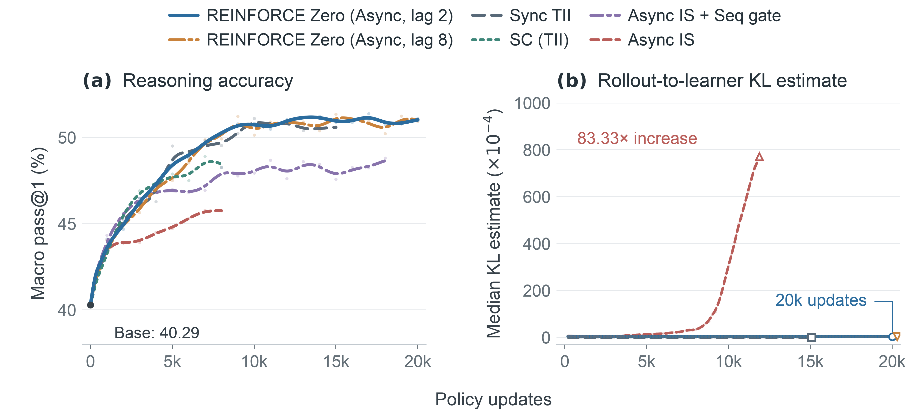

**TL;DR**

- Asynchronous RL is faster, but it trains on samples generated by older weights.
- The rollout-to-learner gap has two parts. Weight lag changes smoothly and unclipped importance sampling (IS) controls it. Kernel mismatch, where rollout and training compute different numbers for the same weights, fluctuates and persists despite IS.
- Align the kernels, and unclipped IS corrects the remaining weight lag without sample-rejection gates. [REINFORCE Zero](https://github.com/hijkzzz/REINFORCE-Zero) (NVIDIA Research and Inferact) trains stably for **20,000 updates**, learns at **policy lag 64**, and reaches **2.40×** the training-step throughput of synchronous training with aligned kernels.
- Zero mismatch now covers **DeepSeek-V4.1-Flash** (2.3–7.2% longer DAPO rollout step), **Kimi K3.1** on day 0, and both DeepSeek-V4-Flash and Kimi K3.1 on **AMD MI355X**.
- Everything is in [Inferact/zero-mismatch-rl](https://github.com/Inferact/zero-mismatch-rl).

## 1. From synchronous to asynchronous

Last month, [we showed](https://vllm.ai/blog/2026-10-14-train-inference-consistency) that rollout and training can agree exactly. On DeepSeek-V4-Flash, vLLM and the trainer produced the same logprob for every sampled token, bit for bit, on the fast kernels, with an 8.7% reduction in rollout throughput. An agent skill now does the alignment for each new model.

That post was about synchronous RL, which has no weight lag, so zero mismatch removes the only gap between rollout and training. This post is about asynchronous RL, which is faster but off-policy by design. Does zero mismatch still matter there?

We answer with a new paper from NVIDIA Research and Inferact (Jian Hu et al.): [REINFORCE Zero: Kernel Alignment Unlocks Stable Asynchronous RL with Importance Sampling](https://github.com/hijkzzz/REINFORCE-Zero). All numbers in sections 2 to 4 come from it.

## 2. Asynchronous RL: faster, but off-policy

In synchronous RL, rollout and training take turns, and each waits for the other. Asynchronous RL runs them at the same time: rollout keeps generating while the learner updates.

The price is **weight lag**. A sample generated with weights version v is trained at version k > v. The gap k − v is not small: REINFORCE Zero runs at lag 2 and 8 on math reasoning, and at lag 64 on agentic tool use.

So the learner always trains on samples from an older policy. The standard correction is importance sampling (IS): reweight each token by π / μ, the learner's probability for it divided by the probability the rollout recorded when it sampled it. The question is whether that correction covers the whole gap.

## 3. Two gaps that behave differently

The logprob gap between learner and rollout splits into two terms:

```
log π_θk − log μ_v  =  (log π_θk − log π_θv)  +  (log π_θv − log μ_v)
                        weight lag                kernel mismatch
```

π is the learner's computation and μ is the rollout engine's. The second term compares the two at the same weights θv.

**Weight lag changes smoothly.** It telescopes over the most recent updates, and when each update is small it follows a smoothly changing policy trajectory. This is the gap IS is meant to correct.

**Kernel mismatch fluctuates.** It depends on batch composition and numerical execution, so it introduces fluctuations even when rollout and learner use identical weights.

<iframe class="vllm-embed" src="/assets/interactive_pages/zero-mismatch-async-two-mismatches.html" title="Peak-to-median ratio of importance-weight deviation D3: 1.50× with aligned kernels, 442.54× with standard kernels" loading="lazy" scrolling="no" style="display: block; width: 100%; height: 420px; border: 0; overflow: hidden;"></iframe>

*Figure 1: Peak-to-median ratio of the importance-weight deviation D3, log scale, for two asynchronous runs on DeepSeek-R1-Distill-Qwen-1.5B: REINFORCE Zero with aligned kernels and IS with standard kernels. Source: REINFORCE Zero, Table 2.*

The REINFORCE Zero paper measures this with D3, the per-update average of w − 1 − log w over tokens, where w is the importance weight. Each token's term is 0 when w = 1 and grows as w moves away from 1. With aligned kernels, D3 peaks at 1.50× its median: unclipped IS keeps the remaining weight-lag mismatch smooth and controlled. With standard kernels, it peaks at 442.54×: large importance-weight fluctuations persist despite IS.

**So remove the kernel term first.** Then what remains is weight lag, and plain unclipped IS corrects it, with no truncation and no rejection gates.

## 4. REINFORCE Zero

REINFORCE Zero is the recipe that follows from section 3. It has three parts.

### The recipe

1. **Align the kernels.** The rollout and the learner compute the same logprob for the same weights and tokens, as in our last post. The kernel term is exactly 0, so whatever gap remains is weight lag.
2. **Correct weight lag with token-level IS, unclipped.** The rollout already records the logprob of every token it samples. The learner divides its own probability by that recorded one and uses the ratio as is: no truncation, no filtering.
3. **Optimize plain REINFORCE.** Each response's advantage is its reward minus the mean reward of its group. Tokens are averaged within a response. No value model, no rejection gates.

For a batch of B responses, with A_i the advantage of response i:

```
L(θ) = − (1/B) Σ_i (1/T_i) Σ_t  A_i · π_θ(a_it | h_it) / μ_i(a_it | h_it)
```

That is the whole algorithm.

### Why unclipped IS

At a fixed history, weighting each sampled token by the exact ratio w = π / μ makes the expected update equal the update under the current policy. Clipping the weights generally introduces bias.

A correct mean gradient is not enough for stable training. In a Gaussian model, the paper derives the exact update error and shows that mismatch amplifies update variance and narrows the stable step-size range, even under unbiased IS: the same step size learns with no mismatch and loses reward with it. The experiments point to kernel mismatch as the source of large excursions (Figure 1), so removing it is what lets unclipped IS stay stable.

### What happens without alignment

The paper runs the same asynchronous IS with standard kernels:

- The median rollout-to-learner KL rises **83.33×** between the first and last 1,000 updates, and online AIME24 pass@1 falls from 34.27% to 13.96%. With aligned kernels it stays flat.
- The largest gradient norm before clipping reaches **38.27**, against **0.0555** with aligned kernels.
- Adding a sequence gate stabilizes training, but by the last 1,000 updates it rejects **24.48%** of sequences. REINFORCE Zero rejects none.

### Results

| Setting | Result |
|---|---|
| Throughput, 16 GPUs, 12K updates | **2.40×** the training-step throughput of synchronous training with aligned kernels (68.55 vs 164.77 hours), comparable quality |
| 20K-update reasoning, DeepSeek-R1-Distill-Qwen-1.5B | Stable at lag 2 and 8; rollout-to-learner KL stays flat |
| High lag, Qwen3-4B + Python tools | Learns at **lag 64** for 6,000 updates; mean reward 0.287 → 0.782 |
| MoE with tools, Qwen3-30B-A3B | Macro pass@1 31.29% → 71.55% in 3,000 updates |
| Computer use, Nemotron-3-Nano-Omni-30B on OSWorld | Pass@1 50.97% → 56.16% after 428 updates |

On the 1.5B reasoning task at 6,000 updates, the variants line up as the analysis predicts:

| Recipe | Aligned kernels | Async | Macro pass@1 |
|---|:---:|:---:|---:|
| Base model | — | — | 40.29% |
| Synchronous | ✓ | | 48.91% |
| IS | | ✓ | 45.32% |
| IS + sequence gate | | ✓ | 46.79% |
| IS + token gate | | ✓ | 44.59% |
| Score Centering, no IS | ✓ | ✓ | 47.50% |
| **REINFORCE Zero, lag 2** | ✓ | ✓ | **48.80%** |
| **REINFORCE Zero, lag 8** | ✓ | ✓ | **48.53%** |

Asynchronous REINFORCE Zero matches synchronous training. Every standard-kernel variant falls behind, whichever correction it uses; with aligned kernels, Score Centering without IS lands in between.



*Figure 2 (REINFORCE Zero, Figure 1). Left: macro pass@1. Right: rollout-to-learner KL. Standard-kernel IS drifts upward; REINFORCE Zero stays flat through 20,000 updates.*

### What alignment costs here

Aligned kernels are slower than the fastest standard ones. On OSWorld, REINFORCE Zero's mean step takes 944.25 s against 884.17 s for standard-kernel IS with a sequence gate, 6.8% more. The paper's models were aligned with the agent skill from our last post; the training code is in [NVIDIA-NeMo/labs-molt](https://github.com/NVIDIA-NeMo/labs-molt).

## 5. Flagship models: DeepSeek-V4.1 and Kimi K3.1

REINFORCE Zero starts from aligned kernels, and every new model brings new operators to align. Since the last post, two flagship releases reached zero mismatch: DeepSeek-V4.1-Flash, and Kimi K3.1 on its release day. The runs below validate alignment on these models; long asynchronous runs on them are next.

Throughout, diff 0 means the rollout and the trainer compute the same logprob for every sampled token, bit for bit.

### DeepSeek-V4.1-Flash, at release precision

The consistent path keeps release precision end to end: FP8 and MXFP4 weights, MegaMoE, sparse attention with sliding window, and DSpark speculative decoding, with CUDA graphs. The Megatron-LM trainer (mLite, by Yan Bai of NVIDIA DevTech) calls the rollout's own kernels in the same order. The key operator is the sliding window under prefix caching: agentic RL needs the prefix cache on, and a cache hit must give the same logprobs as a miss.

On 16 nodes × 4 GB200, SWE-bench Pro agentic RL at 128K context stayed at diff 0 at every step. For DAPO math rollout, with 128 trajectories per node and responses up to 8K tokens, the consistent rollout step takes **2.3–7.2%** longer.

### Kimi K3.1, on day 0

Kimi K3.1 launched with [day-0 vLLM support](https://vllm.ai/blog/2026-11-04-kimi-k31-pro), zero-mismatch RL included. The hard part was KDA linear attention: prefill computes it chunk by chunk and decode token by token, and the two round differently. Decode now repeats prefill's arithmetic for the same chunk row, so prefill, decode and the trainer agree, for the base model and for a LoRA adapter on every module. On 4 nodes × 4 GB300, 100 DAPO steps with LoRA stayed at diff 0 and AIME 24/25/26 mean@8 rose from 0.451 to 0.664. Performance optimization is ongoing.

## 6. Beyond NVIDIA: AMD MI355X

Zero mismatch is a property of the kernels, not of one vendor. On MI355X, as on NVIDIA, the trainer's forward calls vLLM's own modules and kernels, and `VLLM_BATCH_INVARIANT` switches between the consistent and the fast version.

**DeepSeek-V4-Flash** held diff 0 for 36 GRPO steps on 4 nodes × 8 MI355X, including across a resume. Batch-invariant mode alone changed nothing at first: bisection found ten sources of batch variance. Half were libraries choosing kernels by shape (hipBLASLt, AITER/CK, Triton, TileLang); the rest included the indexer's top-k, decode using a different kernel from prefill, and an expert-parallel combine that summed ranks in arrival order. Bit-preserving optimizations then cut the serving-throughput loss from 62–66% to 7.4–10.1%. Recipe and image: [verl#8505](https://github.com/verl-project/verl/pull/8505).

**Kimi K3.1** runs the GB300 setup (LoRA r32 on every layer including experts, frozen MXFP4 base) on 2 nodes × 8 MI355X, at diff 0 every step, checked token by token. It needed two fixes: route the trainer's bmm and indexer linear away from hipBLASLt, which picks a different tile at 4,096 rows than at 4,097; and deduplicate KDA state-slot writes after wake-up, where an eviction and a reuse could write the same slot in one step. A bit-preserving MoE path cut the RL step from about 2,300 s to 1,350 s; the cost against the fast baseline is still being measured. Recipe and patches: draft [verl#8574](https://github.com/verl-project/verl/pull/8574).

## 7. Open source

REINFORCE Zero: the paper and code are at [hijkzzz/REINFORCE-Zero](https://github.com/hijkzzz/REINFORCE-Zero), and the training code is in [NVIDIA-NeMo/labs-molt](https://github.com/NVIDIA-NeMo/labs-molt).

Zero mismatch: [Inferact/zero-mismatch-rl](https://github.com/Inferact/zero-mismatch-rl) holds the agent skill and, for every model in this post, its recipe, what broke, how it was fixed, and the code.

**Next**: long asynchronous runs on these large models, and performance optimization on Kimi K3.1.

## Acknowledgments

Thanks to (alphabetical by organization):

- **Verda**: sandboxes for the SWE-bench Pro agentic RL runs
- The [verl](https://github.com/verl-project/verl) team
