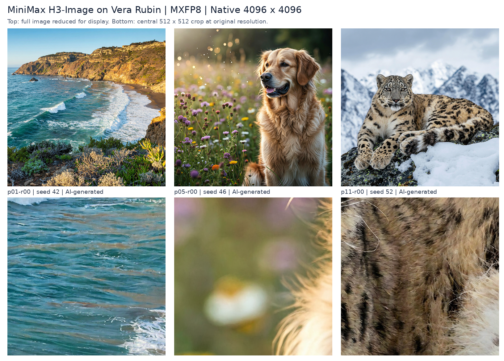

**Native 4K generation in 0.87 seconds. Up to 6,115 images per hour on four Rubin GPUs.**
MiniMax H3-Image on vLLM-Omni supports two serving goals on the same hardware:
subsecond response latency with SP4, and higher aggregate throughput with four
independent single-GPU replicas. At an assumed selling price of $0.06879 per image,
the throughput configuration represents **$420.64/hour in gross revenue capacity**.

These are separate operating points: the 0.87-second median uses SP4 at
concurrency 1; the throughput peak uses **SP1×DP4 at concurrency 8**.
Both generate **4096×4096 pixels natively**, with no upscaling, using the released
six-step schedule and **MXFP8 DiT execution**.

## Native 4K in under one second

[MiniMax H3-Image](https://huggingface.co/MiniMaxAI/MiniMax-H3-Image) supports
text-to-image generation, reference images and editing. We focus on one workload:
4K text-to-image generation without reference images.

The MXFP8 result completes 160 measured requests with 0 failures, a p95 of **0.944 s**, and a p99 of **0.960 s**. The corpus contains 20 prompts across eight seed rounds.

The latency includes generation, PNG encoding and receipt of the complete base64
HTTP response over loopback. It measures delivery of the image, beyond the DiT
computation alone.

## Low latency and high throughput

SP4 splits one image's DiT computation across four GPUs. SP1×DP4 runs four independent
single-GPU instances. **C is the total number of in-flight requests across the node.**

| Rubin MXFP8 setting | Images/hour | Median latency (s) | p95 latency (s) |
| --- | --- | --- | --- |
| Lowest latency · SP4 (C1) | 3,364 | 0.866 | 0.944 |
| SP4 throughput (C2) | 4,407 | 1.421 | 1.504 |
| Maximum observed throughput · SP1×DP4 (C8) | 6,115 | 4.411 | 4.731 |

SP4 at C2 delivers **99.9%** of SP4's observed peak throughput with a median latency of **1.421 seconds**.

For maximum node throughput, four independent single-GPU replicas (SP1×DP4) reach **6,115 images/hour**, **38.7%** above SP4, at **4.411 s** median latency. The GPU count remains four. Both the SP4 and DP4 sweeps completed 800 measured requests with zero failures.

Each operating point contains 160 measured requests after warmup. Throughput includes
client image validation and saving; HTTP latency ends when the response body arrives.
Each DiT forward generates one image, including in the DP4 configuration.

[Explore the interactive benchmark](/assets/figures/minimax-h3-image-rubin/performance-benchmarks.html)
for latency constraints, throughput and revenue estimates.
GB200 and GB300 provide reference curves using SP4 and FP8; Rubin uses MXFP8 with
the labeled topology. The curves compare these serving configurations, rather than
isolating a hardware-only speedup.

## What that capacity is worth

At **$0.06879 per billable image**, the peak measured rate of 6,115
images/hour corresponds to **$420.64/hour** or **$10,095.31/day**
in gross revenue at full billable utilization. The subsecond SP4 configuration
corresponds to **$231.42/hour** at the same assumed price.

We use MiniMax's non-promotional standard-mode 4K T2I pricing example as a scenario
sale price. MiniMax bills by actual token usage; this example is not a fixed
per-image tariff. [Official pricing](https://platform.minimax.io/docs/pricing/overview).

Revenue/hour = measured images/hour × billable utilization × realized price/image.
At 75% billable utilization, the peak configuration projects to **$315.48/hour**.
These figures are gross capacity estimates before GPU, power, storage, network and
other costs; daily values extrapolate the measured rate, not a 24-hour load test.
The interactive benchmark lets readers adjust price, utilization and operating cost,
and select a latency constraint before estimating revenue.

## The optimizations behind the results

The [vLLM Rubin preview](https://vllm.ai/blog/2026-10-09-vera-rubin-preview) describes
the platform's compute, HBM and NVLink improvements. For H3-Image, three execution
choices turn the hardware into a low-latency or high-throughput serving configuration:

- **DiT kernels:** `TRTLLM_ATTN` attention and MXFP8 linear layers, using vLLM's
  online quantization and FlashInfer's CuTe-DSL kernel.
- **Parallel execution:** Ulysses SP4 and encoder TP4 for low latency; four
  independent SP1/encoder-TP1 replicas for maximum measured node throughput.
- **VAE execution:** tiled decoding with CUDA Graph replay on six independent
  streams per GPU. Replay reduces repeated launch overhead, while the streams
  allow tile work to overlap. SP4 also distributes tiles across GPUs.

Both configurations keep model weights resident. The encoder and VAE retain the
release pipeline's precision. In a separate native-precision Rubin ablation, the
combined VAE graph-and-stream configuration reduced 4K HTTP latency from **2.01 to
1.04 seconds**, a **1.94×** speedup, with pixel-identical outputs across six tested
workloads. This is a separate experiment from the MXFP8 headline; graph replay and
stream concurrency were enabled together.

Separate 160-pair quality checks found mean CLIP text–image scores of **34.353 for
BF16 and 34.370 for MXFP8** with SP4. The DP4-minus-SP4 score difference was −0.065,
with a prompt-cluster 95% interval of [−0.301, +0.140]. These semantic diagnostics
cover the tested corpus and do not establish full-resolution quality equivalence.

Measurements use the image integration in
[vLLM-Omni PR #10120](https://github.com/vllm-project/vllm-omni/pull/10120), with
additional MXFP8 integration and an output-transfer correction. This article
reports that tested configuration.
