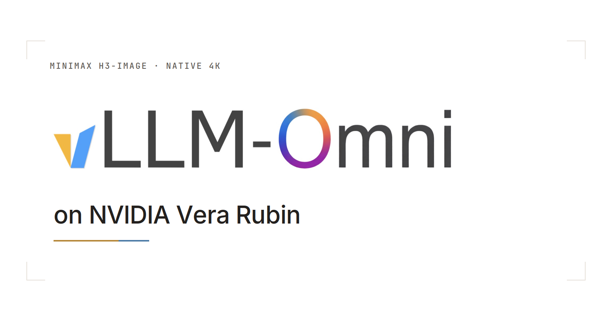
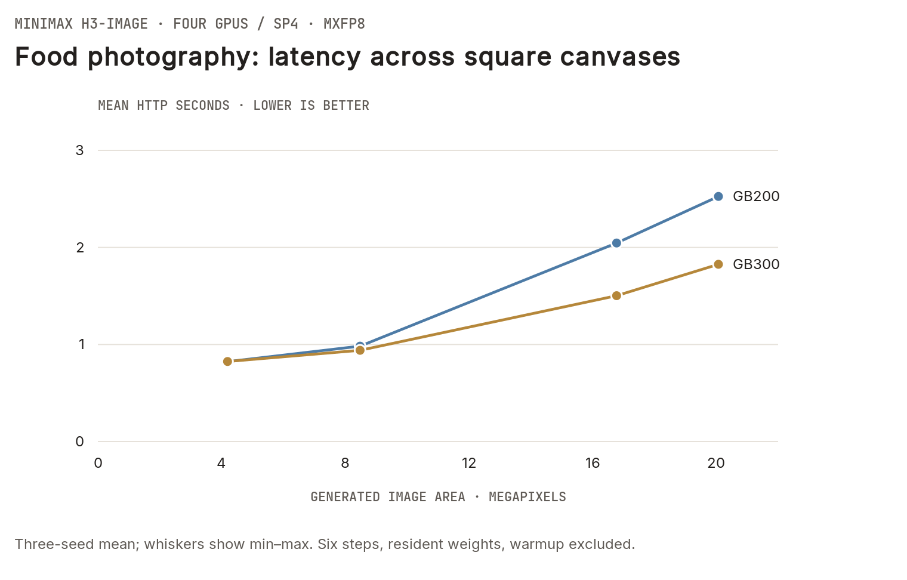
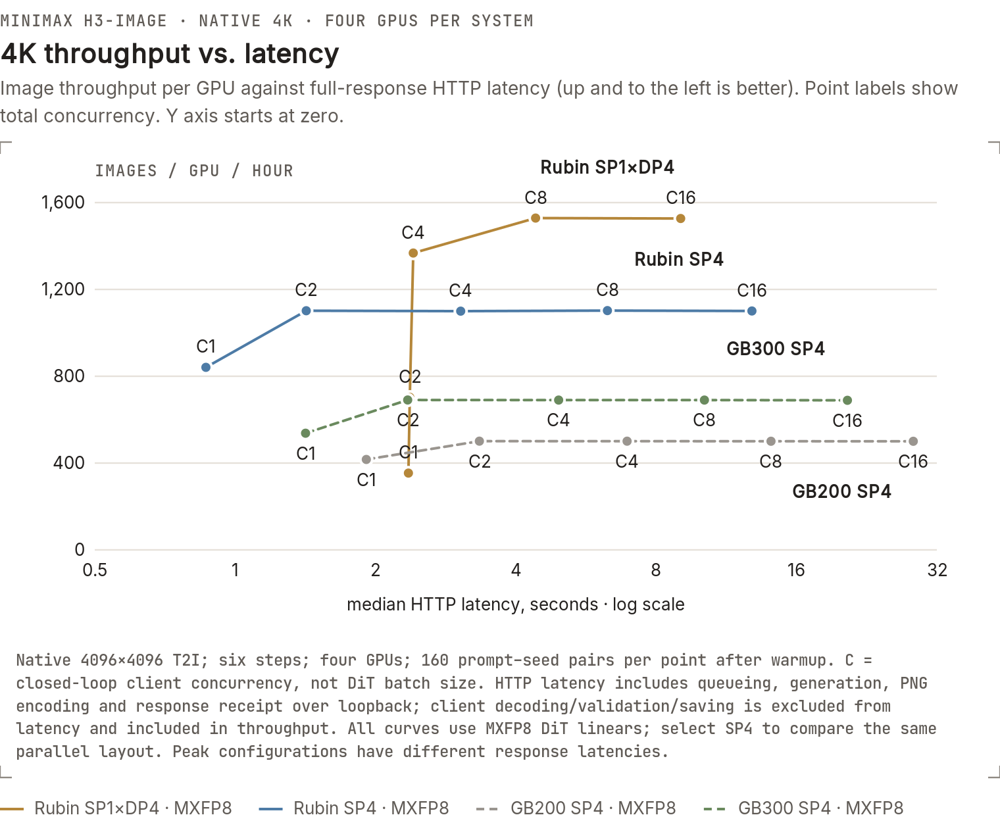

*Cover adapted from [MiniMax’s H3-Image release artwork](https://github.com/MiniMax-AI/MiniMax-H3-Image/blob/main/assets/minimax-h3-image.jpg).*

[MiniMax H3-Image](https://huggingface.co/MiniMaxAI/MiniMax-H3-Image) brings
text-to-image generation and image editing into one open-weight checkpoint.
It uses six sampling steps, generates native high-resolution images without an
upscaler, and supports up to 16 reference images.

With vLLM-Omni, we put H3-Image to work on food photography, a podcast edit,
a workshop poster and an adventure-game environment. For the food photograph
and podcast edit, we run **32 canvases on four GB200 GPUs and four GB300 GPUs**: **64 workloads per system**, covering
approximately **4–20 megapixels and eight aspect ratios**. Each workload has three
measured seeds. The same prompts, reference bytes and seeds go to both systems.

The examples come first, followed by multi-GPU performance across workloads.
At the end, a separate Rubin serving benchmark explores **4K in 0.87 seconds**
and the tradeoff between response time and throughput.

## Same Request, Every Machine

Choose a task and canvas below. Photograph a meal, redesign a studio interaction,
lay out a workshop poster, or imagine an explorer crossing a flooded observatory.
The podcast edit uses one reference image; the other three tasks start from text.
Each panel shows the same preselected seed, **42**, alongside the **mean latency
of three measured requests**. The poster also includes an H200 BF16 result,
labeled separately from the MXFP8 runs.

<iframe class="vllm-embed" src="/assets/figures/minimax-h3-image-rubin/workload-gallery.html" title="H3-Image examples: matched food, editing, typography and game-art requests across GPUs" loading="lazy" scrolling="no" style="display:block;width:100%;height:900px;border:0;overflow:hidden;"></iframe>

The food and podcast requests come from MiniMax's
[released examples](https://huggingface.co/MiniMaxAI/MiniMax-H3-Image/tree/main/examples).
The poster and game prompts follow its
[H3-Image prompt-writing guide](https://github.com/MiniMax-AI/MiniMax-H3-Image/blob/6ea7b9e55523a2177e4f759db372065ba6089510/skills/h3-image-prompt-writing/SKILL.md).
Prompts are prepared ahead of time; the PE checkpoint is not part of these timings.
The model's text encoder, generation, PNG encoding and response transfer are included.

## Generation and Editing

On four GB300 GPUs, H3-Image generates the **4096×4096 food photograph in
1.50 seconds** and completes the **podcast edit in 1.74 seconds**, averaged over
three requests. The same examples take **2.05 seconds** and **2.39 seconds** on
four GB200 GPUs.

Switch between generation and editing below, then choose an aspect ratio to see
how latency changes from roughly **4 to 20 megapixels**.

<iframe class="vllm-embed" src="/assets/figures/minimax-h3-image-rubin/workload-performance.html" title="H3-Image latency across tasks, output areas and aspect ratios" loading="lazy" scrolling="no" style="display:block;width:100%;height:680px;border:0;overflow:hidden;"></iframe>

<noscript></noscript>

All **384 measured requests in this canvas sweep** completed successfully. Each point shows the mean
of three seeds after warmup; hover for the measured range and exact image size.
The figure includes the serving configuration and timing details.

Testing of additional hardware and multi-reference editing is ongoing.

## Serving the Model

The image pipeline combines a text encoder, a diffusion transformer and
a tiled VAE decoder. Output size changes the generated latent sequence and VAE
work; editing also introduces reference conditioning. We keep the exact task
and canvas attached to every timing.

**MXFP8 and attention.** Eligible DiT linears use MXFP8 through vLLM and FlashInfer.
The recorded attention backend on both GB200 and GB300 is **`TRTLLM_ATTN`**.
Linear-layer quantization does not make the entire pipeline MXFP8: attention,
the text encoder and the VAE retain their configured precision.

**Four-GPU execution.** Ulysses SP4 partitions sequence work while DiT TP1 keeps
the transformer weights replicated. Text-encoder TP4 and VAE tile distribution
also use the four GPUs. The VAE graph path replays captured tile computations;
multiple streams allow independent tiles to overlap. All workloads in the
comparison use the same layout and resident weights.

The Rubin section below adds four independent single-GPU replicas as a separate
throughput mode. HTTP concurrency, replica count and the number of images in a
DiT forward are different settings; these measurements use one image per forward.

## Rubin Bringup

The expanded workload matrix above is separate from this earlier serving sweep.
Here we keep one request contract: **4096×4096 text-to-image, no references,
six steps and MXFP8 DiT linears**, using the same 160 prompt–seed pairs at each
concurrency point. The following figures retain those measured statistics.

Four Rubin GPUs reached **0.866 s median / 0.944 s p95** with SP4 at concurrency 1.
Four single-GPU replicas reached **6,115 images/hour**, at **4.411 s median**
latency. The latency and throughput headlines are different operating points.

### 4K Latency

The workload is deliberately simple: one prompt, no reference images, and a native
**4096×4096** output from [MiniMax H3-Image](https://huggingface.co/MiniMaxAI/MiniMax-H3-Image).
We use the released six-step schedule, with no upscaling. Latency includes image
generation, PNG encoding and receipt of the full base64 response over loopback.

At concurrency 1, the Rubin configuration delivers **2.21× faster generation than
GB200 and 1.64× faster than GB300**, measured as reference latency divided by Rubin
latency. All three use SP4 and MXFP8 DiT linears for this latency comparison.

<iframe class="vllm-embed" src="/assets/figures/minimax-h3-image-rubin/hardware-comparison.html" title="4K image latency and peak throughput across Rubin, GB200 and GB300" loading="lazy" scrolling="no" style="display: block; width: 100%; height: 720px; border: 0; overflow: hidden;"></iframe>

### Throughput

Fast responses and a busy image service need different configurations. SP4 splits
one image's DiT work across four GPUs. SP1×DP4 instead runs four independent
single-GPU servers, so several images can be generated at once.

SP4 at concurrency 2 reaches **4,407 images/hour** with a **1.421-second median**
response. That is already 99.9% of the measured SP4 peak. Moving to four replicas
raises throughput to **6,115 images/hour**, a **38.7% increase**, at concurrency 8
and a **4.411-second median** response. It is a useful choice when a queue of
requests matters more than finishing one request as quickly as possible.

<iframe class="vllm-embed" src="/assets/figures/minimax-h3-image-rubin/performance-benchmarks.html?embed=1" title="MiniMax H3-Image: throughput per GPU versus response latency" loading="lazy" style="display: block; width: 100%; height: 720px; border: 0; overflow: hidden;"></iframe>

<noscript></noscript>

C is the total number of in-flight requests across the four GPUs. Every plotted
point contains 160 measured requests after warmup. Both Rubin sweeps completed
800 requests with zero failures. Throughput includes client image validation and
saving. Each DiT forward generates one image; the replicas do not pack requests
into a shared DiT batch.

With **MXFP8/SP4 on all three platforms**, Rubin reaches **2.20× GB200 and 1.60× GB300
peak throughput**. The
[interactive chart](/assets/figures/minimax-h3-image-rubin/performance-benchmarks.html)
lets readers select the SP4 curves and inspect the corresponding response times.

### Serving Economics

At the peak measured rate, a four-GPU Rubin system projects to **146,755 4K
images/day**. Using **$0.06879 per billable image**, that is **$105.16/GPU/hour**
in gross revenue. At 75% billable utilization, it becomes **$78.87/GPU/hour**.

<iframe class="vllm-embed" src="/assets/figures/minimax-h3-image-rubin/serving-economics.html" title="Daily image capacity and gross revenue per GPU-hour" loading="lazy" scrolling="no" style="display: block; width: 100%; height: 720px; border: 0; overflow: hidden;"></iframe>

The price is MiniMax's non-promotional standard 4K T2I example, used here as an
assumed sale price. MiniMax's actual API bill depends on token usage.
[Official pricing](https://platform.minimax.io/docs/pricing/overview).

The calculation is straightforward: **images/hour × price/image × billable
utilization ÷ 4 GPUs**. These are gross-revenue scenarios, before hardware, power,
network and other operating costs. Daily image counts extend the measured hourly
rate to 24 hours; they are not results from a day-long load test. For the subsecond
SP4 operating point, the same price gives **$57.86/GPU/hour** at full billable utilization.

## Acknowledgements

We thank MiniMax for releasing H3-Image and its model weights; the NVIDIA team and
the vLLM community for their work on Vera Rubin support; and the vLLM-Omni and
FlashInfer contributors for the serving and kernel infrastructure used in this
work.

