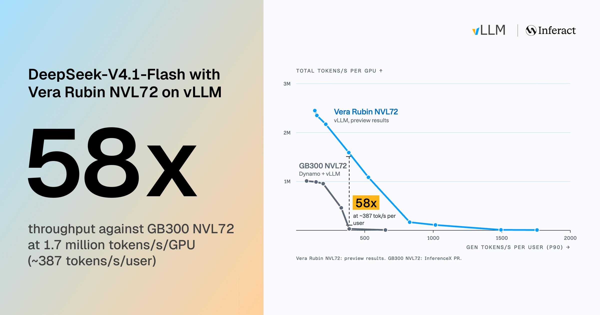

**TL;DR:** On one NVIDIA Vera Rubin NVL72 rack, vLLM serves DeepSeek-V4.1-Flash at **1.7M** tokens/s per GPU while each user gets **387** tokens/s, **58×** GB300 NVL72, and reaches **2.52M** at peak throughput and **1,810** tokens/s for a single user. The gains come from building on what is new in Rubin: kernels tuned for its split memory and FP4 tensor cores, specialized decode kernels for low latency, and a rack-wide KV cache and Engram tables shared over NVLink.

This is the third post in our DeepSeek-V4.1-Flash series. The [first post](https://vllm.ai/blog/2026-10-07-deepseek-v41-flash) covered day-0 bring-up and kernel fusions. The [second](https://vllm.ai/blog/2026-10-23-deepseek-v41-flash-pd-wide-ep) scaled the model to a GB300 NVL72 rack with P/D disaggregation and Wide-EP. This post moves the same stack to Vera Rubin NVL72, which we [introduced last month](https://vllm.ai/blog/2026-10-09-vera-rubin-preview).

Rubin opens up new avenues for optimization. We start with the hardware facts that shaped our work, then go through four groups of optimizations:

- **Rubin-optimized kernels for DEP prefill and decode.**[^terms] We reworked the MoE, attention, GEMM, mHC and indexer kernels for Rubin: bandwidth-bound data stays in each SM's own memory domain, SM107's wider MMA instructions do more work per issue, and kernels start their loads, and their dependents, before they wait. DEP2 prefill steps are about 28% faster, and DEP decode steps about 25% faster.
- **A specialized TP decode path for the lowest latency.** We perform cross-operator fusions, overlapping computation with communication, and tuning, then spread the model over two trays with TP8, to achieve 1,810 tokens/s (P90) at batch size 1.
- **Dynamo workload-aware routing over rack-scale memory pools.** Rubin's speed brings much higher concurrency, so we pool the rack's memory: the Mooncake KV pool extends from DRAM to spare HBM, and the Engram tables are sharded across GPU HBM. Even at very high concurrency the prefix hit rate stays at 96.5–97%, and routing alone balances the ranks.

## Performance overview

<iframe class="vllm-embed" src="/assets/interactive_pages/dsv41-rubin-agentx-curve.html?v=20261112" title="SemiAnalysis AgentX on NVIDIA Vera Rubin NVL72 vs. GB300 NVL72, per GPU and per MW" loading="lazy" scrolling="no" style="display: block; width: 100%; height: 720px; border: 0; overflow: hidden;"></iframe>

*Figure 1: SemiAnalysis AgentX on NVIDIA Vera Rubin NVL72 (vLLM, P/D disaggregation, Wide-EP) vs. GB300 NVL72. Throughput counts cached input, uncached input and output tokens ([GB300 source](https://inferencex.semianalysis.com/infx/inference/deepseek-v41-flash?i_seq=agentic-traces&g_model=DeepSeek-V4.1-Flash&i_metric=y_tpPerMw&i_best=0&i_active=gb300_dynamo-vllm)).*

We measure performance with the [SemiAnalysis AgentX](https://vllm.ai/blog/2026-09-08-vllm-agentx) benchmark as a representative agentic serving workload, aligned with our previous posts. Figure 1 compares the two racks' raw throughput (total tokens per GPU per second, including input, cached, and output) and power-normalized throughput, respectively in two tabs.

#### How we measured

We use the same methodology as in our [previous GB300 post](https://vllm.ai/blog/2026-10-23-deepseek-v41-flash-pd-wide-ep#how-we-measured). For kernels and model forward profiling, `vllm bench forward` times exact prefill and decode batches through the real `execute_model` path, with real weights and real AgentX tokens. We A/B prefill kernels in loops that run for several seconds and report sustained numbers where they differ.

## Rubin through the lens of DeepSeek-V4.1-Flash

Three properties of Vera Rubin NVL72 drove most of the decisions below. Where an optimization is specific to Rubin, we say which of them it relies on.

- **Each GPU has two memory domains.** SMs read their own domain much faster than interleaved memory, and slower still from the other domain. As the [Rubin preview](https://vllm.ai/blog/2026-10-09-vera-rubin-preview#locality-domain-support) showed, this matters for bandwidth-bound data: MoE weights, the LM head, MegaMoE's combine buffer and the mHC residual stream.
- **SM107 adds wider block-scaled MMA instructions.** We use the new K64 mixed-precision (FP8×FP4) MMA, which does twice the work per instruction, in MegaMoE and the low-latency routed GEMMs: MegaMoE gets 8–11% more throughput at 8K+ tokens per rank, and the low batch size routed GEMM runs 12% faster. In the indexer, the new K128 FP4 MMA, together with six-token query tiles, makes the decode MQA-logits kernel 15–22% faster.
- **72 GPUs share one NVLink domain.** TP8 can span two compute trays at almost no extra all-reduce cost. Prefill instances can read each other's HBM efficiently, so a large table no longer has to be copied to every instance.

<iframe class="vllm-embed" src="/assets/interactive_pages/dsv41-rubin-fp4-stages.html?v=20261112" title="Weight stages of the routed-expert GEMM with the SM100 MXFP8×MXFP4 MMA and the SM107 K64 MXFP8×MXFP4 MMA on packed FP4" loading="lazy" scrolling="no" style="display: block; width: 100%; height: 520px; border: 0; overflow: hidden;"></iframe>

*Figure 2: Weight stages of the routed-expert GEMM in one SM's shared memory, with the SM100 MXFP8×MXFP4 MMA and with SM107's K64 MXFP8×MXFP4 MMA on packed FP4.*

## Diving into optimizations

### Kernels

We kept GB300's three engine shapes: DEP2 prefill, Wide-EP decode (DEP16 or DEP32), and a TP decode path for the lowest latency (next section). We also kept DeepSeek's kernel set (MegaMoE, MegaAttn, Mega-mHC, MegaGate, DeepSelect) and rebuilt much of it for SM107.

#### DEP prefill: about 28% less time per step

At 32K tokens per rank, a prefill step is dominated by the expert GEMMs; most of the rest goes into streaming the residual and attention's working set through HBM. So this round went into the kernels around the GEMMs and into Rubin's two memory domains: Mega-mHC keeps the residual die-local, MegaAttn keeps its tensor cores issuing instead of waiting on loads, and MegaGate scores only the experts that can still make the top 6. Together they cut a 32K-token DEP2 prefill step by 28%.

<iframe class="vllm-embed" src="/assets/interactive_pages/dsv41-rubin-prefill-kernels.html?v=20261112" title="Three prefill kernel changes on Rubin: a die-local residual stream, an attention pipeline that keeps issuing, and a gate that scores only the contenders" loading="lazy" scrolling="no" style="display: block; width: 100%; height: 700px; border: 0; overflow: hidden;"></iframe>

*Figure 3: Three of the prefill kernel changes: Mega-mHC's die-local residual, MegaAttn's pipeline and MegaGate's contender filter, and the step they add up to.*

Prefill optimization details

- **MegaMoE: size tiles for the busiest rank.** vLLM does not pad DP batches in eager prefill, so in 86% of real DEP2 prefill steps an idle rank sized MegaMoE tiles for its own tiny token count while its experts served the busy rank's tokens. Tiles now follow the larger of the local and DP-average token counts. MegaMoE time drops 55% over a 40-step replay, and single-request TTFT next to an idle rank 13–39% from 8K to 32K tokens.
- **Mega-mHC: the residual stream in die-local memory.** At prefill sizes, Mega-mHC is HBM-bound, streaming about 100 KB of four-route residual per token. The residual now lives in a pool striped across both memory domains, and Mega-mHC keeps one task counter per domain, so each SM drains its own domain before helping the other. That left large grids instruction-cache bound, so they now loop over one copy of the Post body instead of four. Mega-mHC drops from 354 to 317 µs per call at 32K tokens; DEP2 steps of 5K+ tokens get 0.6–1.3% faster.
- **Query up-projection on SM107's K64 block-scaled MMA.** MegaAttn's [tokens × 1,280] × [1,280 × 32,768] query GEMM moved from cuDNN's SM100 kernel to FlashInfer's CuTe DSL GEMM on SM107's K64 MMA: 13–18% faster from 4K to 32K rows, and 1.1–1.7% off DEP2 steps at 16K–32K.
- **MegaAttn: keep the tensor cores fed.** At 16K–32K tokens per rank, sparse attention was bound by issue and load latency. An idle warp now issues the SVs so QKs no longer wait behind them, the KV producer loads the next block's top-k indices before waiting for a slot, the cluster-launch-control warp prefetches the next job's index row into L2, and the next job's queries load before the current job's last QK. Each TMEM lane group now scores its own keys completely, so the softmax no longer swaps partial sums through shared memory. The kernel is 15% faster at 16K–32K tokens and 23% at 4K, and DEP2 steps 0.9–2.1%.
- **Mega-mHC: a ticketed task ring.** At long prompts, fixed task strides left the RMSNorm workers so far behind Post that their rereads of Post's output missed L2. Large grids now take tasks from an atomic ticket counter (−18% at 32K). Norm tasks also issue all loads up front, the next task's coefficients arrive early, and both Post warpgroups share one code copy to spare the instruction cache: another 13–22% per call from 4K to 32K tokens.
- **MegaGate: read each token once, score only the contenders.** For long prompts, one CTA pair computes all 384 experts of a token block from one shared-memory stage (M=256 and M=128 UMMAs) instead of rereading tokens per 128-expert group. The router evaluates the exact sqrt-softplus only for experts that can still make the top 6: a bound on the sixth-largest score and the function's slope give each expert a threshold, and about 7 of 384 pass. The kernel gets 3–13% faster from 4K tokens (77 → 68 µs at 32K).

#### DEP decode: about 25% less time per step

Decode is MoE-bound, as on GB300. Against our first Rubin build, which already had die-local weights, the Wide-EP dispatch changes and the MQA logits change, these optimizations cut the target forward of a DEP32 decode step (20 requests × 6 tokens per rank, DSpark k=5, simulated on one 4-GPU node) by about 25%.

<iframe class="vllm-embed" src="/assets/interactive_pages/dsv41-rubin-decode-kernels.html?v=20261112" title="Four Wide-EP decode kernel changes on Rubin: die-local expert weights, one NVLink round trip per dispatched token, a combine that waits for data, and split-K projections across an SM107 cluster" loading="lazy" scrolling="no" style="display: block; width: 100%; height: 740px; border: 0; overflow: hidden;"></iframe>

*Figure 4: Four of the Wide-EP decode changes: die-local expert weights, one NVLink round trip per dispatched token, a combine that waits for data, and split-K projections across an SM107 cluster.*

Decode optimization details

- **Die-local MegaMoE weights.** Decode MoE is bound by weight reads, and an SM streams its own memory domain much faster than interleaved memory. vLLM splits expert weights by output columns across the domains, and MegaMoE gives each domain's SMs only local tiles. The DEP2 decode forward gets 10.1% faster at batch size 32 and 5.5% at 168.
- **Wide-EP dispatch: one NVLink round trip per token.** At DEP8 decode, NVLink ran at only 39% of peak. Each pulled token now issues all remote loads before any local store, paying one round trip instead of two or three. Warps publish pulls with one fence and one elected release, and expert counts go out as non-returning `red` atomics, so the first SM's 392 remote updates no longer serialize. MegaMoE gets 17% faster at DEP8 (192 → 160 µs).
- **MegaMoE: a combine that waits for data, not a barrier.** The combine buffer starts each launch filled with a sentinel no output can take, so a CTA combines as soon as its own GEMM tasks finish, re-reading only 16-byte groups still holding the sentinel and then restoring it. The cross-rank tail barrier is signalled at one launch's end and awaited at the next one's start. With few local experts, all first-GEMM tasks are claimed before any second-GEMM task, keeping weights streaming. MegaMoE gets 3.5–10.8% faster at decode sizes.
- **Split-K GEMMs on SM107 clusters.** With a few dozen rows per rank, the attention input and output projections launch too few CTAs to stream weights at full bandwidth. A split-K GEMM spreads K over an SM107 cluster and reduces partial sums through distributed shared memory, or from registers through L2 when a CTA's peer slices exceed 28 KB. The GEMMs get 10–38% faster, and the decode forward 3.1% at ≤16 requests per rank, 1.9% at 17–24.
- **MQA logits: six-token tiles and SM107's K=128 MMA.** DSpark verification sends 5–6 query rows per request to the indexer. The kernel now packs them into one 192-wide tile on two warpgroups instead of two 4-token tiles on three, issues each 128-dim head as one SM107 K=128 MMA rather than two K=64 ones, and stores at immediate offsets without per-split 64-bit address math: 15–22% faster at 5–6 tokens per request.
- **Split Mega-mHC: only what the next layer needs on the critical path.** The next layer needs Mega-mHC's Post, route collapse and RMSNorm, but not its next mixes. A small kernel now does just those three, and the mixes run on a side stream joining at the next boundary. It moves each route in coalesced 16-byte chunks, with up to three tokens per CTA, so 636 tokens fit in one wave on 212 SMs. The decode forward gets 2.0–4.8% faster at 20–30 requests per rank; the coalesced rewrite makes the kernel another 30–58% faster at 18–192 tokens.
- **MegaAttn decode: deeper pipelines.** Decode attention runs one or two tokens per CTA, a latency chain of index loads, KV gathers and unpacking, then per-block QK, softmax and SV. Three blocks of index loads and four gather batches now stay in flight, the idle query warpgroup unpacks the KV when each SM has one job, and the kernel triggers dependents right after its own dependency wait, overlapping the output projection's prologue with attention. The kernel gets 7–10% faster at 6–424 rows.

### Low latency: a specialized decode path with TP

For the lowest latency, we run a specialized decode path. We ported it from our GB300 post, largely rebuilt it for Rubin, and spread it across two compute trays with TP8. On real AgentX sessions at concurrency 1, with a fixed DSpark acceptance of 3.51 tokens per step, it went from 1,117 to 1,844 tokens/s per user at P50. Apart from the first expert GEMM, a step is a chain of small kernels near their latency floor.

<iframe class="vllm-embed" src="/assets/interactive_pages/dsv41-rubin-tp8-step.html?v=20261112" title="One step of the specialized TP8 decode path: the engine spread over two compute trays, and the per-layer kernel chain with its boundaries fused" loading="lazy" scrolling="no" style="display: block; width: 100%; height: 700px; border: 0; overflow: hidden;"></iframe>

*Figure 5: One step of the specialized TP8 decode path: the engine spread over two compute trays, and the per-layer kernel chain with its boundaries fused.*

Low-latency optimization details

- **TP8 across two trays over NVL72.** Each rank holds a 288-column slice of every expert and 8 attention heads. A cross-tray all-reduce costs only 0.3 µs more than an in-tray one, so TP8 halves per-GPU weight reads almost for free. With native TP8 shapes for the routed GEMMs and sparse MLA, a step got 35% faster.
- **Packed-FP4 weight stages on SM107.** The first expert GEMM is limited by the weight bytes each SM keeps in flight. UMMA descriptors address only 256 KB of shared memory, which fit 7 stages in SM100's one-byte FP4 layout. SM107's K64 MMA reads packed FP4, so the same space holds 11 stages (Figure 2), saving 57 µs per step.
- **A die-local LM head.** The LM head reads a copy of its weights split across the two memory domains. Each SM streams only its own half, at close to the domain-local ceiling.
- **All-reduce and mHC in one pass.** Both all-reduces publish from their GEMM epilogues straight into a Lamport mailbox with NVLink multicast stores. The receiving kernel sums the ranks, applies mHC Post, collapses the four routes and computes RMSNorm; at the MoE boundary it also runs the router GEMM before its grid wait (about −30 µs per step). The next layer's mHC pre-norm runs on a side stream, split 64 ways (5.8 → 3.7 µs), and the routed GEMMs leave 16 of Rubin's 212 SMs free for it (−4 to −10 µs).
- **Sparse MLA.** At TP8, each rank runs an 8-head sparse MLA kernel. While the previous kernel still runs, it gathers every KV row except the step's new ones, and each PV block sends its partial to the owner as soon as its MMAs finish (−16 to −21 µs). Query RoPE and the KV-cache insert are fused into the kernels around attention, which also starts its prologue early (another −36 µs).
- **Shared expert inside the routed GEMMs.** The shared expert was the MoE sublayer's tail in 80% of layers. Below 16 rows it now runs inside the routed GEMMs, saving 220 µs per step.
- **Launch the next kernel early.** The all-reduce finalizer launches its dependents right after its own grid wait (−16 µs), and the indexer's MQA logits load KV before their grid sync (−24 µs).
- **Engram all-gathers on the layer's stream.** At TP8, NCCL all-gathers put 22 µs on Engram's critical path. A fused entry kernel and Lamport all-gathers on the layer's own stream save about 40 µs per step.

### Dynamo workload-aware routing + rack-scale shared memory pools

Rubin computes fast, so a rack sustains far higher concurrency than GB300, and the live prefixes of all those agentic sessions outgrow any per-rank cache. On GB300, we kept prefixes in a per-rank CPU tier and pinned each session to a rank; at Rubin's concurrency that tier was too small, and pinning left some ranks idle while others queued. We pushed memory to the limit by pooling it across the rack: KV in DRAM and spare HBM, loaded over RDMA, and the Engram tables in HBM, read over NVL72's NVLink. Even at very high concurrency, the prefix hit rate stays at 96.5–97%, close to the theoretical hit rate. With no session tied to a rank, workload-aware routing alone keeps the ranks balanced.

<iframe class="vllm-embed" src="/assets/interactive_pages/dsv41-rubin-kv-pool-arch.html?v=20261112" title="Every prefill rank reads one shared Mooncake KV pool, and the Dynamo router sends each request to the least-loaded rank" loading="lazy" scrolling="no" style="display: block; width: 100%; height: 560px; border: 0; overflow: hidden;"></iframe>

*Figure 6: Every prefill rank loads KV from one Mooncake pool over the rack's DRAM and spare HBM (RDMA) and reads Engram tables from peers' HBM (NVLink), so the Dynamo router can send each request to the least-loaded rank.*

**Mooncake pool.** One [Mooncake store](https://vllm.ai/blog/2026-05-06-mooncake-store) across the DRAM of every prefill and decode tray replaces the per-rank CPU tier, so any rank can load any prefix over RDMA and a moved request costs a KV load, not a recompute. We optimized how the prefill scheduler waits on the pool: lookups run asynchronously out of process, a request already hit in local HBM skips the lookup but still refreshes its lease, and KV loads start as soon as a lookup returns instead of at the next step. Prefill steps left underfilled by pending lookups fell from 6–14% of step time to under 0.5%, and those waiting on KV loads from 13.5% to 1%.

**HBM pool.** DeepSeek-V4.1-Flash is small and its KV cache per token is small, so serving a request uses only a fraction of a prefill and decode GPU's HBM. Once Mooncake holds the prefixes, the rest would sit idle. Each prefill rank now keeps just enough KV cache for one maximum-length request and gives the rest of its KV budget to Mooncake as an HBM segment, sized automatically, extending the pool from DRAM to the spare HBM of every prefill GPU; those segments are read over the same RDMA path. The HBM pool is still experimental.

**Engram pool.** Both roles now keep Engram's two 94.4 GiB hashed n-gram tables in HBM. Decode already split them across its DP ranks ([vllm#54371](https://github.com/vllm-project/vllm/pull/54371)), but every DEP2 prefill instance kept its own copy in host memory, about 378 GiB per tray. Over NVL72, the prefill engines now form one peer group that splits the tables, 10.5 GiB on each of 18 GPUs, and reads the rest from peers' HBM over NVL72's NVLink, not RDMA ([vllm#66552](https://github.com/vllm-project/vllm/pull/66552), Figure 7). Lookups get faster than they were from host memory, and the freed host memory holds the live prefixes of about 1,500 more sessions.

<iframe class="vllm-embed" src="/assets/interactive_pages/dsv41-rubin-engram-peers.html?v=20261112" title="Engram tables per instance in host DRAM vs. split across the HBM of a peer group" loading="lazy" scrolling="no" style="display: block; width: 100%; height: 520px; border: 0; overflow: hidden;"></iframe>

*Figure 7: Engram tables per instance in host DRAM (before) vs. split across the HBM of a peer group (after).*

**Workload-aware routing.** With every prefix in a shared pool, sessions no longer need to stay on one rank, which removes the DP imbalance that session affinity caused. Dynamo places each request on the (worker, DP rank) with the least uncached work, a configuration-only change. On three DEP2 instances at concurrency 4,800, the pools plus routing serve 68% more requests, cut TTFT P50 from 29.8 s to 4.2 s and lift the hit rate from 91.8% to 96.1% (Figure 8). In a 12 × DEP2 simulation, the time ranks sit idle while another rank queues drops from 10.3% to 1.3%, and TTFT P90 from 0.98 s to 0.38 s.

<iframe class="vllm-embed" src="/assets/interactive_pages/dsv41-rubin-kv-pool-results.html?v=20261112" title="Requests/s, TTFT P50 and hit rate with and without the shared Mooncake pool" loading="lazy" scrolling="no" style="display: block; width: 100%; height: 440px; border: 0; overflow: hidden;"></iframe>

*Figure 8: Requests/s, TTFT P50 and hit rate on three DEP2 prefill instances at concurrency 4,800.*

## Acknowledgements

We thank **DeepSeek** for open-sourcing DeepSeek-V4.1-Flash and its kernels, and **NVIDIA** for providing early access to Vera Rubin NVL72. We are especially grateful to Hanjie Qiu, Lisa Wang, Jie Hao, Yaoyao Ding, Pei Li, Xin Li, and Pen Chung Li from NVIDIA for their close collaboration on performance optimizations and continued support for **vLLM** and **Dynamo**. We also thank the **Mooncake** team for their KV cache store and **SemiAnalysis** for developing the AgentX benchmark.

This work was led by **Inferact**.

[^terms]: DEP2, DEP16 and DEP32 mean data-parallel attention plus expert parallelism over 2, 16 and 32 GPUs.

