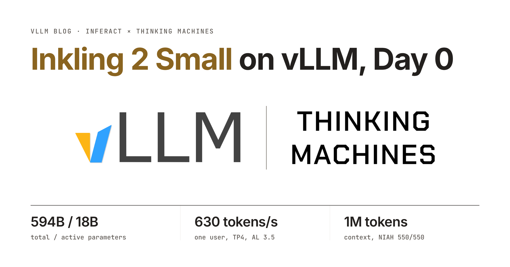

<p align="center">

</p>

vLLM supports Thinking Machines' [Inkling 2 Small](https://thinkingmachines.ai/news/inkling-2-small/) on day 0. It is a multimodal (text and vision) MoE model with 594B total and 17B active parameters and up to 1M tokens of context. The model also comes with a native DSpark speculator. vLLM supports it with optimized performance (up to 630 TPS/user at TP4 and acceptance length 3.5) and also supports LoRA.

## TL;DR

- **594B total, 17B active, 1M context.** A 48-layer MoE with 384 experts (top-8) that takes images and text and outputs text.
- **Architecture upgrade from Inkling.** Block attention residuals, attention sink, gated attention, and ViT image encoder.
- **Mixed-precision MoE.** The MoE uses NVFP4 (layers 0–39) and MXFP8 (layers 40–47), so the model can be served with a single node.
- **Native DSpark speculator.** DSpark with an RNN head drafts 7 tokens per step.
- **Extensive optimizations.** Kernel fusion, PDL, highly tuned Gluon attention kernel, and sequence parallelism, achieving up to 630 TPS/user on GB200 at TP4 and acceptance length 3.5.
- **RL and LoRA support.** vLLM supports RL (via SkyRL) and LoRA for the model.

You can serve the model with:

```bash
vllm serve thinkingmachines/Inkling-2-Small \
  --tensor-parallel-size 8 \
  --reasoning-parser inkling --tool-call-parser inkling --enable-auto-tool-choice \
  --speculative-config '{"method":"dspark","num_speculative_tokens":7,"draft_sample_method":"probabilistic"}'
```

## Model Architecture

<iframe class="vllm-embed" src="/assets/interactive_pages/inkling2-arch-layer.html" title="Inkling 2 Small architecture: one decoder layer" loading="lazy" scrolling="no" style="display: block; width: 100%; height: 630px; border: 0; overflow: hidden;"></iframe>

*Figure 1. Inkling 2 Small architecture. Gold marks what is new or changed since Inkling.*

| | Inkling | Inkling 2 Small |
|---|---|---|
| Layers | 66 (55 sliding-window + 11 full) | 48 (40 sliding-window + 8 full) |
| Residual path | residual stream | block attention residuals (8 blocks of 6 layers) |
| Attention | GQA with relative bias, no RoPE | same |
| Heads (query / KV) | 64 / 8 full, 64 / 16 sliding | 48 / 8 in all layers |
| Sliding window | 512 | 1,024 |
| Attention output | plain | sigmoid gate and per-token sink |
| Short convolutions | 4 per layer (K, V, attention out, MLP out), kernel size 4 | same |
| MoE | 256 routed (top-6) + 2 shared expert sinks, first 2 layers dense | 384 routed (top-8), no shared experts, all layers MoE |
| Expert precision | NVFP4 | NVFP4 (layers 0–39), MXFP8 (layers 40–47) |
| Modality | text, image, audio in; text out | text, image in; text out |
| Image encoder | 4-layer hMLP on 40×40 patches | 23-layer ViT (1,024 wide) on 20×20 patches |
| Speculative decoding | 8 chained MTP heads | DSpark draft, 7 tokens per step |

**Inkling backbone + recent advances.** Inkling 2 Small keeps Inkling's backbone: the 5:1 mix of sliding-window and full attention, GQA with a learned relative bias instead of RoPE, the four short convolutions per layer and a sigmoid-routed MoE. On top of it, it adds recent advances. [Block attention residuals](https://arxiv.org/abs/2603.15031) replace the residual stream, so before each sublayer a learned query mixes the outputs of earlier 6-layer blocks. [Gated attention](https://arxiv.org/abs/2505.06708) puts a sigmoid gate on each head's output, together with a per-token [attention sink](https://arxiv.org/abs/2309.17453). It replaces the hMLP image encoder with a 23-layer ViT.

**Mixed-precision MoE with Four-Over-Six NVFP4.** Out of Inkling 2 Small's 48 layers, the experts of the first 40 use NVFP4 and those of the last 8 use MXFP8. The NVFP4 activations use a per-token global scale plus dual-candidate block scales ([Four Over Six](https://arxiv.org/abs/2512.02010)): for each 16-element block, the quantizer tries scaling the block's maximum to 6 and to 4, and keeps whichever gives the lower reconstruction error (MAE).

**DSpark speculator with an RNN head.** The checkpoint also ships a DSpark draft in place of Inkling's 8 chained MTP heads. The speculator has 5 layers and drafts 7 tokens per step. The head is the RNN variant that [DeepSeek's DSpark paper](https://arxiv.org/abs/2607.05147) described.

## vLLM Integration & Optimization

<iframe class="vllm-embed" src="/assets/interactive_pages/inkling2-fused.html" title="Inkling 2 Small: kernels per layer for decode and prefill" loading="lazy" scrolling="no" style="display: block; width: 100%; height: 780px; border: 0; overflow: hidden;"></iframe>

*Figure 2. Kernels in one decoder layer, for decode and large prefills.*

**Kernel fusion and PDL.** vLLM aggressively fuses the collective communication and memory-bound ops between sublayers into a single kernel. With attention residuals, each boundary needs an all-reduce, a short convolution, a residual update, the attention-residual mix and an RMSNorm: five memory-bound steps on the same hidden states. The fused kernel, `allreduce_conv_mix` (gold in Figure 2), runs the all-reduce over NVLink multicast and keeps everything after it in registers. The GEMM, attention, routing and activation kernels launch with programmatic dependent launch (PDL), so each one's prologue overlaps the tail of the previous kernel, which matters at small batch sizes, where a decode step is a long chain of short kernels.

**MoE with fused activation quantization.** vLLM quantizes the expert activations (NVFP4 or MXFP8, matching each layer) inside the kernels that produce them, so no separate quantization pass touches the hidden states: the routing kernel quantizes the tokens before the gate/up projection, and the softcapped SwiGLU quantizes its output before the down projection. The expert GEMMs run on TensorRT-LLM's batched-GEMM kernels, shipped with FlashInfer.

**Sequence parallelism for prefill.** Under plain tensor parallelism, every GPU runs the short convolution, attention-residual mix and RMSNorm on all tokens after each all-reduce: the same work, repeated on every rank. That is cheap in decode but costly in prefill. vLLM removes the redundancy with sequence parallelism (purple and gold in Figure 2). Each GPU reduce-scatters, runs the short convolution, residual update, attention-residual mix and RMSNorm in one fused `conv_mix` kernel on only its slice of tokens, and all-gathers the result for the next GEMM. This cuts an 8K-token prefill step by 22% at TP4 and 26% at TP8, and frees 1.3–1.9 GiB per GPU for KV cache.

**Optimized Gluon relative attention kernel for decode.** Inkling's FlashAttention-4 decode path is slow for Inkling 2 Small: the 6:1 GQA ratio silently disables GQA packing. To fix this, we wrote a warp-specialized Gluon kernel for decode and verify that packs the 6 heads into one 64-row tile and reads KV once: a TMA warp streams KV, a tcgen05 warp runs the MMAs and four softmax warps apply the relative bias. A batch-1 decode step at 100K context drops from 15.1 ms to 4.8 ms. Prefill keeps Inkling's sheared-bias FlashAttention-4 path.

### Performance

We benchmarked Inkling 2 Small on an agentic workload at TP8 (two 4-GPU nodes) with DSpark (probabilistic drafting) and prefix caching. Each session keeps a long context and, on every turn, appends the previous answer and a ~2K-token tool output, so only about 3K tokens per turn are new; each turn then generates 1,024 tokens with reasoning on at temperature 1.0. The table gives output throughput per GPU at the concurrency where each user gets 100 tokens/s.

| Session context | Output tok/s per GPU at 100 tok/s/user | Concurrent sessions | Prefix-cache hit rate | Acceptance length |
|---|---|---|---|---|
| 32K | ~1,070 | ~84 | 91% | 3.3 |
| 64K | ~915 | ~72 | 95% | 3.4 |
| 128K | ~700 | ~55 | 98% | 3.5 |
| 256K | ~450 | ~37 | 99% | 3.5 |

For a single user at TP4, the model decodes at about 630 tok/s with an acceptance length of 3.5.

## Accuracy Evals

vLLM keeps the reference implementation's numerics: the same data types at every step, FP32 attention output and router, and the same NVFP4/MXFP8 activation quantization, with only the reduction order and the all-reduce's BF16 partials differing. End to end, we verified accuracy on NIAH up to 1M tokens, MMMU-Pro and HLE with [inkling-verify](https://github.com/thinking-machines-lab/inkling-verify), with DSpark enabled; the scores match our runs without speculative decoding.

## Acknowledgements

We thank the Thinking Machines team for their close collaboration in integrating and optimizing Inkling 2 Small in vLLM. The work was led by Aurick Qiao (Thinking Machines) and Woosuk Kwon (Inferact).

<script>
(function () {
  // Resize embedded interactive figures to their content height (they post it when framed).
  window.addEventListener('message', function (event) {
    var d = event.data;
    if (!d || d.type !== 'vllm-embed-resize' || typeof d.height !== 'number') return;
    var frames = document.querySelectorAll('iframe.vllm-embed');
    for (var i = 0; i < frames.length; i++) {
      if (frames[i].contentWindow === event.source) {
        frames[i].style.height = Math.ceil(d.height) + 'px';
      }
    }
  });
})();
</script>
