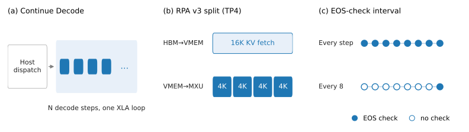

*Authors —*<br>
***ASA:** Loki Chen, Yang Song, Hongye Xie, Ming Lei, Greg Rehm, Chongyang Bai, Dre Olgiati, Bob Kamma, Tej Choudhary, Hang Cui, Imed Zitouni, Hamed Firooz.*<br>
***Ranking AI Research:** Mingfu Liang, Kavosh Asadi, Yufei Li, Frank Shyu, Parish Aggarwal, Senthil Manickavelu, Xi Liu, Luke Simon.*

**Takeaways**

- In small dense-model RL, decode scheduling, synchronization, attention geometry, and KV-cache lifecycle become first-order bottlenecks.
- We co-designed across the open-source TPU stack (vLLM, Tunix, MaxText, and Pallas) and upstreamed the changes, so developers on Google Cloud TPU v7 can reach the 56-second (~183K tokens/s) path with the merged [tpu-recipes recipe](https://github.com/AI-Hypercomputer/tpu-recipes/pull/387) and the flags listed in [Appendix B](#appendix-b--how-to-reproduce), without repeating our bring-up work.
- The complete rollout-to-update cycle is 107x faster on Google Cloud TPU v7, falling from roughly 100 minutes to about 56 seconds while keeping the full 8,192-token response budget.

## Why a small model matters for research

Generative reasoning is reshaping how ranking and decision systems work. Models like GR2 (Generative Reasoning Re-ranker) [[arXiv:2606.31984](https://arxiv.org/abs/2606.31984)] have demonstrated that generative reasoning can meaningfully improve re-ranking quality. The next question is: *for large-scale ranking and decision systems, how small can the policy model be without losing that generative reasoning capability?*

A 0.6B dense student distilled from stronger teachers could serve with much lower latency and cost, enabling broader traffic coverage, faster model refreshes, and more RL experiments per day. That requires the whole training cycle to be fast, and model FLOPs are only one part of it. At 0.6B parameters, rollout generation, synchronization, and framework overhead take a growing share of wall-clock time.

Because a 0.6B model has far less matrix arithmetic per layer than frontier dense or MoE models, fixed system overheads (host dispatch, synchronization, and KV-cache lifecycle) shift the bottleneck from FLOPs to coordination.

## The research challenge

<p align="center">

</p>

<p align="center">
<em>Figure 1: Illustrative share of RL step time by category for a large Qwen-family MoE model (Qwen3.5-397B-A17B, which has 662× the total and 28.3× the active parameters of Qwen3-0.6B) and for Qwen3-0.6B dense RL. Not measured; it shows why fixed coordination costs take a larger share for a small model.</em>
</p>

We ran RL for a 0.6-billion-parameter model on a 64-chip Google Cloud TPU v7 (Ironwood) slice. The model has far fewer weights than the large dense and mixture-of-experts systems that usually motivate distributed training work, and its small size made the workload hard to run efficiently.

For a large dense or MoE model, each layer performs enough matrix computation that device utilization is often dominated by the familiar questions: how to shard parameters, move activations, route experts, and keep large matrix units busy. Those problems are hard, but their costs scale visibly with the model.

A small dense model changes the balance. The useful matrix work per device shrinks, but many fixed costs do not:

- the host still schedules decode iterations;
- every token still traverses the attention stack;
- every layer still launches or enters compiled kernels;
- every rollout step still updates and synchronizes weights;
- the runtime still tracks thousands of sequences and their stopping conditions;
- the RL cycle still includes reward computation, training, cache invalidation, and distributed orchestration.

As the model gets smaller, these fixed costs take a larger share of each step. A few milliseconds of dispatch overhead, an overly large attention compute block, or a cache allocation repeated on every update could dominate the work we wanted TPU v7 to perform.

Small dense-model RL is therefore a coordination-sensitive workload with its own bottlenecks, and it benefits from hardware-software-model co-design.

## Why co-design mattered

<p align="center">

</p>

<p align="center">
<em>Figure 2: Co-designing RL for a 0.6B dense model on Google Cloud TPU v7. Three stages of optimization: (1) configuration and mesh tuning (~4K → ~30K tok/s; ~6,000 s → 1,260 s → 616 s), (2) cross-stack decode co-design across the XLA device loop, Pallas VMEM pipeline, and host-device scheduler (~30K → ~130.5K tok/s; 616 s → 299 s), and (3) full-cycle optimization: continuous-batching decode, vocab-sharded sampling, reward process pool, sequence packing, and GC control (299 s → 88 s), then KV lifecycle, weight sync, training kernels, and the TP1×DP128 rollout shape (88 s → 56 s). Throughputs up to 130.5K tok/s are full-batch decode rates; ~183K tok/s is the whole-rollout average, a conservative lower bound (asterisks). 56 s is the fastest steady-state step time (p10 55.7 s; 20-step median 57.9 s).</em>
</p>

As with any distributed accelerator stack, the first step was aligning basic configuration parameters (parallelism, batch concurrency, mesh shape, and HBM limits) with our workload geometry to establish a clean baseline. The remaining bottlenecks sat deeper in the open-source stack and were specific to long-context, high-concurrency small-model RL with frequent on-policy weight synchronization.

We then profiled the full RL cycle, identified the mechanism behind each new bottleneck, and worked downward through MaxText, Tunix, vLLM/tpu-inference, Pathways/XLA, and Pallas in three stages: configuration tuning; cross-stack decode co-design across the XLA device loop, Pallas VMEM pipeline, and host-device scheduler; and full-cycle optimization of host-side overheads, KV-cache lifecycle, training attention geometry, and rollout shape. Configuration tuning plateaued at roughly 30K tokens/s, the decode co-design raised the full-batch decode rate to approximately 130.5K tokens/s, and the final configuration sustained ~183K tokens/s averaged over the whole rollout.

Throughout, we kept the model, GRPO recipe, completions per step, and 8,192-token response cap fixed (the prompt cap changed once; see Benchmark methodology), and upstreamed the fast paths. Most are opt-in settings; Appendix B lists the ones the final configuration uses.

## Benchmark methodology and dataset

Because proprietary Ads ranking and generative recommendation (GR) models and user-interaction logs at Meta cannot be shared publicly, we built an open, reproducible benchmark proxy using Qwen3-0.6B on public math reasoning prompts. It mirrors the systems geometry of production generative ranking: a compact sub-billion-parameter dense policy generating long multi-step reasoning traces (up to 8,192 tokens) across thousands of concurrent candidates.

Our headline workload is Qwen3-0.6B Group Relative Policy Optimization (GRPO) true-8K: 256 prompts × 8 generations (2,048 completions per rollout), up to 8,192 generated tokens, BF16, and synchronous on-policy execution. The bring-up and Phase I–II milestones (up to 299 s) ran with a 16,384-token prompt cap (24K maximum context) on NuminaMath and OpenMath prompts. From the 88-second milestone on, runs use [OpenMathInstruct-2](https://huggingface.co/datasets/nvidia/OpenMathInstruct-2) (`train_1M`) with a 4,096-token prompt cap (12,288-token context). Model, GRPO recipe, completions per step, and the 8,192-token response cap are identical, and real prompts are short in both (~170 tokens for NuminaMath, 149 tokens on average for OpenMathInstruct-2), so the generated work per step is comparable; the larger prompt cap mainly reserves more KV capacity per sequence. We report steady-state complete-cycle wall-clock time, excluding compilation, warmup, and checkpoint writes. We tracked rollout throughput and full-cycle latency across the campaign, then used controlled ablations to isolate individual mechanisms.

**Metric definitions.** *Step time* is the steady-state wall-clock time of one complete rollout-to-update cycle (TensorBoard `perf/train/global_step_time`, median over steps 3 and later of a 20-step run); for the final configuration the headline 56 s is its fastest steady-state steps (p10 55.7 s), next to the 57.9 s median. *Decode throughput (tokens/s)* counts generated (completion) tokens only, excludes prefill, and is aggregated over the whole 64-chip slice. For the milestones up to 299 seconds it is the full-batch decode rate measured in controlled runs. For the 88-second milestone and the final configuration it is the generated tokens of one rollout divided by the whole rollout phase (~9.2M tokens in 68 s; ~9.0M tokens in 49.1 s), which includes the low-occupancy tail and is therefore a conservative lower bound on the full-batch rate.

**Milestones at a glance.** Rollout dominated every step. Up to the 299-second milestone it took 80–90% of the step, so those rows give approximate (~) phase times; the 88-second and final splits are measured from per-phase step timers. Rows up to 299 s used the 16K-prompt-cap contract; the 88-second and final rows use the 4K-prompt-cap contract (see Benchmark methodology).

| Milestone | Step time | Decode throughput | Rollout | Everything else |
|---|---|---|---|---|
| Un-tuned bring-up | ~6,000 s | ~4K tok/s | ~5,100 s | ~900 s |
| Configuration and mesh tuning | 1,260 s | ~30K tok/s | ~1,070 s | ~190 s |
| Controlled baseline (colocated, TP/DP rebalanced) | 616 s | ~30K tok/s | ~525 s | ~90 s |
| + Continue Decode | 369 s | ~64.9K tok/s | ~315 s | ~55 s |
| + RPA block split + EOS-check interval | 299 s | ~130.5K tok/s | ~255 s | ~45 s |
| + Continuous-batching decode, sharded sampling, reward pool, packing, GC control | 88 s | ~135K tok/s | 68 s | 20 s (training 8 s, weight sync 7 s) |
| Final configuration (TP1×DP128) | **56 s** fastest steady-state steps (p10 55.7 s); 57.9 s 20-step median | **~183K tok/s** | 49.1 s | 8.4 s |

In the final configuration a rollout generates about 9.0M tokens (2,048 completions × ~4.4K mean completion length; 27.8% of completions reach the 8,192-token cap), and the median phase times are 49.1 s of rollout and 8.4 s for training, weight sync, reward, and cache lifecycle combined (85% rollout).

## Optimizing on Google Cloud TPU v7

We ran the true-8K reference workload on a 64-chip Google Cloud TPU v7 (4×4×4) slice using TP1×DP128 rollout parallelism: 128 independent vLLM engines, one per TPU device (two per chip), each holding the full 0.6B model (1.2 GB in BF16) and all eight KV heads, with requests spread across engines by round-robin data-parallel routing. Earlier in the campaign we used 4-way tensor parallelism to pool HBM for the KV caches; the move to TP1×DP128 is quantified in Phase III. The complete step included:

- rollout generation;
- reward computation and advantage construction;
- MaxText training;
- policy-weight synchronization;
- KV-cache and request-state lifecycle;
- preparation for the next rollout.

We intentionally began with a serial full-batch design. It made policy ownership, weight versions, cache invalidation, and timing boundaries explicit. Pathways managed the multi-host mesh and in-memory transitions, while the learner and sampler shared the 64-chip resource over the cycle. We later brought up an asynchronous RL prototype, but kept the main performance ladder on the serial path so the timing boundaries remained explicit and optimizations could be compared without adding hardware.

All milestones below reflect steady-state steps. To isolate sub-second kernel and runtime deltas from cluster topology variance, we used dedicated slices and same-window controls.

### Phase I: align basic workload configuration to establish a proper baseline

Our initial un-tuned bring-up (2,048 synchronous 24K-context rollouts, before mesh sizing or continuous device-side decode) generated roughly 4K rollout tokens/s, or about 100 minutes per full RL cycle. Before modifying any runtime or kernel code, we tuned the configuration space of the existing stack.

The work included:

- tensor- and data-parallel mesh sweeps;
- rollout batch size and concurrency;
- maximum active sequences and token budgets;
- HBM allocation and host-memory limits;
- prompt and response geometry;
- sampler and trainer resource balance;
- Pathways JobSet placement, compilation, checkpoint, and staging behavior.

This first phase increased decode throughput from roughly 4K to approximately 30K tokens/s (7.5x) and reduced the full cycle from ~100 minutes (6,000 s) to 21 minutes (1,260 s, 4.8x). Colocation and TP/DP host-mesh rebalancing then established our 616-second controlled baseline, and we moved into stack co-design.

These steps aligned basic configuration parameters (mesh topology, batch concurrency, and HBM limits) with a 24K-context, 2,048-rollout workload shape. The slow starting point came from a configuration not yet tuned for this workload shape; fixing it gave us a properly configured baseline and exposed the real runtime bottlenecks.

Decode throughput improved much more than full-cycle latency: the full-batch decode rate is only part of rollout time, and prefill, host returns, and the low-occupancy tail of long completions did not speed up with it.

### Phase II: cross-stack decode co-design, from MaxText and vLLM down to XLA and Pallas

At approximately 30K tokens/s, configuration sweeps stopped paying off. Profiling showed that device execution on TPU v7 took only milliseconds per decode step, while end-to-end rollout time was dominated by host-device dispatch round trips, XLA compilation and runner overheads on the Flax NNX path, and Pallas kernel pipeline stalls over 24K-token contexts.

The Phase II changes landed in tpu-inference and MaxText (PRs in the table at the end of this phase) and act along this execution path:

MaxText → Tunix → vLLM/tpu-inference (Runner & Scheduler) → Ragged Paged Attention (RPA v3)/Pallas → Pathways/XLA

This phase raised steady-state decode throughput (attending over up to 24K context tokens per sequence across 2,048 synchronous rollouts) to approximately 130.5K tokens/s (4.35x the 30K operating point), cutting full-step latency in the controlled ladder from 616 seconds to 299 seconds.

#### Compiling multi-step device decode loops across Flax NNX, vLLM, and XLA

Autoregressive decoding is sequential across tokens, but re-entering the Python host scheduler on every token is too expensive for a 0.6B model: the fixed cost of host-device dispatch, request-state bookkeeping, and trace serialization exceeds the matrix compute of the forward pass itself.

Continue Decode in vLLM moved many decode iterations into a single compiled XLA device loop, which required changes to how MaxText, Flax NNX, and tpu-inference compile and run the loop. We repaired `continue_decode` on the `flax_nnx` serving path and prevented the runtime from dropping XLA compile options ([tpu-inference #3374](https://github.com/vllm-project/tpu-inference/pull/3374)), eliminated mutable metadata state leaks across compiled linear layers ([tpu-inference #3101](https://github.com/vllm-project/tpu-inference/pull/3101)), stopped the vLLM runner from over-padding steps past `max_num_batched_tokens` ([tpu-inference #3466](https://github.com/vllm-project/tpu-inference/pull/3466)), and capped per-step request-ID trace serialization overhead at 2,048 concurrent rollouts ([tpu-inference #3510](https://github.com/vllm-project/tpu-inference/pull/3510)).

In the controlled MaxText production ladder, this cross-stack path reduced a 616-second clean step to 369 seconds, a 40.1% reduction.

This result showed where the time went: the small model was waiting on the runtime and compiler stack to deliver uninterrupted device work to the TPU v7 MXUs.

#### Splitting RPA v3 KV fetch and compute blocks for 24K-context caches

Once host dispatch was amortized, on-device attention memory movement became the primary bottleneck. Ragged Paged Attention v3 (RPA v3), written in Pallas, overlaps HBM-to-VMEM DMA transfers with TensorCore compute using a double-buffered VMEM pipeline. However, its default heuristic coupled the KV fetch block size and the compute block size to a single monolithic value (~16K tokens). On our 24K-context RL workload, a 16K compute block starved the Pallas double-buffered pipeline: each compute stage had to wait for a large KV tile transfer to complete, reducing pipeline depth between DMA and MXU execution.

We refactored the kernel interface to decouple HBM fetch geometry from VMEM compute tiling across decode, prefill, and mixed paths ([tpu-inference #3102](https://github.com/vllm-project/tpu-inference/pull/3102)) and plumbed those kernel controls up through the tpu-inference MaxText serving bridge ([tpu-inference #3395](https://github.com/vllm-project/tpu-inference/pull/3395)) and MaxText RL trainer configs ([MaxText #5100](https://github.com/AI-Hypercomputer/maxtext/pull/5100)). Keeping a 16,384-token HBM fetch block to maximize burst DMA bandwidth while slicing execution into 4,096-token VMEM compute blocks restored deep DMA/MXU overlap and lifted decode throughput from 64,929 to 96,273 tokens/s (+48%).

The kernel's default heuristic could not know this workload's block geometry; exposing the block sizes as settings let us match it.

The split above was measured with 4-way tensor parallelism. In the final TP1×DP128 configuration every chip holds all eight KV heads, so the tiles were re-tuned to 2,048-token decode blocks (`RPA_V3_DECODE_BLOCK_SIZES=1,2048,1,2048`, with matching prefill and mixed overrides; see Appendix B): at TP1, a 4,096-token decode tile is slower and an 8,192-token tile exceeds VMEM.

#### Checking EOS less often inside the fused decode loop

Even inside a fused device loop, Continue Decode still executed an on-device reduction (any-sequence-hit-EOS) and evaluated the early-exit condition on every token step. Across 2,048 concurrent rollouts, that per-token reduction created an unnecessary synchronization barrier inside the compiled loop.

We modified the compiled loop to skip the per-step on-device EOS reduction when the check is off ([tpu-inference #3509](https://github.com/vllm-project/tpu-inference/pull/3509)) and exposed cadence control to balance device execution against host scheduling ([tpu-inference #3174](https://github.com/vllm-project/tpu-inference/pull/3174)), while per-sequence masking preserved the true EOS boundary.

The interval is a trade-off: checking every step incurred on-device sync overhead, whereas checking every 32 steps delayed returning to the vLLM host scheduler to evict finished sequences and free batch slots. An interval of 8 steps balanced uninterrupted XLA loop execution against timely scheduler retirement. Together with the RPA block split, this change took the step from 369 seconds to the 299-second true-8K milestone; we did not retain a separate step-time measurement for each of the two.

In the final configuration we turn the in-loop EOS check off entirely (`CONTINUE_DECODE_EOS_CHECK_INTERVAL=0`) and instead lengthen the fused loop to 512 decode steps per return to the host scheduler (`max_decode_steps=512`); per-sequence masking still preserves each EOS boundary (see the continuous-batching decode window in Phase III).

Phase II at a glance:

| Mechanism | PRs | Measured impact |
|---|---|---|
| Continue Decode (compiled XLA decode loop) | tpu-inference [#2507](https://github.com/vllm-project/tpu-inference/pull/2507), [#3374](https://github.com/vllm-project/tpu-inference/pull/3374), [#3101](https://github.com/vllm-project/tpu-inference/pull/3101), [#3466](https://github.com/vllm-project/tpu-inference/pull/3466), [#3510](https://github.com/vllm-project/tpu-inference/pull/3510) | 616 s → 369 s step (−40.1%) |
| RPA v3 HBM-fetch / VMEM-compute split | tpu-inference [#3102](https://github.com/vllm-project/tpu-inference/pull/3102), [#3395](https://github.com/vllm-project/tpu-inference/pull/3395); MaxText [#5100](https://github.com/AI-Hypercomputer/maxtext/pull/5100) | 64.9K → 96.3K decode tok/s (+48%) |
| EOS-check interval (8 steps) | tpu-inference [#3068](https://github.com/vllm-project/tpu-inference/pull/3068), [#3174](https://github.com/vllm-project/tpu-inference/pull/3174), [#3509](https://github.com/vllm-project/tpu-inference/pull/3509) | 369 s → 299 s, together with the RPA split |

<p align="center">

</p>

<p align="center">
<em>Figure 3: (a) Continue Decode runs many decode steps in one compiled XLA loop, so the host dispatches once per loop. (b) RPA v3 splits a 16K-token KV fetch into 4K-token VMEM compute blocks (TP4 setting; 2K blocks at TP1 in the final run). (c) The any-sequence-hit-EOS check runs every 8 steps instead of every step (Phase II setting; off in the final run).</em>
</p>

### Phase III: optimize the whole RL cycle

Once decode reached 130.5K tokens/s, other costs set the step time: most of the 299-second step was still rollout, stretched by its low-occupancy tail, and the rest went to KV-cache reallocation and weight synchronization, host-side reward/detokenization/GC overhead, and the training attention kernel.

Phase III had two stages. The first took the step from 299 seconds to 88 seconds by late August (rollout 68 s, training 8 s, weight sync 7 s). On the rollout side, a continuous-batching decode window kept the fused loop full by retiring finished sequences as inert masked slots instead of exiting on EOS, and vocab-sharded sampling removed a full-vocabulary logits all-gather (~78 MB per data-parallel rank) and the top-k/top-p sweeps from every decode iteration. Off the rollout path, serial reward scoring, measured at ~30 s per step, moved to a process pool, and sequence packing and configurable garbage collection shortened training and host time. Per-change contributions within this stage were not isolated. The move to the 4K prompt cap also happened here (see Benchmark methodology). KV persistence, faster weight synchronization and detokenization, the Splash Attention retune, and the final rollout configuration then took it from 88 seconds to 56 seconds.

#### Separating logical cache invalidation from physical allocation

Every RL step changes the policy weights. KV values computed under the old policy must never be visible to the new policy. The conservative lifecycle reset the prefix cache, deleted the physical KV allocation, synchronized weights, and reallocated the cache.

We observed that resetting prefix mappings already made every old block logically unreachable. When HBM headroom allowed it, the physical allocation could persist safely across the weight update even though its contents were invalid. The next rollout re-prefilled and overwrote the blocks before reading them.

On the earlier TP4 stack, an opt-in KV-persistence path reduced the measured setup phase from ~37 seconds to 3 seconds. On the final configuration, turning it on (`free_kv_cache_during_weight_sync=false`) still moves the 20-step median from 60.3 s to 57.9 s. The weight-sync unroll ([Tunix #2232](https://github.com/google/tunix/pull/2232)) and the overlap of detokenization and log-prob extraction with decode ([Tunix #2233](https://github.com/google/tunix/pull/2233)) landed with KV persistence in the 88 → 56 s stage. The reward process pool ([Tunix #1904](https://github.com/google/tunix/pull/1904), [MaxText #5255](https://github.com/AI-Hypercomputer/maxtext/pull/5255)) and configurable garbage collection ([Tunix #2086](https://github.com/google/tunix/pull/2086), [MaxText #5236](https://github.com/AI-Hypercomputer/maxtext/pull/5236)) landed earlier, in the 299 → 88 s stage.

The [public implementation](https://github.com/google/tunix/pull/2231) is default-off and requires two safety conditions: prefix mappings must be reset on every policy update, and the weight reshard must not depend on freeing the cache allocation for HBM headroom.

#### Retuning Splash Attention for the training shape

Training took 8 s of the 88-second step. After enabling RL sequence packing ([MaxText #5100](https://github.com/AI-Hypercomputer/maxtext/pull/5100)) in the 299 → 88 s stage, we switched training to flash attention and retuned the Splash Attention block sizes for the production sequence geometry, passed as MaxText config overrides on the RL trainer command line:

```bash
attention='flash' \
  sa_block_q=1024 sa_block_q_dkv=1024 sa_block_q_dq=1024 \
  sa_block_kv=2048 sa_block_kv_compute=2048 \
  sa_block_kv_dkv=2048 sa_block_kv_dkv_compute=2048 sa_block_kv_dq=2048 \
  sa_use_base2_exp=false
```

In a same-window control, the retune saved about 2 s per step.

#### Final rollout configuration

The table below lists the remaining changes in the 88 → 56 s stage. Part of the gain came with the software itself: running the 88-second launcher unchanged on an image built at upstream head (which includes Tunix #2232, #2233, and #2309 and MaxText #5235) measured 74 s on a second cluster, and launcher tuning on that image took it the rest of the way; cluster-to-cluster differences were not separated. Unless a row says otherwise, each change was measured against a same-window control run on an earlier image and was not re-measured on the final image. The KV-persistence row was measured on the final configuration.

| Change | Effect |
|---|---|
| `max_decode_steps` 128 → 512 (fused decode steps per host return) | ~4 s less rollout (128 → 256: ~1.6 s; 256 → 512: ~2.6 s) |
| TP4 → TP1×DP128, with round-robin DP routing | ~1 s per step (−1.3 s and −0.9 s in two controlled pairs); the default least-loaded routing costs ~35 s per step at DP128 |
| Flash attention and Splash block sizes for training | ~2 s per step |
| KV persistence across the weight update | 60.3 s → 57.9 s 20-step median |
| Reward workers (`reward_num_workers=32`, `math_verify_num_procs=64`) | small |
| Weight-sync unroll and detokenization overlap ([Tunix #2232](https://github.com/google/tunix/pull/2232), [#2233](https://github.com/google/tunix/pull/2233)) | not isolated |

<p align="center">

</p>

<p align="center">
<em>Figure 4: (a) Steady-state step time per milestone (log scale, excluding compilation and checkpointing); the dashed line marks the move from the 16K to the 4K prompt cap. (b) Rollout share of each step: approximate (~85%) up to 299 s, measured at 88 s (68 s of 88 s) and in the final configuration (49.1 s + 8.4 s medians). 56 s is the fastest steady-state step time (p10 55.7 s); the 20-step median is 57.9 s.</em>
</p>

## What did not work

The campaign produced several negative results. We include them because they kept plausible but incorrect explanations from becoming roadmap commitments.

### Weight and KV byte reduction gave little decode speedup

We verified a weight-only INT8 path and observed no meaningful decode improvement. For a 0.6B model with long contexts, model weights were a small fraction of the data movement and fixed execution cost.

We also verified an FP8 KV-cache path by checking that cache capacity doubled. The latency result was far smaller than a bandwidth-proportional speedup. That ruled out one hypothesis: at this operating point, decode time depended on more than HBM bytes. Dispatch, fusion, per-iteration fixed cost, and other kernels set a floor that byte reduction alone could not remove.

Quantization helps most when weights or KV traffic dominate, and it helps little when a different roofline controls the workload.

### Shared-prefix cascade attention gave no net gain at production scale

Eight generations from the same prompt appear to be an ideal case for explicit shared-prefix attention. Early prototypes looked promising against a naive JAX baseline. When compared with the real pipelined RPA kernel at production scale, the advantage fell sharply. A composed prefix/suffix cascade measured no net gain because the stock paged-attention path already benefited substantially from shared physical pages and the extra calls and merge overhead consumed the remaining opportunity.

The negative result saved a larger kernel project. It also reinforced a benchmarking rule: compare against the production kernel on the production image at the production batch size, because a mathematically equivalent reference implementation (here, the naive JAX baseline) overstated the gain.

### A larger training microbatch did not shorten training

A larger training microbatch fit after memory tuning, but halving the number of gradient-accumulation loops did not reduce the total training FLOPs. The step remained flat. Similarly, lighter rematerialization freed HBM but did not shorten the compute-bound training path.

### Shorter response caps had diminishing returns

Reducing the response cap from 8,192 to 6,144 removed a large low-occupancy tail and reached approximately 56 seconds, but it changed the RL recipe and therefore remained a separate candidate. Reducing the cap further to 5,120 produced no reliable additional gain. By then, training and setup time set the floor.

This was a separate experiment on the stack before the final Splash and rollout changes. The later Splash, KV-persistence, weight-sync, and final rollout changes reached approximately the same latency while preserving the true 8,192-token cap; every headline number in this post uses the full 8,192-token cap.

## Our optimization loop

The performance curve came from repeating the same engineering loop:

- Measure the full cycle. Isolated tokens/s was useful, but the decision metric was rollout-to-update time.
- Profile the current winner. Every successful optimization changed the phase breakdown.
- Form a mechanism hypothesis. We asked what specific synchronization, allocation, block shape, or data movement created the wall time.
- Change one mechanism at a time where possible; risky paths were environment-gated and default-off. In the 299 → 88 s stage several changes landed together and were not isolated.
- Use dedicated-slice or same-window controls. Cluster placement and contention can overwhelm small deltas.
- Validate semantics. EOS boundaries, policy versions, token/log-prob alignment, finite loss, cache invalidation, and reward behavior were part of performance testing.
- Bank negative results. A null result that closed a large engineering branch was considered a successful experiment.
- Profile again. The next bottleneck was rarely the one that had mattered one round earlier.

What we kept and what we dropped:

| Change | Outcome |
|---|---|
| Continue Decode (compiled XLA decode loop) | Adopted: 616 s → 369 s |
| RPA v3 block-size override | Adopted: +48% decode tok/s at TP4; 2K decode blocks at TP1 |
| EOS-check interval of 8 steps | Superseded: 369 s → 299 s with the RPA split in Phase II; the final configuration turns the check off (`CONTINUE_DECODE_EOS_CHECK_INTERVAL=0`) and runs 512 decode steps per host return |
| KV persistence across the weight update | Adopted: setup ~37 s → 3 s on the earlier TP4 stack; 60.3 s → 57.9 s on the final configuration |
| Reward scoring in a process pool | Adopted (299 → 88 s stage): serial scoring had measured ~30 s per step; saving not isolated |
| Continuous-batching decode window; vocab-sharded sampling | Used in the 299 → 88 s stage (contributions not isolated); the final configuration runs on upstream code, with the decode window covered by `CONTINUE_DECODE_EOS_CHECK_INTERVAL=0` and sharded sampling still to be upstreamed |
| Sequence packing; flash/Splash retune | Adopted: ~2 s per step from the Splash retune |
| 512-step decode loop; TP1×DP128 with round-robin routing | Adopted: ~4 s and ~1 s per step |
| Weight-only INT8 | Not adopted: no meaningful decode gain |
| FP8 KV cache | Not adopted: 2× capacity, small latency gain |
| Composed prefix/suffix cascade attention | Not adopted: no net gain at production scale |
| Larger training microbatch | Not adopted: step time flat |
| Shorter response cap (8,192 → 6,144, then 5,120) | Not adopted: 6,144 reached ~56 s on an earlier stack but changes the RL recipe; 5,120 gave no reliable further gain |

## When systems optimization exposes a learning bottleneck

The 56-second result runs RL from the raw 0.6B checkpoint without an SFT warm-start, which stresses the systems side: 27.8% of the 2,048 completions hit the 8,192-token cap, and the mean completion length was ~4.4K tokens. Policies warm-started with SFT converge to more concise reasoning traces, so their training cycles run faster than the steps measured here (56 s fastest, 57.9 s median).

Combining a lightweight format-and-task SFT warm-start and reward shaping with on-policy RL post-training (GRPO / Decoupled Clip and Dynamic Sampling Policy Optimization, DAPO) teaches the compact policy to solve reasoning and ranking tasks with shorter average completion lengths, which adds to the systems speedups.

Shorter completions also shorten rollout, which is 85% of the step in the final configuration, so in RL post-training the policy's behavior is part of the workload the hardware sees.

## What comes next

Next, we plan to work on the following in vLLM, Tunix, and MaxText on Google Cloud TPU v7:

- Scaling multi-stage SFT + RL (GRPO/DAPO) recipes across broader generative ranking and reasoning model families;
- Auto-tuning the Pallas RPA v3 and Splash Attention heuristics so DMA/compute block sizes and layouts are chosen automatically from model and context shape;
- Upstreaming replay-exact sharded sampling for deterministic, reproducible multi-host RL evaluation at scale;
- Scaling to 128-chip (4×4×8) and larger TPU v7 slices for higher rollout concurrency and decode throughput;
- Asynchronous and agentic RL (AgenticAsync) with strict policy-version and behavior-log-prob guarantees;
- Multiple Program, Multiple Data (MPMD) disaggregated rollout and training to overlap generation and learner updates across dedicated TPU sub-meshes.

We plan to upstream these as well, so they also run without custom patches.

## Conclusion

The project started with a small dense model that appeared easy to run and a full RL cycle that took roughly 100 minutes.

Configuration and mesh tuning gave the first 7.5x in decode throughput. Decode-path changes in tpu-inference (including the Pallas RPA v3 kernel) and MaxText took the step from 616 s to 299 s. A continuous-batching decode window and vocab-sharded sampling on the rollout side, plus a reward process pool, sequence packing, and GC control, took it to 88 s. KV persistence, the weight-sync and detokenization changes, the Splash retune, and TP1×DP128 rollout took it to 56 s.

Across the program on Google Cloud TPU v7, decode throughput increased from approximately 4K to ~183K tokens/s (the final value is a whole-rollout average, so this is a conservative comparison), while end-to-end cycle time fell from roughly 100 minutes to approximately 56 seconds. That is about 46x higher throughput and 107x faster full-cycle execution.

All runtime, trainer, and kernel PRs in Appendix A are merged into tpu-inference, Tunix, and MaxText, and the [tpu-recipes recipe](https://github.com/AI-Hypercomputer/tpu-recipes/pull/387) with the Appendix B flags reproduces the 56-second (~183K tokens/s) configuration.

## Acknowledgments

We thank Tianyu Gu (@gutianyu-google), Alisa Chen, Pysith Vanuptikul, Summer Yang, Hossein Sarshar, Jianting Cao, Weiren Yu and the Google Cloud TPU, vLLM, Tunix, and MaxText engineering teams for their close collaboration in co-designing and upstreaming these optimizations.

## Appendix A — Merged upstream PRs

All 23 PRs below are merged upstream (the last on September 21, 2026), across **vllm-project/tpu-inference**, **google/tunix**, and **AI-Hypercomputer/maxtext** during this optimization campaign:

**vLLM / tpu-inference — 10 merged PRs**

- [#2507](https://github.com/vllm-project/tpu-inference/pull/2507) continuous decoding
- [#3068](https://github.com/vllm-project/tpu-inference/pull/3068) continuous decoding EOS
- [#3101](https://github.com/vllm-project/tpu-inference/pull/3101) fix(linear): mutable default kernel_metadata/bias_metadata dicts leak state
- [#3102](https://github.com/vllm-project/tpu-inference/pull/3102) feat(rpa-v3): env override for decode/prefill/mixed block sizes
- [#3174](https://github.com/vllm-project/tpu-inference/pull/3174) feat(continue_decode): env-gated EOS-check interval for the fused decode loop
- [#3374](https://github.com/vllm-project/tpu-inference/pull/3374) Fix continue_decode on the flax_nnx path and stop dropping compile options
- [#3395](https://github.com/vllm-project/tpu-inference/pull/3395) Forward RPA v3 block-size overrides on the MaxText serving path
- [#3466](https://github.com/vllm-project/tpu-inference/pull/3466) [Runner] Never pad a step past max_num_batched_tokens
- [#3509](https://github.com/vllm-project/tpu-inference/pull/3509) [continue_decode] Skip the per-step EOS reduction when the EOS check is off
- [#3510](https://github.com/vllm-project/tpu-inference/pull/3510) [Runner] Cap the request ids attached to the execute_model trace annotation

**Tunix — 7 merged PRs**

- [#1904](https://github.com/google/tunix/pull/1904) Add optional process-pool evaluation of reward functions
- [#2086](https://github.com/google/tunix/pull/2086) Make the per-step gc.collect() in RLEngine configurable
- [#2088](https://github.com/google/tunix/pull/2088) Disable the profiler on an empty profiling window instead of raising
- [#2231](https://github.com/google/tunix/pull/2231) Make freeing the vLLM KV cache around the weight sync optional
- [#2232](https://github.com/google/tunix/pull/2232) Unroll scanned layers with one jitted call per parameter in the weight sync
- [#2233](https://github.com/google/tunix/pull/2233) Overlap detokenization and logprob extraction with decode in VllmSampler
- [#2309](https://github.com/google/tunix/pull/2309) Fix packed-row conversion failing on TPU/GPU with copy=False

**MaxText — 6 merged PRs**

- [#5100](https://github.com/AI-Hypercomputer/maxtext/pull/5100) Add RL sequence-packing and vLLM block-size knobs
- [#5235](https://github.com/AI-Hypercomputer/maxtext/pull/5235) Make extract_answer linear in the response length
- [#5236](https://github.com/AI-Hypercomputer/maxtext/pull/5236) Plumb tunix gc_collect_after_weight_sync into the RL trainer
- [#5255](https://github.com/AI-Hypercomputer/maxtext/pull/5255) Plumb tunix reward_num_workers into the RL trainer with a picklable reward wrapper
- [#5270](https://github.com/AI-Hypercomputer/maxtext/pull/5270) Restore needs_layout_passes=False on the SC ragged_gather_reduce v2 kernel (fixes TPU unit tests on main)
- [#5289](https://github.com/AI-Hypercomputer/maxtext/pull/5289) Add free_kv_cache_during_weight_sync to the RL config and forward it to tunix

Several optimizations required both a runtime change and trainer configuration: reward workers (Tunix #1904 / MaxText #5255), GC control (#2086 / #5236), and KV-cache lifetime (#2231 / #5289).

## Appendix B — How to reproduce

**Recipe.** The 56-second configuration is published as a merged recipe in [AI-Hypercomputer/tpu-recipes#387](https://github.com/AI-Hypercomputer/tpu-recipes/pull/387) ([README](https://github.com/AI-Hypercomputer/tpu-recipes/blob/main/rl/ironwood/qwen3-0.6b-grpo/math-bf16-tpu7x-4x4x4/k8s/README.md)): a Pathways JobSet manifest for one tpu7x 4×4×4 slice, the image build with its dependency pins, checkpoint conversion, and a step-time reader. It uses no source patches, since everything behind the number is merged upstream, and its validation run measured a 56.94 s median step time (p10 55.2 s, n = 18). The settings below match it.

**Software.** All 23 PRs are included in [MaxText v0.2.6](https://github.com/AI-Hypercomputer/maxtext/releases/tag/maxtext-v0.2.6) together with the post-training dependencies it pins: Tunix [`385551df`](https://github.com/google/tunix/commit/385551df4643ee3ac3205e813a93c2ff217dffa5), tpu-inference [`73d7342d`](https://github.com/vllm-project/tpu-inference/commit/73d7342da057ecc4d4f453df85cb036976701efd), vLLM [`5df63a72`](https://github.com/vllm-project/vllm/commit/5df63a7203cdb9328d824a27b682e77c7b9928be), JAX/jaxlib 0.11.0, and libtpu 0.0.44. The numbers in this post were measured on an earlier build with the same changes (MaxText `78aa1555`, Tunix `28ad56f7`, tpu-inference `1224e9fb`, vLLM `51da0ca6`, JAX 0.11.0, libtpu 0.0.44, Python 3.12).

**Hardware.** One Google Cloud TPU v7 4×4×4 slice (64 chips, 16 hosts), with Pathways managing the multi-host mesh.

**Workload.** Qwen3-0.6B, [OpenMathInstruct-2](https://huggingface.co/datasets/nvidia/OpenMathInstruct-2) `train_1M`, GRPO with 256 prompts × 8 generations per step, a 20-step run, and step time read as the median over steps 3 and later.

**Environment variables** (tpu-inference):

```bash
export RPA_V3_DECODE_BLOCK_SIZES="1,2048,1,2048"
export RPA_V3_MIXED_BLOCK_SIZES="512,1024,256,512"
export RPA_V3_PREFILL_BLOCK_SIZES="512,1024,256,512"
export CONTINUE_DECODE_EOS_CHECK_INTERVAL="0"
export DP_SCHED_ROUTING=round_robin
```

**MaxText RL trainer command**, run from the MaxText repository root (add your checkpoint path with `load_parameters_path=...`):

```bash
PYTHONPATH=src python3 -m maxtext.trainers.post_train.rl.train_rl src/maxtext/configs/post_train/rl.yml \
  model_name=qwen3-0.6b tokenizer_path=Qwen/Qwen3-0.6B \
  dataset_name=nvidia/OpenMathInstruct-2 train_split=train_1M \
  hf_train_files='hf://datasets/nvidia/OpenMathInstruct-2/data/train_1M-*.parquet' \
  batch_size=256 rl.num_generations=8 \
  rl.grpo_beta=0.0 rl.grpo_epsilon=0.2 rl.epsilon_high=0.28 learning_rate=1e-6 \
  max_prefill_predict_length=4096 max_target_length=12288 kv_cache_buffer=4352 \
  decode_sampling_temperature=0.8 decode_sampling_top_k=50 decode_sampling_nucleus_p=0.95 \
  rollout_data_parallelism=128 rollout_tensor_parallelism=1 \
  max_num_seqs=256 max_num_batched_tokens=33280 hbm_utilization_vllm=0.3 \
  vllm_block_size=128 enable_prefix_caching=false async_scheduling=False \
  vllm_additional_config='{"enable_continue_decode": true, "max_decode_steps": 512}' \
  max_seq_token_per_tpu=12288 train_micro_batch_size=32 \
  free_kv_cache_during_weight_sync=false gc_collect_after_weight_sync=false \
  reward_num_workers=32 math_verify_num_procs=64 \
  attention=flash \
  sa_block_q=1024 sa_block_q_dkv=1024 sa_block_q_dq=1024 \
  sa_block_kv=2048 sa_block_kv_compute=2048 \
  sa_block_kv_dkv=2048 sa_block_kv_dkv_compute=2048 sa_block_kv_dq=2048 \
  sa_use_base2_exp=false
```

Keep `async_scheduling=False` when enabling Continue Decode, as synchronous host scheduling is required for the fused device loop path.

