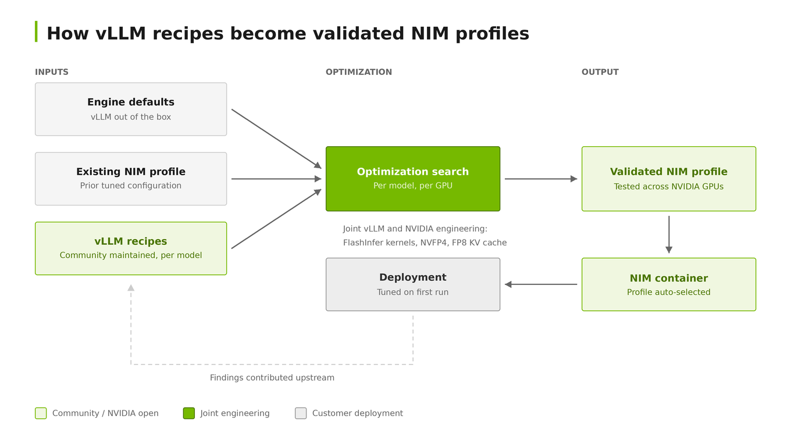

When open model weights land, the hard question every team asks next is: how do I run and serve this model, on my hardware, for my workload efficiently? Answering it has traditionally meant reading a model card, guessing at engine flags, benchmarking, and repeating until the numbers look acceptable.

Through [vLLM Recipes](https://recipes.vllm.ai/), the community maintains structured, per-model serving guides that specify the exact configuration for a given model and hardware target, covering NVIDIA H100, H200, B200, B300, and Grace Blackwell systems. Each recipe captures what actually matters in practice: the quantization format, parallelism strategy, context length, whether speculative decoding applies, and whether prefill and decode should be disaggregated. Developers pick a model and a hardware target and copy the vllm serve command that runs. The recipes are also published as machine-readable JSON so tools and agents can consume them directly, and [serve\_with\_recipe.sh](https://github.com/vllm-project/vllm/blob/main/tools/recipes/README.md) fetches the current recipe at runtime and launches the engine in one step.

Much of the performance those recipes encode comes from joint engineering efforts between vLLM and NVIDIA engineering teams. Enabling NVIDIA Blackwell in vLLM spanned [more than a hundred pull requests](https://vllm.ai/blog/2025-10-09-blackwell-inferencemax) developed with NVIDIA engineers: FlashInfer kernels for FP8 attention and NVFP4 GEMMs, MoE backends, FP8 KV cache, async scheduling, and disaggregated serving. The result is that a recipe calling for NVFP4 on a B200 is not an aspiration. It is a tested path built on kernels both teams worked on together.

Performance-optimized NVIDIA NIM microservices build on vLLM and its community recipes, turning tested serving configurations into defaults. An automated optimization workflow starts with vLLM engine defaults, existing NIM profiles, and published recipes, tunes each model and GPU combination, and ships the result as a validated NIM profile developers can use out of the box.

Where a recipe tells a developer which settings to apply, NIM ships those settings already applied, validated across more than 37 NVIDIA hardware SKUs and packaged with [hardware-aware profile selection](https://docs.nvidia.com/nim/large-language-models/latest/reference/support-matrix.html). A team pulls the container, points it at a model, and gets a tuned configuration without assembling one. For supported models, NIM documents the [verified configurations](https://docs.nvidia.com/nim/large-language-models/2.1.4/reference/support-matrix.html) and the performance to expect from each.

That matters most where recipes get hardest to write by hand. An interactive assistant and a batch generation service want different configurations of the same model, and a deployment spanning multiple nodes with disaggregated prefill and decode has more variables than any single command line captures. NVIDIA Dynamo extends the same idea to that tier, publishing [pre-tuned deployment manifests](https://docs.nvidia.com/dynamo/kubernetes-deployment/deploy-models/model-deployment-guide) with model cache setup and benchmark jobs, and profiling a model against discovered cluster hardware to generate a configuration when no recipe matches.

None of this removes the engine from the developer’s hands. The [model-free vLLM NIM container](https://catalog.ngc.nvidia.com/orgs/nim/nvidia/collections/certified-nim-model-free/-) serves whatever weights you point it at, exposes an OpenAI-compatible API with the engine’s native metrics, and leaves vLLM’s [configuration surface](https://docs.nvidia.com/nim/large-language-models/2.1.4/reference/advanced-configuration.html) accessible for teams with requirements no recipe anticipates. What changes is the starting point: a tuned, supported configuration rather than a blank command line.

For production, NIM adds what a recipe cannot: [vulnerability scanning and remediation, validated releases, and enterprise support](https://docs.nvidia.com/nim/large-language-models/2.1.4/about-nim-llm/enterprise-grade.html), with [Production Branch images](https://docs.nvidia.com/nim/large-language-models/latest/about-nim-llm/nim-offerings.html) offering a fixed software baseline and monthly security fixes for regulated environments. Enterprise support is optional and available with an active [NVIDIA AI Enterprise subscription](https://docs.nvidia.com/ai-enterprise/planning-resource/licensing-guide/latest/licensing.html).

The most useful part of this arrangement is that it runs in both directions. Validating configurations across dozens of hardware SKUs surfaces issues a single-GPU recipe would never expose, and tuning models for customer workloads produces findings that belong upstream rather than in a container. Contributing them back is what keeps the recipes worth reading, and what makes the next open model launch easier to deploy than the last one.
