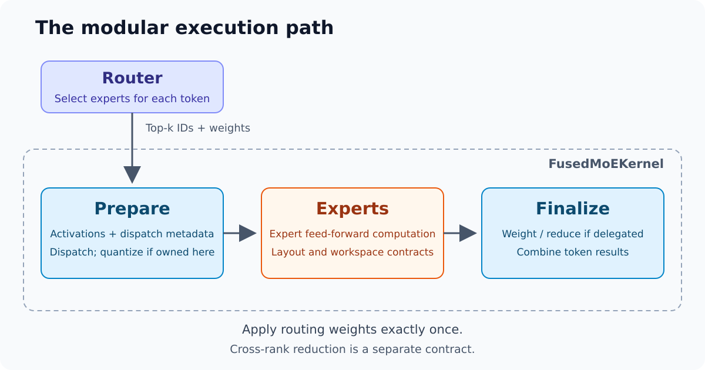

A fast Mixture-of-Experts kernel is only one part of a working MoE
implementation. Before it can serve a model, tokens need to reach the right
experts, checkpoint weights need to match the kernel's layout, and the results
need to return to the right requests. Quantization, expert parallelism, shared
experts, and different routing algorithms all affect those steps.

For a contributor adding a kernel, the challenge is knowing how much of that
machinery needs to change. For a maintainer, it is knowing which combinations
are valid—and why.

The MoE refactoring in vLLM separates these responsibilities: model-level
orchestration, expert weights, routing, communication, compute, and backend
selection. The goal is to let implementations reuse the pieces they share
while making their compatibility requirements explicit.

This post walks through that structure and follows a new kernel from its
compute implementation to selection and execution in a model. The focus is on
what these boundaries mean for someone adding a kernel, dispatcher, or
quantization method.

## Why MoE needs more than a kernel interface

At a high level, a routed MoE layer selects a small number of experts for each
token, runs their feed-forward networks, and combines their weighted outputs.
Under expert parallelism, those experts can live on different devices, so
dispatch and combine also move data between ranks.

Each stage has multiple implementations. One communication backend might
produce a token-major tensor; another might group tokens into fixed-capacity
batches for each local expert. A compute kernel might expect quantized inputs,
or it might fuse input quantization into its own implementation. Different
kernels can require different weight packing even when they support the same
checkpoint quantization format.

Treating each combination as a separate end-to-end implementation duplicates
integration work. Treating all implementations as interchangeable hides
important correctness constraints. The useful boundary is between components
that can be developed separately, with explicit rules governing how they fit
together.

## Separate the layer from the implementation

The model-facing entry point is `FusedMoEFactory()`. It assembles the MoE
components and returns a `MoERunner`, the module called by the model's forward
pass.

The runner coordinates execution: routing, optional input and output
transforms, expert computation, shared experts, and the required reductions.
It does not need to own the details of every expert weight representation or
compute backend.

Those responsibilities are divided among cooperating components:

- `FusedMoERouter` supplies expert IDs and routing weights for the modular
  execution path. Routing policy is separate from the expert computation.
- `RoutedExperts` owns the expert parameters and their loading machinery,
  including sharding and expert placement. Its quantization method connects
  those parameters to the selected execution backend.
- `SharedExperts` wraps the shared-expert module supplied by the model and
  coordinates when it runs, including supported overlap with routed work.

This distinction matters when changing one part of the stack. A new compute
kernel does not inherently require a new router or a replacement checkpoint
loader. A new scheduling strategy for shared experts does not need to
redefine their neural-network architecture.

There is also a useful distinction between two lifecycles. During model
initialization and loading, vLLM selects an implementation, prepares its
weights and quantization configuration, and constructs the kernel. During a
forward pass, the runner coordinates execution using that prepared state.
Backend selection is not repeated as a benchmarking exercise for every token.

The [companion layer architecture document](https://github.com/neuralmagic/vllm/blob/6b64a1fb04e16e0c6e76f075eb51cadb9960c316/docs/design/fused_moe_design.md) describes
the full ownership and execution relationships.

## Make communication and compute separate components

Within the kernel framework, `FusedMoEKernel` pairs an experts implementation
with a prepare/finalize implementation. For the modular path, the conceptual
sequence is:

*Figure 1. The modular execution path. Boxes mark responsibilities, not GPU
kernel launches; input quantization and top-k reduction ownership depend on
the paired implementations.*

Preparation handles dispatch and, when appropriate, input quantization. The
experts component implements the feed-forward computation: arranging tokens
for the selected experts, the first matrix multiplication, activation,
intermediate quantization where needed, the second matrix multiplication, and
restoring the required output layout. Finalization combines the results back
into token outputs.

These are ownership boundaries, not a requirement to launch a separate GPU
kernel for every operation. Implementations can fuse work within those
boundaries. Output weighting and top-k reduction can be fused into the experts
implementation or delegated to finalization. Models that weight expert inputs
instead must not apply those weights again when combining outputs. The
interfaces record these ownership choices.

This separation lets a communication implementation be reused with compatible
experts implementations, and lets a compute implementation be exercised with
compatible communication paths. A local execution path also uses
prepare/finalize without requiring distributed dispatch.

### Leave room for monolithic implementations

Not every optimized implementation exposes routing as a separate step. The
framework also supports monolithic experts that normally receive router logits
and perform expert selection internally.

`FusedMoEKernel` supports both styles, but the pairing must be consistent:
modular experts use modular prepare/finalize, and monolithic experts use
monolithic prepare/finalize. The abstraction preserves specialized routing and
fusion choices instead of requiring every backend to expose the same internal
sequence.

Supported monolithic implementations can additionally accept precomputed
routing for data-parallel padding cases. That is an optional contract on both
components, not a third kernel category or a capability every monolithic
backend inherits automatically.

## Compatibility means more than matching tensor shapes

The most important part of the interface is often the information around the
tensor rather than the tensor itself.

Consider an experts kernel that consumes a standard `(tokens, hidden)` input.
A padded input can have the same two-dimensional shape, but some rows are
inactive, marked by expert IDs of `-1`, and may contain uninitialized data.
Supporting ordinary token-major input does not establish that those rows are
handled safely.

Similarly, a batched dispatcher produces per-expert capacity, not necessarily
that many valid tokens. The experts implementation must honor the accompanying
valid-token counts.

Quantization has an ownership contract too. An experts implementation can
request unquantized inputs because it performs input quantization itself.
The prepare/finalize implementation must support deferring that work. Matching
the activation layout and nominal quantization scheme is not enough to make
the pair compatible.

Two other boundaries are easy to confuse:

- **Routing-weight reduction and cross-rank reduction are different.** Summing
  a token's top-k expert contributions does not establish that its output has
  been reduced across ranks. The runner needs to know whether another
  cross-rank reduction is necessary, including for shared-expert outputs.
- **Launching asynchronous work and making its output available are
  different.** The async prepare/finalize interface separates completion hooks
  from result receivers so execution can coordinate communication and overlap
  safely, including with Dual Batch Overlap.

Experts declare support for device capabilities, quantization schemes,
activation formats, routing, and parallel configurations. The shared
`is_supported_config()` checker combines these constraints and returns a
rejection reason when a candidate does not fit. Pairing and execution contracts
still need validation; a support predicate is not proof that every combination
works.

The [modular kernel design](https://github.com/neuralmagic/vllm/blob/6b64a1fb04e16e0c6e76f075eb51cadb9960c316/docs/design/fused_moe_modular_kernel.md) describes
these contracts in detail. The
[capability tables](https://github.com/neuralmagic/vllm/blob/6b64a1fb04e16e0c6e76f075eb51cadb9960c316/docs/design/moe_kernel_features.md) are a useful starting
point when choosing an implementation to extend.

## Oracles connect selection to usable weights

In vLLM, a MoE *oracle* is the selection and construction policy associated
with a quantization family. Despite the name, it is not a runtime autotuner
that benchmarks every kernel and discovers the fastest one.

Automatic selection follows an ordered policy and checks candidate experts
against the deployment configuration. Explicit backend choices also need
compatibility checking, subject to the family's mapping and fallback rules.

Selection alone is insufficient. A selected kernel also needs weights in its
expected representation and a matching runtime quantization configuration.
The oracle organization therefore brings together four related tasks:

1. Select a supported backend and experts class.
2. Convert loaded weights and scales into the backend's required format.
3. Construct the runtime quantization configuration where needed.
4. Assemble compatible prepare/finalize and experts components into a kernel.

The quantization method connects these tasks to the layer's loading lifecycle
and execution entry points. The oracle does not replace checkpoint loading,
and constructing a kernel does not perform weight conversion by itself.

The [oracle unification RFC](https://github.com/vllm-project/vllm/issues/37753)
proposes a common class structure for these responsibilities. The shared
`MoEKernelOracle` interface is being adopted incrementally: class-based helpers
and module-level entry points coexist. The architectural direction is a
consistent interface, not a claim that all existing implementations have
already completed that transition.

## What adding a new implementation looks like

Suppose you have a new FP8 experts kernel for a supported accelerator, using
an existing quantization scheme and standard token-major inputs. The compute
kernel is new; the model, router, and checkpoint format are not.

The integration starts with an adapter under `fused_moe/experts/` implementing
`FusedMoEExpertsModular`. It declares its scratch-buffer requirements, writes
its computation into the supplied output buffer, and identifies who applies
routing weights and reduces the expert contributions. Its capability methods
describe the devices, quantization details, activations, layouts, and parallel
configurations it actually supports.

Next, connect it to the existing FP8 oracle. Add the class to the appropriate
backend's candidate mapping and make it reachable through automatic selection
or the applicable explicit choice. If it needs different weight packing or
scale handling, add the corresponding conversion and quantization-config
logic. Pass any additional construction requirements through kernel assembly,
and connect required post-load hooks.

That does not ordinarily require a new quantization method or a new oracle
module. The existing family is the integration point for another implementation
of the same scheme.

Finally, validate three distinct questions: is the new implementation selected,
is its computation correct, and does it work with weights loaded through the
real layer path? Registering it in the modular-kernel test harness helps test
combinations, but that registry does not register it for production selection.

The same separation helps locate other kinds of contributions:

| Contribution | Main work | Integration that must accompany it |
| --- | --- | --- |
| New experts kernel | Compute adapter and capability declarations | Oracle selection, weight conversion, and kernel construction |
| New dispatch/combine backend | Communication manager and prepare/finalize adapter | Backend configuration, communicator construction, activation-format prediction, and the adapter factory |
| New quantization method | Parameter creation, loading metadata, post-load processing, and execution | Quantization-config selection for `RoutedExperts`, plus the relevant oracle calls |
| New oracle or selection policy | Candidate mapping, priorities, conversion, and construction policy | Connect the quantization method's call sites; a new class is not automatically registered |

For a dispatcher, activation-format prediction is especially important:
selection consults the deployment configuration before constructing the
prepare/finalize object. The predicted format must match what dispatch actually
produces.

For a quantization method, the execution entry points are just as important as
the weight setup. Assigning `moe_kernel` does not supply the method's forwarding
implementation; the concrete method must implement the execution modes it
supports.

The [contribution guide](https://github.com/neuralmagic/vllm/blob/6b64a1fb04e16e0c6e76f075eb51cadb9960c316/docs/contributing/fused_moe.md) follows each of these
paths through the relevant factories, configuration, loading hooks, and tests.

## Test the boundaries as well as the kernel

The component boundaries provide a useful way to structure validation.
Selection tests can check priorities, explicit choices, and rejection reasons
without running GPU kernels. Numerical tests compare compatible experts and
dispatchers against a reference. Layer and model tests exercise the checkpoint
loading, conversion, routing, and execution that synthetic kernel inputs do
not cover.

Distributed tests need more than evenly balanced traffic. Empty ranks, uneven
expert assignments, padding, capacity limits, and nontrivial expert mappings
are part of the interface.

Optional features also need their own evidence. Fixed-placement expert
parallelism does not prove Expert Parallel Load Balancing (EPLB) support:
expert weights and scales must remain valid after redistribution. An ordinary
forward pass does not prove LoRA support or compatibility with
Transformers-backed model integration. Shared-expert overlap and CUDA graph
execution likewise need coverage when a backend claims those capabilities.

Performance remains a separate question. Changing automatic backend priority
should be supported by measurements on representative hardware, shapes,
quantization schemes, and communication topologies. A cleaner integration
interface does not establish which implementation is fastest for a workload.

## A clearer path from kernel to serving

The refactoring gives MoE contributors a more precise unit of change. A kernel
author can focus on expert computation and its input contracts. A communication
author can focus on dispatch, combine, and synchronization. A quantization
author can focus on how checkpoint parameters become executable weights.
Selection policy connects those implementations to supported deployments.

The result is a framework for reusing compatible implementations while keeping
specialization possible. When adding the next kernel or communication backend,
start by identifying the responsibility that is new, then make its contracts,
selection, and validation explicit.
