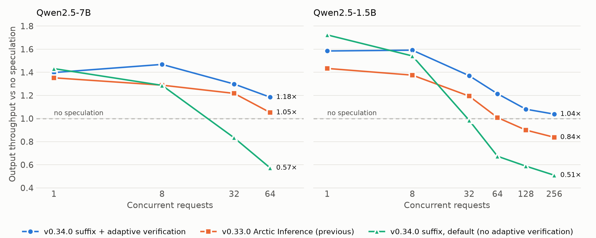

vLLM v0.34.0 ships a new implementation of suffix decoding: a speculator that runs entirely on the GPU inside Model Runner V2 (MRV2), works with async scheduling, and no longer depends on the Arctic Inference package. With adaptive verification it beats the previous implementation at every concurrency we measured, by 1.05–1.22× in offline throughput up to 64 concurrent requests and 1.19–1.33× at 128–256 on the same attention backend. At high load it stays faster than running without speculation, where the previous implementation fell behind it.

This post explains how it works, the trade-offs we made, how it performs, and how to use it.

## Suffix decoding in one paragraph

Speculative decoding proposes several tokens ahead and lets the target model verify them in a single forward pass. Most speculators need a draft model. [SuffixDecoding](https://arxiv.org/abs/2411.04975) needs none: it looks for the longest earlier occurrence of the text the model just produced, both in the request's own prompt and output and in responses to earlier requests, and proposes what followed it, choosing the continuation by how often each next token appears across matches. That is cheap, and very effective whenever outputs repeat: agent loops, code editing, RL rollouts, structured JSON, templated reports. The technique was introduced by the SuffixDecoding authors and Snowflake's [Arctic Inference](https://github.com/snowflakedb/ArcticInference), whose CPU suffix tree powered `method="suffix"` in vLLM until now.

## Why a new implementation

vLLM's previous suffix decoding called Arctic Inference's suffix tree on the CPU for every request at every step. That needs the latest sampled tokens on the host each step, so it only ran on the V1 model runner, with async scheduling turned off. MRV2 overlaps CPU scheduling with GPU execution and never waits on the GPU in the decode loop, so a host-side drafter doesn't fit. With V1 removed in v0.34.0, suffix decoding needed a GPU-native design.

The goals were:
- **No host sync** on the propose path, so async scheduling keeps working.
- **Cost that doesn't grow** with batch size or corpus size in any way that matters.
- **Identical state on every tensor-parallel rank** without extra collectives.
- **Acceptance on par** with the CPU suffix tree.

## Architecture

Each decode step, for every request, the speculator produces exactly `num_speculative_tokens` (k) draft tokens from two sources and keeps the better one.

**1. The request's own history.** A Triton kernel finds the longest suffix of the request's tokens that occurred earlier in its prompt or output, up to `suffix_decoding_max_tree_depth` (24) tokens, preferring the newest occurrence, and drafts what followed it. It uses the same blocked layout as vLLM's `ngram_gpu` speculator: each block of positions computes its best match, and the results are packed into one integer per block and reduced.

**2. A corpus of finished responses.** When a request finishes, its response, plus its last three prompt tokens so that a response's first tokens can be drafted too, is appended to a GPU token ring buffer (`suffix_decoding_corpus_tokens`, 1M tokens by default). The oldest responses are overwritten first. Every position is indexed in two hash tables, keyed on the 2 and the 4 tokens before it. Each bucket has 8 slots, one per recent document (slot = document number mod 8), and each slot keeps the newest occurrence via an `atomic_max` over `(document << 32 | position)`.

**3. Lookup, verify, extend.** For a request, the speculator hashes its last 2 and last 4 tokens, which gives up to 16 candidate positions. The index is only an entry point. Each candidate is compared backwards against the request's history to get its real match length, so hash collisions and entries for overwritten documents simply drop out instead of producing wrong drafts.

**4. Frequency vote.** As in SuffixDecoding, for each distinct match length L among the candidates, the candidates matching at least L tokens vote on the continuation token by token. Each step takes the most frequent next token (ties go to the newest candidate), and a chain's score is the sum of its per-token vote shares. The highest-scoring chain wins, with exact ties going to the longer match (scores are compared as integer fractions). The corpus draft then competes with the own-history draft, and the longer match wins.

```
Request history:  ... "report" "the" "camera" "at" "the" "north" "gate"
                                          └──── last 4 ────┘
                                                       └─ last 2 ┘

1) LOOK UP          hash(last 4), hash(last 2) -> buckets, 8 slots each
2) EXTEND BACKWARDS each candidate against the request (up to 24 tokens):
   request:   report the camera at the north gate
   corpus:    log:   the camera at the north gate     -> match length 6
   stale or colliding candidate -> length 0, dropped
3) VOTE + DRAFT     candidates matching >= L tokens vote on the next k tokens
4) COMPARE          with the longest match in the request's own history;
                    the longer match wins, empty slots get the last token
```

**5. Fixed-width drafts.** The draft always has k tokens. Slots without a match are filled with the last sampled token, so shapes stay static for CUDA graphs and async scheduling. Verifying filler slots costs compute, though, which is where adaptive verification comes in.

**6. Adaptive verification.** With `enable_adaptive_verification`, the speculator reports a confidence for every draft slot. It is learned online from what the target model actually accepted, per draft source (own history or corpus), match-length bucket and position, using integer counters with Laplace smoothing that are halved every 1,024 steps. vLLM's adaptive verification then decides, per batch, how many slots are worth verifying given the cost of verification at the current batch size. At low concurrency it verifies almost everything. Under load it trims the long tail.

**7. Ingestion.** Finished requests are ingested in a hook that runs before their slots are freed (preempted requests are skipped). One GPU program per (document, block) writes the tokens and index entries. Each program replays the burst's placement to find its offset, and skips positions that a later document in the same burst will overwrite. So every position is written by exactly one program, and the result is exact and order-independent even when a burst is larger than the ring. A burst of 256 finished 4,096-token responses takes 0.57 ms at the default corpus size. The corpus is also reset after MRV2's startup kernel warmup, so warmup requests don't stay in it.

**8. Tensor parallelism without collectives.** Every rank ingests finished requests in sorted id order, index inserts are order-independent `atomic_max` operations, and the adaptive-verification statistics are integer counters. Every TP rank therefore holds an identical corpus and produces identical drafts without communicating.

All of this is device-resident. Proposing a draft is a few Triton kernel launches with no host reads: 11–34 µs of GPU time for batches of 1–256 requests, the same at 1M and 4M corpus tokens. As the engine runs it today (without CUDA graphs for the drafter), that is about 90 µs per step at 4K context, mostly launch overhead, and 240 µs at 128K context with 32 requests.

## Design trade-offs

**Hash index instead of a suffix tree or suffix array.** An exact structure finds every match, but on the GPU it needs rebuilds, epochs or CPU coordination, and a brute-force scan costs time proportional to batch × corpus. The hash index has a fixed per-request cost and needs no rebuilds. To measure what it gives up, we replayed 21,299 greedy Qwen2.5-1.5B requests (5.1M output tokens; chat, instructions, GSM8K, Spec-Bench, code editing, rewriting and templated JSON) in waves of 64 with a 1M-token corpus and k=8:

| Drafter | Mean tokens per step |
|---|---|
| Own history only | 1.651 |
| **This implementation** | **1.937** |
| Exact corpus search + the same vote (upper bound) | 1.956 |
| Arctic Inference, k=8 | 1.923 |
| Arctic Inference, k=24 | 1.948 |

The index costs about 1% of acceptance compared with an exact search, and acceptance is on par with Arctic. The kernels match this replay on all 1,280 sampled drafts.

**Only finished responses are indexed.** Arctic also indexes responses while they are still being generated, which helps when many concurrent requests produce near-identical output, for example templated reports over a batch of images. Indexing in-flight responses on the GPU is possible future work.

**Fixed-width drafts.** Always proposing k tokens keeps the drafter simple and graph-friendly, and makes adaptive verification essential under load: without it, verifying every slot loses throughput from roughly 32 concurrent requests up (see below).

**Adaptive verification needs a capable attention backend.** It replays variable-length decode batches in CUDA graphs. On Hopper, FlashAttention 3 supports this. On earlier GPUs, vLLM's FlashAttention 2 backend doesn't, so use `TRITON_ATTN`.

**Memory.** At the defaults the corpus and index take 36 MB (a 4 MB ring plus a 32 MB index). Suffix decoding also keeps each request's token history on the GPU (`max_num_seqs × max_model_len × 4` bytes, e.g. 32 MiB for 256 × 32K).

**One shared corpus.** Like Arctic's global tree, the corpus holds responses from all requests regardless of `cache_salt` or LoRA adapter. Drafts never change the output distribution, but how many are accepted shows up in decode speed. Where requests must not influence each other, set `suffix_decoding_corpus_tokens: 0`.

**Seeded sampling isn't reproducible.** Drafts depend on earlier requests, and with adaptive verification the number of verified slots depends on the batch, so a request with a fixed `seed` can produce different samples on different runs. For reproducible seeded sampling, set `suffix_decoding_corpus_tokens: 0` and leave adaptive verification off.

## Performance

We benchmarked the released wheels: vLLM v0.34.0 against v0.33.0, the last release where `method="suffix"` used Arctic Inference (V1 runner, async scheduling off).
- **Hardware and models:** NVIDIA L4 GPUs, one GPU per run; Qwen2.5-7B-Instruct and Qwen2.5-1.5B-Instruct in bf16.
- **Decoding:** greedy, up to 256 output tokens, prompts from a fixed mix of chat, instruction, math, code-editing and templated-JSON requests.
- **Configs:** each implementation at its defaults (Arctic k=24, v0.34.0 k=8). We also ran Arctic at k=8 and report its better result. Adaptive verification runs use `TRITON_ATTN`.
- **Ratios** are against no speculation in the same release on the same attention backend. Each point is one run.



Offline throughput (`LLM.generate`, concurrency = `max_num_seqs`), output tokens/s:

| Qwen2.5-7B | 1 | 8 | 32 | 64 |
|---|---|---|---|---|
| v0.33.0 no speculation | 17.6 | 120.2 | 399.1 | 684.0 |
| v0.33.0 Arctic (best of k=24, k=8) | 23.8 | 154.9 | 485.9 | 719.4 |
| v0.34.0 suffix, default | **25.2** | 154.3 | 326.1 | 390.8 |
| v0.34.0 suffix + adaptive verification | 24.6 | **175.6** | **510.8** | **806.8** |

| Qwen2.5-1.5B | 1 | 8 | 32 | 64 | 128 | 256 |
|---|---|---|---|---|---|---|
| v0.33.0 no speculation | 74.3 | 512.3 | 1,619 | 2,666 | 3,707 | 4,181 |
| v0.33.0 Arctic (best of k=24, k=8) | 106.5 | 704.6 | 1,933 | 2,689 | 3,336 | 3,502 |
| v0.34.0 suffix, default | **127.2** | 794.0 | 1,585 | 1,793 | 2,131 | 2,100 |
| v0.34.0 suffix + adaptive verification | 120.9 | **819.3** | **2,217** | **3,288** | **4,271** | **5,104** |

- **Against the previous implementation:** 1.06×, 1.13×, 1.05× and 1.12× faster on 7B at 1–64 concurrent requests, and 1.15–1.22× on 1.5B at 1–64.
- **Backend effect at 128–256 (1.5B):** `TRITON_ATTN` alone is 1.09–1.19× faster than FlashAttention 2 there. On the same Triton backend, the best Arctic run reaches 3,604 and 3,844 tok/s, so the new implementation is 1.19× and 1.33× faster.
- **Against no speculation under load:** at 256 concurrent requests the new implementation is still 1.04× faster. Arctic drops to 0.84× (0.77× on Triton).
- **Without adaptive verification**, verifying all 8 slots every step is best at a single request, but falls well below no speculation from about 32 concurrent requests up.

Online serving (`vllm serve` + `vllm bench serve`, Qwen2.5-7B, after a warm-up), throughput vs no speculation:

| Concurrency | 1 | 8 | 32 | 64 |
|---|---|---|---|---|
| v0.33.0 Arctic | 1.32× | 1.37× | 1.24× | 1.09× |
| v0.34.0 suffix, default | 1.49× | 1.37× | 0.84× | 0.65× |
| v0.34.0 suffix + adaptive verification | 1.45× | 1.44× | 1.35× | 1.22× |

In absolute terms that is 1.10×, 1.06×, 1.07× and 1.13× Arctic's throughput. Time per output token at one request drops from 56 to 44 ms. One cost: median time to first token at one request is 126 ms vs 73 ms without speculation, about one decode step, which other MRV2 speculative-decoding methods share.

Workloads, throughput vs no speculation (concurrency 32 unless noted):

| Workload | v0.33.0 Arctic | v0.34.0 default | v0.34.0 + adaptive verification |
|---|---|---|---|
| VLM: Qwen2.5-VL-3B, 360 camera frames, templated JSON reports and captions | 1.65× | 1.36× | 1.64× |
| RL rollouts: Qwen2.5-1.5B, GSM8K, n=8, temperature 1 | 1.16× | 0.92× | **1.47×** |
| Multi-turn chat: Qwen2.5-7B, UltraChat histories | 1.07× | 0.77× | **1.14×** |
| RAG and summarization: Qwen2.5-7B, Spec-Bench | 1.13× | 0.83× | **1.16×** |
| Long-context decode: Qwen2.5-7B, 24K-token prompts, concurrency 3 | 1.06× | **1.15×** | 1.04× |

RL rollouts gain the most: eight samples of the same prompt are exactly the kind of repetition the corpus captures. On the templated VLM workload the two implementations are tied (1.02× in absolute terms), plausibly because Arctic also indexes in-flight responses.

Accuracy is unchanged. On GSM8K (Qwen2.5-7B, all 1,319 questions, 5-shot, greedy) every configuration scores 82.6–83.2%. Speculative decoding verifies drafts with the target model, so outputs follow the target's distribution.

## How to use it

Suffix decoding needs no draft model and no extra package:

```python
from vllm import LLM, SamplingParams

llm = LLM(
    model="Qwen/Qwen3-8B",
    speculative_config={"method": "suffix"},  # num_speculative_tokens defaults to 8
)
outputs = llm.generate(["..."], SamplingParams(temperature=0, max_tokens=512))
```

For serving with more than a handful of concurrent requests, enable adaptive verification. On pre-Hopper GPUs, select the Triton attention backend:

```bash
vllm serve Qwen/Qwen3-8B \
  --speculative-config '{"method": "suffix", "enable_adaptive_verification": true}' \
  --attention-backend TRITON_ATTN
```

Options:

| Key | Default | What it does |
|---|---|---|
| `num_speculative_tokens` | `8` | Draft length. Every slot is verified unless adaptive verification trims it, so keep it moderate. |
| `enable_adaptive_verification` | `false` | Verify only the draft slots worth their cost; recommended from about 8–32 concurrent requests up. |
| `suffix_decoding_max_tree_depth` | `24` | Maximum match length (at least 2 for corpus matches). |
| `suffix_decoding_corpus_tokens` | `1048576` | Capacity of the cross-request corpus. `0` drafts only from each request's own history. |

Suffix decoding helps most when outputs repeat: agentic loops, code editing, RL rollouts, structured or templated output, and repeated or similar prompts. For open-ended chat at high concurrency, use adaptive verification or another speculator.

The implementation is in [#60339](https://github.com/vllm-project/vllm/pull/60339), and the user guide is in the [suffix decoding docs](https://docs.vllm.ai/en/latest/features/speculative_decoding/suffix/).
