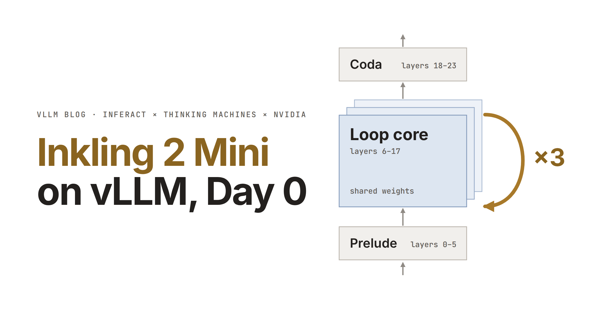

<p align="center">

</p>

Thinking Machines [announced](https://thinkingmachines.ai/news/inkling-2-mini/) [Inkling 2 Mini](https://huggingface.co/thinkingmachines/Inkling-2-Mini) today. vLLM supports it and its variable-loop research checkpoint, [TML-d24-varloop-research](https://huggingface.co/thinkingmachines/TML-d24-varloop-research), on day 0 on NVIDIA Blackwell, Hopper and DGX Spark. Inkling 2 Mini is a **looped** model: its middle 12 layers run three times per token with shared weights, each pass with its own KV cache and gated messages from the pass before. It is a multimodal MoE with 26B total and 3.5B active parameters, up to 1M tokens of context and a native DSpark speculator.

## TL;DR

- **Looped layers.** Layers 6–17 run three passes with shared weights. Each pass keeps its own KV cache and reads gated messages from the one before.
- **26B total, 3.5B active, 1M context, Native DSpark.** A multimodal MoE built from Inkling 2 Small's components, with NVFP4 experts (MXFP8 in the last 4 layers) and a native DSpark speculator.
- **Optimized day-0 support on Blackwell, Hopper and DGX Spark.** vLLM manages each pass's caches like any other cache layer, fuses the message reads and controllers, and reuses Inkling 2 Small's fused kernels.
- **RL support.** vLLM serves Inkling 2 Mini for reinforcement learning with [SkyRL](https://github.com/NovaSky-AI/SkyRL).
- **Variable-loop research checkpoint.** vLLM also serves TML-d24-varloop-research, where you choose the number of passes, and whether the passes share one KV cache, at startup.

We provide a Docker image with Inkling 2 Mini support, `vllm/vllm-openai:inkling-2-mini`. You can serve the model with:

```bash
docker run --gpus all --ipc=host -p 8000:8000 \
  -v ~/.cache/huggingface:/root/.cache/huggingface \
  vllm/vllm-openai:inkling-2-mini thinkingmachines/Inkling-2-Mini \
  --reasoning-parser inkling --tool-call-parser inkling --enable-auto-tool-choice \
  --speculative-config '{"method":"dspark","num_speculative_tokens":7,"draft_sample_method":"probabilistic"}'
```

And the variable-loop research checkpoint, here with 2 passes and one KV cache shared across passes:

```bash
docker run --gpus all --ipc=host -p 8000:8000 \
  -v ~/.cache/huggingface:/root/.cache/huggingface \
  vllm/vllm-openai:inkling-2-mini thinkingmachines/TML-d24-varloop-research \
  --reasoning-parser inkling --tool-call-parser inkling --enable-auto-tool-choice \
  --hf-overrides '{"text_config": {"loop_num_passes": 2, "loop_share_cache": true}}'
```

## The Loop

<iframe class="vllm-embed" src="/assets/interactive_pages/inkling-loop.html" title="Inkling 2 Mini: looped layers" loading="lazy" scrolling="no" style="display: block; width: 100%; height: 520px; border: 0; overflow: hidden;"></iframe>

*Figure 1. The prelude and coda run once; the loop core runs three passes, each reading messages from the one before.*

**Prelude, core, coda.** The 24 layers split into a prelude (layers 0–5), a loop core (layers 6–17) and a coda (layers 18–23). The prelude and coda run once each; the core runs three passes with shared weights, and the coda continues from the last pass. Each group of six layers is one block of the [block attention residuals](https://arxiv.org/abs/2603.15031) used in Inkling 2 Small, so one pass of the core produces exactly two blocks.

**Every pass starts from the prelude's output.** A plain looped model feeds pass p's output into pass p + 1. Here, all three passes start from that same output, and pass p + 1 sees pass p only through messages.

**Messages are read at every sublayer.** From the second pass on, each core sublayer input (the attention's query, key and value inputs and the MLP input) gets its own message, read from the previous pass's two blocks by an attention-residual read with a learned query per layer and input type. A rank-64 controller then merges the message into the input, per channel:

```
h   = W_down · [rms(input), rms(message)]
out = (1 − tanh(W_forget · h)) · input + tanh(W_gain · h) · message
```

With 12 core layers and 4 inputs each, every later pass reads 48 messages per token. Because the query, key and value inputs get different messages, the sliding-window layers, which project all three from one input in the first pass, take three separate inputs in later passes.

**Each pass keeps its own memory.** Every core layer has a KV cache and a conv-state cache per pass, so pass p attends to the keys and values that pass p computed for earlier tokens. The model has 24 layers but 48 KV caches and 48 conv-state caches.

**DSpark draft from inside the loop.** The 3-layer DSpark draft reads the target's hidden states at four layer visits: one in the prelude, one each in the second and third passes, and the final output.

**The layers themselves follow Inkling 2 Small.** Each layer uses Inkling 2 Small's components at hidden size 2,304: block attention residuals, relative-bias attention with a gate and sink (20 sliding-window and 4 full-attention layers, 24 query and 8 KV heads), short convolutions, and 128 routed experts (top-8) in NVFP4 (layers 0–19) and MXFP8 (layers 20–23). Images go through a 23-layer ViT encoder configured like Inkling 2 Small's.

## Serving the Loop in vLLM

**Per-pass caches as regular cache layers.** vLLM registers each extra pass of a core layer as its own attention layer with its own KV and conv-state cache. The KV cache manager and prefix caching treat these caches like any others, so serving the loop needed no new cache-management logic.

**Fused message reads and controllers.** A direct implementation launches 4 message reads and 4 controllers, several kernels each, for every core layer in a later pass. vLLM reads all four messages of a layer in one attention-residual kernel and stacks the four controllers' weights, so their down and gain/forget projections run as batched GEMMs. One Triton kernel computes the controllers' RMS normalizations, and another fuses the gated merge with the RMSNorm of the sublayer the message feeds. The merge runs in FP32 without FMA contraction, matching the reference.

**Fused kernels around every sublayer.** For Inkling 2 Small, vLLM fuses each sublayer's all-reduce, short convolution, residual update, attention-residual mix and RMSNorm into one kernel. vLLM generalizes these kernels from hidden size 4,608 to 2,304 and adds a mode that returns the FP32 mix before the RMSNorm, so the later passes can merge their messages into it. Inkling 2 Mini uses them at every tensor-parallel size, including TP1; at TP > 1, small batches also fuse the all-reduce over NVLink multicast.

## Variable-Loop Research Checkpoint

Thinking Machines also releases [TML-d24-varloop-research](https://huggingface.co/thinkingmachines/TML-d24-varloop-research), a research checkpoint trained to run with a variable number of passes. vLLM exposes its two options through `--hf-overrides`:

```bash
docker run --gpus all --ipc=host -p 8000:8000 \
  -v ~/.cache/huggingface:/root/.cache/huggingface \
  vllm/vllm-openai:inkling-2-mini thinkingmachines/TML-d24-varloop-research \
  --reasoning-parser inkling --tool-call-parser inkling --enable-auto-tool-choice \
  --hf-overrides '{"text_config": {"loop_num_passes": 2, "loop_share_cache": true}}'
```

- `loop_num_passes` sets the number of passes (at least 1; the default is the checkpoint's 3). Fewer passes are faster; more passes give higher quality. DSpark requires the default, since the draft reads fixed layer visits.
- `loop_share_cache` makes all passes of a core layer share one KV cache: each pass overwrites the keys and values of its tokens, so later tokens read the last pass's. Conv states stay per pass.

Both options are rejected on fixed-loop checkpoints such as Inkling 2 Mini. On one GB200 (TP1, 4K context, forward pass only):

| Passes | Decode step, batch 1 | Decode step, batch 32 | KV cache capacity |
|---|---|---|---|
| 1 | 1.51 ms | 3.81 ms | 352K tokens |
| 2 | 2.67 ms | 5.92 ms | 233K tokens |
| 3 | 3.85 ms | 8.11 ms | 175K tokens |
| 3, shared KV cache | 3.86 ms | 8.10 ms | 194K tokens |

Sharing the KV cache frees less memory than dropping a pass, because the per-pass conv-state caches remain.

## Accuracy Evals

vLLM keeps the reference implementation's numerics: the same data types at every step, the same NVFP4 and MXFP8 activation quantization, and FP32 message merges, with only the reduction order differing. On a fixed prompt, vLLM's hidden state at each of the 48 layer visits differs from the reference by about as much as the reference's own FlashAttention-4 and PyTorch attention paths differ from each other, and the MoE outputs match bitwise given the same inputs.

End to end, we tested accuracy on needle-in-a-haystack up to 1M tokens, MMMU-Pro and HLE with [inkling-verify](https://github.com/thinking-machines-lab/inkling-verify), and on GSM8K, with DSpark enabled.

## Acknowledgements

We thank the Thinking Machines and NVIDIA teams for their close collaboration in integrating and optimizing Inkling 2 Mini in vLLM. We especially thank Drew Botwinick (NVIDIA).

<script>
(function () {
  // Resize embedded interactive figures to their content height (they post it when framed).
  window.addEventListener('message', function (event) {
    var d = event.data;
    if (!d || d.type !== 'vllm-embed-resize' || typeof d.height !== 'number') return;
    var frames = document.querySelectorAll('iframe.vllm-embed');
    for (var i = 0; i < frames.length; i++) {
      if (frames[i].contentWindow === event.source) {
        frames[i].style.height = Math.ceil(d.height) + 'px';
      }
    }
  });
})();
</script>
