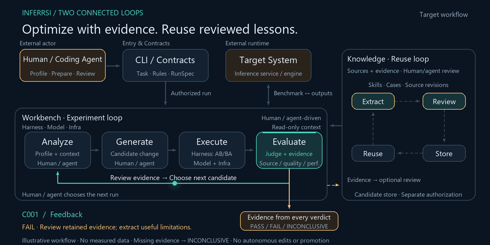

On four NVIDIA B300 GPUs, a patch cut Qwen-Image-2.1-Turbo's warm request latency from 382.92 ms to 268.77 ms. The experiment recorded a failure. The team had set a 30% latency-reduction target before the run, and this set of trials reached 29.81%. The next candidate still had to clear the original threshold. [Qwen-Image campaign record](https://github.com/InferMatrixLab/InferRSI/blob/6bdc86ee339c3007f15833434065adf893bff953/docs/qwen-image-2.1-turbo-b300.md)

InferRSI is a developer-preview tool for bringing up models and tuning inference engines with a coding agent. The agent edits the engine. InferRSI runs the checks and records what happened, including the near misses. Those records let us ask a second question. Can what the agent learns on one workload help it find a better patch on the next? [InferRSI](https://github.com/InferMatrixLab/InferRSI)

## What makes an optimization loop recursive?

In **recursive self-improvement (RSI)**, a system can change the method it will use to make its next improvement. The original Gödel machine proposed rewriting its own code after proving a rewrite would help. The later Darwin Gödel Machine took an empirical approach. It modified the code of a coding agent and evaluated the resulting agents on programming tasks. [Gödel machines](https://arxiv.org/abs/cs/0309048) · [Darwin Gödel Machine](https://arxiv.org/abs/2505.22954)

For inference engineering, consider what happens after an idea fails. On one Ascend 910B1, caching per-step masks and prompt tensors for a BF16 Qwen-Image run at 1280 × 704 exhausted device memory. Within that run, the agent could try a different patch. For future runs, the reusable lesson is to check how long the tensors stay live and how much memory is free before proposing the cache. A maintainer can review a lesson like this in a pull request. The library entry pairs the advice with the device, precision and resolution where the failure occurred. [Qwen-Image failure record](https://github.com/InferMatrixLab/InferRSI/blob/6bdc86ee339c3007f15833434065adf893bff953/src/inferrsi/knowledge/data/skill_library/casebooks/inference/inference-optimization-casebook/cases/qwen-ascend-rejected-directions.md)



*Figure 1. InferRSI’s two loops. Within a campaign, measurements guide the next engine edit. Between campaigns, a reviewed lesson can change how a later agent approaches a task.* [InferRSI project diagram](https://github.com/InferMatrixLab/InferRSI/blob/6bdc86ee339c3007f15833434065adf893bff953/docs/assets/inferrsi-loop.png) · [Apache 2.0 license](https://github.com/InferMatrixLab/InferRSI/blob/6bdc86ee339c3007f15833434065adf893bff953/LICENSE)

These loops need different tests. For the engine, compare the patch against its baseline on the same requests. For the optimizer, give fresh agent sessions the same task and budget, vary access to the reviewed knowledge, and independently retest the best patch each session finds. That second experiment measures the effect of offering the library on those runs. [Paired benchmark design](https://github.com/InferMatrixLab/InferRSI/pull/338)

## How an optimization campaign works

Take an image-generation request whose outputs must remain pixel-identical. Before editing the engine, the agent needs a working baseline, fixed prompts and seeds, a checker that compares the decoded images, and a timer that stops when the client has received the whole response. Timing only the denoising loop would miss costs that the user still pays.

A **campaign** is one search under those fixed conditions. InferRSI splits the work across three components.

1. **Knowledge** gives the agent a place to look for an earlier measurement or failed idea. Each record carries its source and conditions. An agent can inspect the original revision and compare its workload with the recorded one before spending device time on a candidate.
2. **Harness** freezes the baseline, evaluation scripts, budget and acceptance criteria. Each round checks output quality before timing the candidate against the baseline. A completed check can accept or reject a patch. A crash or missing measurement leaves the result inconclusive. The harness retains failed rounds and runs a separate final evaluation of the best saved candidate in a fresh process. [Campaign workflow](https://github.com/InferMatrixLab/InferRSI/blob/6bdc86ee339c3007f15833434065adf893bff953/docs/optimization-workflow-unification.md)
3. **Benchmark** packages a task with a baseline and an independent grader. To test a change to InferRSI itself, two fresh agent sessions can tackle the same task with the same budget. The change might be as small as giving one session access to the knowledge library. Each session gets to choose its own patches. [Benchmark design and first paired run](https://github.com/InferMatrixLab/InferRSI/pull/338)

## Bringing up a new model in vLLM-Omni

Model onboarding produces a different kind of record. Before anything can be tuned, the engine has to load the checkpoint and match the reference implementation. Two recent vLLM-Omni bring-ups show which lessons are worth keeping.

[Realtime-Venus](https://huggingface.co/inclusionAI/Realtime-Venus) failed before generating a token. Its Omni `config.json` points to a separate root YAML rather than describing the language model. Treating it as an ordinary Qwen3 config lost the backbone dimensions. Under Transformers 5.20.2, the released configuration code also called a removed API. The adapter reads the sibling YAML and verifies its SHA-256, and it refuses to fetch a different file on an offline host. The architecture derives from MiniCPM-o 4.5, so vLLM-Omni reuses the existing Thinker, Talker and Code2Wav stages instead of copying kernels. Reuse had limits. The MiniCPM-o recipe runs five FP16 Flow steps, but the Venus profile keeps the checkpoint's ten FP32 steps, which keeps an execution change separate from a sampling or precision change. Checking for a structurally valid WAV file was not enough either. The first bring-up waveform transcribed as unrelated markers in both vLLM-Omni and the reference, so the audio check transcribes the round trip. The case record marks full parity and sustained duplex service as inconclusive. [Realtime-Venus field note](https://github.com/InferMatrixLab/InferRSI/blob/01333d70e3c8b33f940b844b8569d96b39388a83/docs/field-notes/realtime-venus-vllm-omni.md) · [Merged PR](https://github.com/vllm-project/vllm-omni/pull/10976)

LFM3-Omni-2B on one Ascend 910B1 needed a stricter parity ladder. Text tokens for six understanding cases, every audio code and the full greedy waveform had to match Transformers exactly. One mismatch came from rotary frequency buffers. Building them directly on the NPU introduced rounding differences that eventually changed audio codes, even though the weights were identical. The fix builds them on the CPU and then moves them to the device. That lesson now sits in vLLM-Omni's in-tree `add-omni-model` agent skill, so the next coding agent that adds an omni model reads it before it writes the stage. [LFM3 PR and parity results](https://github.com/vllm-project/vllm-omni/pull/9827) · [`add-omni-model` lesson](https://github.com/vllm-project/vllm-omni/blob/495b5f12f6b604db9517d586da9eac0b9f67f25b/.claude/skills/add-omni-model/references/lfm3-omni.md)

Both cases follow the same debugging rule. Replay the same input and compare intermediate values in execution order until you find the first operation whose inputs agree and whose outputs diverge. Only after that check passes does the bring-up become a baseline for an optimization campaign.

## What changed in Qwen-Image

The B300 workload used BF16, eight native denoising steps and one 1280 × 704 request at a time. Some conditioning and geometry work repeats across those steps even though its inputs stay fixed for the request. The patch reused that work, fused operations including query/key normalization and rotary position embedding (RoPE), and added an opt-in symmetric-memory path for exchanging queries, keys and values across GPUs. [Implementation and workload](https://github.com/vllm-project/vllm-omni/pull/8739)

After the 29.81% result, the historical campaign measured **384.16 ms to 266.60 ms**, a 30.60% reduction on a fresh comparison. All 44 measured and held-out output files matched their references in RGB and alpha. Each latency was the median of five trial means. This result belongs to the historical pair of revisions recorded in the campaign. [Measurements and acceptance issue](https://github.com/InferMatrixLab/InferRSI/issues/3)

The upstream PR made a second comparison on a newer pair of revisions. It ran five fresh-server trials per arm and timed the HTTP POST through receipt of the full PNG response. Keeping the communication setting fixed on each side isolates the code change within that setting. [Upstream A/B report](https://github.com/vllm-project/vllm-omni/pull/8739#issuecomment-6119846759)

| Communication setting | Baseline | Candidate | Lower latency |
| --- | ---: | ---: | ---: |
| Default on both revisions | 381.91 ms | 279.83 ms | 26.73% |
| Symmetric memory on both revisions | 374.65 ms | 264.19 ms | 29.48% |

Switching from the baseline default to the candidate with symmetric memory gives a 30.82% reduction. That comparison answers a deployment question because it includes the configuration change. The authors report exact RGB and alpha matches across the tested outputs. The timings describe warm repeated prompts at concurrency one. [Upstream PR](https://github.com/vllm-project/vllm-omni/pull/8739)

On one Ascend 910B1, a separate Qwen-Image-2.1-Turbo change cut warm offline latency from 2,921.23 ms to 2,272.83 ms (22.20%) at the same resolution and step count. All 18 candidate images matched the baseline pixels. A later leave-one-out experiment disabled one optimization at a time against the merged stack. Preparing shared modulation once per step saved 10.05%. Native NPU RoPE with frequency-table reuse saved 7.84%, and attention fusion saved 2.09%. Residual-buffer and KV-owner reuse showed no stable effect. These conditional effects do not add up to the total. They do show which ideas carried the result on this workload, which is the kind of evidence a later agent needs. Every process exited with code 134 after its requests finished, so the authors left teardown inconclusive. [Ascend PR and leave-one-out table](https://github.com/vllm-project/vllm-omni/pull/8729)

## Results across vLLM-Omni workloads

The linked PRs report measurements on the revisions and configurations tested by their authors. For latency, a speedup is baseline time divided by candidate time. For throughput, it is candidate rate divided by baseline rate. The B300 Qwen-Image, Ascend H3-Image, MiniCPM-o and Drama 3 changes reached upstream within 2.5 to 5.1 days of their first public campaign or PR record. That interval excludes development before the first public record. [Optimization roadmap and evidence](https://github.com/InferMatrixLab/InferRSI/issues/416)

| Workload and device | Reported measurement | What the comparison covers |
| --- | --- | --- |
| [MiniMax-H3-Image, 2 × RTX 3090](https://github.com/vllm-project/vllm-omni/pull/10243) | Warm HTTP latency fell from 36.62 s to 14.59 s (2.51×). | One A/B pair of full deployment profiles. All nine paired images, including warmups, matched in RGB. Open PR. |
| [MiniMax-H3-Image, 4 × Ascend 910B1](https://github.com/vllm-project/vllm-omni/pull/10184) | Generation latency fell 35.7% at 4736 × 3552 and 38.2% at 1024 × 1024. | Sequential measurements of opt-in batched VAE decoding and FP16 encoding. The 18 images passed the numerical screen with some pixel differences. The merged defaults use a different profile. |
| [Qwen-Image-2.1-Turbo, 4 × B300](https://github.com/vllm-project/vllm-omni/pull/8739) | Warm HTTP latency improved 1.36–1.42×. | The two matched communication configurations above. Merged PR. |
| [Qwen-Image-2.1-Turbo, 1 × Ascend 910B1](https://github.com/vllm-project/vllm-omni/pull/8729) | Warm offline latency fell from 2,921.23 ms to 2,272.83 ms (1.29×). | Two fresh processes per arm in A–B–B–A order against the merge parent. All 18 candidate images matched pixel for pixel. Teardown inconclusive. Merged PR. |
| [MiniMax-H3 Ref2VA, 8 × Ascend 910B1](https://github.com/vllm-project/vllm-omni/pull/9698) | Mean HTTP latency for a complete video fell from 407.27 s to 108.12 s (3.77×). | Lossy Cache-DiT reuse passed the specified media checks. Sampled peak device memory rose 3.10%. Draft PR. |
| [MiniCPM-o 4.5, 1 × L20X](https://github.com/vllm-project/vllm-omni/pull/10331) | At 32 concurrent requests, Seed-TTS throughput rose from 11.46 to 22.99 requests/s (2.01×). | Five fresh-server repetitions. The tests did not establish speech-quality non-inferiority. Merged PR. |
| [LFM3-Omni-2B, 1 × Ascend 910B1](https://github.com/vllm-project/vllm-omni/pull/9827) | At four concurrent greedy requests, offline throughput rose from 0.285 to 0.593 requests/s (2.08×). | NPU depth graphs and grouped greedy codebook selection, compared with the functional eager adapter because upstream had no LFM3 baseline. Retained waveforms were bitwise identical across arms. Merged PR. |
| [Qwen3-TTS, 1 × Ascend 910B1](https://github.com/vllm-project/vllm-omni/pull/9068) | At concurrency one, streaming audio throughput rose from 1.869 to 4.822 audio seconds per second (2.58×). | Fresh same-card control. Mandarin speaker similarity and some higher-concurrency ASR scores regressed. The authors kept the defaults as an explicit performance/quality tradeoff. Merged PR. |
| [Drama 3, 2 × Ascend 910B1](https://github.com/vllm-project/vllm-omni/pull/9308) | Single-stream throughput rose from 17.31 to 22.40–22.91 audio frames/s (about 1.30×). | Full-graph decode replay improved frame rate. The single-stream real-time-factor target of 0.1 remained out of reach. Merged PR. |

## Does giving the agent prior experience help?

In one paired experiment, two fresh GPT-6.1 Sol sessions optimized the same Qwen denoising benchmark on a single Ascend 910B1, with eight rounds each and the same correctness checks. Both made similar early changes, including reusing RoPE sine and cosine tensors within a request. In round seven, the session without the library found a native interleaved RoPE operation. The two documents delivered to the other session lacked that API. That gap mattered. On the full pipeline, the Ascend leave-one-out experiment above attributed 7.84% of latency to native NPU RoPE. [Round-by-round record](https://github.com/InferMatrixLab/InferRSI/pull/338)

On independent retest, the patch found with the library reached **1.48×** the baseline speed. Its search took **11.9 minutes** and used **5.45 million session tokens**. The search without the library took **19.5 minutes** and used **7.93 million tokens**. Its patch reached **1.92×**. Each arm ran once. Wall time includes queueing and process startup. Most tokens were cached input. A shorter campaign, fewer tokens and a faster engine are three different outcomes. [Timing and token counts](https://github.com/InferMatrixLab/InferRSI/pull/338)

Later paired searches on Qwen denoising and mixture-of-experts forward execution show how much the result can move. With GPT-6.2 Sol, knowledge on/off yielded final speedups of **2.31×/2.29×** on Qwen and **2.46×/2.39×** on MoE. Under the predeclared selection rule, the authors excluded an earlier Qwen pair after a local command failed and reran both arms. With DeepSeek Flash, the direction reversed on both tasks. The Qwen investigation found that default retrieval had omitted the task's own knowledge card. With one retained pair per task and agent, a general performance benefit remains an open question. [Paired results and exclusions](https://github.com/InferMatrixLab/InferRSI/pull/501#issuecomment-6985903643) · [DeepSeek Flash follow-up](https://github.com/InferMatrixLab/InferRSI/issues/509)

The reversal led to changes in InferRSI, not in the scores. That is the knowledge loop in Figure 1 at work, applied to the optimizer itself. Three fixes have merged so far.

- **Delivery is checked.** A task can declare the card its knowledge-on arm must receive. The plan freezes the query, scenario and card revision, and the report looks for the card body in the first round's retained context. If the body is missing or exceeds the context budget, the result is recorded as a delivery gap. That pair is then excluded from conclusions about the card. [Card delivery check](https://github.com/InferMatrixLab/InferRSI/pull/670)
- **A bad candidate no longer ends the session.** Earlier, a candidate's shape error was recorded as an infrastructure failure, and the Qwen knowledge-on arm was blocked after seven rounds. Now the error is attributed to the candidate, but only after the harness rechecks the baseline and replays the failing call on the same frozen inputs. [Failure attribution](https://github.com/InferMatrixLab/InferRSI/pull/588)
- **Retries are counted.** Each arm keeps every attempt as evidence and reports total wall time from the first attempt, so a retry cannot hide a failed run. [Attempt accounting](https://github.com/InferMatrixLab/InferRSI/pull/589)

Two items from that investigation remain open: admission rules for unverified or poorly matched cards, and wall-time measurements that separate device queueing from search time. [Open framework items](https://github.com/InferMatrixLab/InferRSI/issues/509)

## Try it

You can inspect the knowledge behind a failed optimization before reserving a device. With Python 3.10+ and Git, install this source revision in a virtual environment. Then run the query for the memory case described above and list the packaged benchmarks.

```bash
python3 -m venv .venv
source .venv/bin/activate
python -m pip install "git+https://github.com/InferMatrixLab/InferRSI.git@01333d70e3c8b33f940b844b8569d96b39388a83"
inferrsi find 'cache per-step masks ran out of device memory' --kinds case --limit 1
inferrsi benchmarks list
```

From the root of a vLLM-Omni checkout, the readiness probe records the commit, dirty state and installed packages without starting a benchmark. On the CPU backend it reports accelerator compatibility as unverified, so treat it as a pre-flight record rather than a hardware qualification.

```bash
inferrsi doctor --repo . --repo-type vllm_omni --backend cpu
```

The `find` result includes a command to open the record. Read the precision, resolution and execution mode before deciding whether the same change fits your workload. To run a campaign, start with a working engine on the target machine, a reproducible request, and a quality check that can reject a plausible bad output. In one diffusion-grader test, reference PSNR scored a blurred image above a sharp copy of the reference shifted by three pixels. [Quickstart](https://github.com/InferMatrixLab/InferRSI/blob/01333d70e3c8b33f940b844b8569d96b39388a83/docs/quickstart.md) · [Grader example](https://github.com/InferMatrixLab/InferRSI/issues/364)

After a campaign, `inferrsi dashboard --input <run-directory>` writes a single offline HTML page. It compares baseline and candidate profiles and links each record to its evidence. [Dashboard guide](https://github.com/InferMatrixLab/InferRSI/blob/01333d70e3c8b33f940b844b8569d96b39388a83/docs/dashboard.md)

If you work inside vLLM-Omni with a coding agent, the in-tree `omni-perf-opt` skill applies the same discipline to multi-stage omni models. It freezes the server, request and benchmark commands, attributes the gap to one stage, and changes one lever at a time. For image and video generation, `diffusion-perf-opt` keeps low-overhead baselines separate from profiler traces, which are diagnostic and can distort latency. [vLLM-Omni agent skills](https://github.com/vllm-project/vllm-omni/tree/495b5f12f6b604db9517d586da9eac0b9f67f25b/.claude/skills)

The most useful next experiment is to repeat the same search on both arms to measure ordinary run-to-run variation, then repeat with knowledge enabled on just one arm. If you have a vLLM-Omni bottleneck, a baseline and an independent quality check, the project roadmap is a place to contribute a task that others can run on their own hardware. [vLLM-Omni optimization roadmap](https://github.com/InferMatrixLab/InferRSI/issues/416)
