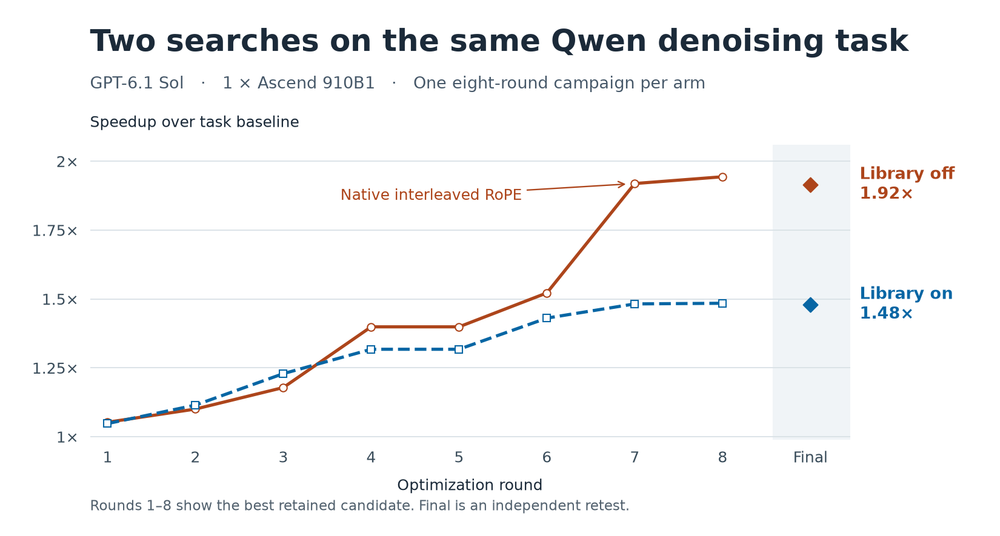

On four NVIDIA B300 GPUs, a patch cut Qwen-Image-2.1-Turbo's warm request latency from 382.92 ms to 268.77 ms. The experiment recorded a failure. The team had set a 30% latency-reduction target before the run, and this set of trials reached 29.81%. Keeping that result makes it possible to see what the next candidate had to beat. [Qwen-Image campaign record](https://github.com/InferMatrixLab/InferRSI/blob/6bdc86ee339c3007f15833434065adf893bff953/docs/qwen-image-2.1-turbo-b300.md)

InferRSI is a developer-preview tool that works with a coding agent to bring up models and tune inference engines. The agent can propose a patch, build it and try again. InferRSI saves the baseline, runs the checks and keeps the evidence for each attempt. This post follows a Qwen-Image change through that process, then asks a second question. If we give the agent lessons from earlier runs, does it find a better patch? [InferRSI](https://github.com/InferMatrixLab/InferRSI)

## How an optimization campaign works

Take an image-generation request whose outputs must remain pixel-identical. Before editing the engine, the agent needs a working baseline, fixed prompts and seeds, a checker that compares the decoded images, and a timer that stops when the client has received the whole response. Timing only the denoising loop would miss costs that the user still pays.

A **campaign** is one search under those fixed conditions. InferRSI splits the work across three components.

1. **Knowledge** gives the agent a place to look for an earlier measurement or failed idea. Each record carries its source and conditions. A report that caching per-step masks exhausted memory on one Ascend 910B1 in BF16 at 1280 × 704 suggests checking tensor lifetimes and memory headroom before trying that change on another device.
2. **Harness** freezes the baseline, evaluation scripts, budget and acceptance criteria. Each round checks output quality before timing the candidate against the baseline. A completed check can accept or reject a patch. A crash or missing measurement leaves the result inconclusive. The harness retains failed rounds and runs a separate final evaluation of the best saved candidate in a fresh process. [Campaign workflow](https://github.com/InferMatrixLab/InferRSI/blob/6bdc86ee339c3007f15833434065adf893bff953/docs/optimization-workflow-unification.md)
3. **Benchmark** packages a task with a baseline and an independent grader. To test a change to InferRSI itself, two fresh agent sessions can tackle the same task with the same budget. The change might be as small as giving one session access to the knowledge library. Each session gets to choose its own patches. [Benchmark design and first paired run](https://github.com/InferMatrixLab/InferRSI/pull/338)

Model onboarding produces a different kind of record. On eight Ascend 950DT devices, the DeepSeek-V4.1-Flash bring-up involved integrating the Engram memory module, capturing decode graphs with fixed buffers, and connecting the DSpark draft model. When disabling Engram restored accuracy, that observation narrowed the search to a path but left several operations on it as possible causes. The debugging procedure that came out of this incident starts by replaying the same input. Compare intermediate tensors in execution order until you find the first operation whose inputs agree and whose outputs diverge. The day-zero branch includes separate validators for Engram and DSpark. [Bring-up code and validators](https://github.com/jiangkuaixue123/vllm-ascend/tree/64c6f16d1f1dc66a52997797940aa6150e695e6c)

## What changed in Qwen-Image

The B300 workload used BF16, eight native denoising steps and one 1280 × 704 request at a time. Some conditioning and geometry work repeats across those steps even though its inputs stay fixed for the request. The patch reused that work, fused operations including query/key normalization and rotary position embedding (RoPE), and added an opt-in symmetric-memory path for exchanging queries, keys and values across GPUs. [Implementation and workload](https://github.com/vllm-project/vllm-omni/pull/8739)

After the 29.81% result, the historical campaign measured **384.16 ms to 266.60 ms**, a 30.60% reduction on a fresh comparison. All 44 measured and held-out output files matched their references in RGB and alpha. Each latency was the median of five trial means. This result belongs to the historical pair of revisions recorded in the campaign. [Measurements and acceptance issue](https://github.com/InferMatrixLab/InferRSI/issues/3)

The upstream PR made a second comparison on a newer pair of revisions. It ran five fresh-server trials per arm and timed the HTTP POST through receipt of the full PNG response. Keeping the communication setting fixed on each side isolates the code change within that setting. [Upstream A/B report](https://github.com/vllm-project/vllm-omni/pull/8739#issuecomment-6119846759)

| Communication setting | Baseline | Candidate | Lower latency |
| --- | ---: | ---: | ---: |
| Default on both revisions | 381.91 ms | 279.83 ms | 26.73% |
| Symmetric memory on both revisions | 374.65 ms | 264.19 ms | 29.48% |

Switching from the baseline default to the candidate with symmetric memory gives a 30.82% reduction. That comparison answers a deployment question because it includes the configuration change. The authors report exact RGB and alpha matches across the tested outputs. The timings describe warm repeated prompts at concurrency one. [Upstream PR](https://github.com/vllm-project/vllm-omni/pull/8739)

## Results across vLLM-Omni workloads

The linked PRs report measurements on the revisions and configurations tested by their authors. For latency, a speedup is baseline time divided by candidate time. For throughput, it is candidate rate divided by baseline rate. Qwen-Image, the Ascend H3-Image change and both speech changes reached upstream within 2.5 to 5.1 days of their first public campaign or PR record. That interval excludes development before the first public record. [Optimization roadmap and evidence](https://github.com/InferMatrixLab/InferRSI/issues/416)

| Workload and device | Reported measurement | What the comparison covers |
| --- | --- | --- |
| [MiniMax-H3-Image, 2 × RTX 3090](https://github.com/vllm-project/vllm-omni/pull/10243) | Warm HTTP latency fell from 36.62 s to 14.59 s (2.51×). | One A/B pair of full deployment profiles. All nine paired images, including warmups, matched in RGB. Open PR. |
| [MiniMax-H3-Image, 4 × Ascend 910B1](https://github.com/vllm-project/vllm-omni/pull/10184) | Generation latency fell 35.7% at 4736 × 3552 and 38.2% at 1024 × 1024. | Sequential measurements of opt-in batched VAE decoding and FP16 encoding. The 18 images passed the numerical screen with some pixel differences. The merged defaults use a different profile. |
| [Qwen-Image-2.1-Turbo, 4 × B300](https://github.com/vllm-project/vllm-omni/pull/8739) | Warm HTTP latency improved 1.36–1.42×. | The two matched communication configurations above. Merged PR. |
| [MiniMax-H3 Ref2VA, 8 × Ascend 910B1](https://github.com/vllm-project/vllm-omni/pull/9698) | Mean HTTP latency for a complete video fell from 407.27 s to 108.12 s (3.77×). | Lossy Cache-DiT reuse passed the specified media checks. Sampled peak device memory rose 3.10%. Draft PR. |
| [MiniCPM-o 4.5, 1 × L20X](https://github.com/vllm-project/vllm-omni/pull/10331) | At 32 concurrent requests, Seed-TTS throughput rose from 11.46 to 22.99 requests/s (2.01×). | Five fresh-server repetitions. The tests did not establish speech-quality non-inferiority. Merged PR. |
| [Drama 3, 2 × Ascend 910B1](https://github.com/vllm-project/vllm-omni/pull/9308) | Single-stream throughput rose from 17.31 to 22.40–22.91 audio frames/s (about 1.30×). | Full-graph decode replay improved frame rate. The single-stream real-time-factor target of 0.1 remained out of reach. Merged PR. |

## Does giving the agent prior experience help?

The engine patch is only one product of a campaign. The team can review a failed attempt and add the lesson to the library through a pull request. This is where recursive self-improvement (RSI) enters the picture. Changing what the next agent can learn from is a change to the optimizer itself.

To isolate the effect of the library, we have to compare entire searches. In one experiment, two fresh GPT-6.1 Sol sessions optimized the same Qwen denoising benchmark on a single Ascend 910B1, with eight rounds each and the same correctness checks. Both made similar early changes, including reusing RoPE sine and cosine tensors within a request. In round seven, the session without the library found a native interleaved RoPE operation. The two documents delivered to the other session lacked that API. [Round-by-round record](https://github.com/InferMatrixLab/InferRSI/pull/338)



*Figure 1. Best retained speedup after each search round. Both fifth-round candidates regressed, so both lines stay flat. The diamonds show fresh final measurements of the selected code. Each arm ran once.*

With the library, the campaign finished in **11.9 minutes** and used **5.45 million session tokens**. Without it, the campaign took **19.5 minutes** and used **7.93 million tokens**, but produced the faster patch. Wall time includes queueing and process startup. Most tokens were cached input. A shorter campaign, fewer tokens and a faster engine are three different outcomes. [Timing and token counts](https://github.com/InferMatrixLab/InferRSI/pull/338)

Later paired searches on Qwen denoising and mixture-of-experts forward execution show how much the result can move. With GPT-6.2 Sol, knowledge on/off yielded final speedups of **2.31×/2.29×** on Qwen and **2.46×/2.39×** on MoE. Under the predeclared selection rule, the authors excluded an earlier Qwen pair after a local command failed and reran both arms. With DeepSeek Flash, the direction reversed on both tasks. The Qwen investigation found that default retrieval had omitted the task's own knowledge card. With one retained pair per task and agent, a general performance benefit remains an open question. [Paired results and exclusions](https://github.com/InferMatrixLab/InferRSI/pull/501#issuecomment-6985903643) · [DeepSeek Flash follow-up](https://github.com/InferMatrixLab/InferRSI/issues/509)

## Try it

You can inspect the knowledge behind a failed optimization before reserving a device. With Python 3.10+ and Git, install this source revision in a virtual environment and run the query for the memory case described above.

```bash
python3 -m venv .venv
source .venv/bin/activate
python -m pip install "git+https://github.com/InferMatrixLab/InferRSI.git@6bdc86ee339c3007f15833434065adf893bff953"
inferrsi find 'cache per-step masks ran out of device memory' --kinds case --limit 1
```

The result includes a command to open the record. Read the precision, resolution and execution mode before deciding whether the same change fits your workload. To run a campaign, start with a working engine on the target machine, a reproducible request, and a quality check that can reject a plausible bad output. In one diffusion-grader test, reference PSNR scored a blurred image above a sharp copy of the reference shifted by three pixels. [Quickstart](https://github.com/InferMatrixLab/InferRSI/blob/6bdc86ee339c3007f15833434065adf893bff953/docs/quickstart.md) · [Grader example](https://github.com/InferMatrixLab/InferRSI/issues/364)

The most useful next experiment is to repeat the same search on both arms to measure ordinary run-to-run variation, then repeat with knowledge enabled on just one arm. If you have a vLLM-Omni bottleneck, a baseline and an independent quality check, the project roadmap is a place to contribute a task that others can run on their own hardware. [vLLM-Omni optimization roadmap](https://github.com/InferMatrixLab/InferRSI/issues/416)
