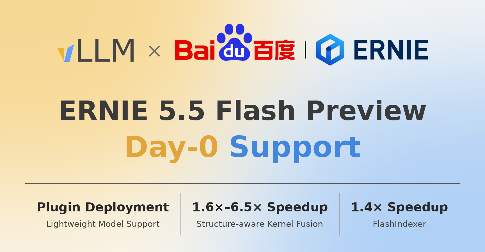
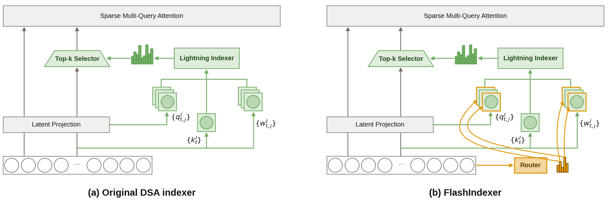
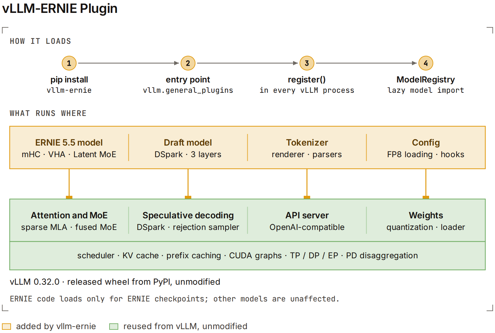

<p align="center">

</p>

The Baidu ERNIE team has worked with vLLM to bring day-0 support for ERNIE 5.5 Flash Preview to vLLM. ERNIE 5.5 Flash Preview is a sparse mixture-of-experts (MoE) model with 280B total parameters and 14B activated per token. It supports a 1M-token context, thinks before it answers, and uses tool calling to carry out long-horizon Agent tasks. vLLM supports the model on release day through the [vLLM-ERNIE](https://github.com/baidu/vLLM-ERNIE) plugin, a standalone package that you install into the same environment as the official `vllm==0.32.0` wheel.

## Highlights

- **Model Architecture:** 280B total and 14B active parameters across 43 layers. 37 layers use Heavily Compressed Attention (HCA) and 6 use MLA with DSA sparse attention. The model also adds a low-rank attention gate, Virtual Head Attention (VHA), Multi-Router Latent MoE, mHC residual streams and a MultiMax output head.
- **Sparse Indexer Acceleration:** FlashIndexer, a plug-and-play indexer acceleration released with the weights, cuts indexing cost through dynamic head routing and threshold pre-filtering, for a 40% speedup at 1M context.
- **Quantization:** The default checkpoint stores the routed experts in MXFP4 (W4A8) and everything else in FP8. FP8 and BF16 checkpoints are also available. The KV cache is FP8, and the DSA indexer cache can use MXFP4.
- **Speculative Decoding:** A 3-layer MoE-based DSpark draft model ships with the weights. It proposes up to 7 tokens per step and reaches a mean acceptance length above 4.0 on real-world coding and agent workloads.
- **Inference Acceleration:** Data-parallel attention with expert parallelism, attention tensor parallelism at TP2/4/8, prefill-decode (PD) disaggregation over Mooncake, and KV cache offloading to CPU.
- **vLLM Plugin:** Install `vllm==0.32.0` from PyPI, then install the vLLM-ERNIE plugin into the same environment. There is no fork to maintain, and no model-specific Docker image or nightly wheel to wait for.

## Usage

Install the released vLLM wheel and the plugin into the same environment. vLLM discovers the plugin automatically through its `vllm.general_plugins` entrypoint, so there is nothing to import or configure.

```bash
uv venv --python 3.12
source .venv/bin/activate
uv pip install vllm==0.32.0
uv pip install git+https://github.com/baidu/vLLM-ERNIE.git
```

The following command serves the default FP4 weights on a single 4-GPU node, with DSpark speculative decoding drafting 7 tokens per step:

```bash
vllm serve baidu/ERNIE-5.5-Flash-Preview \
    --trust-remote-code \
    --data-parallel-size 4 \
    --enable-expert-parallel \
    --kv-cache-dtype fp8 \
    --max-model-len 131072 \
    --reasoning-parser ernie5 \
    --tool-call-parser ernie5 \
    --enable-auto-tool-choice \
    --attention-config '{"indexer_kv_dtype": "mxfp4"}' \
    --speculative-config '{"method": "dspark", "num_speculative_tokens": 7, "draft_sample_method": "probabilistic"}'
```

Send a request to the Chat Completions endpoint:

```bash
curl http://localhost:8000/v1/chat/completions -H 'Content-Type: application/json' -d '{
    "model": "baidu/ERNIE-5.5-Flash-Preview",
    "messages": [{"role": "user", "content": "What is 15% of 240?"}],
    "max_tokens": 4096
}'
```

To turn off thinking for a request, pass `"chat_template_kwargs": {"enable_thinking": false}`. Launch commands for 1M context, attention TP and PD disaggregation are in the [vLLM-ERNIE README](https://github.com/baidu/vLLM-ERNIE) and the [vLLM recipe](https://docs.vllm.ai/projects/recipes/).

## Model Architecture Overview

ERNIE 5.5 Flash was designed with inference cost as a primary goal from the start, weighing activated compute, KV cache size and long-context overhead together. Every component, from the attention structure and residual connections to the MoE layers and the output head, was redesigned around that goal. For design and training details, see the [ERNIE 5.5 Flash Preview blog](https://ernie.baidu.com/release/ernie-5-5-flash-preview/).

| Item | Details |
| :---: | :---: |
| **Parameters** | 280B total, 14B activated per token |
| **Layers** | 43: layer 0 is a dense FFN, layers 1–42 are MoE |
| **Attention** | 37 HCA layers (head dim 512) + 6 MLA-DSA layers (head dim 256); 64 query heads, 1 KV head |
| **Hidden size** | 4096, carried by 4 mHC residual streams |
| **MoE** | 512 routed experts (top-10) + 1 shared expert; experts compute in a 2048-dim latent space |
| **Vocabulary** | 201,216 |
| **Context length** | 1M (1,048,576) tokens, extended from the Base model's 128K during post-training |
| **Quantization Precision** | Routed experts in MXFP4 (W4A8, quantization-aware training), other weights in FP8; FP8 KV cache; FP4 DSA indexer |
| **Draft model** | DSpark, 3 layers, 2–7 token draft blocks, shipped with the weights |

## Kernel Fusion for ERNIE 5.5 Flash's Architecture

ERNIE 5.5 Flash introduces several new structures in attention and MoE: low-rank cross-head post-mixing (VHA post-mix), Multi-Router Latent MoE, the MultiMax output head and sigmoid output gating. When implemented op by op from their mathematical definitions, these structures produce many intermediate tensors and pay for them in memory traffic and kernel launches. For each structure, we designed a dedicated fused kernel around its compute and memory-access profile, and folded everything that can be precomputed into the weights at load time. **The fused kernels run 1.55× to 6.53× faster than naive implementations.**

- **VHA cross-head mixing: pre-folding with fused FP8 quantization.** VHA applies a low-rank mix to the attention output along the head dimension. Computed directly, it takes two low-rank matrix multiplications and a residual add. Because the mixing parameters are fixed at inference time, we fold them into a single mixing matrix when loading the weights, so inference needs only one small matmul. We also move the FP8 quantization required by the downstream output projection into the same kernel: the mixed result is quantized directly in registers, which avoids a round trip of the BF16 intermediate through memory. **1.56× to 1.73× faster per kernel.**
- **Multi-Router Latent MoE: merged router GEMM and a fused routing chain.** The weights of all routers are concatenated at load time, so a single GEMM produces every router's logits. Score summation, biased top-10 selection, weight normalization and per-expert scaling then run in one kernel, and the selected experts exactly match the unfused implementation. **3.54× to 6.10× faster per kernel.**
- **MultiMax output head: single-pass fusion of the piecewise activation.** MultiMax applies a 4-piece piecewise transform to roughly 200K logits. A term-by-term implementation reads and writes the full logits row again and again, so it is bound by memory bandwidth. We merge all pieces into a single pass that reads and writes each element once, with output that is bitwise identical to the term-by-term implementation. **4.33× to 6.53× faster per kernel.**
- **Gated attention: merged gate projection and fused sigmoid gating.** The query up-projection and the output gate take the same low-rank latent vector as input, so we concatenate their weights and compute both with one GEMM. The sigmoid activation and the gating multiply are fused into one kernel, with results bitwise identical to the op-by-op implementation. **1.55× to 1.75× faster per kernel in prefill.**
- **Other fusions.** We also fuse norm, RoPE and the KV cache write; RoPE, the Hadamard transform and low-bit quantization in the sparse indexer; the mHC residual connections; MegaMoE expert computation; and DSpark draft sampling. Programmatic Dependent Launch (PDL) shortens the gaps between kernel launches.

Together, these fusions cover the full forward pass of ERNIE 5.5 Flash, from attention and MoE routing to the output head. They cut the number of kernel launches and the round trips of intermediate tensors through GPU memory while keeping the numerics aligned, and they underpin the model's high inference performance.

## Plug-and-Play Sparse Indexer Routing

The Baidu ERNIE inference team developed FlashIndexer, a lightweight indexer acceleration built on dynamic head routing. FlashIndexer plugs a small head router into the indexer. For each query token, the router looks only at that token's hidden state and picks a few sparse indexer heads to perform token-level sparse selection, which sharply reduces the computation required for sparse indexing. Because routing depends only on the current token, its cost does not grow with context length. The original DSA interface and the downstream sparse attention computation stay unchanged.

FlashIndexer needs a short fine-tuning run on a small amount of data. Training freezes the backbone and the DSA indexer and updates only the lightweight router. The token sets selected by the original DSA serve as teacher-forced distillation targets, so the routed indexer learns to reproduce the selections made with all heads. The router is small and trains stably: about 1B tokens are enough to adapt it, and deployment only needs to load the router weights.

<p align="center">

</p>

FlashIndexer also adds threshold pre-filtering, which skips low-scoring candidate tokens early and shrinks the top-k candidate set. DSA in ERNIE 5.5 Flash uses a large token-level top-k of 2048, so this further cuts the cost of top-k selection. At 1M context, **we measured a 1.4× speedup**, which substantially relieves the indexing bottleneck in long-context prefill. FlashIndexer needs no changes to the downstream sparse attention kernels and can be integrated quickly as a pluggable module.

## FP4 Quantization-Aware Training

To keep W4A8 inference lossless while making it faster, ERNIE 5.5 Flash adds W4A8 quantization-aware training (QAT) during post-training. The fake quantization used in training matches inference exactly in quantization granularity, scales and rounding rules, which removes the accuracy gap that mismatched numerics between training and inference would otherwise cause. QAT has almost no effect on training throughput, and the resulting model can be deployed directly for W4A8 inference with no extra conversion or calibration. In addition, the KV cache is stored in FP8 to reduce its size, and the indexer computation in DSA runs in FP4 for speed.

## Multi-Stage DSpark Speculative Decoding Training

ERNIE 5.5 Flash uses single-step ECHO MTP during pretraining. In post-training, this module can be trained further into multi-step MTP with dynamic sampling, which extrapolates well over multiple steps. Autoregressive and parallel speculative decoding each have advantages, depending on whether a task is high- or low-entropy and on the serving concurrency, so we also added DSpark speculative decoding training in post-training.

We built a **multi-stage DSpark training pipeline that spans mid-training, post-training and on-policy distillation**. Once the main model completes mid-training, the draft model is trained offline with the DSpark + D-Pace recipe on a high-performance draft-training framework that enables training more than 3× faster than conventional joint training. During post-training, MTP and DSpark are trained compatibly, and the DSpark weights are updated continuously to track the main model's policy as it changes. This limits the drop in acceptance rate that distribution drift between the two models would cause. After post-training, we apply on-policy distillation (OPD) with an E2E-TV objective, continuing to optimize DSpark on the live data distribution so that it adapts better to real inference requests. The result is a mean acceptance length above 4.0 on real-world coding and complex agent workloads, which makes online inference more efficient.

## Supporting New Models Efficiently with a vLLM Plugin

ERNIE 5.5 Flash Preview runs in vLLM through a standalone Python plugin package, which vLLM loads through its `vllm.general_plugins` entrypoint. The plugin mainly contains the ERNIE model code and a set of kernel optimizations. Attention kernels, the KV cache manager, speculative decoding, parallelism and the server mostly come from vLLM itself.

<p align="center">

</p>

### How to Integrate Plugins

vLLM-ERNIE declares a single entrypoint:

```toml
[project.entry-points."vllm.general_plugins"]
ernie = "vllm_ernie:register"
```

At startup, vLLM calls `register()` in every process, including the API server, the engine core and each worker. The function registers the ERNIE architectures with `ModelRegistry` as module paths rather than imported classes:

```python
ARCHITECTURES = {
    "Ernie5_5_MoeForCausalLM": "Ernie5_5ForCausalLM",
    "Ernie5_5MoeMTPModel": "Ernie5_5MTP",
    "Ernie5_5_MoeDSparkDraftModel": "Ernie5_5DSparkForCausalLM",
    # ...
}

def register() -> None:
    from vllm import ModelRegistry

    for arch, cls_name in ARCHITECTURES.items():
        if arch not in ModelRegistry.get_supported_archs():
            ModelRegistry.register_model(arch, f"{_MODEL_MODULE}:{cls_name}")
    apply_patches()
```

The plugin imports the model code only when a model's `config.json` names one of these architectures, so having it installed adds no overhead when the same environment serves other models. `register()` also registers the `ernie5_5_moe` config class, the tokenizer mode, the chat renderer, and the reasoning and tool-call parsers. To disable the plugin, set `VLLM_PLUGINS=""`.

### What the Plugin Gives Users

- **The official wheel just works.** ERNIE 5.5 Flash Preview runs directly on `vllm==0.32.0` from PyPI. There is no model-specific image to pull, and no waiting for code to be merged and a nightly build to land.
- **Fixes and features ship on the model's schedule.** Since the Base release, the plugin has added 128 × 128 block FP8 weights, attention tensor parallelism, MXFP4 routed experts, the bundled DSpark draft model and a Python chat renderer, none of which had to wait for a vLLM release.
- **Existing vLLM features work out of the box.** Prefix caching, chunked prefill, both full and piecewise CUDA graphs, speculative decoding, the PD connectors, KV offload and the OpenAI-compatible server all work without any ERNIE-specific code.
- **Upstream improvements arrive with each version bump.** New kernels, schedulers and connectors in vLLM core become available to ERNIE 5.5 as soon as the plugin moves to the next vLLM release.
- **Other models are unaffected.** The plugin applies only a few hooks to shared vLLM code, and those hooks take effect only for the ERNIE architectures.

## Acknowledgements

We thank the Baidu ERNIE team for the model, and the vLLM community: many of the compressed-attention, sparse-attention, fused-MoE, and DSpark speculative-decoding components used in this work reuse implementations that the community had already built.
