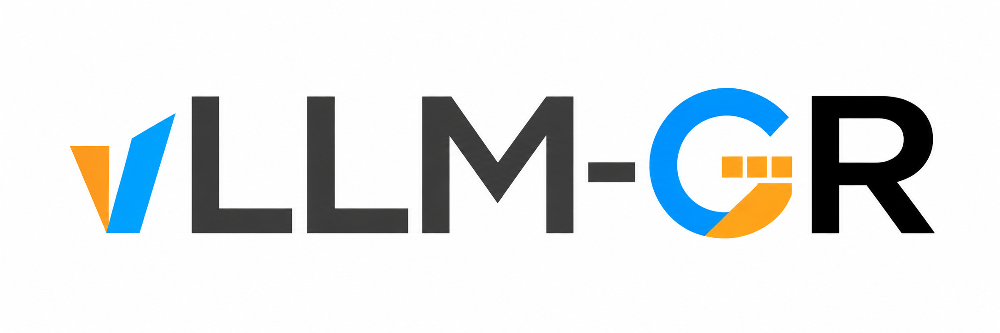

## About

Today we’re introducing [**vLLM-GR**](https://github.com/vllm-project/vllm-gr), an open-source inference and serving framework built on vLLM for generative recommendation models.

Consider a video feed. Given a viewer’s history, a model such as OneRec can generate a semantic ID (SID) for a video the viewer might watch next. To assemble a feed, the application needs a set of candidates. vLLM-GR extends vLLM’s model execution and paged key-value (KV) cache with beam search that explores multiple candidate IDs in one request.

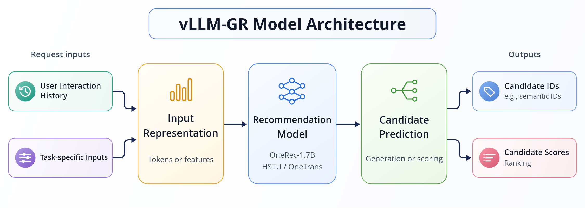

The overview shows how recommendation models generate item IDs or score supplied candidates. The OneRec-1.7B example below follows the generation path, from a viewer’s history to 128 candidate SIDs.

## Why vLLM-GR?

A recommendation service has to turn a long interaction history into a set of candidates within a single request’s latency budget. Generating each item ID may take only a few tokens, yet the engine must explore many paths and return items the application can serve.

1. **Run recommendation models on the vLLM stack.** Teams can reuse vLLM’s model execution, scheduling, and paged KV cache when moving from offline evaluation to online serving on NVIDIA GPUs and Ascend NPUs.
2. **Reduce the cost of wide candidate searches.** Candidate paths share the cached user history. The engine runs successive beam-search steps in one request and selects candidates on the accelerator, reducing duplicate work and per-step coordination with the host.
3. **Keep recommendations aligned with the item catalog.** Catalog constraints guide the search toward IDs that map to real items. Support for model and catalog updates lets teams refresh what the service recommends as models and inventory change.

## Inside the Architecture

vLLM-GR builds its recommendation search into the vLLM engine. vLLM supplies the scheduler, model execution, and paged KV cache. vLLM-GR adds a beam session that spans the whole search and keeps track of how candidate paths branch.

EngineCore owns each beam session from admission to completion. The scheduler dispatches prefill and decode stages to a worker. At each stage, the model runner scores the next token and beam selection records the score and parent of each surviving path. The next decode uses those parent indices to read the right KV state.

### Key Features

- **Simplicity.** Submit a complete beam search through the offline Python interface, OpenAI-compatible HTTP, or gRPC. The engine runs the decode loop and returns candidate sequences and scores in one response.
- **Flexibility.** Search the full vocabulary or restrict generation to semantic IDs in the item catalog. Per-stage beam widths and per-parent candidate limits let a service explore more partial IDs than it ultimately returns.
- **Performance.** Sharing prompt KV across beams avoids copying the viewer’s history for each candidate. While the accelerator executes one stage, the host prepares the next, reducing the wait between decode steps.

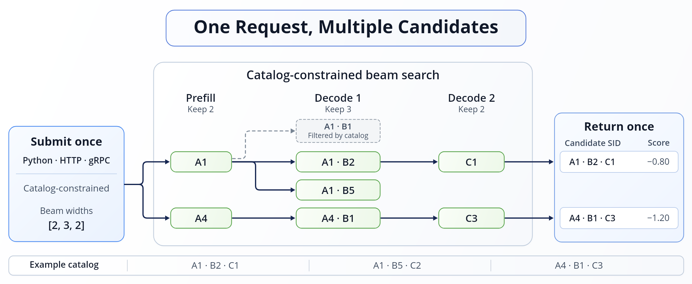

*One request returns two candidates with beam widths of 2 → 3 → 2. The catalog filters out `A1 · B1` because no item starts with that prefix. A full-vocabulary search skips this filter. The SIDs and scores are illustrative.*

*In the prefill–decode–decode (PDD) pipeline, the scheduler admits a `BeamSearch()` request and dispatches its prefill stage to the worker. Prefill scores the first SID component while the host prepares decode 1. During decode 1, the host prepares decode 2. The second decode inherits the selected parents’ suffix KV and completes two SIDs. Green marks the component selected at each stage.*

## Performance Evaluation

The benchmarks measure P99 latency to show how beam width and batch size affect tail latency for generative recommendation. The two overview charts hold the input length at 1,024 tokens and compare beam widths of 256 and 128 at batch sizes 1, 4, and 8 across four NVIDIA GPUs and two Ascend NPUs. The figures summarize separate benchmark runs with different timing definitions, sample counts, and backend settings.

On RTX PRO 6000, vLLM-GR, SGLang Beam, and NVIDIA SID-GR ran OneRec-1.7B in BF16 and generated three tokens from the same synthetic inputs with catalog constraints disabled. Each point reports whole-batch P99 over 48 timed batches after three warmups. Timing includes returning candidate IDs and scores to the host and excludes HTTP. With beam width denoted by *W* and candidate pool size by *K*, vLLM-GR and NVIDIA SID-GR used *K* equal to *W*. SGLang Beam used its native pool of *2W* candidates.

On the Ascend A2 and A5, vLLM-GR and xLLM used a catalog constraint table. The SGLang constraint setting was not recorded in the benchmark summary. Recorded L20 sample counts range from 100 to 1,000 timed batches per configuration. The available summaries do not specify exact backend revisions for these comparisons or warmup counts outside the RTX PRO 6000 run.

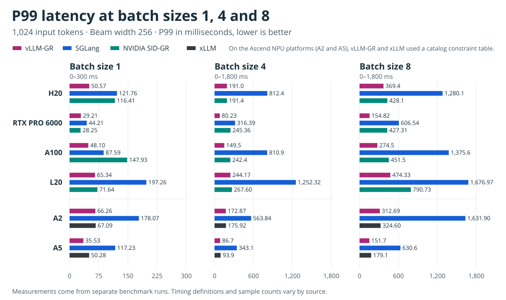

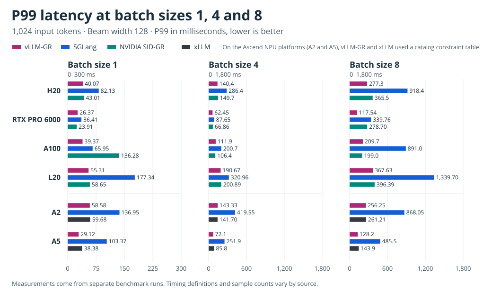

At beam width 256, vLLM-GR recorded the lowest P99 among the backends shown at batch sizes 4 and 8 on all six accelerators. On H20 at beam width 256 and batch size 8, P99 was 369.4 ms for vLLM-GR, 1,280.1 ms for SGLang, and 428.1 ms for NVIDIA SID-GR.

At beam width 256 and batch size 1 on RTX PRO 6000, NVIDIA SID-GR reported 28.25 ms versus 29.21 ms for vLLM-GR. On A2 at the same beam width and batch size 8, vLLM-GR and xLLM reported 312.69 ms and 324.60 ms, respectively, with catalog constraints enabled for both. At beam width 128, the lowest-latency backend varies by accelerator and batch size.

Expand the hardware sections below to see how latency changes across a wider range of beam widths and input lengths. The tested ranges vary by accelerator and batch size.

H20 · B=1, B=4 and B=8

At beam width 256 and batch size 4, vLLM-GR and NVIDIA SID-GR both measured about 191 ms P99. At batch size 8, their P99 latencies were 369.4 ms and 428.1 ms, respectively.

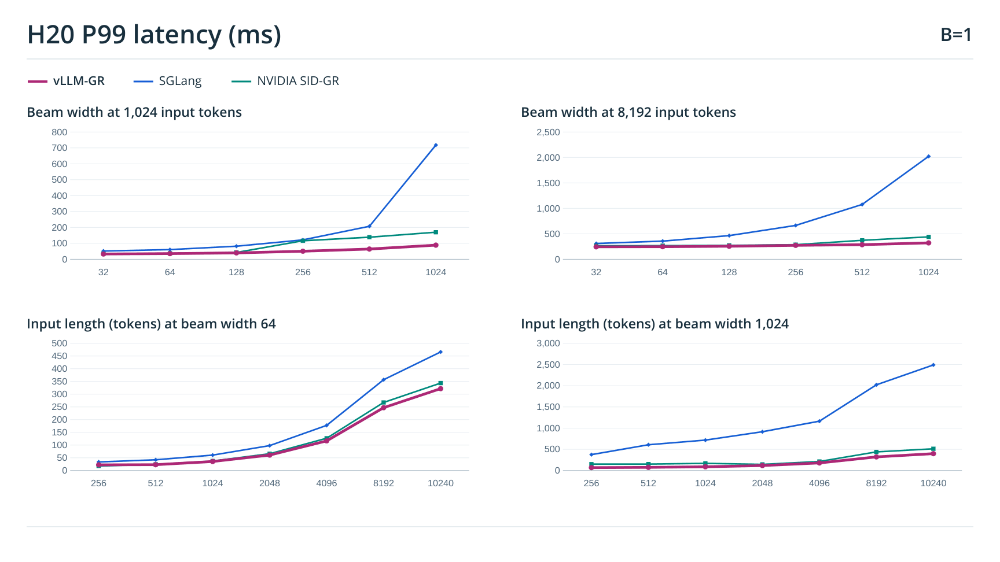

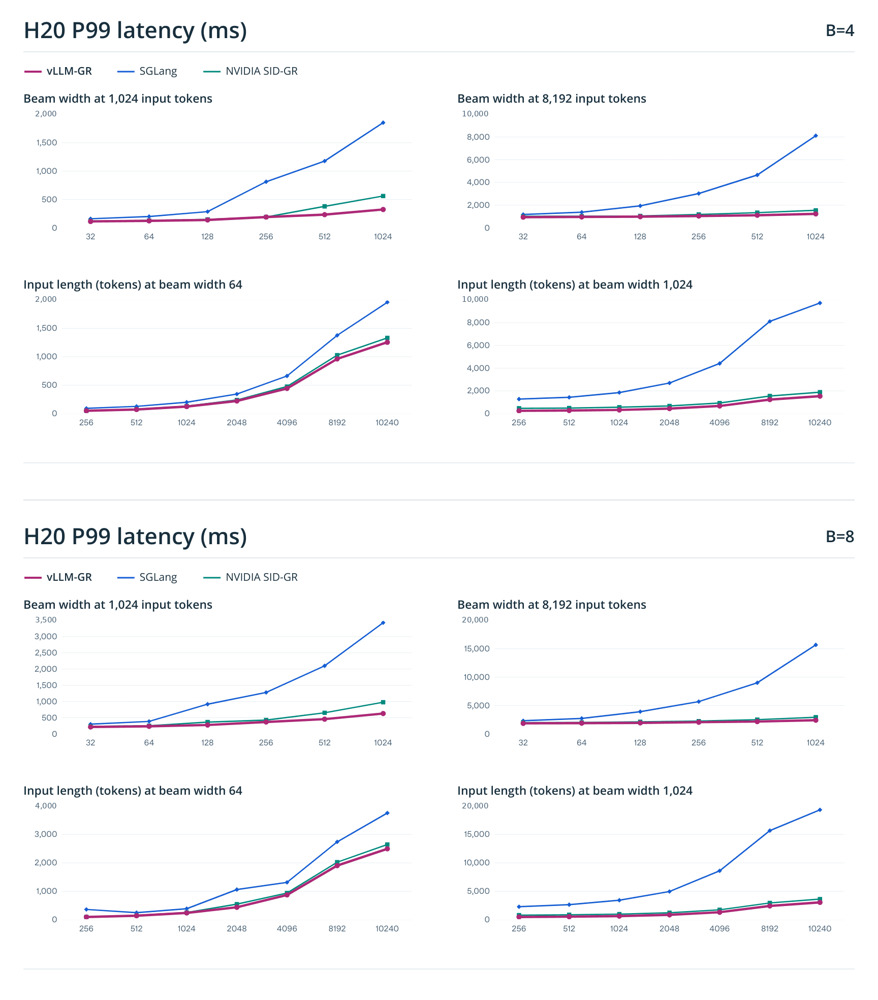

RTX PRO 6000 · B=1, B=4 and B=8

NVIDIA SID-GR had the lowest P99 at batch size 1 for both overview beam widths. vLLM-GR had the lowest P99 at batch sizes 4 and 8 for both widths.

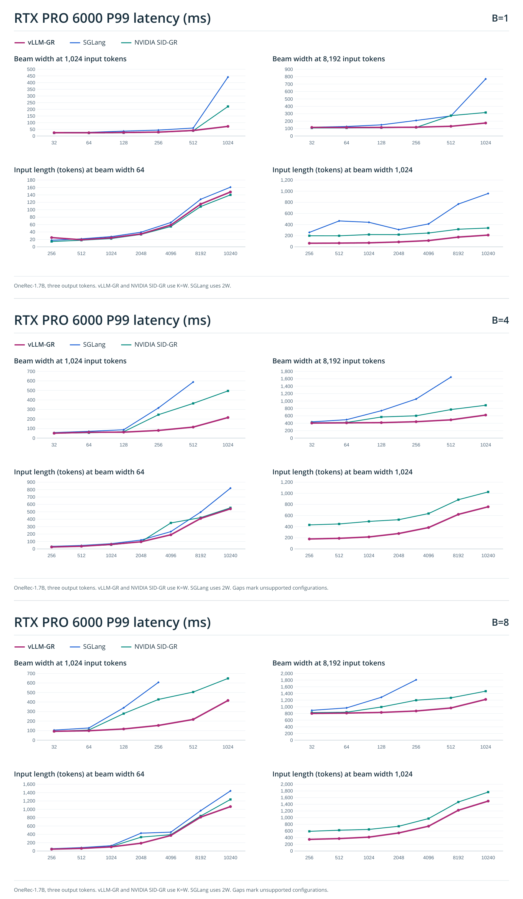

A100 · B=1, B=4 and B=8

At batch size 8, NVIDIA SID-GR measured 199.0 ms and vLLM-GR measured 209.7 ms at beam width 128. At beam width 256, vLLM-GR measured 274.5 ms and NVIDIA SID-GR measured 451.5 ms.

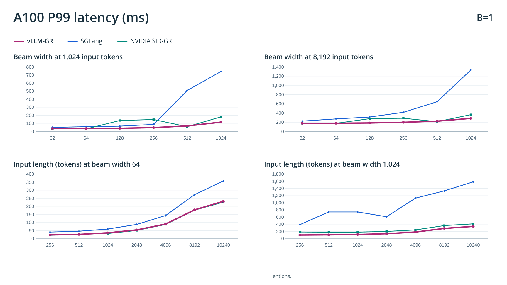

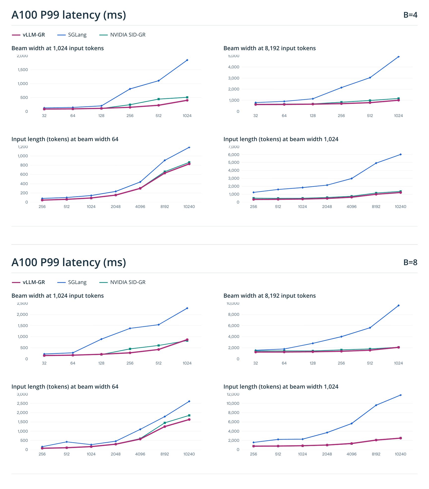

L20 · B=1, B=4 and B=8

At batch size 8 and beam width 256, vLLM-GR measured 474.3 ms P99, followed by NVIDIA SID-GR at 790.7 ms.

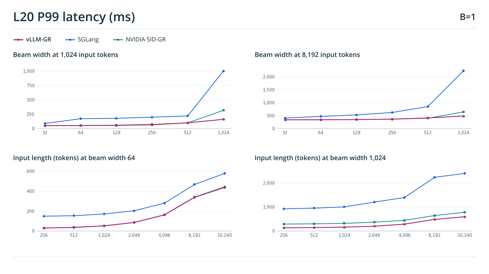

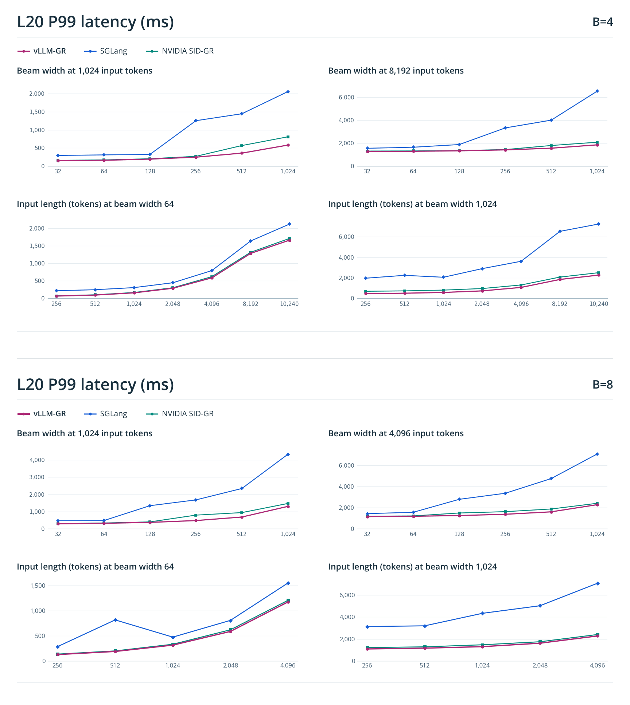

A2 · B=1, B=4 and B=8

Some curves end before the final configuration because those runs exceeded device memory. At 8,192 input tokens and batch size 8, vLLM-GR completed the beam-width sweep through 1,024.

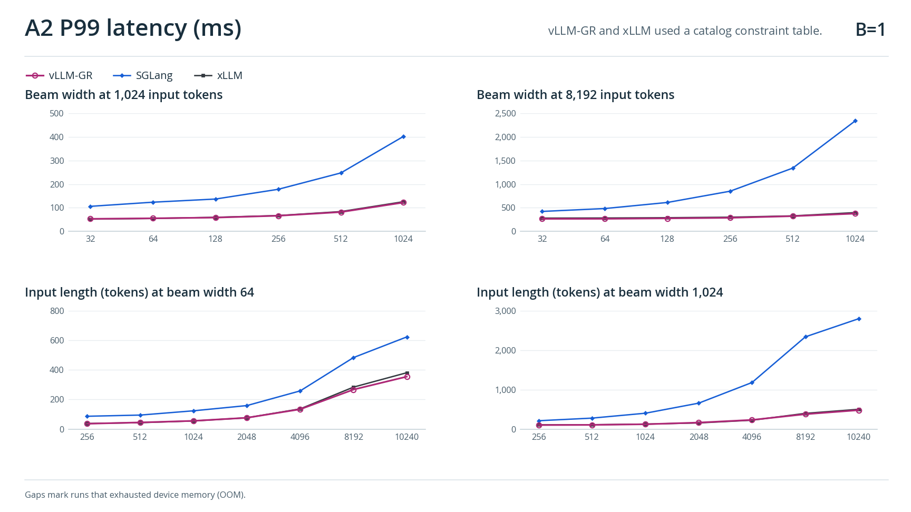

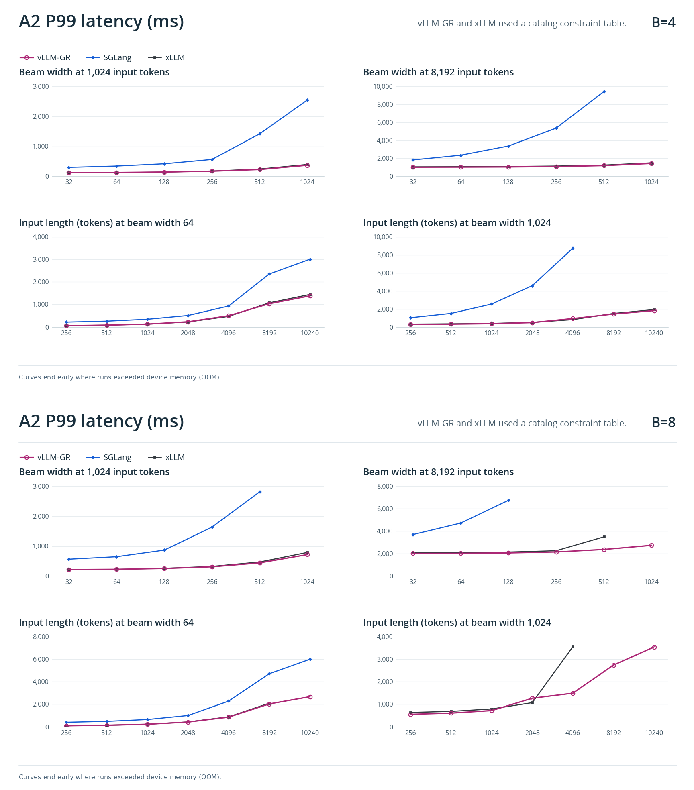

A5 · B=1, B=4 and B=8

At batch size 8, vLLM-GR measured 128.2 ms P99 at beam width 128 and 151.7 ms at beam width 256. It recorded the lowest P99 among the backends shown at all three batch sizes for both overview beam widths.

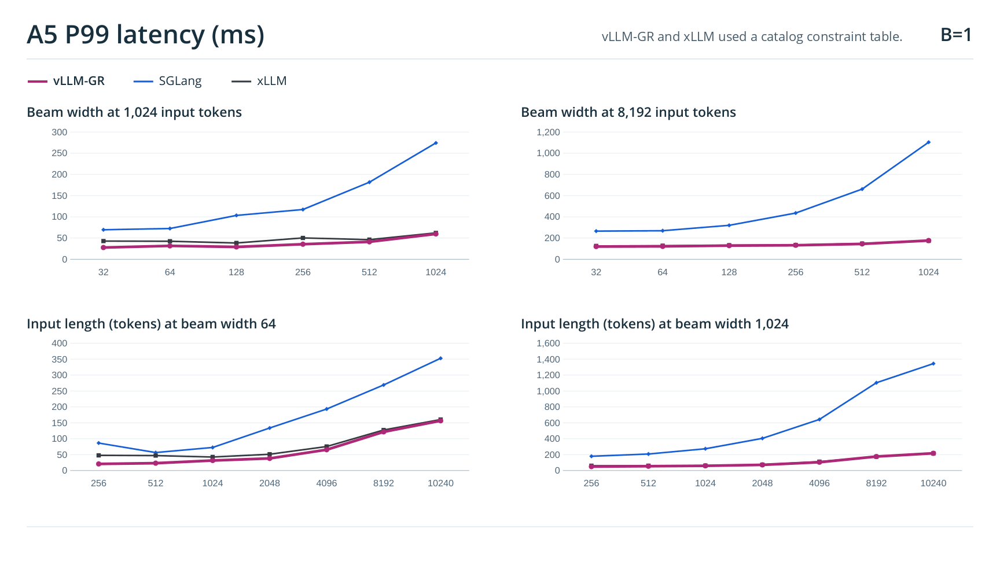

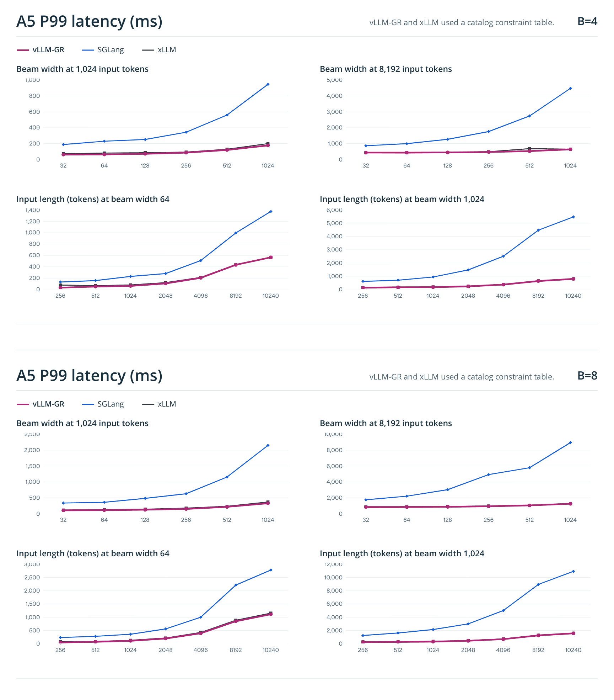

## Future Roadmap

We’re working toward a framework that can serve both candidate generation and ranking, from long user histories to wide beam searches.

- **Broader model support.** Extend candidate scoring to HSTU, MTGR, and RankMixer, add native serving for OneTrans, and explore serving optimizations for recommendation models with larger total parameter counts, including mixture-of-experts (MoE) models.
- **More flexible beam search.** Explore value-aware candidate selection and additional output heads for semantic IDs. Support deeper SID hierarchies across device types and variable-length generation that can stop individual beams at EOS, release their slots and KV, and admit new requests.
- **Online batching and scheduling.** Explore an online scheduler that decides when to form a batch and which queued requests to include, allowing requests with different user history lengths to run together while keeping queues bounded under overload. Group batches with similar shapes so they can reuse the same captured computation graph for replay with less padding.
- **Long histories and KV reuse.** Optimize prefill for histories of 10,000 tokens or more and explore beam search with linear or sparse attention. As a user’s history grows, reuse KV blocks for the unchanged prefix across requests to avoid repeating prefill for those tokens.
- **Distributed inference and KV caching.** Explore a distributed KV cache that lets a serving instance reuse KV blocks from another device on the same node or on a different node. Evaluate model sharding and KV transfer costs in both settings.
- **Closer integration with upstream vLLM.** Build on vLLM’s engine and platform interfaces to bring upstream improvements in scheduling and KV cache management to recommendation workloads. Regularly update vLLM-GR to newer stable vLLM releases and validate engine correctness, recommendation quality, and serving performance across supported devices.

## Getting Started

vLLM-GR 0.30.0 is built on vLLM 0.30.0 and supports NVIDIA GPUs and Ascend NPUs.

### Installation

Follow the installation guide for your accelerator, either [NVIDIA CUDA](https://github.com/vllm-project/vllm-gr/blob/main/docs/getting_started/installation/gpu.md) or [Ascend NPU](https://github.com/vllm-project/vllm-gr/blob/main/docs/getting_started/installation/npu.md).

### Serving Generative Recommendation Models

Run OneRec-1.7B [offline](https://github.com/vllm-project/vllm-gr/blob/main/examples/offline_inference/beam_search/README.md) or follow the [HTTP serving example](https://github.com/vllm-project/vllm-gr/blob/main/examples/online_serving/beam_search/README.md) or the [gRPC serving example for CUDA](https://github.com/vllm-project/vllm-gr/blob/main/examples/online_serving/grpc/README.md).

## Join the Community

If you’re bringing another recommendation model to vLLM-GR, tell us how it represents interaction history and what it predicts. If you’re reporting a serving bottleneck, include the model, history length, beam width, and hardware so others can reproduce it. [GitHub repository](https://github.com/vllm-project/vllm-gr) · [Open an issue](https://github.com/vllm-project/vllm-gr/issues) · [Contributing guide](https://github.com/vllm-project/vllm-gr/blob/main/CONTRIBUTING.md)

## Acknowledgements

We thank Hongsheng Liu and Han Zhang from the InferMatrix team for first proposing that vLLM support high-performance inference for generative recommendation. We’re grateful to Roger Wang and Zhipeng Wang from Inferact for the in-depth discussions that helped shape the vLLM-GR roadmap and architecture.

We also thank the following teams and community members for contributing to vLLM-GR and sharing their experience and feedback from large-scale production deployments.

- [Inferact](https://inferact.ai/): [Zhipeng Wang](https://github.com/princepride), [Roger Wang](https://github.com/ywang96)
- [InferMatrix Team](https://infermatrix.si/): [Han Zhang](https://github.com/zhanghanleo10), [Shucheng Zhang](https://github.com/candanzg), [Xiaodong Tian](https://github.com/parallel-star8), [Yunpeng Zhi](https://github.com/ZhiYunpenghuawei), [Yi Ding](https://github.com/DINGEde), [Jierui Yu](https://github.com/JerryTcl), [Hongsheng Liu](https://github.com/hsliuustc0106)
- openPangu: [Xinming Han](https://github.com/Lechmere-1), [Zhiwei Yi](https://github.com/zhiweiyi11), [Mengyuan Ma](https://github.com/mengyuanuom), [Yongxiang Feng](https://github.com/fxy18)
- TikTok-Global E-commerce: [Bin Wang](https://github.com/wangbin-cs), [Junye Long](https://github.com/LJHG)
- Data-Arch-China Commerce and Advertising-ML Infra: [Haoran Ma](https://github.com/MaTwickenham), [Wenqiang Zhou](https://github.com/SENGEL-code), [Junwen Guo](https://github.com/CrazyKing5023)
- LingQuAI: [Chunxu Jin](https://github.com/Trenx-J), [Wuping Liu](https://github.com/wupingL)
