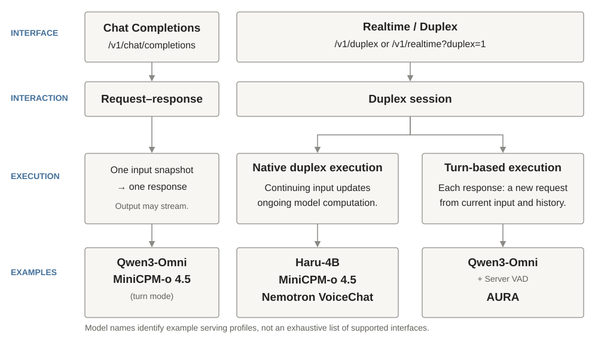

During a duplex conversation, a client can keep sending input while the assistant's audio plays. [vLLM-Omni v0.34.0](https://github.com/vllm-project/vllm-omni/tree/06a28821a7f72bdb436c3df656b10f67fded0846) coordinates incoming audio and video, generation, playback, and interruptions through a shared session runtime.

## TL;DR

- MiniCPM-o 4.5 and Haru-4B use native duplex execution. AURA and Qwen3-Omni use turn-based execution. JoyAI adds visual interaction and background memory to the same session runtime.
- Clients connect through `/v1/realtime?duplex=1` or its `/v1/duplex` alias.
- The [MiniCPM-o 4.5 and Qwen3-Omni quickstarts](#try-minicpm-o-45-and-qwen3-omni) use Model Runner V2, two GPUs, and the same realtime web client.

**In this post:** [Interaction modes](#from-streaming-replies-to-continuous-interaction) · [Architecture](#session-runtime-architecture) · [Model paths](#model-specific-execution-and-retained-state) · [Optimization and metrics](#optimizing-the-live-audio-path) · [Quickstart](#try-minicpm-o-45-and-qwen3-omni) · [Next steps](#next-steps-for-the-framework)

## From streaming replies to continuous interaction

Chat interfaces made request–response interaction familiar: submit an input and receive an answer. Voice interfaces added streaming audio, but many still followed the same pattern—finish speaking, submit the utterance, then play the response.

Native full duplex lets the model process incoming audio while producing its own output. MiniCPM-o 4.5 also processes video in this path. New input can affect subsequent speech, including whether to keep speaking or yield the floor.

<iframe class="vllm-embed" src="/assets/interactive_pages/vllm-omni-duplex/interfaces.html" title="Interfaces, interaction modes and model execution: request-response and duplex session paths" loading="lazy" scrolling="no" style="display: block; width: 100%; height: 1000px; border: 0; overflow: hidden;"></iframe>

*Figure 1. Interfaces, interaction modes, and model execution are separate layers. Select a branch to highlight its model profiles. [Open the interactive diagram](/assets/interactive_pages/vllm-omni-duplex/interfaces.html).*

<details markdown="1">
<summary>View static diagram</summary>



</details>

Qwen3-Omni with Server VAD can receive microphone audio during playback, cancel a response on speech onset, and start another after the new turn is committed. Its inference remains turn-based.

The duplex protocol builds on OpenAI Realtime event names and adds video input, session recovery, and playback reporting. Each model advertises its available operations in `session.capabilities`. See the [Realtime and Duplex API guide](https://github.com/vllm-project/vllm-omni/blob/06a28821a7f72bdb436c3df656b10f67fded0846/docs/serving/realtime_duplex_api.md).

## Session runtime architecture

With MiniCPM, a new camera frame and “Actually, I meant this one” can arrive while the assistant is speaking. The API forwards that input, the runtime orders it alongside stage outputs, and the model processes it with retained context. The next output can adjust the explanation or yield the floor.

<iframe class="vllm-embed" src="/assets/interactive_pages/vllm-omni-duplex/architecture.html" title="Inside a live duplex session: communication, session coordination, and model execution" loading="lazy" scrolling="no" style="display: block; width: 100%; height: 960px; border: 0; overflow: hidden;"></iframe>

*Figure 2. Step through the input and output paths, or click a component to explore its role. [Open the interactive diagram](/assets/interactive_pages/vllm-omni-duplex/architecture.html).*

<details markdown="1">
<summary>View static diagram</summary>


</details>

| Component | Responsibility |
|---|---|
| **API Server** | Read and validate WebSocket messages, translate them into commands, render outgoing events, and manage connection attachment and replay information. |
| **EngineClient** | Expose session handles to the application, coordinate open/close/resume operations, submit commands, and deliver each session's events to its consumer. |
| **Duplex Orchestrator** | Admit sessions, order session work, coordinate responses and playback state, and submit model work through the stage machinery. |
| **Model stages** | Encode inputs, run autoregressive or other generation steps, preserve model computation state where supported, and produce text, codec tokens, or PCM audio. |

**DuplexSessionManager** admits sessions and manages their resources. Each **DuplexSessionRunner** processes commands and stage outputs in order. **DuplexEngineSession** tracks the conversation, active responses, and playback progress.

The **model plugin** declares capabilities, prepares inputs and generation settings, and interprets outputs. For MiniCPM, it handles `LISTEN` as a decision to continue listening.

v0.34 uses **Model Runner V2** by default for AR and generation stages. Any stage that resolves to V1 is rejected. The [runner compatibility guide](https://github.com/vllm-project/vllm-omni/blob/06a28821a7f72bdb436c3df656b10f67fded0846/docs/configuration/stage_configs.md#stage-level-runner-selection) lists the supported platform profiles.

The API side and the orchestrator share a frontend process, with the orchestrator on its own thread and event loop. Stage engines and GPU workers run in separate processes, and stage replicas can run on other hosts. With `least_sessions`, the manager reserves a replica group when a session opens. Sessions stay on their group; they are not migrated if a replica fails. See [duplex replica placement](https://github.com/vllm-project/vllm-omni/blob/06a28821a7f72bdb436c3df656b10f67fded0846/docs/configuration/stage_configs.md#duplex-replica-placement).

A session emits events into its own bounded output buffer; the handle consumes them and the API sends them to the client. If a slow consumer exceeds the output limit, the runtime fails the response and closes that session. The client must open a new session to continue. See the [framework design](https://github.com/vllm-project/vllm-omni/blob/06a28821a7f72bdb436c3df656b10f67fded0846/docs/design/fullduplex.md) for the lifecycle and ordering rules.

## Model-specific execution and retained state

The diagram compares the MiniCPM-o 4.5, AURA, and Qwen3-Omni pipelines with the earlier PersonaPlex speech path. PersonaPlex depends on a V1 Talker and cannot run on v0.34.

<iframe class="vllm-embed" src="/assets/interactive_pages/vllm-omni-duplex/models.html" title="Speech execution and state: compare PersonaPlex, MiniCPM-o 4.5, AURA, and Qwen3-Omni" loading="lazy" scrolling="no" style="display: block; width: 100%; height: 1000px; border: 0; overflow: hidden;"></iframe>

*Figure 3. Switch models and step through their encoders, autoregressive modules, waveform decoders, and retained state. Brackets group neural modules into serving stages. [Open the interactive diagram](/assets/interactive_pages/vllm-omni-duplex/models.html).*

<details markdown="1">
<summary>View static diagram</summary>


</details>

### PersonaPlex: an earlier frame-by-frame speech path

Before the V2-only transition, PersonaPlex processed 24 kHz PCM audio in **80 ms model frames**. Input buffering assembles client packets into complete model frames.

Stage 0 combines Mimi audio encoding with a Temporal Transformer and a Depformer. The Temporal Transformer advances across frames. The Depformer predicts the audio codebooks within a frame. Both are autoregressive, but they operate along different dimensions and are tightly coupled, so they belong to the same Talker stage. Stage 1 uses Mimi to decode the generated tokens into PCM.

Temporal context and streaming codec state carry forward across frames. The Depformer [starts with empty per-frame KV state](https://github.com/vllm-project/vllm-omni/blob/c792d3aef476876f3d7af93f3f95d37b469d11ad/vllm_omni/model_executor/models/personaplex/personaplex_depformer.py#L233), then reuses it across codebook predictions within that frame. The model keeps listening as it produces speech and controls its own turn boundaries. **80 ms describes the input processing cadence, not an end-to-end latency guarantee.** See the [PersonaPlex serving guide](https://github.com/vllm-project/vllm-omni/blob/c792d3aef476876f3d7af93f3f95d37b469d11ad/examples/online_serving/personaplex/README.md).

### MiniCPM-o 4.5: audio and video with model-driven speech decisions

MiniCPM-o 4.5 declares a one-second input cadence (`chunk_period_ms=1000`) and groups PCM audio with associated video frames. Its first stage combines audio and visual encoding with language-model execution. A `LISTEN` result keeps the conversation listening; a `SPEAK` result forwards text and model features to the Talker.

The Talker predicts audio tokens. Code2Wav then uses conditional flow matching, implemented with a DiT, followed by a HiFT vocoder to produce PCM. Continuing input reuses LLM and audio-processing state. The retained context follows the configured KV window and stage token budget. The [MiniCPM pipeline](https://github.com/vllm-project/vllm-omni/blob/06a28821a7f72bdb436c3df656b10f67fded0846/vllm_omni/model_executor/models/minicpmo_4_5/pipeline.py) separates understanding, speech-token generation, and waveform synthesis into three stages.

### Haru-4B: audio generation inside one stage

Haru-4B processes 24 kHz audio in 3,200-sample frames, about 133 ms each. Each `input_audio_buffer.append` must contain exactly 3,200 samples of `pcm_f32le` audio; the client must assemble these frames before sending them. Its Qwen3.5 backbone, MeanFlow audio head, and VibeVoice codec run in one serving stage. The generated audio latent feeds the next frame, so the audio head and codec execute with the language-model step rather than through separate Talker and Code2Wav stages. Each conversation keeps one engine request that resumes as frames arrive. Reconnecting after a disconnect requires a new public session. The [Haru pipeline](https://github.com/vllm-project/vllm-omni/blob/06a28821a7f72bdb436c3df656b10f67fded0846/vllm_omni/model_executor/models/haru/pipeline.py) and [serving recipe](https://github.com/vllm-project/vllm-omni/blob/06a28821a7f72bdb436c3df656b10f67fded0846/recipes/higurashi-ai/Haru-4B-H200.md) describe the frame contract and deployment.

### AURA and Qwen3-Omni: new requests from retained history

AURA follows a four-stage path: **ASR → Thinker → Talker → Code2Wav**. AURA duplex sessions require video; audio is optional. When provided, audio is converted to text by ASR, while video goes to the visual Thinker. The Thinker-side session history retains transcripts, video clips, and assistant text for later turns.

Qwen3-Omni instead feeds audio features from its AuT encoder and visual features into the Thinker, followed by Talker and Code2Wav. Its duplex adapter retains multimodal conversation content and prepares subsequent requests from that history. In v0.34, the default `full_history` policy keeps effective original messages and media. A request that exceeds the deployed context or media limits returns `input_capacity_exceeded`; the adapter does not silently drop old turns.

Both maintain a live session. Each response starts a new inference request built from the current turn and retained history. Committing input and requesting a response can be separate operations. The implementations are described by the [AURA pipeline](https://github.com/vllm-project/vllm-omni/blob/06a28821a7f72bdb436c3df656b10f67fded0846/vllm_omni/model_executor/models/aura_omni/pipeline.py) and [Qwen3-Omni duplex adapter](https://github.com/vllm-project/vllm-omni/blob/06a28821a7f72bdb436c3df656b10f67fded0846/vllm_omni/model_executor/models/qwen3_omni/duplex/plugin.py).

### JoyAI: visual interaction and conversation memory

JoyAI supports text and video input, with an ASR stage for speech input in the audio-enabled pipeline. Its plugin constructs each model request from the current observation, recent conversation, and available memory. Background requests to the JoyAI VLM summarize older frame chunks and consolidate those summaries into longer-term visual memory; conversation text can also be summarized during idle time. The session runtime owns execution, cancellation, and cleanup of these auxiliary requests. The [JoyAI memory policy](https://github.com/vllm-project/vllm-omni/blob/06a28821a7f72bdb436c3df656b10f67fded0846/docs/serving/realtime_duplex_api.md#joyai-visual-and-conversation-memory) bounds retained visual data and model-input context.

JoyAI also streams VLM, speech-token generation, and waveform decoding through async chunks. Its `delegate` function lets an application handle a question outside the VLM; the result becomes input to a later observation. See the [JoyAI duplex profile](https://github.com/vllm-project/vllm-omni/blob/06a28821a7f72bdb436c3df656b10f67fded0846/vllm_omni/deploy/joyai_vl_interaction_duplex.yaml).

### Context selection and background summaries

Summaries track their source messages and versions, so editing or deleting a message invalidates the affected summaries. The model plugin chooses the context policy, and `SessionMemoryRuntime` executes, cancels, and cleans up background summary requests.

Qwen offers two experimental, opt-in policies beyond `full_history` and the legacy `recent` window. `bounded_recent` selects complete recent turns within a context and media budget. `incremental` combines published summaries with uncompressed turns, using text memory for older text and audio and visual summaries for images. Both currently reject tool calls. Prompt budgets and retention limits for source records and summary dependencies are configured separately. See the [Qwen history-policy design](https://github.com/vllm-project/vllm-omni/blob/06a28821a7f72bdb436c3df656b10f67fded0846/docs/design/fullduplex.md#experimental-qwen-history-policy).

## Model decisions, playback stop, and server cancellation

Three mechanisms can stop or change speech:

| Mechanism | What changes | Example |
|---|---|---|
| **Model-driven speech** | The model responds to continuing input and determines its subsequent speech or silence. | MiniCPM-o `LISTEN` / `SPEAK`; Haru speech output. |
| **Local playback stop** | The client stops playing queued audio. Inference can continue unless separately cancelled. | Holding the talk button in the AURA demo. |
| **Server cancellation** | The serving runtime cancels the active generation. The client must also handle queued audio appropriately. | Qwen3-Omni with Server VAD and `interrupt_response` enabled. |

In the MiniCPM web client, [`response.listen` updates the listening state without clearing the playback queue](https://github.com/vllm-project/vllm-omni/blob/06a28821a7f72bdb436c3df656b10f67fded0846/examples/online_serving/realtime_web/app/static/app.js#L746-L750), so previously buffered audio can continue playing. Stopping that audio requires a separate client playback action.

**Server VAD** uses Silero to detect speech activity and applies a configurable silence policy to determine when to commit a turn. When `interrupt_response` is enabled, detected speech onset can separately cancel the active response.

**Semantic VAD** builds on that Silero-based detection path, adding [Smart Turn v3.2](https://github.com/vllm-project/vllm-omni/blob/06a28821a7f72bdb436c3df656b10f67fded0846/examples/online_serving/realtime_web/README.md#semantic-vad-silero--smart-turn) to predict turn completion at candidate pauses. If the prediction is incomplete, the session continues buffering the same turn. A completion prediction or the silence timeout commits the turn through the existing session and response-handling flow.

`create_response` controls whether a detector-triggered commit also starts a response. In the unified duplex runtime, Semantic VAD is supported for turn-based sessions and requires `interrupt_response=true`; native auto-responding sessions reject `semantic_vad`. Native models retain their own speech/silence decisions.

Session resume differs by model. MiniCPM-o 4.5, AURA, and Qwen3-Omni can reattach a client while the original session is alive and its events remain available for replay. Haru requires a new session after disconnect. The historical PersonaPlex path also required a new session and reset context on explicit cancellation. Resume reattaches a connection; it is not recovery from a destroyed engine or restarted frontend. See the [session capabilities](https://github.com/vllm-project/vllm-omni/blob/06a28821a7f72bdb436c3df656b10f67fded0846/docs/serving/realtime_duplex_api.md).

### Shared tool-call lifecycle

Adapters with tool support send a call to the client, which executes it and returns a `function_call_output`. Input can continue while the tool runs. The runtime matches results to calls and rejects duplicate or late results. Applications can use [`DuplexToolRunner`](https://github.com/vllm-project/vllm-omni/blob/06a28821a7f72bdb436c3df656b10f67fded0846/vllm_omni/clients/tool_calls.py) to dispatch registered functions.

Clients can cancel a pending call with `function_call.cancel`. Qwen receives cancellation and timeout notices as tool messages in a later prompt; Nemotron receives notices on its function channel. If an interruption cancels a pending call, Nemotron is notified only if it repeats that call while the retry block still applies. The [tool-call protocol](https://github.com/vllm-project/vllm-omni/blob/06a28821a7f72bdb436c3df656b10f67fded0846/docs/serving/realtime_duplex_api.md#tool-calls-results-deadlines-and-cancellation) describes deadlines, retry rules, and model-specific delivery.

## Optimizing the live audio path

MiniCPM-o 4.5 batches work from active sessions through its Thinker, Talker, and Code2Wav stages, with separate state for each conversation. Its [execution profiles](https://github.com/vllm-project/vllm-omni/blob/06a28821a7f72bdb436c3df656b10f67fded0846/docs/design/minicpm_o45_mrv2_performance.md) apply several optimizations along this path:

- **Code2Wav graphs and fusion.** CFM and HiFT use CUDA Graphs, and the DiT computation has a fused implementation. Codec chunks include left context to preserve audio continuity. A graph cache reuses captured execution shapes across compatible chunks.
- **Multi-frame Talker.** The CUDA settings in `minicpmo_4_5.yaml` enable several codec frames per step. K-step batches replay a CUDA graph for compatible sampling settings; mixed prefill/decode uses the single-frame path. The `minicpmo_4_5_2gpu.yaml` quickstart below uses the single-frame Talker.
- **Streaming between stages.** Async chunks let downstream stages begin work as upstream results arrive. Chunk length controls delivery cadence; left context supplies the decoder's history at each boundary.

The earlier PersonaPlex implementation retained Mimi convolution and attention state across audio frames. See [Engineering TTS Inference in vLLM-Omni](https://vllm-project.github.io/2026/06/23/vllm-omni-tts.html) for chunking and decoder-context trade-offs in TTS serving.

## Measure first audio, continuity, and interaction quality

| View | Measure | Why it matters |
|---|---|---|
| **First response** | Text TTFT; audio TTFP; conversational response timing | Measures how long the user waits for the first text or audio. |
| **Sustained audio** | Generation RTF, chunk-arrival intervals, playback underruns | Detects gaps after the first packet. |
| **Conversation under load** | Session count and duration, memory use, cleanup, task quality | Measure latency, resource use, and task quality across session durations and concurrency levels. |

For generation measurements, **RTF = generation time / generated audio duration**; a value below one means generation is faster than playback over that interval.

A paced benchmark can include input-streaming time in its elapsed time, so report that interval separately from generation RTF; the historical [PersonaPlex load-test guide](https://github.com/vllm-project/vllm-omni/blob/c792d3aef476876f3d7af93f3f95d37b469d11ad/docs/design/fullduplex-personaplex.md) defines its delivery metrics.

[**OmniInteract**](https://github.com/vllm-project/vllm-omni/blob/06a28821a7f72bdb436c3df656b10f67fded0846/vllm_omni/benchmarks/omniinteract.py) and **Omni-DuplexEval** evaluate understanding and conversational behavior with streamed inputs. The [Omni-DuplexEval CI guide](https://github.com/vllm-project/vllm-omni/blob/06a28821a7f72bdb436c3df656b10f67fded0846/tests/e2e/accuracy/omni_duplex_eval/README.md) provides a MiniCPM-o 4.5 evaluation path.

## Try MiniCPM-o 4.5 and Qwen3-Omni

These examples use the same realtime web client to explore two execution modes. Use a v0.34.0 checkout and matching installation, following the [installation guide](https://github.com/vllm-project/vllm-omni/blob/06a28821a7f72bdb436c3df656b10f67fded0846/docs/getting_started/installation/README.md). Run the commands from that checkout. The deploy profiles below use two GPUs: the Thinker runs on GPU 0, while Talker and Code2Wav share GPU 1. Run one backend at a time and select a deployment profile that fits your GPU memory.

### MiniCPM-o 4.5: native audio-video interaction

The Code2Wav path uses `step-audio2==1.0.0`, which is included in the repository's [development dependencies](https://github.com/vllm-project/vllm-omni/blob/06a28821a7f72bdb436c3df656b10f67fded0846/pyproject.toml#L93-L95). If your serving environment does not already include it, install it first:

```bash
pip install step-audio2==1.0.0
```

Start the backend:

```bash
vllm serve openbmb/MiniCPM-o-4_5 --omni --trust-remote-code \
  --deploy-config vllm_omni/deploy/minicpmo_4_5_2gpu.yaml \
  --port 8099
```

Once the backend is ready, start the web client in another terminal:

```bash
curl --fail http://127.0.0.1:8099/health
python -m examples.online_serving.realtime_web --profile minicpm-native \
  --backend ws://127.0.0.1:8099 --port 7862
```

Open `http://localhost:7862`, start a session, and enable **Camera**. Ask about an object, then add information while the assistant is speaking. The client keeps sending microphone audio and camera frames; the model controls `LISTEN` / `SPEAK` without client commits or Server VAD. The event log exposes those decisions alongside streaming output. Previously buffered audio may continue playing when the model yields, as discussed above.

The backend uses the model-bundled reference voice by default; add `--ref-audio /path/to/reference.wav` to the client command to choose another. See the [MiniCPM serving guide](https://github.com/vllm-project/vllm-omni/blob/06a28821a7f72bdb436c3df656b10f67fded0846/examples/online_serving/minicpmo/README.md) for other GPU layouts and the [shared UI guide](https://github.com/vllm-project/vllm-omni/blob/06a28821a7f72bdb436c3df656b10f67fded0846/examples/online_serving/realtime_web/README.md) for remote access. Browser microphone and camera capture require localhost or HTTPS.

### Qwen3-Omni: automatic turns with Server VAD

This example keeps a live session while each committed utterance starts a new Thinker → Talker → Code2Wav request. Install ONNX Runtime and obtain the pinned Silero v6.2 ONNX artifact from `istupakov/silero-vad-onnx`, as described in the [Server VAD prerequisites](https://github.com/vllm-project/vllm-omni/blob/06a28821a7f72bdb436c3df656b10f67fded0846/examples/online_serving/realtime_web/README.md#L138-L144). Create `qwen3_vad.yaml`, replacing both paths with absolute paths on the backend host:

```yaml
base_config: /path/to/vllm-omni/vllm_omni/deploy/qwen3_omni_duplex_mrv2.yaml
duplex_session:
  server_vad_model_path: /path/to/silero_vad.onnx
  model_custom_options:
    history_policy: recent
```

This CUDA profile uses Model Runner V2. Talker and Code2Wav share GPU 1, so the profile recommends [NVIDIA MPS](https://github.com/vllm-project/vllm-omni/blob/06a28821a7f72bdb436c3df656b10f67fded0846/docs/configuration/stage_configs.md#experimental-mps-deployment) for colocated execution.

The example selects `recent` to trim older turns as the conversation grows. The v0.34 default, `full_history`, preserves original inputs and reports `input_capacity_exceeded` when they exceed the request limits. This profile allows four audio inputs and eight images per request, so full history can exhaust the audio allowance on the fifth spoken turn, or the image allowance earlier with Camera enabled. `recent` keeps a limited conversation window; it does not summarize discarded context.

Start the backend:

```bash
vllm serve Qwen/Qwen3-Omni-30B-A3B-Instruct --omni \
  --deploy-config qwen3_vad.yaml --port 8091
```

Once it is ready, start the same web client with the Qwen profile:

```bash
curl --fail http://127.0.0.1:8091/health
python -m examples.online_serving.realtime_web --profile qwen3-turn \
  --backend ws://127.0.0.1:8091 --vad --port 7863
```

Open `http://localhost:7863`. Speak and pause to let Server VAD commit a turn, then speak during the answer to exercise cancellation and the next response. Enable **Camera** to include sampled frames with spoken turns.

## Next steps for the framework

- **PersonaPlex on Model Runner V2.** Port the Talker to V2 so the full pipeline can run on v0.34. Its current runner dependency is described in the [compatibility guide](https://github.com/vllm-project/vllm-omni/blob/06a28821a7f72bdb436c3df656b10f67fded0846/docs/configuration/stage_configs.md#stage-level-runner-selection).
- **Session resume across frontends.** Extend multi-frontend routing to reconnect clients to their existing sessions. The current implementation accepts non-resumable plugins; see the [frontend constraints](https://github.com/vllm-project/vllm-omni/blob/06a28821a7f72bdb436c3df656b10f67fded0846/docs/serving/realtime_duplex_api.md#multiple-frontends).

## References

- [Full-Duplex Serving Roadmap and PR Status — RFC #6494](https://github.com/vllm-project/vllm-omni/issues/6494): the roadmap and development history behind the duplex serving work.
- [Design of Unified Full-duplex Framework — RFC #7181](https://github.com/vllm-project/vllm-omni/issues/7181): the motivation for separating communication, session coordination, and model execution.
- [Full-duplex framework design](https://github.com/vllm-project/vllm-omni/blob/06a28821a7f72bdb436c3df656b10f67fded0846/docs/design/fullduplex.md): session ownership, command ordering, cancellation, and stage coordination in the implementation discussed here.
- [Realtime and Duplex API guide](https://github.com/vllm-project/vllm-omni/blob/06a28821a7f72bdb436c3df656b10f67fded0846/docs/serving/realtime_duplex_api.md): endpoints, messages, model capabilities, playback feedback, and session recovery.

- [PersonaPlex serving guide](https://github.com/vllm-project/vllm-omni/blob/c792d3aef476876f3d7af93f3f95d37b469d11ad/examples/online_serving/personaplex/README.md) and [native-duplex design and load testing](https://github.com/vllm-project/vllm-omni/blob/c792d3aef476876f3d7af93f3f95d37b469d11ad/docs/design/fullduplex-personaplex.md): streaming execution, state lifetime, deployment, and measurement.
- [MiniCPM-o 4.5 pipeline](https://github.com/vllm-project/vllm-omni/blob/06a28821a7f72bdb436c3df656b10f67fded0846/vllm_omni/model_executor/models/minicpmo_4_5/pipeline.py) and [execution and performance design](https://github.com/vllm-project/vllm-omni/blob/06a28821a7f72bdb436c3df656b10f67fded0846/docs/design/minicpm_o45_mrv2_performance.md): model stages, retained state, and implementation-specific optimization.
- [AURA integration — PR #7633](https://github.com/vllm-project/vllm-omni/pull/7633) and [AURA pipeline](https://github.com/vllm-project/vllm-omni/blob/06a28821a7f72bdb436c3df656b10f67fded0846/vllm_omni/model_executor/models/aura_omni/pipeline.py): the ASR–Thinker–Talker–Code2Wav path and its duplex integration.
- [Qwen3-Omni duplex adapter](https://github.com/vllm-project/vllm-omni/blob/06a28821a7f72bdb436c3df656b10f67fded0846/vllm_omni/model_executor/models/qwen3_omni/duplex/plugin.py): turn-based execution and input/history preparation within a duplex session.
- [OmniInteract implementation](https://github.com/vllm-project/vllm-omni/blob/06a28821a7f72bdb436c3df656b10f67fded0846/vllm_omni/benchmarks/omniinteract.py) and [Omni-DuplexEval integration guide](https://github.com/vllm-project/vllm-omni/blob/06a28821a7f72bdb436c3df656b10f67fded0846/tests/e2e/accuracy/omni_duplex_eval/README.md): evaluation of streamed multimodal inputs and conversational behavior.

- [Silero VAD](https://github.com/snakers4/silero-vad): acoustic speech-activity detection.
- [Pipecat Smart Turn](https://github.com/pipecat-ai/smart-turn) and [LiveKit turn detection](https://docs.livekit.io/agents/logic/turns/turn-detector/): turn-completion detection and its combination with acoustic VAD.

- [vLLM Office Hours #57 — vLLM-Omni Project Update & Demos](https://docs.google.com/presentation/d/1L84FWrGAI-fns6TaR0Q8R6I9CvbrWQvbVbGl_KtXhy8/edit): the September 2026 presentation, including the v0.28 duplex update on slide 19.
- [Streaming Requests & Realtime API in vLLM](https://vllm-project.github.io/2026/01/31/streaming-realtime.html): incremental input processing and the Realtime transport foundation.
- [Engineering TTS Inference in vLLM-Omni](https://vllm-project.github.io/2026/06/23/vllm-omni-tts.html): staged speech generation, batching, CUDA Graphs, and model-specific kernels.
- [Experience and Lessons Learned from Serving Multi-Stage Qwen3-Omni in vLLM-Omni](https://vllm-project.github.io/2026/07/01/qwen3-omni-optimization.html): stage-level optimization methods and performance measurement.
- [Announcing vLLM-Omni](https://vllm-project.github.io/2025/11/30/vllm-omni.html): the project's original multimodal and multi-stage serving architecture.

<script>
(function () {
  window.addEventListener('message', function (event) {
    var data = event.data;
    if (event.origin !== window.location.origin || !data || data.type !== 'vllm-embed-resize' || !Number.isFinite(data.height)) return;
    document.querySelectorAll('iframe.vllm-embed').forEach(function (frame) {
      if (frame.contentWindow === event.source) {
        frame.style.height = Math.max(400, Math.min(2400, Math.ceil(data.height))) + 'px';
      }
    });
  });
})();
</script>
