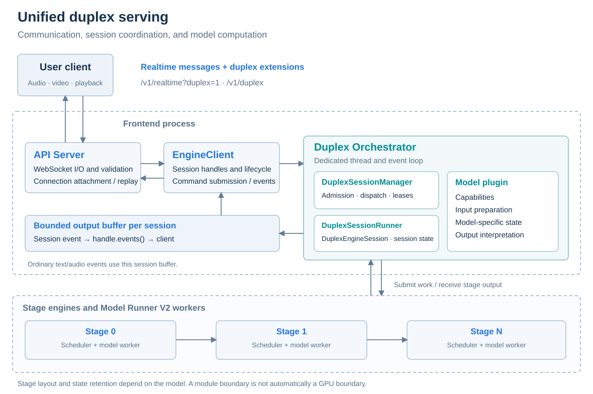
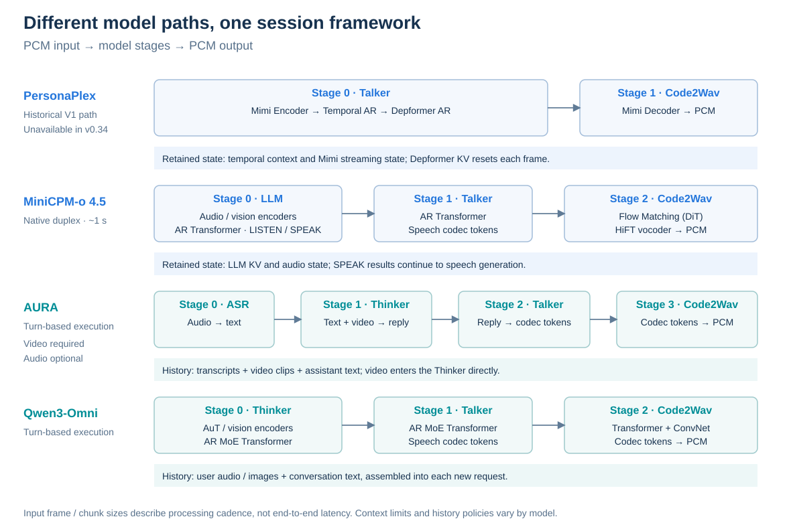

Imagine asking a voice assistant to explain what is on your screen. Halfway through its answer, you point to a different object and say, “Actually, I meant this one.” A natural interaction requires more than fast speech synthesis: the system must keep receiving your voice and camera frames, preserve the conversation state, and let new information affect what happens next.

This is the serving problem behind full-duplex interaction. The input does not end when generation starts, and the conversation does not end when one response finishes.

vLLM-Omni's unified duplex framework brings these interactions into a common session runtime. In v0.34, it serves native duplex models such as **MiniCPM-o 4.5** and **Haru-4B**, as well as models such as **AURA** and **Qwen3-Omni** that execute one turn at a time within an ongoing duplex session. The framework shares connection handling, session control, and stage execution while preserving the behavior each model actually supports.

The architecture and examples below use [vLLM-Omni v0.34.0](https://github.com/vllm-project/vllm-omni/tree/06a28821a7f72bdb436c3df656b10f67fded0846).

## TL;DR

- **One session framework, different execution modes.** Native duplex models incorporate continuing input into live model execution. Turn-based models start each response with a new request built from the current turn and retained history.
- **Clear ownership from connection to computation.** The API Server handles communication; EngineClient connects applications to session handles; the Duplex Orchestrator coordinates session state and work; model stages perform inference.
- **Model behavior stays model-specific.** Plugins adapt input preparation, capabilities, and output interpretation. Model-driven speech, local playback stop, and server cancellation remain distinct operations.
- **Optimization targets the entire audio path.** Batching ready sessions, reusing execution graphs, reducing repeated codec work, and streaming stage outputs all matter. Evaluation must also measure audio continuity and interaction quality.

**In this post:** [Interaction modes](#from-streaming-replies-to-continuous-interaction) · [Architecture](#a-session-runtime-with-clear-responsibilities) · [Model paths](#model-specific-execution-and-retained-state) · [Optimization and metrics](#optimizing-the-live-audio-path) · [Quickstart](#try-minicpm-o-45-and-qwen3-omni) · [Next steps](#next-steps-for-the-framework)

## From streaming replies to continuous interaction

Chat interfaces made request–response interaction familiar: submit an input and receive an answer. Voice interfaces added streaming audio, but many still followed the same pattern—finish speaking, submit the utterance, then play the response.

Streaming output improves the wait for the first sound. Native full duplex changes what can happen *during* that sound. The model continues processing incoming audio, and where supported video, while producing its own output. New input can affect subsequent speech, including whether to keep speaking or yield the floor. Already played audio cannot be taken back; the opportunity is to adapt what comes next.

The interface, interaction mode, and model execution describe different layers:

<iframe class="vllm-embed" src="/assets/interactive_pages/vllm-omni-duplex/interfaces.html" title="Interfaces, interaction modes and model execution: request-response and duplex session paths" loading="lazy" scrolling="no" style="display: block; width: 100%; height: 1000px; border: 0; overflow: hidden;"></iframe>

*Figure 1. Follow an interface through its interaction and execution modes, then see example model profiles. Select a branch to highlight its path. [Open the interactive diagram](/assets/interactive_pages/vllm-omni-duplex/interfaces.html).*

<details markdown="1">
<summary>View static diagram</summary>


</details>

A bidirectional connection is therefore useful for both execution modes. Qwen3-Omni with Server VAD can receive microphone audio during playback, stop a response, and start another after a new turn is committed. That provides an interruptible voice experience, while its model execution remains turn-based. MiniCPM-o 4.5 and Haru-4B additionally support model-native processing of continuing input.

The public duplex surface is **`/v1/realtime?duplex=1`**, with **`/v1/duplex`** as an alias. Its message protocol builds on OpenAI Realtime event names and adds vLLM-Omni extensions for capabilities such as video input, session recovery, and playback reporting. Support for individual operations is advertised by the model's session capabilities; sharing an endpoint does not make every feature universal. See the [Realtime and Duplex API guide](https://github.com/vllm-project/vllm-omni/blob/06a28821a7f72bdb436c3df656b10f67fded0846/docs/serving/realtime_duplex_api.md).

## A session runtime with clear responsibilities

A live conversation has several activities in flight: input arrives, inference produces output, the client plays audio, and the user may interrupt or disconnect. The unified framework gives these activities a common session identity and explicit owners.

Consider the opening example with MiniCPM: new camera frames and “Actually, I meant this one” arrive while the assistant is speaking. The API forwards that input, the runtime orders it alongside stage outputs, and the model processes it with retained context. Its next output can adapt the explanation or yield the floor. Follow that path in the diagram below.

<iframe class="vllm-embed" src="/assets/interactive_pages/vllm-omni-duplex/architecture.html" title="Inside a live duplex session: communication, session coordination, and model execution" loading="lazy" scrolling="no" style="display: block; width: 100%; height: 960px; border: 0; overflow: hidden;"></iframe>

*Figure 2. Step through the input and output paths, or click a component to explore its role. [Open the interactive diagram](/assets/interactive_pages/vllm-omni-duplex/architecture.html).*

<details markdown="1">
<summary>View static diagram</summary>



</details>

| Component | Responsibility |
|---|---|
| **API Server** | Read and validate WebSocket messages, translate them into commands, render outgoing events, and manage connection attachment and replay information. |
| **EngineClient** | Expose session handles to the application, coordinate open/close/resume operations, submit commands, and deliver each session's events to its consumer. |
| **Duplex Orchestrator** | Admit sessions, order session work, coordinate responses and playback state, and submit model work through the stage machinery. |
| **Model stages** | Encode inputs, run autoregressive or other generation steps, preserve model computation state where supported, and produce text, codec tokens, or PCM audio. |

Inside the orchestrator, **DuplexSessionManager** manages admission, session-to-runner mappings, input pressure, leases, and cleanup. Each session has a **DuplexSessionRunner** that processes an ordered mailbox of commands and stage outputs. **DuplexEngineSession** holds the session's turns, responses, epochs, request resources, and playback progress.

The **model plugin** supplies the model-specific rules: which capabilities are available, how to buffer and construct inputs, how to configure generation, and how to interpret outputs. For example, a MiniCPM `LISTEN` decision must be handled as a session decision rather than sent onward as text to synthesize.

v0.34 uses **Model Runner V2** by default for AR and generation stages. Any stage that resolves to V1 is rejected. The [runner compatibility guide](https://github.com/vllm-project/vllm-omni/blob/06a28821a7f72bdb436c3df656b10f67fded0846/docs/configuration/stage_configs.md#stage-level-runner-selection) lists the supported platform profiles.

These responsibilities also clarify the process boundary. In the local serving arrangement, the API side and the orchestrator run in the same frontend process, with the orchestrator on its own thread and event loop. Stage engines and GPU workers perform model computation in their execution processes. Stage replicas can also attach through distributed runtimes on other hosts. With `least_sessions`, the manager reserves a replica group when a session opens and keeps its work on that group. This adds placement capacity, not live session migration or failover. See [duplex replica placement](https://github.com/vllm-project/vllm-omni/blob/06a28821a7f72bdb436c3df656b10f67fded0846/docs/configuration/stage_configs.md#duplex-replica-placement).

The common output path is deliberately short: a session emits an event into its bounded output buffer, its handle consumes the event, and the API sends it to the client. This avoids routing every audio chunk through a global event queue. Per-session output limits bound the audio backlog. If a slow consumer exceeds the per-session output limit, the runtime fails the affected response and closes that session. The client must open a new session to continue. The [framework design](https://github.com/vllm-project/vllm-omni/blob/06a28821a7f72bdb436c3df656b10f67fded0846/docs/design/fullduplex.md) describes the lifecycle and ordering rules behind this separation.

## Model-specific execution and retained state

Each model defines its own inference pipeline within the shared session runtime. The diagram compares the MiniCPM-o 4.5, AURA, and Qwen3-Omni pipelines with the earlier PersonaPlex speech path. PersonaPlex depends on a V1 Talker and cannot run on v0.34.

<iframe class="vllm-embed" src="/assets/interactive_pages/vllm-omni-duplex/models.html" title="Speech execution and state: compare PersonaPlex, MiniCPM-o 4.5, AURA, and Qwen3-Omni" loading="lazy" scrolling="no" style="display: block; width: 100%; height: 1000px; border: 0; overflow: hidden;"></iframe>

*Figure 3. Switch models and step through their encoders, autoregressive modules, waveform decoders, and retained state. Brackets group neural modules into serving stages. [Open the interactive diagram](/assets/interactive_pages/vllm-omni-duplex/models.html).*

<details markdown="1">
<summary>View static diagram</summary>



</details>

### PersonaPlex: an earlier frame-by-frame speech path

Before the V2-only transition, PersonaPlex processed 24 kHz PCM audio in **80 ms model frames**. Client packets do not have to match that size: input buffering assembles complete frames for the model.

Stage 0 combines Mimi audio encoding with a Temporal Transformer and a Depformer. The Temporal Transformer advances across frames. The Depformer predicts the audio codebooks within a frame. Both are autoregressive, but they operate along different dimensions and are tightly coupled, so they belong to the same Talker stage. Stage 1 uses Mimi to decode the generated tokens into PCM.

Temporal context and streaming codec state carry forward across frames. The Depformer [starts with empty per-frame KV state](https://github.com/vllm-project/vllm-omni/blob/c792d3aef476876f3d7af93f3f95d37b469d11ad/vllm_omni/model_executor/models/personaplex/personaplex_depformer.py#L233), then reuses it across codebook predictions within that frame. This allows the model to keep listening as it produces speech without requiring a client commit or Server VAD to mark every turn. **80 ms describes the input processing cadence, not an end-to-end latency guarantee.** See the [PersonaPlex serving guide](https://github.com/vllm-project/vllm-omni/blob/c792d3aef476876f3d7af93f3f95d37b469d11ad/examples/online_serving/personaplex/README.md).

### MiniCPM-o 4.5: audio and video with model-driven speech decisions

MiniCPM-o 4.5 accumulates PCM audio and associated video frames into input chunks, typically around one second. Its first stage combines audio and visual encoding with language-model execution. A `LISTEN` result keeps the conversation listening; a `SPEAK` result forwards text and model features to the Talker.

The Talker predicts audio tokens. Code2Wav then uses conditional flow matching, implemented with a DiT, followed by a HiFT vocoder to produce PCM. Continuing input reuses the supported LLM and audio-processing state instead of reconstructing every turn from scratch. Context remains bounded by the model and serving configuration; KV reuse is not unlimited conversation memory. The [MiniCPM pipeline](https://github.com/vllm-project/vllm-omni/blob/06a28821a7f72bdb436c3df656b10f67fded0846/vllm_omni/model_executor/models/minicpmo_4_5/pipeline.py) separates understanding, speech-token generation, and waveform synthesis into three stages.

### Haru-4B: audio generation inside one stage

Haru-4B processes 24 kHz audio in 3,200-sample frames, about 133 ms each. Each `input_audio_buffer.append` must contain exactly 3,200 samples of `pcm_f32le` audio; the client must assemble these frames before sending them. Its Qwen3.5 backbone, MeanFlow audio head, and VibeVoice codec run in one serving stage. The generated audio latent feeds the next frame, so the audio head and codec execute with the language-model step rather than through separate Talker and Code2Wav stages. Each conversation keeps one resumable engine request. This is an internal execution mechanism: the adapter does **not** support reconnecting to the same public Session. The [Haru pipeline](https://github.com/vllm-project/vllm-omni/blob/06a28821a7f72bdb436c3df656b10f67fded0846/vllm_omni/model_executor/models/haru/pipeline.py) and [serving recipe](https://github.com/vllm-project/vllm-omni/blob/06a28821a7f72bdb436c3df656b10f67fded0846/recipes/higurashi-ai/Haru-4B-H200.md) describe the frame contract and deployment.

### AURA and Qwen3-Omni: new requests from retained history

AURA follows a four-stage path: **ASR → Thinker → Talker → Code2Wav**. AURA duplex sessions require video; audio is optional. When provided, audio is converted to text by ASR, while video goes to the visual Thinker. The Thinker-side session history retains transcripts, video clips, and assistant text for later turns.

Qwen3-Omni instead feeds audio features from its AuT encoder and visual features into the Thinker, followed by Talker and Code2Wav. Its duplex adapter retains multimodal conversation content and prepares subsequent requests from that history. In v0.34, the default `full_history` policy keeps effective original messages and media. A request that exceeds the deployed context or media limits returns `input_capacity_exceeded`; the adapter does not silently drop old turns.

Both maintain a live session. Each response starts a new inference request built from the current turn and retained history. Committing input and requesting a response can be separate operations. The implementations are described by the [AURA pipeline](https://github.com/vllm-project/vllm-omni/blob/06a28821a7f72bdb436c3df656b10f67fded0846/vllm_omni/model_executor/models/aura_omni/pipeline.py) and [Qwen3-Omni duplex adapter](https://github.com/vllm-project/vllm-omni/blob/06a28821a7f72bdb436c3df656b10f67fded0846/vllm_omni/model_executor/models/qwen3_omni/duplex/plugin.py).

### JoyAI: visual interaction and conversation memory

JoyAI is also integrated into the unified session runtime. It supports text and video input, with an ASR stage for speech input in the audio-enabled pipeline. Its plugin constructs each model request from the current observation, recent conversation, and available memory. Background requests to the JoyAI VLM summarize older frame chunks and consolidate those summaries into longer-term visual memory; conversation text can also be summarized during idle time. The Session Runtime owns execution, cancellation, and cleanup of these auxiliary requests. The [JoyAI memory policy](https://github.com/vllm-project/vllm-omni/blob/06a28821a7f72bdb436c3df656b10f67fded0846/docs/serving/realtime_duplex_api.md#joyai-visual-and-conversation-memory) bounds retained visual data and model-input context. Summaries are lossy, and the underlying conversation ledger has a separate lifecycle.

JoyAI also streams VLM, speech-token generation, and waveform decoding through async chunks. Its `delegate` function lets an application handle a question outside the VLM; the result becomes input to a later observation. See the [JoyAI duplex profile](https://github.com/vllm-project/vllm-omni/blob/06a28821a7f72bdb436c3df656b10f67fded0846/vllm_omni/deploy/joyai_vl_interaction_duplex.yaml).

### Context selection and background summaries

The shared Session history identifies sources by ID and revision. Summaries record which sources they depend on, so a deletion or revision can invalidate derived memory. The model plugin chooses the context policy. `SessionMemoryRuntime` runs the private summary requests and handles their cancellation and cleanup; those outputs do not become speech responses.

Qwen offers two experimental, opt-in policies beyond `full_history` and the legacy `recent` window. `bounded_recent` selects complete recent turns within a context and media budget. `incremental` combines published summaries with uncompressed turns, using text memory for older text and audio and visual summaries for images. Both currently reject tool calls. Bounding a model prompt does not bound total Session storage: original records and summary dependencies have separate retention limits. See the [Qwen history-policy design](https://github.com/vllm-project/vllm-omni/blob/06a28821a7f72bdb436c3df656b10f67fded0846/docs/design/fullduplex.md#experimental-qwen-history-policy).

## Model decisions, playback stop, and server cancellation

“Interruptible” can describe several different behaviors. Applications need to distinguish them because they affect different parts of the conversation.

| Mechanism | What changes | Example |
|---|---|---|
| **Model-driven speech** | The model responds to continuing input and determines its subsequent speech or silence. | MiniCPM-o `LISTEN` / `SPEAK`; Haru speech output. |
| **Local playback stop** | The client stops playing queued audio. Inference can continue unless separately cancelled. | Holding the talk button in the AURA demo. |
| **Server cancellation** | The serving runtime cancels the active generation. The client must also handle queued audio appropriately. | Qwen3-Omni with Server VAD and `interrupt_response` enabled. |

Model-driven yielding and client playback have separate state. In the MiniCPM web client, [`response.listen` updates the listening state without clearing the playback queue](https://github.com/vllm-project/vllm-omni/blob/06a28821a7f72bdb436c3df656b10f67fded0846/examples/online_serving/realtime_web/app/static/app.js#L746-L750), so previously buffered audio can continue playing. Stopping that audio requires a separate client playback action.

**Server VAD** uses Silero to detect speech activity and applies a configurable silence policy to determine when to commit a turn. It reuses the session's existing input buffering and commit/response flow. When `interrupt_response` is enabled, detected speech onset can separately cancel the active response. Speech activity and pauses alone do not establish whether the user has finished their thought or intends to interrupt.

**Semantic VAD** builds on that Silero-based detection path, adding [Smart Turn v3.2](https://github.com/vllm-project/vllm-omni/blob/06a28821a7f72bdb436c3df656b10f67fded0846/examples/online_serving/realtime_web/README.md#semantic-vad-silero--smart-turn) to predict turn completion at candidate pauses. If the prediction is incomplete, the session continues buffering the same turn. A completion prediction or the silence timeout commits the turn through the existing session and response-handling flow.

`create_response` controls whether a detector-triggered commit also starts a response. In the unified duplex runtime, Semantic VAD is supported for turn-based sessions and requires `interrupt_response=true`; native auto-responding sessions reject `semantic_vad`. Native models retain their own speech/silence decisions.

Model-driven overlap also does not imply arbitrary state rewind. Haru keeps state inside an ongoing engine request but does not expose public Session resume. The earlier PersonaPlex integration also required a new session after disconnect and reset context on explicit cancellation. MiniCPM-o 4.5, AURA, and Qwen3-Omni expose session resume, subject to the existing session remaining alive and retained events being available for replay. Resume reattaches a connection; it is not recovery from a destroyed engine or restarted frontend. These differences are part of the [advertised session capabilities](https://github.com/vllm-project/vllm-omni/blob/06a28821a7f72bdb436c3df656b10f67fded0846/docs/serving/realtime_duplex_api.md), rather than assumptions a client must infer from the model name.

### Shared tool-call lifecycle

The framework includes a shared tool-call flow for turn-based and native duplex adapters. A supported adapter exposes a call to the client, the client executes the tool, and a `function_call_output` returns the result. The runtime tracks call identity and rejects duplicate, cancelled, or late results so that an old result cannot answer a newer call. Optional deadlines settle pending calls, while input can continue flowing. Applications can use [`DuplexToolRunner`](https://github.com/vllm-project/vllm-omni/blob/06a28821a7f72bdb436c3df656b10f67fded0846/vllm_omni/clients/tool_calls.py) to dispatch registered functions and return results through this protocol.

Clients can end a pending call with `function_call.cancel`. The runtime reports calls that end without a result through `duplex.function_call.settled` and rejected repeats through `duplex.function_call.suppressed`. Pending or abandoned calls block identical repeats under the session's retry policy.

The runtime also sends a fixed status notice through `runtime_config_for_abandoned_tool_call`. Nemotron receives it on the open request's function channel; Qwen receives cancellation and timeout notices as tool messages in a later prompt. After an epoch cancellation, Nemotron receives a notice only if it repeats the call while the retry block still applies. How a model responds to the notice depends on the model. See the [tool-call protocol and lifecycle](https://github.com/vllm-project/vllm-omni/blob/06a28821a7f72bdb436c3df656b10f67fded0846/docs/serving/realtime_duplex_api.md#tool-calls-results-deadlines-and-cancellation) and the [shared-flow implementation](https://github.com/vllm-project/vllm-omni/pull/8493).

## Optimizing the live audio path

Full duplex repeatedly performs small pieces of work under a timing budget. A short audio frame may need encoding, model execution, token prediction, waveform decoding, and delivery before the next frames create a backlog. Optimizing only the largest Transformer misses much of that path.

### Batch ready sessions together

Several active conversations produce similar work at nearby times. Processing ready frames together amortizes per-call overhead and gives the GPU larger operations. MiniCPM-o 4.5 can schedule multiple sessions through its stage pipeline while retaining separate conversation state. Batching improves utilization, but an interactive scheduler must also avoid waiting too long to assemble a batch.

### Reuse prepared execution and reduce small operations

CUDA Graphs reduce repeated CPU kernel-launch work for supported, stable execution shapes. Model-specific graph capture is especially useful for repeated audio-frame operations. Kernel fusion addresses a related cost: several small operations can otherwise require separate launches and intermediate memory traffic.

These techniques apply at different points in different models. MiniCPM's Code2Wav path contains graph execution and fused DiT work. The CUDA settings in `minicpmo_4_5.yaml` enable its MRv2 Talker to generate several codec frames per step and replay supported K-step batches in a CUDA graph; mixed prefill/decode uses the single-frame path. The `minicpmo_4_5_2gpu.yaml` quickstart profile below uses the single-frame Talker. Capture policy, batch shapes, precision, and memory budgets still need to match the stage and hardware. The [MiniCPM execution profiles](https://github.com/vllm-project/vllm-omni/blob/06a28821a7f72bdb436c3df656b10f67fded0846/docs/design/minicpm_o45_mrv2_performance.md) expose those choices.

### Keep codec state and process new audio

A streaming codec needs the context required at an audio boundary. MiniCPM's Code2Wav receives codec chunks with left context, and its graph cache avoids recapturing compatible execution shapes. Chunk length and left context remain deployment choices. The [MiniCPM execution guide](https://github.com/vllm-project/vllm-omni/blob/06a28821a7f72bdb436c3df656b10f67fded0846/docs/design/minicpm_o45_mrv2_performance.md) describes the supported paths. The earlier PersonaPlex implementation illustrates another approach: Mimi carried convolution and attention state across frames rather than decoding the whole prefix again.

### Start downstream work as soon as useful input is available

Speech pipelines can overlap work when a stage forwards a usable chunk instead of waiting for the whole response. The appropriate boundary is model-dependent: it may be a completed model segment, a set of codec tokens, or one codec frame. Transfer cadence and the decoder's context window are separate decisions; making a network packet smaller does not automatically make the decoder faster or preserve audio quality.

This is also a central lesson of [Engineering TTS Inference in vLLM-Omni](https://vllm-project.github.io/2026/06/23/vllm-omni-tts.html): first-audio latency, decoder continuity, and stage throughput need to be optimized together.

## Measure first audio, continuity, and interaction quality

For a live conversation, a fast first response is only part of the experience. Speech must arrive continuously, and the assistant must respond at the right time as new input arrives. Three complementary views capture these requirements:

| View | Measure | Why it matters |
|---|---|---|
| **First response** | Text TTFT; audio TTFP; conversational response timing | The first packet's arrival and the decision to answer are different events. Define the starting point for each measurement. |
| **Sustained audio** | Generation RTF, chunk-arrival intervals, playback underruns | Good first-audio latency does not guarantee continuous playback. |
| **Conversation under load** | Session count and duration, memory use, cleanup, task quality | Measure latency, resource use, and task quality across session durations and concurrency levels. |

For generation measurements, **RTF = generation time / generated audio duration**, so lower is better and a value below one indicates faster-than-real-time generation for that measured interval. Output audio duration divided by elapsed time is an audio-throughput measure; it is the reciprocal only when both measurements use the same scope and aggregation.

A paced duplex benchmark has a different clock. If it includes the time spent sending a real-time input stream, its client-observed RTF measures the session's delivery behavior, not just inference speed. Record that timing window explicitly, and distinguish warm runs from cold starts. The earlier [PersonaPlex load-test guide](https://github.com/vllm-project/vllm-omni/blob/c792d3aef476876f3d7af93f3f95d37b469d11ad/docs/design/fullduplex-personaplex.md) documents these metrics and fixed-window acceptance checks.

vLLM-Omni also includes [**OmniInteract**](https://github.com/vllm-project/vllm-omni/blob/06a28821a7f72bdb436c3df656b10f67fded0846/vllm_omni/benchmarks/omniinteract.py) and **Omni-DuplexEval** integrations to evaluate what the assistant understands and how it interacts with streamed inputs. These complement serving metrics: a system can emit audio quickly yet answer at the wrong time or miss an event in the video. Model adapters and task coverage determine which evaluations apply; the [Omni-DuplexEval CI guide](https://github.com/vllm-project/vllm-omni/blob/06a28821a7f72bdb436c3df656b10f67fded0846/tests/e2e/accuracy/omni_duplex_eval/README.md) provides a concrete MiniCPM-o 4.5 evaluation path.

## Try MiniCPM-o 4.5 and Qwen3-Omni

These examples use the same realtime web client to explore two execution modes. Use a v0.34.0 checkout and matching installation, following the [installation guide](https://github.com/vllm-project/vllm-omni/blob/06a28821a7f72bdb436c3df656b10f67fded0846/docs/getting_started/installation/README.md). Run the commands from that checkout. The deploy profiles below use two GPUs: the Thinker runs on GPU 0, while Talker and Code2Wav share GPU 1. Run one backend at a time and select a deployment profile that fits your GPU memory.

### MiniCPM-o 4.5: native audio-video interaction

The Code2Wav path uses `step-audio2==1.0.0`, which is included in the repository's [development dependencies](https://github.com/vllm-project/vllm-omni/blob/06a28821a7f72bdb436c3df656b10f67fded0846/pyproject.toml#L93-L95). If your serving environment does not already include it, install it first:

```bash
pip install step-audio2==1.0.0
```

Start the backend:

```bash
vllm serve openbmb/MiniCPM-o-4_5 --omni --trust-remote-code \
  --deploy-config vllm_omni/deploy/minicpmo_4_5_2gpu.yaml \
  --port 8099
```

Once the backend is ready, start the web client in another terminal:

```bash
curl --fail http://127.0.0.1:8099/health
python -m examples.online_serving.realtime_web --profile minicpm-native \
  --backend ws://127.0.0.1:8099 --port 7862
```

Open `http://localhost:7862`, start a session, and enable **Camera**. Ask about an object, then add information while the assistant is speaking. The client keeps sending microphone audio and camera frames; the model controls `LISTEN` / `SPEAK` without client commits or Server VAD. The event log exposes those decisions alongside streaming output. Previously buffered audio may continue playing when the model yields, as discussed above.

The backend uses the model-bundled reference voice by default; add `--ref-audio /path/to/reference.wav` to the client command to choose another. See the [MiniCPM serving guide](https://github.com/vllm-project/vllm-omni/blob/06a28821a7f72bdb436c3df656b10f67fded0846/examples/online_serving/minicpmo/README.md) for other GPU layouts and the [shared UI guide](https://github.com/vllm-project/vllm-omni/blob/06a28821a7f72bdb436c3df656b10f67fded0846/examples/online_serving/realtime_web/README.md) for remote access. Browser microphone and camera capture require localhost or HTTPS.

### Qwen3-Omni: automatic turns with Server VAD

This example keeps a live session while each committed utterance starts a new Thinker → Talker → Code2Wav request. Install ONNX Runtime and obtain the pinned Silero v6.2 ONNX artifact from `istupakov/silero-vad-onnx`, as described in the [Server VAD prerequisites](https://github.com/vllm-project/vllm-omni/blob/06a28821a7f72bdb436c3df656b10f67fded0846/examples/online_serving/realtime_web/README.md#L138-L144). Create `qwen3_vad.yaml`, replacing both paths with absolute paths on the backend host:

```yaml
base_config: /path/to/vllm-omni/vllm_omni/deploy/qwen3_omni_duplex_mrv2.yaml
duplex_session:
  server_vad_model_path: /path/to/silero_vad.onnx
  model_custom_options:
    history_policy: recent
```

This CUDA profile uses Model Runner V2. Talker and Code2Wav share GPU 1, so the profile recommends [NVIDIA MPS](https://github.com/vllm-project/vllm-omni/blob/06a28821a7f72bdb436c3df656b10f67fded0846/docs/configuration/stage_configs.md#experimental-mps-deployment) for colocated execution.

The example selects `recent` to trim older turns as the conversation grows. The v0.34 default, `full_history`, preserves original inputs and reports `input_capacity_exceeded` when they exceed the request limits. This profile allows four audio inputs and eight images per request, so full history can exhaust the audio allowance on the fifth spoken turn, or the image allowance earlier with Camera enabled. `recent` keeps a limited conversation window; it does not summarize discarded context.

Start the backend:

```bash
vllm serve Qwen/Qwen3-Omni-30B-A3B-Instruct --omni \
  --deploy-config qwen3_vad.yaml --port 8091
```

Once it is ready, start the same web client with the Qwen profile:

```bash
curl --fail http://127.0.0.1:8091/health
python -m examples.online_serving.realtime_web --profile qwen3-turn \
  --backend ws://127.0.0.1:8091 --vad --port 7863
```

Open `http://localhost:7863`. Speak and pause to let Server VAD commit a turn, then speak during the answer to exercise cancellation and the next response. Enable **Camera** to include sampled frames with spoken turns. The session runtime coordinates input, interruption, playback feedback, and retained history; Qwen still generates each response from a committed turn. The MiniCPM example demonstrates model-native speech decisions, while this example demonstrates VAD-driven turn control through the same serving framework.

## Next steps for the framework

- **Broader tool-call validation.** Test how each model continues after cancellation and timeout notices, including repeated calls, late results, and interruptions during tool execution.
- **Longer conversations and broader scale.** Build on the existing memory policies with broader long-session validation and predictable resource use. Cross-host stage placement is available. Multi-frontend routing still requires non-resumable plugins; resumable sessions, replica recovery, and session migration need separate work. See the [current frontend constraints](https://github.com/vllm-project/vllm-omni/blob/06a28821a7f72bdb436c3df656b10f67fded0846/docs/serving/realtime_duplex_api.md#multiple-frontends).
- **Broader interaction evaluation.** Expand model and task coverage, including interruptions, long audio/video sessions, and regressions in both quality and responsiveness.

The work is developed in the open. Join the discussion in [vLLM-Omni](https://github.com/vllm-project/vllm-omni), try a session with your workload, and contribute model adapters, evaluation cases, or performance improvements.

## References

- [Full-Duplex Serving Roadmap and PR Status — RFC #6494](https://github.com/vllm-project/vllm-omni/issues/6494): the roadmap and development history behind the duplex serving work.
- [Design of Unified Full-duplex Framework — RFC #7181](https://github.com/vllm-project/vllm-omni/issues/7181): the motivation for separating communication, session coordination, and model execution.
- [Full-duplex framework design](https://github.com/vllm-project/vllm-omni/blob/06a28821a7f72bdb436c3df656b10f67fded0846/docs/design/fullduplex.md): session ownership, command ordering, cancellation, and stage coordination in the implementation discussed here.
- [Realtime and Duplex API guide](https://github.com/vllm-project/vllm-omni/blob/06a28821a7f72bdb436c3df656b10f67fded0846/docs/serving/realtime_duplex_api.md): endpoints, messages, model capabilities, playback feedback, and session recovery.

- [PersonaPlex serving guide](https://github.com/vllm-project/vllm-omni/blob/c792d3aef476876f3d7af93f3f95d37b469d11ad/examples/online_serving/personaplex/README.md) and [native-duplex design and load testing](https://github.com/vllm-project/vllm-omni/blob/c792d3aef476876f3d7af93f3f95d37b469d11ad/docs/design/fullduplex-personaplex.md): streaming execution, state lifetime, deployment, and measurement.
- [MiniCPM-o 4.5 pipeline](https://github.com/vllm-project/vllm-omni/blob/06a28821a7f72bdb436c3df656b10f67fded0846/vllm_omni/model_executor/models/minicpmo_4_5/pipeline.py) and [execution and performance design](https://github.com/vllm-project/vllm-omni/blob/06a28821a7f72bdb436c3df656b10f67fded0846/docs/design/minicpm_o45_mrv2_performance.md): model stages, retained state, and implementation-specific optimization.
- [AURA integration — PR #7633](https://github.com/vllm-project/vllm-omni/pull/7633) and [AURA pipeline](https://github.com/vllm-project/vllm-omni/blob/06a28821a7f72bdb436c3df656b10f67fded0846/vllm_omni/model_executor/models/aura_omni/pipeline.py): the ASR–Thinker–Talker–Code2Wav path and its duplex integration.
- [Qwen3-Omni duplex adapter](https://github.com/vllm-project/vllm-omni/blob/06a28821a7f72bdb436c3df656b10f67fded0846/vllm_omni/model_executor/models/qwen3_omni/duplex/plugin.py): turn-based execution and input/history preparation within a duplex session.
- [OmniInteract implementation](https://github.com/vllm-project/vllm-omni/blob/06a28821a7f72bdb436c3df656b10f67fded0846/vllm_omni/benchmarks/omniinteract.py) and [Omni-DuplexEval integration guide](https://github.com/vllm-project/vllm-omni/blob/06a28821a7f72bdb436c3df656b10f67fded0846/tests/e2e/accuracy/omni_duplex_eval/README.md): evaluation of streamed multimodal inputs and conversational behavior.

- [Silero VAD](https://github.com/snakers4/silero-vad): acoustic speech-activity detection.
- [Pipecat Smart Turn](https://github.com/pipecat-ai/smart-turn) and [LiveKit turn detection](https://docs.livekit.io/agents/logic/turns/turn-detector/): turn-completion detection and its combination with acoustic VAD.

- [vLLM Office Hours #57 — vLLM-Omni Project Update & Demos](https://docs.google.com/presentation/d/1L84FWrGAI-fns6TaR0Q8R6I9CvbrWQvbVbGl_KtXhy8/edit): the September 2026 presentation, including the v0.28 duplex update on slide 19.
- [Streaming Requests & Realtime API in vLLM](https://vllm-project.github.io/2026/01/31/streaming-realtime.html): incremental input processing and the Realtime transport foundation.
- [Engineering TTS Inference in vLLM-Omni](https://vllm-project.github.io/2026/06/23/vllm-omni-tts.html): staged speech generation, batching, CUDA Graphs, and model-specific kernels.
- [Experience and Lessons Learned from Serving Multi-Stage Qwen3-Omni in vLLM-Omni](https://vllm-project.github.io/2026/07/01/qwen3-omni-optimization.html): stage-level optimization methods and performance measurement.
- [Announcing vLLM-Omni](https://vllm-project.github.io/2025/11/30/vllm-omni.html): the project's original multimodal and multi-stage serving architecture.

<script>
(function () {
  window.addEventListener('message', function (event) {
    var data = event.data;
    if (event.origin !== window.location.origin || !data || data.type !== 'vllm-embed-resize' || !Number.isFinite(data.height)) return;
    document.querySelectorAll('iframe.vllm-embed').forEach(function (frame) {
      if (frame.contentWindow === event.source) {
        frame.style.height = Math.max(400, Math.min(2400, Math.ceil(data.height))) + 'px';
      }
    });
  });
})();
</script>
