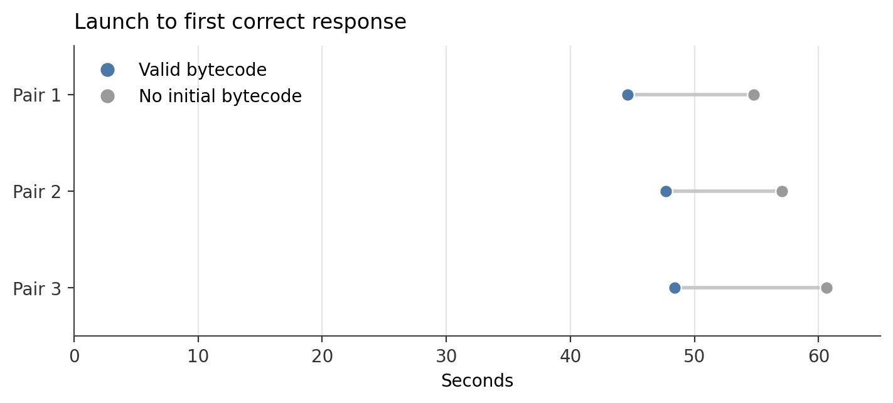
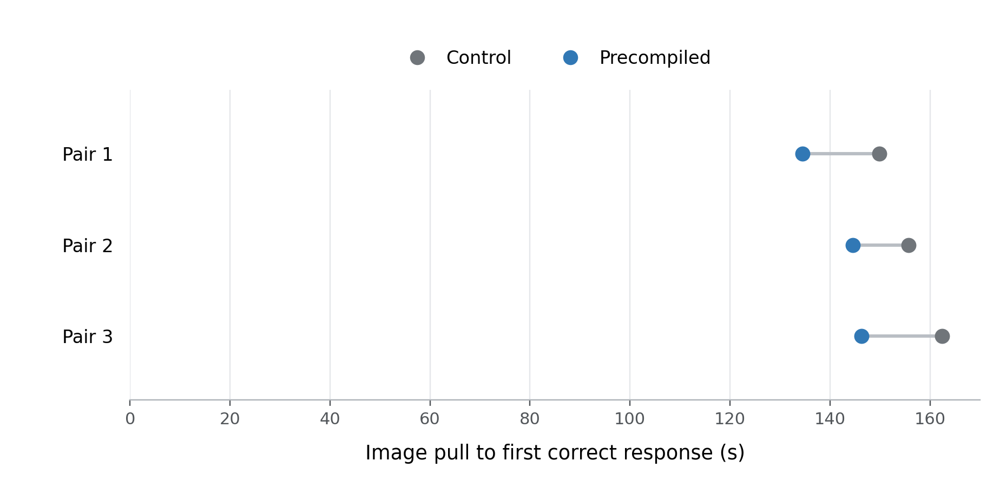

# Measurement supplement

This accompanies the bytecode article. The October 9 sections add a three-model rig study and a separate official-nightly server study; earlier studies retain their original measurements and clocks. MB and GB use decimal units. Serving and import plot data is in [measurements.csv](measurements.csv). The image-delivery plot data, including per-run pull and container-start times, and the complete numerical extract are in [supplementary-measurements.json](supplementary-measurements.json). The full original harnesses and raw logs remain in the author's research ledger and have not been published.

## Serving outside Docker

This test launches `vllm serve` directly from a Linux Python installation, outside Docker. The clock runs from server launch to the first correct HTTP completion; it includes no image pull. The model is local, the measured installed `.py` and `.so` pages are resident, and normal bytecode writes and multiprocessing remain enabled. “No initial package bytecode” means no `.pyc` files in the tested package installation at launch, not an interpreter that executes without bytecode.

| Repeat | Precompiled (s) | No initial package bytecode (s) | Paired saving (s) |
|---|---:|---:|---:|
| 1 | 44.618814008 | 54.748841574 | 10.130027566 |
| 2 | 47.691064560 | 57.039401972 | 9.348337412 |
| 3 | 48.405441556 | 60.638731790 | 12.233290234 |

Median paired saving: 10.130027566 s. Subtracting condition medians instead gives 9.348337412 s; that is a different statistic. Launch order: B1, C1, C2, B2, B3, C3, where B is precompiled and C begins without bytecode in the private installation. Normal bytecode writes remain enabled.



Before each launch, all 2,174,434 pages of the measured 23,273 installed Python/shared-library files were resident (8,852,520,345 bytes). B began with 21,870 caches; C began with zero and had 7,789 at completion. Residency covers this file set, not all filesystem metadata or model pages. CPU frequency and thermal state were not fixed. No OS-cold claim is made.

Environment: Linux, vLLM 0.28.0, Torch 2.13.0, CPython 3.12.3 (June 19, 2026 build, GCC 13.3.0), Qwen3-0.6B BF16, maximum model length 2048, RTX 4090 Laptop GPU. CPU affinity was 0–3, representing four logical CPUs on two SMT cores. The CPU model was not retained in this study's receipt.

## Direct source compilation

Fresh isolated process compiles the exact 5,118 preloaded source byte arrays; no module execution or bytecode writes.

| Pass | Whole-pass wall (s) | Current-thread CPU (s) |
|---|---:|---:|
| 1 | 6.246119038 | 6.245765872 |
| 2 | 6.303333864 | 6.302903434 |
| 3 | 6.319382935 | 6.318963402 |

Corpus: 5,118 files, 78,595,607 source bytes, 2,159,169 newline characters. Sources were loaded and hashed before the clock; whole-pass timings include compilation and discarding code objects. No module execution, per-file timing hook or cache writes in these passes. Fresh isolated CPython processes used -I -S -B. The Python build differs from the original native serving study; both are CPython 3.12.3.

The direct-compile study used CPython 3.12.3 (August 31, 2026 build, GCC 13.3.0) on the same host. Dependencies accounted for 94.4% of source bytes, and Torch contributed 1,276 files in the full serving-CLI corpus. The line count includes comments and docstrings and is not a count of executable statements. The 6.30-second standalone median is not an exact subtraction from the 10.13-second serving saving.

## Instrumented import diagnostic

One observation per condition, separately instrumented through the source loader. These are not the repeated primary import samples.

| Condition | Import wall (s) | Compiler-call wall (s) | Calls |
|---|---:|---:|---:|
| without_bytecode | 12.201944349 | 6.987958802 | 5118 |
| with_valid_bytecode | 5.009506710 | 0.000000000 | 0 |

The import difference is 7.192437639 s; compiler-call wall time is 6.987958802 s. Their difference is 0.204478837 s. Compiler-call time is part of the import clock. This is not an accounting partition of the full serving runs, and the diagnostic can include instrumentation/GC effects.

The September 15 diagnostic used the direct-compile installation: CPython 3.12.3 (August 31, 2026 build, GCC 13.3.0). The September 9 instrumented trace quoted in the PR used the June 19 CPython 3.12.3 build. It measured 13.855056 s uncached and 5.744176 s cached, an 8.110880 s import difference, with 8.196185 s inside 5,118 source-compiler calls. Compiler-call wall time exceeded that difference by 0.085305 s. The later trace's compiler-call time was 0.204479 s below its import difference. These are separate observations, not pooled samples. The effects of interpreter build and run conditions were not isolated; the earlier 8.623 s CPU figure measures process CPU, not compiler-thread CPU.

Receipts: September 9 `trace-B.json` and `trace-C.json`; September 15 `import-original.json` and `import-cached.json`.

## Independent import measurements

“Serving-CLI import” means executing `import vllm.entrypoints.cli.serve` in a fresh Python process. It loads the Python code and dependencies behind the `vllm serve` command without loading model weights, launching a serving engine or handling a request. It is a narrower measurement than server startup.

Fresh child process; clock begins immediately before import and excludes interpreter launch/preparation; common Python/native-library pages 100% resident; no compiler hook in the 24 primary observations.

The CSV supplies three observations per condition per root. Each root includes its dependencies; rows cannot be summed or subtracted to infer exclusive package costs. All plots show recorded observations and descriptive medians without inferred confidence intervals.

| Import root | No initial bytecode, median (s) | Valid bytecode, median (s) |
|---|---:|---:|
| `torch` | 2.13 | 0.80 |
| `transformers` | 1.29 | 0.68 |
| `vllm` | 6.71 | 2.11 |
| `vllm.entrypoints.cli.serve` | 12.27 | 5.02 |

The repeated import-root study used the August 31 CPython 3.12.3 build. All six processes per root had the same recorded module-presence result: bare Torch and bare Transformers loaded none of `torch._dynamo`, `torch._inductor` or `sympy`; vLLM and the serving CLI loaded all three. In installed vLLM 0.28.0, the package initializer imports `vllm.env_override`, whose fallback-list patch imports Inductor lowering. This identifies one eager path, not the exclusive cause of the incremental import time or current-main behavior. Receipt: September 15 package study `ANALYSIS.json` and its saved source context.

## Image delivery



Gray shows pull/unpack; blue shows everything after pull through the first correct response.

Matched CUDA images from separate empty classic-overlay2 Docker stores through loopback pull/unpack to first correct response; model already local; gzip export in both arms; host/source page cache warm or uncontrolled. All three repeats use the same Qwen3-0.6B model, host and serving settings. Each repeat contains one launch per image; these are repeated comparisons, not three-model coverage.

| Repeat | Control gzip (s) | Bytecode gzip (s) | Paired saving (s) |
|---|---:|---:|---:|
| 1 | 149.815616736 | 134.454980230 | 15.360636506 |
| 2 | 155.726505630 | 144.513727492 | 11.212778138 |
| 3 | 162.384975863 | 146.280619865 | 16.104355998 |

Median paired saving: 15.360636506 s. Subtracting condition medians instead gives 11.212778138 s; that is a different statistic. The preregistered order was three rotated triples: A1 B1 C1, C2 A2 B2, B3 C3 A3, where A is the control, B the bytecode image and C the excluded zstd condition. Pairs 1 and 2 ran the control first; pair 3 ran bytecode first. Complete clocks rose through the session in both arms; CPU frequency, thermal state and registry state were not fixed. Three pairs establish the observed range, not a precise fleet-wide effect.

The harness recorded pull/unpack and container launch to first correct response within the same monotonic clock. The precompiled image's pull/unpack took 3.434 s less, 2.465 s more and 1.169 s more in pairs 1–3. Its launch-to-response interval took 11.925 s, 13.673 s and 17.276 s less. Pull time varied in both directions; every pair improved in the launch interval. The experiment did not isolate a bytecode-induced pull cost or test bandwidth-limited delivery. The stacked figure uses directly measured total minus pull for the blue segment, so the bars add exactly to each total. This includes the 45–53 ms orchestration handoff before the separately measured container-launch interval.

Encoded layer bytes: 8,511,741,380 control versus 8,664,824,384 candidate; +153,083,004 bytes (+1.798492191%). The loopback registry was uncapped; image stores were empty, model files local, host pages warm or uncontrolled. The full historical run also included a zstd condition; its cells are excluded from this bytecode comparison. Build timings were not a matched experiment and are not used to infer build overhead.

Environment: vLLM source `470fe3942ecdb889b2f3c0b57ace4b09d61dd103`, Docker 29.1.3, Intel Core i9-13900HX, RTX 4090 Laptop GPU, four-logical-CPU daemon affinity and a four-CPU server quota. These hardware records belong to the image-delivery study; the native serving receipt did not independently record the CPU model.

The images used CPython 3.12.3 (July 15, 2026 build, GCC 13.3.0), Torch 2.13.0+cu130 and uv 0.12.10. The runtime target was `vllm-openai`, built for CUDA architecture 8.9. The source checkout reported version `0.1.dev1+g470fe3942`; this was not the released vLLM 0.28.0 image used elsewhere in the investigation. Both derived build recipes required the same host-networking correction for the test machine and differed only by `ENV UV_COMPILE_BYTECODE=1`. Both forced fresh runtime-package installation while reusing native build stages. The setup durations do not isolate bytecode build overhead.

### Image identity and bytecode use

The identity check compared interpreter version and executable hash, 244 Python distribution versions, 483 system package versions, Python source hashes, native payload hashes and all other installed-package payload bytes. The inventory covers `/usr/local/lib/python3.12/dist-packages`. Bytecode and package `RECORD` files are excluded from the payload comparison because the treatment changes them. All 17,341,585,327 compared payload bytes matched.

| Check | Default build | Precompiled build |
|---|---:|---:|
| Installed package source files | 26,734 | 26,734 |
| Sources with valid bytecode | 407 | 26,734 |
| Sources missing bytecode | 26,327 | 0 |
| Bytecode bytes, uncompressed | 5,010,861 | 423,003,516 |
| Serving-CLI source compiler calls | 5,257 | 0 |

The source-compilation probes ran in fresh read-only containers, with network disabled, a four-CPU quota, `PYTHONDONTWRITEBYTECODE=1` and `python3 -B`. Cache writes were disabled; existing caches could still be read. The precompiled image was then run unchanged with `-X pycache_prefix=/tmp/ibz0907-bypass`, pointing lookup at a fresh tmpfs directory. That restored 5,478 source compiler calls. The count exceeds the default image's 5,257 because the override also bypasses standard-library caches. This is evidence of cache use, not a third equivalent latency arm. All three probes exited successfully.

Every measured activation passed the saved CPU/Transformers next-token checks. Four additional 16-token request bursts per activation matched generated choices and usage across arms. These checks cover this pinned model and environment.

The machine-readable extract includes these checks under `image_cache_identity`. The original receipts are `identity-gate.json`, `inventory-A.json`, `inventory-B.json`, `import-A.json`, `import-B.json` and `import-bypass-B.json` in the September 7 image study. Their SHA-256 hashes are listed under `image_cache_identity.source_receipts` in the JSON; the original files have not been published with this post.

## Official image availability: October 9, 2026

The official CUDA image `vllm/vllm-openai:nightly-8cbd5d03006c33185f402249ff2b448efd594986` includes the build-time setting from [PR #55422](https://github.com/vllm-project/vllm/pull/55422). At the October 9, 16:50 UTC check, the latest stable release was [v0.31.0](https://github.com/vllm-project/vllm/releases/tag/v0.31.0); its official image did not include the change.

| Image | Multi-platform index digest |
|---|---|
| Pinned nightly above | `sha256:b25e8a046fdbe948987b3dba06ef2cf9ea0f02b36d9482a25113a445ee52ad21` |
| `vllm/vllm-openai:v0.31.0` | `sha256:c1c9f6fd5c109ba7f0546a59f5b2f15fb87f64c77782e90a27b648b42a8e67c3` |

For both linux/amd64 and linux/arm64, the nightly's OCI configuration contains `UV_COMPILE_BYTECODE=1` and its build history contains the corresponding `ENV` instruction. Its source revision includes merge commit `76d3929916c6594c11924e9f91adbc69b90cbd35`. Both stable-image configurations lack that setting, and their source revision `db9527a46873454610df6dbedf79a36d6bf1a7f6` does not include the merge.

The initial 16:50 UTC check was read-only registry metadata and source ancestry, without downloading layers or measuring coverage. The later server study actually used the pinned linux/amd64 nightly, manifest `sha256:f4c82e7bbfcb04b13a3c07c74713a09c6fa2d1588e7139987307e440c6e44193`, and found valid default caches for all 31,528 installed package source files. The arm64 verification remains metadata-only. The earlier matched-image observations remain separate from the server study below.

Sources: Docker Hub tag records for the [nightly](https://hub.docker.com/v2/repositories/vllm/vllm-openai/tags/nightly-8cbd5d03006c33185f402249ff2b448efd594986) and [stable image](https://hub.docker.com/v2/repositories/vllm/vllm-openai/tags/v0.31.0), the [nightly source comparison](https://github.com/vllm-project/vllm/compare/76d3929916c6594c11924e9f91adbc69b90cbd35...8cbd5d03006c33185f402249ff2b448efd594986), and the [stable source comparison](https://github.com/vllm-project/vllm/compare/76d3929916c6594c11924e9f91adbc69b90cbd35...db9527a46873454610df6dbedf79a36d6bf1a7f6). The date matters: mutable tags and later releases can change this answer.

## Historical official image probe

On September 3, 2026, the inspected `vllm/vllm-openai:latest` image (digest `sha256:61fc8a896b0a4fbbbdc063bc4b0dbc25ce98e02b5050c24aeb7830ac02039b14`, vLLM 0.28.0, Torch 2.13.0+cu130) contained 408 `.pyc` files and 27,753 `.py` files under `/usr/local/lib/python3.12/dist-packages`. These are raw file counts, not per-source validity checks. That published image differs from the matched test images, and this is a dated inventory rather than a claim about today's `latest` tag. Receipt: September 3 image-bytecode probe and its recorded image inspection.

## Final-image diagnostic

For default Python optimization and cache-path settings, this command checks for missing cache files in the final image. It checks existence, not validity; `-B` prevents the check from writing new caches.

```sh
docker run --rm -i --read-only --network none --entrypoint python3 your-image -B - <<'PY'
import importlib.util
from pathlib import Path
import site

sources = {p for d in site.getsitepackages() for p in Path(d).rglob("*.py")}
missing = sum(
    not Path(importlib.util.cache_from_source(str(p))).is_file()
    for p in sources
)
print(f"{missing} of {len(sources)} installed .py files have no .pyc")
PY
```

The missing-cache command above was run on September 22 with CPython 3.12.3 in the retained official image identified above, using a read-only root, no network and no GPU access. Across all three directories returned by `site.getsitepackages()`, it reported **27,345 of 28,088 installed `.py` files with no `.pyc`**. This is wider than the September 3 `/usr/local/lib/python3.12/dist-packages` inventory, and checks file existence rather than header validity. A separate two-source fixture reported two missing caches before compilation and zero afterward using the same code and interpreter. `-B` kept the diagnostic itself from writing caches.

The diagnostic source, interpreter details and observations are in [cache-coverage-check.json](cache-coverage-check.json).

These are diagnostic checks, not new startup measurements or a repeat of the matched-image validity inventory.

## The three cache layers

| Cache | What it saves |
|---|---|
| OS page cache | Reading file contents from storage; source still needs compiling if bytecode is missing |
| Python `.pyc` files | Compiling source into code objects; module initialization still runs |
| Python `sys.modules` | Importing a module again within the same interpreter |

Only `.pyc` availability is the intended treatment in the comparison outside Docker. All trials use a fresh server process; residency of the measured common source/native-library pages is checked before launch. Normal `.pyc` writes and parent/child reuse remain enabled.

## Compatibility and build caveats

- **Check the final image.** The setting applies to uv operations. It doesn't automatically fill every cache inherited from a base image, and caches left in a builder stage won't help the running container. Coverage depends on the command and uv version. [uv's install reference](https://docs.astral.sh/uv/reference/cli/#uv-pip-install--compile-bytecode) describes the behavior.
- **Use the target Python and retain source.** CPython validates caches according to their invalidation mode. Compatible bytecode is independent of CPU architecture: a small fixture compiled on an ARM Mac loaded unchanged on x86-64 Linux with source compilation blocked. Native extensions and container images still have their own platform constraints. Stale or incompatible caches can fall back to source; arbitrary corruption is not guaranteed to recover cleanly. See [CPython's cache-invalidation rules](https://docs.python.org/3.12/reference/import.html#cached-bytecode-invalidation).
- **Check reproducibility and emulated builds if you depend on them.** Upstream reports cover bytecode serialization differences that change image digests despite equivalent disassembly ([uv #10619](https://github.com/astral-sh/uv/issues/10619), [CPython #129724](https://github.com/python/cpython/issues/129724)), and compilation hangs under QEMU user-mode emulation ([uv #6105](https://github.com/astral-sh/uv/issues/6105)). Those build paths need their own validation.


## Interpretation

The serving outside Docker, standalone compiler, instrumented import, repeated imports and image-delivery series have different timing boundaries. They support related conclusions but cannot be combined into a single additive startup waterfall. The earlier performance studies used one rig. The server follow-up adds one different deployment, with different software, CPU allocation and starting conditions. Do not pool its observations with the rig or assign their difference solely to CPU hardware. External delivery, other architectures/topologies and steady-state throughput remain outside these startup comparisons.

## Three-model launch-only follow-up: October 9, 2026

This follow-up uses the retained matched image pair and a launch-only clock. All 36 primary starts passed decoded-output checks and owned cleanup. Six preliminary A/B qualification starts were timed separately and are excluded from the 18 primary pairs.

The monotonic clock begins immediately before `docker run -d` and ends when the first correct HTTP completion finishes. Polling is every 100 ms. Images and pinned weights are local; no image pull or download is timed. Host file cache is warm or uncontrolled. Fresh writable containers have an executable 2 GiB runtime-cache tmpfs; normal Python bytecode writes remain enabled. Four CPUs is a quota, not pinned affinity. Each server has a 14 GiB memory limit with no added swap, 2 GiB shared memory, maximum model length 2048 and GPU memory utilization 0.5. The host is the Intel i9-13900HX / RTX 4090 Laptop fixture.

Each pair is adjacent. Every model has three A-first and three B-first pairs; seed 20261009 fixes the schedule. A is the control and B is precompiled. The reported saving is A minus B; percentage reduction is (A−B)/A. The median paired difference differs from subtracting arm medians.

| Model | Revision | Dtype |
|---|---|---|
| Qwen3-0.6B | `c1899de289a04d12100db370d81485cdf75e47ca` | bfloat16 |
| Qwen3-1.7B | `70d244cc86ccca08cf5af4e1e306ecf908b1ad5e` | bfloat16 |
| SmolLM2-1.7B-Instruct | `31b70e2e869a7173562077fd711b654946d38674` | bfloat16 |

vLLM source: `470fe3942ecdb889b2f3c0b57ace4b09d61dd103`. Loaded immutable Docker image IDs:

- A: `sha256:727f5e7c9ebd2e4b5326507a2b82fdbda0e630b2c4f847fa1f53fc8245cbd8d6`
- B: `sha256:796601acc9ae2010fcee418310ae2d307f9c57100b584539402ec45ea6da402b`

Config SHA256: `23ff072edba7d749b09524c75465439ec0f08997ef288c1e70b96f919b3a57b7`. Combined config/oracle digest: `d97a4ea09ff038b951aacbba2f8b8938d7e54592ad31bdfae54eb5fb3004f696`.

Schedule, in absolute campaign order:

`qwen06-p1-a qwen06-p1-b qwen17-p1-b qwen17-p1-a smol17-p1-a smol17-p1-b qwen06-p2-b qwen06-p2-a smol17-p2-b smol17-p2-a qwen17-p2-a qwen17-p2-b qwen17-p3-b qwen17-p3-a qwen06-p3-a qwen06-p3-b smol17-p3-a smol17-p3-b qwen06-p4-b qwen06-p4-a qwen17-p4-b qwen17-p4-a smol17-p4-b smol17-p4-a smol17-p5-a smol17-p5-b qwen06-p5-a qwen06-p5-b qwen17-p5-a qwen17-p5-b qwen06-p6-b qwen06-p6-a smol17-p6-b smol17-p6-a qwen17-p6-a qwen17-p6-b`

| Model | Pair | Order | Control (s) | Precompiled (s) | Saving (s) | Reduction (%) |
|---|---:|---|---:|---:|---:|---:|
| Qwen3-0.6B | 1 | A-first | 66.554712 | 55.840181 | 10.714531 | 16.099 |
| Qwen3-0.6B | 2 | B-first | 74.279411 | 57.088989 | 17.190422 | 23.143 |
| Qwen3-0.6B | 3 | A-first | 70.165817 | 58.932543 | 11.233274 | 16.010 |
| Qwen3-0.6B | 4 | B-first | 71.879903 | 59.640317 | 12.239586 | 17.028 |
| Qwen3-0.6B | 5 | A-first | 78.225760 | 63.308326 | 14.917434 | 19.070 |
| Qwen3-0.6B | 6 | B-first | 75.412597 | 62.076775 | 13.335822 | 17.684 |
| Qwen3-1.7B | 1 | B-first | 72.691946 | 59.235407 | 13.456539 | 18.512 |
| Qwen3-1.7B | 2 | A-first | 74.608399 | 62.139253 | 12.469146 | 16.713 |
| Qwen3-1.7B | 3 | B-first | 77.993426 | 62.856911 | 15.136515 | 19.407 |
| Qwen3-1.7B | 4 | B-first | 74.534766 | 64.751465 | 9.783301 | 13.126 |
| Qwen3-1.7B | 5 | A-first | 78.428053 | 64.893549 | 13.534505 | 17.257 |
| Qwen3-1.7B | 6 | A-first | 76.437190 | 61.962094 | 14.475096 | 18.937 |
| SmolLM2-1.7B-Instruct | 1 | A-first | 52.852467 | 43.370475 | 9.481991 | 17.940 |
| SmolLM2-1.7B-Instruct | 2 | B-first | 57.023277 | 41.554698 | 15.468578 | 27.127 |
| SmolLM2-1.7B-Instruct | 3 | A-first | 57.412671 | 45.105950 | 12.306721 | 21.436 |
| SmolLM2-1.7B-Instruct | 4 | B-first | 62.538152 | 48.445212 | 14.092940 | 22.535 |
| SmolLM2-1.7B-Instruct | 5 | A-first | 58.511563 | 45.315869 | 13.195695 | 22.552 |
| SmolLM2-1.7B-Instruct | 6 | B-first | 60.948216 | 47.289552 | 13.658664 | 22.410 |

| Model | Median paired saving (s) | Median paired reduction (%) | Difference of arm medians (s) | A-first median saving (s) | B-first median saving (s) |
|---|---:|---:|---:|---:|---:|
| Qwen3-0.6B | 12.787704 | 17.356 | 13.793227 | 11.233274 | 13.335822 |
| Qwen3-1.7B | 13.495522 | 17.884 | 13.024712 | 13.534505 | 13.456539 |
| SmolLM2-1.7B-Instruct | 13.427180 | 22.473 | 12.751208 | 12.306721 | 14.092940 |

Each order stratum has three pairs. Order-stratified percentage reductions:

- Qwen3-0.6B: A-first 16.099%; B-first 17.684%.
- Qwen3-1.7B: A-first 17.257%; B-first 18.512%.
- SmolLM2-1.7B-Instruct: A-first 21.436%; B-first 22.535%.

CPU/Transformers FP32 fixtures supply independent first-token decoded continuations. Every selected prompt must return the exact decoded text and one completion token; four additional greedy 16-token requests must match the qualification-A choices and usage. These validate decoded text and usage, not generated token-ID identity. Raw responses and full logs remain in the research ledger. No compiler instrumentation runs inside the startup clock.

Preparation retained failures for the Docker missing-container diagnostic, unavailable default bridge, registry readiness and unsupported registry environment configuration. Qualification attempt 1 failed because the runtime tmpfs was noexec, preventing Triton from loading its helper. Attempt 2 made that tmpfs executable, passed the first control qualification, then stopped at the port preflight on TIME_WAIT sockets. Attempt 3 uses SO_REUSEADDR for the bind-only preflight; a live listener still prevents launch. Earlier attempts remain separate and unpooled; they contain no primary measurements.

The accepted analysis rechecks configuration/oracle identity, every scheduled cell, image/model/revision command, first decoded response, all oracles, short bursts, clock boundaries, logs and protected GPU PID restoration. Image identity and compiler suppression gates are retained alongside these serving results. Models and the historical delivery/import/serving clocks are not pooled.

Frozen source/input SHA256 pins:

| File | SHA256 |
|---|---|
| `CONFIG.json` | `23ff072edba7d749b09524c75465439ec0f08997ef288c1e70b96f919b3a57b7` |
| `MODELS.json` | `8ccd99d58c08fe476cb048fb75b4697c463b8439bebecad3b59c2f7ea54ef6c6` |
| `PROTOCOL.md` | `f2b2b966e7425e9de6abfe64895f2bec4648d4d571f255f49dd567ef5b2f6b67` |
| `PROVISION.json` | `f96544c8bbdba7c981918872421985b2a8b624b22c1a06aa497c3692e34706d5` |
| `analyze.py` | `57a91c2e4526c2f460e668dc2a646df023542a594994c00a7e636ec171662598` |
| `campaign.py` | `de729183857d9df04c123442f75ea4cca917c0eb91e28633cb05b46b48273c8b` |
| `harness_selfcheck.py` | `1cac934902a7fe38432254be8bb6aac5a03c882ab12b8fe7c941c7eb0c604299` |
| `identity-gate.json` | `50ddab8ff9c4a0b82165fbaa2254d060afa199fa829f93a27b0538c4739b6a31` |
| `image-A.json` | `15ae40cbbbf225c165d75e42d1eb614bbf31670232321f3747815996db6635a3` |
| `image-B.json` | `0fc2e4547def0cf2289c256a71f9045f092bca14833786b618a547278baab2c3` |
| `oracle-qwen06.json` | `a731726d0c61e0361f2cde40f41c6b557b0846fa2927eb6e4cd8e2da9ffe6611` |
| `oracle-qwen17.json` | `34f50f7fbe948ba47c14f56b8bb162f4cc30f98f2f8389f70392a5219b536fca` |
| `oracle-smol17.json` | `3fa0eab3bcaae0d17b67e8e3ae9d324fd4890ccc02d047066f1fddc19f7023a2` |
| `run_all.py` | `06ed7a7fe1e4f1c7f481ce879182a2daa4cafa8320ba4318a40ad677016077a5` |
| `watchdog.py` | `79d1a26f8cac6a844399bf393c5192685e2e36976754fa7aeaa7f486c609e274` |

Full accepted analysis: [multi-model-measurements.json](multi-model-measurements.json). All 36 timed observations: [multi-model-observations.csv](multi-model-observations.csv). Earlier [measurements.csv](measurements.csv) and [supplementary-measurements.json](supplementary-measurements.json) are unchanged.


## Server follow-up: October 9, 2026

One Secure Cloud server runs the official linux/amd64 nightly `8cbd5d03006c33185f402249ff2b448efd594986`. A removes all source-backed package bytecode; B restores the image's original caches. Both use the same interpreter, installed source/native payload and absolute paths. Standard-library caches are restored identically; sourceless modules are preserved. Before every cell, the reset verifies all 157,599 non-bytecode payload files, removes caches written by prior servers and checks the exact cache set. A begins with 573 standard-library caches, B with 32,101 total source-backed caches. Normal bytecode writes remain enabled in the serving process.

The host is a Xeon Platinum 8480+ with one H100 SXM 80GB, driver 580.126.09. Serving and children inherit affinity to CPUs 0–7, eight distinct physical cores on the GPU's NUMA node. This is not an exclusive CPU allocation; the Pod's cgroup quota is 23.8 CPUs and memory limit about 251 GB. Runtime metadata: CPython 3.12.3 (August 31 build), vLLM 0.31.1rc1.dev173+g8cbd5d030, Torch 2.13.0+cu130, Transformers 5.19.0, Triton 3.7.1 and FlashInfer 0.7.0.post1. Software and model files are on the container's local overlay storage; no network volume is used.

| Model | Pinned revision | Role |
|---|---|---|
| Qwen3-0.6B | `c1899de289a04d12100db370d81485cdf75e47ca` | Unpooled transfer qualification only |
| Qwen3-8B | `b968826d9c46dd6066d109eabc6255188de91218` | Four primary pairs |
| Qwen3-32B | `9216db5781bf21249d130ec9da846c4624c16137` | Four primary pairs |

All use BF16, TP1, maximum model length 2048 and GPU memory utilization 0.9. Six preliminary A/B serving qualifications pass and are excluded. Sixteen primary starts complete four adjacent pairs per large model, balanced at two A-first and two B-first. Model order is interleaved within rounds with seed 20261009. Complete schedule:

`qwen8-p1-b qwen8-p1-a qwen32-p1-a qwen32-p1-b qwen32-p2-b qwen32-p2-a qwen8-p2-a qwen8-p2-b qwen32-p3-a qwen32-p3-b qwen8-p3-b qwen8-p3-a qwen8-p4-a qwen8-p4-b qwen32-p4-b qwen32-p4-a`

Fresh vLLM, TorchInductor, Triton, CUDA and FlashInfer runtime caches use the same absolute paths every launch. All declared non-bytecode payload files are read/hashed in both arms, then visible bytecode is read, outside the timer. Linux mincore verifies at least 99% residency of the checked Python/native/cache pages; every accepted receipt records full residency. This intentionally tests resident software files, not OS-cold startup. Model pages are warm or uncontrolled. There is no global cache drop, CPU frequency control or fixed GPU operating state.

The monotonic clock starts immediately before creating the server process inside the managed container and ends when its first correct loopback HTTP completion finishes. Health is recorded separately; polling is 100 ms. The first request must produce exactly ` Paris` with one completion token. Three additional one-token prompts and four requests of up to 16 tokens must match qualification-A decoded choices and usage. These fixed regression fixtures are outside the first-response timer after the first answer. They are not generated token-ID equivalence, quality evaluation or throughput acceptance. Responses are saved before assertions. No compiler hook or tensor instrumentation runs in primary workers. Process-group cleanup must pass before the next reset; a failed cell stops the study without retry.

| Model | Pair | Order | Package caches absent (s) | Shipped caches (s) | Saving (s) | Reduction (%) |
|---|---:|---|---:|---:|---:|---:|
| Qwen3-8B | 1 | B-first | 100.113515 | 82.200769 | 17.912747 | 17.892 |
| Qwen3-32B | 1 | A-first | 128.065314 | 109.582514 | 18.482800 | 14.432 |
| Qwen3-32B | 2 | B-first | 126.245656 | 111.501021 | 14.744634 | 11.679 |
| Qwen3-8B | 2 | A-first | 99.532606 | 82.800226 | 16.732380 | 16.811 |
| Qwen3-32B | 3 | A-first | 127.196459 | 110.173271 | 17.023188 | 13.383 |
| Qwen3-8B | 3 | B-first | 100.412499 | 83.123896 | 17.288603 | 17.218 |
| Qwen3-8B | 4 | A-first | 102.702835 | 84.179753 | 18.523082 | 18.036 |
| Qwen3-32B | 4 | B-first | 128.306118 | 109.200466 | 19.105652 | 14.891 |

Saving is A−B; reduction is (A−B)/A. The headline uses medians of those paired quantities, rather than subtracting arm medians.

| Model | Median paired saving (s) | Median paired reduction (%) | Saving range (s) | A-first median saving (s) | B-first median saving (s) |
|---|---:|---:|---|---:|---:|
| Qwen3-8B | 17.600675 | 17.555 | 16.732380–18.523082 | 17.627731 | 17.600675 |
| Qwen3-32B | 17.752994 | 13.908 | 14.744634–19.105652 | 17.752994 | 16.925143 |

Each order stratum has two pairs. All observations are shown; no unfavorable pair is removed. Four pairs on one server describe this deployment's observed consistency and range, not a population confidence interval. Both large models are from one family. The rig study supplies separate smaller-model and SmolLM2 evidence; their clocks/builds/conditions differ.

### Nightly import probe and provenance

A separate instrumented fresh import of `vllm.entrypoints.cli.main` records 2,439 source-loader compiler calls with package caches absent, zero with shipped caches, and 2,625 with lookup redirected to a new empty path. Those are 2,433/0/2,619 unique paths; six control calls repeat a source. The extra 186 bypass events all come from standard-library files, and no control event is missing. All 2,743 loaded module paths and source/native hashes match between A and B. This root imports Torch but not Transformers; full installation payload checks include Transformers, but this probe does not instrument its import inside a timed engine. Existing caches remain readable while probe writes are disabled with `-B`.

These probes confirm cache use and its reversal at that import boundary, not an additive explanation of the entire serving saving. The earlier `cli.serve` probe and isolated compiler corpus use different environments and remain separate. Full source/header/reset verification, raw response clocks, cleanup and independent arithmetic checks are retained in the research ledger. Public extracts are [server-measurements.json](server-measurements.json) and [all 16 startup observations](server-observations.csv).

The first SSH preflight lost the image's environment before any model or serving run. The repair carries the frozen public OCI environment; it changes no Python/native packages. An untimed probe's provenance check then found a missing copy of the bootstrap recipe, before any probe; its original bytes were supplied without execution. A derived checker incorrectly required Transformers in this narrower import; it was corrected to report actual absence, preserving the failed check. These setup/analysis failures remain in the ledger. No primary cell was rerun and no serving gate was relaxed. The experiment's cumulative rental limit was $30, including setup, failures and storage, with a six-hour absolute shutdown bound.
